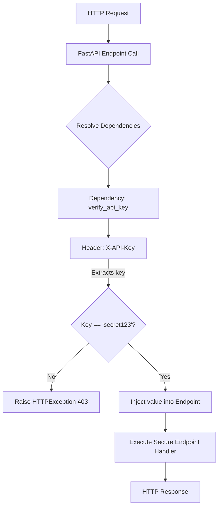

### 🎯 Learning Objectives
- Explain the Dependency Injection pattern and its benefits in web frameworks.
- Create and register dependencies using FastAPI's `Depends` function.
- Design hierarchical dependency chains (dependencies depending on other dependencies).
- Validate HTTP headers and secure API endpoints using dependencies.
- Override dependencies for unit testing and mocking.

### 🧩 Core Concepts (Why)
In software engineering, **Dependency Injection (DI)** is a design pattern where an object or function receives other services or objects that it depends on, rather than creating them internally.

In web development, different endpoint handlers frequently share repetitive tasks:
- Establishing a database connection or session.
- Extracting and validating authentication tokens or credentials.
- Validating custom request headers (such as API keys).
- Implementing pagination parameters or filtering policies.

Without dependency injection, you would write this logic manually inside each route handler. This creates code duplication, tight coupling, and makes testing very difficult (mocking database connections, for example).

FastAPI features a built-in, extremely powerful dependency injection framework. You declare dependencies by using the `Depends` function. FastAPI handles resolving the dependencies, injecting the outputs into the handler, managing connection lifecycles (like closing database sessions), and caching values when multiple components share the same dependency tree.

### 🔁 Logic and Operation

#### Dependency Graph Resolution and Execution
FastAPI parses route signatures and constructs a Directed Acyclic Graph (DAG) representing the endpoint's dependencies. When an HTTP request is made:



### 📝 Annotated Examples

#### 1. Basic Shared Parameter Dependency (Pagination)
Instead of typing the same query parameters for multiple endpoints, we can define a single dependency function.
```python
from fastapi import FastAPI, Depends

app = FastAPI()

# This is the dependency function
def common_parameters(q: str | None = None, skip: int = 0, limit: int = 100):
    return {"q": q, "skip": skip, "limit": limit}

@app.get("/items/")
def read_items(commons: dict = Depends(common_parameters)):
    # FastAPI executes common_parameters, parses the query parameters,
    # and injects the returned dictionary into 'commons'.
    return commons

@app.get("/users/")
def read_users(commons: dict = Depends(common_parameters)):
    return commons
```

#### 2. Route Security with Dependency Injection
Dependencies can raise `HTTPException` to interrupt execution before the endpoint handler is ever called.
```python
from fastapi import FastAPI, Depends, Header, HTTPException, status

app = FastAPI()

# Dependency to check for a valid custom API key header
def verify_api_key(x_api_key: str = Header(..., description="API Key for route security")):
    if x_api_key != "secret123":
        raise HTTPException(
            status_code=status.HTTP_403_FORBIDDEN, 
            detail="Forbidden: Invalid API Key"
        )
    return x_api_key

# Endpoint protected by verify_api_key
@app.get("/secure")
def secure_endpoint(api_key: str = Depends(verify_api_key)):
    # This handler only runs if verify_api_key returns successfully
    return {"status": "authenticated", "key_used": api_key}
```

### ❌ Common Mistakes

**Mistake 1: Calling the dependency function instead of passing its reference inside `Depends`**
```python
from fastapi import FastAPI, Depends

app = FastAPI()

def get_db():
    return "DatabaseConnection"

@app.get("/data")
def read_data(db = Depends(get_db())):  # Wrong: Do not execute the function with parentheses.
    return {"db": db}
```
```text
TypeError: 'str' object is not callable
```
```python
from fastapi import FastAPI, Depends

app = FastAPI()

def get_db():
    return "DatabaseConnection"

@app.get("/data")
def read_data(db = Depends(get_db)):  # Correct: Pass the function reference itself.
    return {"db": db}
```
> `Depends` expects a callable object (like a function or a class) as its argument. FastAPI will handle the execution of that callable on every incoming request. If you write `Depends(get_db())`, you are executing the function at startup and passing its static return value to `Depends`, which causes errors.

**Mistake 2: Assuming dependency values are shared persistently across requests**
```python
from fastapi import FastAPI, Depends

app = FastAPI()

counter = 0

def increment_counter():
    global counter
    counter += 1
    return counter

@app.get("/count")
def get_count(current_count: int = Depends(increment_counter)):
    # Wrong: Relying on side-effects inside dependencies for global state management
    return {"count": current_count}
```
```text
# No direct error, but breaks concurrency and creates race conditions in production.
```
```python
# Dependencies should be stateless or manage isolated connections (like DB sessions).
# If you need shared state, use a dependency that yields a database session or a thread-safe connection pool.
```
> FastAPI dependencies are resolved dynamically on every incoming request. Storing mutable state or relying on global side-effects inside a dependency function is a bad practice that causes concurrent race conditions, memory leaks, and erratic behavior under load.

### 💡 Tips & Idioms
- **Use `Annotated`**: Use `Annotated` to declare dependencies for better readability and to avoid mixing default values in Python signatures.
  ```python
  from typing import Annotated
  from fastapi import Depends
  
  # Clean, explicit, and easy to read
  @app.get("/items/")
  def read(commons: Annotated[dict, Depends(common_parameters)]):
      return commons
  ```
- **Class-based Dependencies**: Sometimes you need stateful dependencies or config parameters. You can use a Python class as a dependency:
  ```python
  class Pagination:
      def __init__(self, limit: int = 10, skip: int = 0):
          self.limit = limit
          self.skip = skip
  
  # FastAPI instantiates Pagination(limit, skip) automatically
  @app.get("/users/")
  def read_users(pagination: Pagination = Depends()):
      return {"limit": pagination.limit, "skip": pagination.skip}
  ```
- **Sub-dependencies**: Dependencies can call other dependencies, allowing you to build modular security, permission, and connection layers.

### 🧠 Deep Dive (Under the hood)
<details><summary>Dependency Graph Resolution, Yield, and Caching</summary>

FastAPI's dependency injection system uses a resolution algorithm that operates similarly to a compilation step:

1. **Dependency Graph Construction**: When the server boots up, FastAPI builds a dependency tree for each route. It validates that there are no circular dependencies.
2. **Caching by Default (`use_cache=True`)**: If multiple dependencies in the tree require the same sub-dependency (for example, two different checks require the database session), FastAPI executes the sub-dependency exactly **once** during the request. It caches the returned value and reuses it for other dependencies in the same request, preventing duplicate database queries or connections. You can disable this by setting `Depends(your_dependency, use_cache=False)`.
3. **Database Sessions with `yield`**: FastAPI supports dependencies that use `yield` instead of `return`. This allows you to run setup logic, pass the resource to the endpoint, and execute teardown/cleanup logic after the response is sent:
   ```python
   def get_db_session():
       db = SessionLocal()
       try:
           yield db  # Resource is injected here
       finally:
           db.close()  # Executed after the response has been sent
   ```
   This guarantees that connections are closed properly even if exceptions are raised inside the endpoint handler.
</details>

### 🏋️ Exercise
Implement a dependency function `verify_api_key` that checks if the request contains the HTTP header `X-API-Key` equal to `"secret123"`. If the key is incorrect or missing, raise an `HTTPException` with status code `403` (Forbidden).

```python
from fastapi import FastAPI, Depends, Header, HTTPException, status

app = FastAPI()

# Implement verify_api_key dependency that checks X-API-Key == "secret123"
```

### ✅ Self-Check
1. What is the difference between `yield` and `return` inside a FastAPI dependency function?
2. If two separate dependencies in the same endpoint both depend on the same sub-dependency `get_settings()`, how many times will `get_settings()` be executed by default?
3. How can you override dependencies in FastAPI for writing unit tests with mock values?
<details><summary>Answers</summary>

1. A dependency using `return` resolves immediately and returns its value. A dependency using `yield` can yield its value and pause execution; after the response is sent, the code after the `yield` statement executes, allowing cleanup operations (like closing connections).
2. By default, it will be executed only **once**. FastAPI caches the result of the dependency for the duration of the request.
3. You can override dependencies using the `app.dependency_overrides` dictionary:
   ```python
   app.dependency_overrides[verify_api_key] = mock_verify_api_key
   ```
   This makes it easy to bypass authentication checks during unit testing.
</details>

### 📌 Summary
- **Dependency Injection** decouples endpoint handlers from external requirements, making code highly modular and testable.
- FastAPI's `Depends` function registers a dependency callback to be resolved during route execution.
- Dependencies can perform validation, raise `HTTPException` errors, and manage connection lifecycles.
- Using `yield` allows dependencies to perform teardown/cleanup actions (like closing database connections or transactions) after the response has been sent.
