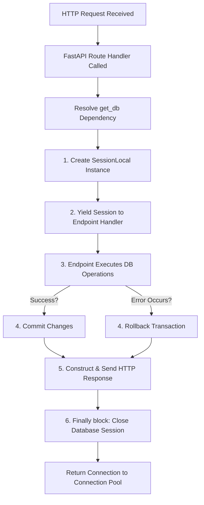

### 🎯 Learning Objectives
- Explain the role of Object-Relational Mapping (ORM) in modern web development.
- Configure a database engine, session factory, and base model using SQLAlchemy.
- Design database schemas by defining declarative SQLAlchemy models.
- Write request-scoped session dependencies using FastAPI's dependency injection system and `yield`.
- Implement robust endpoints that perform CRUD operations with automatic connection cleanup.

### 🧩 Core Concepts (Why)
In early web applications, developers interacted with databases by writing raw SQL queries inside application logic. While functional, this approach introduced significant issues: SQL syntax errors could only be caught at runtime, code duplication was high, and developers had to manually map database rows to application objects.

An **Object-Relational Mapper (ORM)** acts as a bridge between object-oriented programming (Python classes) and relational databases (SQL tables).
- **Python Class** maps to a **Database Table**.
- **Class Attributes** map to **Table Columns**.
- **Object Instance** maps to a **Table Row**.

FastAPI does not include a built-in database layer. Instead, it pairs naturally with **SQLAlchemy**, Python's most popular and feature-rich ORM. 

To integrate SQLAlchemy with FastAPI, we coordinate three key components:
1. **Engine**: The core interface that manages connections, translates SQLAlchemy queries into database-specific SQL dialect, and maintains a connection pool.
2. **SessionLocal**: A session factory configured for request-scoped database transactions. Each request gets its own session, allowing independent transactions.
3. **Declarative Base**: A base class that maintains schema metadata. All models inherit from this base class so SQLAlchemy can track and initialize their schemas.

### 🔁 Logic and Operation

When an HTTP request is made to a FastAPI endpoint requiring a database connection, the session goes through a structured lifecycle managed by dependency injection:



The use of `yield` in the dependency is critical. It guarantees that the `finally` block runs after the endpoint executes and the response is sent, preventing connection leaks.

### 📝 Annotated Examples

Here is a complete implementation showing how database configuration, database models, and FastAPI routes integrate.

#### 1. Database Setup (`database.py`)
```python
from sqlalchemy import create_engine
from sqlalchemy.orm import sessionmaker, declarative_base

# Define the database URL (using SQLite in-memory for illustration)
DATABASE_URL = "sqlite:///./app.db"

# 1. Create the engine. 'connect_args={"check_same_thread": False}' is only required for SQLite
engine = create_engine(DATABASE_URL, connect_args={"check_same_thread": False})

# 2. Create the SessionLocal factory. Disable autocommit and autoflush for transaction control
SessionLocal = sessionmaker(autocommit=False, autoflush=False, bind=engine)

# 3. Create the declarative base for models
Base = declarative_base()
```

#### 2. Declarative Model Definition (`models.py`)
```python
from sqlalchemy import Column, Integer, String, Boolean
from database import Base

class Product(Base):
    __tablename__ = "products"  # Specifies the physical table name in the DB

    # Define table columns mapping to SQLAlchemy types
    id = Column(Integer, primary_key=True, index=True)
    name = Column(String, nullable=False, index=True)
    price = Column(Integer, nullable=False)
    in_stock = Column(Boolean, default=True)
```

#### 3. FastAPI Endpoint Integration (`main.py`)
```python
from fastapi import FastAPI, Depends, HTTPException, status
from sqlalchemy.orm import Session
from typing import Annotated

from database import engine, Base, SessionLocal
import models

# Automatically create tables in the database (for development purposes only)
Base.metadata.create_all(bind=engine)

app = FastAPI()

# Database session dependency generator using yield
def get_db():
    db = SessionLocal()
    try:
        yield db  # Injects the session into the endpoint parameter
    finally:
        db.close()  # Automatically runs after response is sent

# Annotated type alias for cleaner dependencies
DbSession = Annotated[Session, Depends(get_db)]

@app.post("/products/", status_code=status.HTTP_201_CREATED)
def create_product(name: str, price: int, db: DbSession):
    # Instantiate the database model instance
    db_product = models.Product(name=name, price=price)
    
    db.add(db_product)      # Stage the object
    db.commit()             # Save changes to the database
    db.refresh(db_product)  # Refresh instance attributes with database defaults (like id)
    return db_product

@app.get("/products/{product_id}")
def read_product(product_id: int, db: DbSession):
    # Query database using SQLAlchemy ORM
    product = db.query(models.Product).filter(models.Product.id == product_id).first()
    if not product:
        raise HTTPException(
            status_code=status.HTTP_404_NOT_FOUND, 
            detail="Product not found"
        )
    return product
```

### ❌ Common Mistakes

**Mistake 1: Sharing a single global database session instance across requests**
```python
from fastapi import FastAPI
from database import SessionLocal

app = FastAPI()
db = SessionLocal()  # Wrong: Sharing a single session instance globally

@app.get("/items")
def get_items():
    return db.query(Item).all()
```
```text
StateError: Object deleted or session closed.
ResourceClosedError: This transaction has already been closed.
```
```python
from fastapi import FastAPI, Depends
from sqlalchemy.orm import Session
from database import SessionLocal

app = FastAPI()

def get_db():
    db = SessionLocal()
    try:
        yield db
    finally:
        db.close()

@app.get("/items")
def get_items(db: Session = Depends(get_db)):  # Correct: Use request-scoped sessions
    return db.query(Item).all()
```
> Sharing a single global SQLAlchemy session across concurrent requests leads to multi-threading race conditions, cross-talk between user requests, database lockouts, and memory leaks. The session object is fundamentally not thread-safe and must be created and destroyed on a per-request basis.

**Mistake 2: Forgetting to commit write operations to the database**
```python
@app.post("/users")
def create_user(name: str, db: Session = Depends(get_db)):
    user = User(name=name)
    db.add(user)
    # Wrong: Missing db.commit(). The changes are staged but never committed.
    return user
```
```text
# No direct error thrown, but changes are never saved to the physical database file/server.
```
```python
@app.post("/users")
def create_user(name: str, db: Session = Depends(get_db)):
    user = User(name=name)
    db.add(user)
    db.commit()  # Correct: Commit changes to save transaction
    db.refresh(user)
    return user
```
> Simply calling `db.add()` only stages the transaction in SQLAlchemy's local memory. Without calling `db.commit()`, the transaction will be implicitly rolled back when the session is closed at the end of the request, resulting in lost data changes.

**Mistake 3: Accessing lazy-loaded attributes after closing the session**
```python
def get_user_items_bad():
    db = SessionLocal()
    user = db.query(User).first()
    db.close()
    # Wrong: Accessing lazy relationship 'items' after session is closed
    return user.items 
```
```text
sqlalchemy.orm.exc.DetachedInstanceError: Parent instance <User at 0x7f8> is not bound to a Session; lazy load operation of attribute 'items' cannot proceed
```
```python
# Option 1: Access attributes before closing
# Option 2: Use eager loading in the query
from sqlalchemy.orm import joinedload

def get_user_items_good():
    db = SessionLocal()
    try:
        user = db.query(User).options(joinedload(User.items)).first()
        return user.items
    finally:
        db.close()
```
> By default, SQLAlchemy relationships are lazy-loaded. When you access `user.items`, SQLAlchemy attempts to execute a database query to fetch them. If the session has already been closed, SQLAlchemy has no database connection to execute the query, throwing a `DetachedInstanceError`.

### 💡 Tips & Idioms
- **Use `Annotated` Dependencies**: Avoid repeating `Depends(get_db)` across dozens of route definitions. Create a type alias (e.g., `DbSession = Annotated[Session, Depends(get_db)]`) to make code cleaner.
- **Context Managers for Scripts**: If you need to access the database outside of a FastAPI route (e.g., in a CLI command, background script, or test setup), write a context manager to automate session cleanup:
  ```python
  from contextlib import contextmanager

  @contextmanager
  def db_session():
      db = SessionLocal()
      try:
          yield db
          db.commit()
      except Exception:
          db.rollback()
          raise
      finally:
          db.close()
  ```
- **Relationship Eager Loading**: Prevent the "N+1 query problem" by using `joinedload` (for one-to-many/many-to-one) or `selectinload` (for many-to-many) when querying models with relationships.

### 🧠 Deep Dive (Under the hood)
<details><summary>Unit of Work, Identity Map, and SQLAlchemy Sessions</summary>

SQLAlchemy's session layer implements two classic software design patterns: **Unit of Work** and **Identity Map**.

#### 1. Identity Map Pattern
When you load a record from the database, SQLAlchemy keeps track of the record in an internal registry by its primary key. If you query the same object twice within the same session:
```python
user1 = db.query(User).filter_by(id=1).first()
user2 = db.query(User).filter_by(id=1).first()
assert user1 is user2  # True! Points to the exact same Python object memory space
```
This guarantees that changes made to `user1` are immediately reflected in `user2`, maintaining data consistency across different code components running inside the same request.

#### 2. Unit of Work Pattern
The Session maintains a list of pending transactions. When you call `db.add()`, nothing is sent to the database immediately. During `db.commit()` or when query execution forces a flush, SQLAlchemy analyzes all updates, inserts, and deletes, arranges them to prevent foreign key constraint violations, and executes them in a single batch.

#### Object States in Sessions
An ORM object exists in one of four distinct states within a session's lifecycle:
1. **Transient**: The object is created (`user = User()`) but not yet associated with a session. No database representation exists.
2. **Pending**: The object has been added to a session (`db.add(user)`). It will be written to the database during the next flush or commit.
3. **Persistent**: The object is saved in the database and tracked by the session. Changes to attributes are tracked.
4. **Detached**: The session is closed (`db.close()`). The object still exists in memory but is no longer connected to a database session.
</details>

### 🏋️ Exercise
Implement a database setup using SQLite in-memory database and build a `User` model containing:
1. An integer primary key `id`.
2. A string column `name`.

Next, write the standard FastAPI database session generator dependency function named `get_db`. The generator should initialize the database session, yield it, and ensure it is properly closed in the finalizer block.

```python
from sqlalchemy import create_engine, Column, Integer, String
from sqlalchemy.orm import sessionmaker, declarative_base

# Setup sqlite in-memory database and create User model with id and name.
# Write get_db session generator yielding session local.
```

### ✅ Self-Check
1. Why is it bad practice to create a database session inside the endpoint handler and manually close it instead of using FastAPI dependency injection?
2. What is the difference between `db.commit()` and `db.flush()` in SQLAlchemy?
3. How does setting `connect_args={"check_same_thread": False}` prevent errors in SQLite database connections when using FastAPI?
<details><summary>Self-Check Answers</summary>

1. Manually managing session creation and closing inside route handlers leads to redundant boilerplate code. It also increases the risk of connection leaks if an exception is raised before the close statement is reached. Dependency injection with `yield` ensures robust cleanup regardless of route execution errors.
2. `db.flush()` sends the pending SQL instructions (insert, update, delete) to the database server transaction buffer, assigning IDs to new records, but does not finalize the transaction. `db.commit()` writes the flush changes persistently and closes the transaction.
3. By default, SQLite prevents multiple threads from accessing the same database connection to avoid corruption. Because FastAPI routes can run concurrently on different threads, this safety check would raise errors. Disabling this check is safe as long as each request uses its own isolated connection.
</details>

### 📌 Summary
- **ORMs** map object-oriented classes to relational database tables, easing SQL operations.
- The **SQLAlchemy Engine** establishes connections, while **SessionLocal** provides transaction instances.
- Using FastAPI's dependency injection (`Depends`) combined with `yield` manages connection lifecycles automatically.
- Object records are tracked inside the session using the **Identity Map** and **Unit of Work** patterns.
- Always commit changes (`db.commit()`) to finalize database modifications, and ensure sessions are closed.
