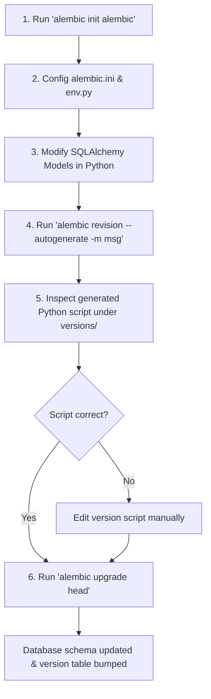

### 🎯 Learning Objectives
- Explain the role of database migrations in production application lifecycles.
- Initialize and configure Alembic in a Python/FastAPI environment.
- Modify `env.py` to point to database metadata for autogenerate support.
- Generate database revision scripts automatically from SQLAlchemy models.
- Apply and rollback database schemas using command-line migration utilities.

### 🧩 Core Concepts (Why)
In early development stages, you can recreate the database on every startup using SQLAlchemy's `Base.metadata.create_all(bind=engine)`. However, in a production environment, this approach fails because dropping tables deletes all customer and application data.

Furthermore, SQLAlchemy's `create_all()` is design-limited: it only creates tables that do not exist. If you add a new column to an existing model in Python, `create_all()` does nothing, leaving your application in an out-of-sync state.

**Database Migrations** solve this problem by managing your database schema as version-controlled code.
- Every schema change is represented as an incremental script (e.g., adding a table, dropping a column).
- Migration scripts can be run sequentially to upgrade the schema, or run in reverse to downgrade.

**Alembic** is the official database migration tool for SQLAlchemy. It acts like Git for database schemas.
- It tracks the current database version using a dedicated table inside the database itself.
- It provides a command-line interface to auto-detect model changes and generate the corresponding SQL statements.

To configure Alembic, we work with three components:
1. `alembic.ini`: The configuration file containing database connection strings and logging setups.
2. `env.py`: A Python script that Alembic executes when run. It connects to the database engine and maps Alembic's transaction layer to your SQLAlchemy models.
3. `versions/`: A directory containing auto-generated, time-stamped Python migration files representing incremental database changes.

### 🔁 Logic and Operation

The standard development loop for database schema modifications consists of the following steps:



When you run `alembic revision --autogenerate`, Alembic inspects your current database schema and compares it to the structure defined in your Python files (`Base.metadata`). It then automatically generates the `upgrade()` and `downgrade()` blocks required to sync them.

### 📝 Annotated Examples

#### 1. Initializing Alembic
In your project root directory, run the initialization command:
```bash
alembic init alembic
```
This creates the following file structure:
- `alembic.ini` (global configuration)
- `alembic/` (migration environment directory)
  - `env.py` (execution runner script)
  - `script.py.mako` (migration script template)
  - `versions/` (migration scripts repository)

#### 2. Configuring `alembic.ini`
Open `alembic.ini` and set your database connection URL:
```ini
# alembic.ini
sqlalchemy.url = sqlite:///./app.db
```

#### 3. Connecting Models in `alembic/env.py`
To enable autogenerate capability, open `alembic/env.py` and modify it to import your model metadata:
```python
# alembic/env.py
from logging.config import fileConfig
from sqlalchemy import engine_from_config
from sqlalchemy import pool

from alembic import context

# 1. Import your SQLAlchemy Base class and models
from database import Base
import models  # Must import models to register tables with Base metadata

config = context.config
if config.config_file_name is not None:
    fileConfig(config.config_file_name)

# 2. Assign the target metadata to enable schema comparison
target_metadata = Base.metadata
```

#### 4. Generating the Migration Script
Generate the migration files by specifying a description message:
```bash
alembic revision --autogenerate -m "create user table"
```
Alembic creates a file under `alembic/versions/` (e.g., `4a52b31f79e2_create_user_table.py`):
```python
# alembic/versions/4a52b31f79e2_create_user_table.py
"""create user table

Revision ID: 4a52b31f79e2
Revises: 
Create Date: 2026-06-27 12:00:00.000000
"""
from alembic import op
import sqlalchemy as sa

# Revision identifiers
revision = '4a52b31f79e2'
down_revision = None
branch_labels = None
depends_on = None

def upgrade() -> None:
    # 1. Automatically generated commands to update the database
    op.create_table(
        'users',
        sa.Column('id', sa.Integer(), nullable=False),
        sa.Column('name', sa.String(), nullable=True),
        sa.PrimaryKeyConstraint('id')
    )

def downgrade() -> None:
    # 2. Commands to reverse the migration
    op.drop_table('users')
```

#### 5. Executing the Migration
Apply the generated changes to the database:
```bash
alembic upgrade head
```
This updates the database structure and writes `4a52b31f79e2` to the version tracking table.

### ❌ Common Mistakes

**Mistake 1: Forgetting to import target models inside `env.py`**
```python
# alembic/env.py
from database import Base
# Wrong: Missing 'import models' (Base metadata is empty)
target_metadata = Base.metadata
```
```text
INFO  [alembic.runtime.migration] Context class SQLiteContext.
INFO  [alembic.autogenerate.compare] Detected removed table 'users'
```
```python
# alembic/env.py
from database import Base
import models  # Correct: Import models so SQLAlchemy registers tables
target_metadata = Base.metadata
```
> Alembic relies on Python importing your models to register tables with the `Base.metadata` registry. If you only import `Base` and not your models in `env.py`, `Base.metadata` will appear empty. Alembic will assume you deleted all models and generate a revision that drops all existing tables in the database.

**Mistake 2: Specifying wrong table or column name in manual migrations**
```python
# In alembic version script
def upgrade() -> None:
    # Wrong: Specifying non-existent column 'user_name'
    op.drop_column('users', 'user_name')
```
```text
sqlalchemy.exc.OperationalError: (sqlite3.OperationalError) no such column: users.user_name
```
```python
def upgrade() -> None:
    # Correct: Use the correct registered column name 'username'
    op.drop_column('users', 'username')
```
> Autogenerated migrations can sometimes be inaccurate, but manual modifications of migration script commands must be done with caution. Specifying wrong table or column names inside functions like `op.drop_column()` or `op.alter_column()` will bypass compile-time checks and cause database execution failures at runtime.

**Mistake 3: Setting dynamic database URL in env.py without default fallback**
```python
# alembic/env.py
import os
# Wrong: Directly setting option to database URL which might be None
config.set_main_option("sqlalchemy.url", os.getenv("DATABASE_URL"))
```
```text
sqlalchemy.exc.ArgumentError: String connection URL or an URL object is required, got None
```
```python
# alembic/env.py
import os
db_url = os.getenv("DATABASE_URL", "sqlite:///dev.db")  # Correct: Provide a default fallback
config.set_main_option("sqlalchemy.url", db_url)
```
> When overriding Alembic configuration settings in `env.py` dynamically using `os.getenv`, you must ensure that a valid default fallback is provided (e.g., development local SQLite). Otherwise, if the environment variable is not defined, SQLAlchemy will receive a `None` URL, raising an `ArgumentError` during engine instantiation.

### 💡 Tips & Idioms
- **Dynamically Load Database URLs**: Do not hardcode production database credentials in `alembic.ini`. Instead, load the connection string dynamically from environment variables in `env.py`:
  ```python
  # alembic/env.py
  import os
  
  # Override config string with system environment variable
  config.set_main_option("sqlalchemy.url", os.getenv("DATABASE_URL"))
  ```
- **Run `alembic current`**: Use this command to see the exact revision ID currently applied to your active database.
- **Run `alembic history --verbose`**: Use this command to list all database migrations in chronological order, showing dependencies and revision IDs.

### 🧠 Deep Dive (Under the hood)
<details><summary>The alembic_version Table and Autogenerate Internals</summary>

#### The `alembic_version` Table
When you execute migrations, Alembic maintains a version tracking table inside the target database:
```sql
CREATE TABLE alembic_version (
    version_num VARCHAR(32) NOT NULL,
    CONSTRAINT alembic_version_pkc PRIMARY KEY (version_num)
);
```
This table contains exactly one row storing a single string (the revision ID of the current head). When you run `alembic upgrade head`, Alembic:
1. Queries this table to read the current revision ID.
2. Identifies all migration scripts in `versions/` whose `down_revision` points sequentially downstream.
3. Executes their `upgrade()` methods inside a transaction.
4. Updates `version_num` to the target head ID.

#### How Autogenerate Works
When `--autogenerate` is active, Alembic connects to the database, initiates an inspection process, and reads the database metadata. It then maps the database columns, indices, and constraints against `target_metadata`.

Alembic detects:
- Table additions and deletions.
- Column additions, deletions, and type alterations.
- Index additions and deletions.

Alembic does **NOT** detect:
- Column or table name alterations (interprets as drop/add).
- Custom constraints or foreign key changes (unless configured explicitly).
- Table partitions.
</details>

### 🏋️ Exercise
Write a configuration text validator named `validate_alembic_config` that parses mock configuration files representing `alembic.ini`. The validator should split the configuration text by line and verify that it contains a definition setting `script_location` equal to `"alembic"`.

```python
# Write a config parser that validates a mock alembic.ini text configurations.
# The config must contain a "script_location = alembic" definition.
def validate_alembic_config(config_text):
    pass
```

### ✅ Self-Check
1. Why does `Base.metadata.create_all()` fail to update schemas on tables that already exist?
2. What happens to the database if you execute a migration that fails halfway through?
3. How does Alembic track migration order when multiple files exist inside `versions/`?
<details><summary>Self-Check Answers</summary>

1. `Base.metadata.create_all()` is designed to check for the existence of table names in the database. If a table exists, it skips executing any SQL for that table, meaning any new columns, indices, or constraints will not be applied.
2. In transactional databases (like PostgreSQL), the migration rollback will revert all changes applied prior to the failure, maintaining schema integrity. In non-transactional DDL databases (like MySQL/MariaDB or SQLite), changes may remain partially applied, requiring manual recovery.
3. Alembic scripts contain metadata properties `revision` (their own ID) and `down_revision` (the ID of the preceding migration). This creates a linked list structure representing the linear history.
</details>

### 📌 Summary
- **Database migrations** track schema updates as version-controlled code, preserving application data.
- **Alembic** manages these migrations by reading your model metadata and running command utilities.
- Always configure `env.py` to import model files and target `Base.metadata` to support autogeneration.
- Manually review all autogenerated migrations before execution to prevent accidental data loss.
- Use `alembic upgrade head` to run migrations, and manage version offsets dynamically.
