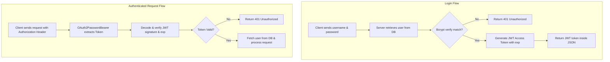

### 🎯 Learning Objectives
- Explain the role of password hashing (bcrypt) in securing user credentials.
- Describe the structure of a JSON Web Token (JWT) including Header, Payload, and Signature.
- Generate and verify JWT access tokens with appropriate expiration times in Python.
- Integrate FastAPI's `OAuth2PasswordBearer` security dependency to extract credentials.
- Implement a complete authentication workflow to protect API endpoints.

### 🧩 Core Concepts (Why)
When building modern web APIs, security is paramount. Storing plain-text passwords in a database is a major security vulnerability; if the database is compromised, all user accounts are exposed. Therefore, passwords must be encrypted using a cryptographic hashing algorithm (like **bcrypt**). Hashing is a one-way function—you can compute a hash from a password, but you cannot reverse the hash back into the password.

Once a user's identity is verified, the server needs a way to identify subsequent requests from that user. Traditional web applications use sessions, storing a session ID on the server and a cookie on the client. For stateless REST APIs, however, **JSON Web Tokens (JWT)** are the industry standard.

A JWT is a compact, self-contained URL-safe token that represents claims between two parties.
- **Compact**: The token is small enough to be sent via URL, POST parameter, or inside an HTTP header.
- **Self-contained**: The token contains all the necessary user information (payload), avoiding the need to query the database repeatedly on every request.

A JWT consists of three parts separated by dots (`.`):
1. **Header**: Contains the token type (JWT) and the signing algorithm (e.g., HS256).
2. **Payload**: Contains the claims (user ID, expiration time, scope).
3. **Signature**: Created by combining the encoded header, encoded payload, and a server-side secret key using the specified algorithm. This ensures the token cannot be tampered with by the client.

FastAPI provides built-in tools like `OAuth2PasswordBearer` to automate the extraction of tokens from the `Authorization: Bearer <token>` header, making it simple to write reusable security dependencies.

### 🔁 Logic and Operation

Below is the flowchart representing the token authentication workflow:



### 📝 Annotated Examples

#### 1. Password Hashing with Bcrypt
To secure user credentials, we hash passwords using `passlib` with the `bcrypt` backend.
```python
from passlib.context import CryptContext

# Create a CryptContext that handles hashing and verification
pwd_context = CryptContext(schemes=["bcrypt"], deprecated="auto")

def hash_password(password: str) -> str:
    # Generates a random salt and hashes the password
    return pwd_context.hash(password)

def verify_password(plain_password: str, hashed_password: str) -> bool:
    # Verifies the plain password against the stored hash
    return pwd_context.verify(plain_password, hashed_password)
```

#### 2. Issuing and Decoding JWTs
We use `PyJWT` to create and parse JSON Web Tokens with a local secret key.
```python
import datetime
import jwt
from fastapi import HTTPException, status

SECRET_KEY = "your-extremely-secure-secret-key"
ALGORITHM = "HS256"

def create_access_token(data: dict, expires_delta: datetime.timedelta):
    to_encode = data.copy()
    expire = datetime.datetime.utcnow() + expires_delta
    # Add expiration claim ('exp') to the payload
    to_encode.update({"exp": expire})
    encoded_jwt = jwt.encode(to_encode, SECRET_KEY, algorithm=ALGORITHM)
    return encoded_jwt

def decode_access_token(token: str):
    try:
        # Decode and verify the signature and expiration automatically
        payload = jwt.decode(token, SECRET_KEY, algorithms=[ALGORITHM])
        return payload
    except jwt.ExpiredSignatureError:
        raise HTTPException(
            status_code=status.HTTP_401_UNAUTHORIZED,
            detail="Token has expired",
            headers={"WWW-Authenticate": "Bearer"},
        )
    except jwt.InvalidTokenError:
        raise HTTPException(
            status_code=status.HTTP_401_UNAUTHORIZED,
            detail="Invalid token credentials",
            headers={"WWW-Authenticate": "Bearer"},
        )
```

#### 3. Protecting Routes with OAuth2PasswordBearer
FastAPI uses dependencies to extract security parameters. The `OAuth2PasswordBearer` class extracts the token from the request's authorization header.
```python
from fastapi import FastAPI, Depends, HTTPException, status
from fastapi.security import OAuth2PasswordBearer

app = FastAPI()

# Defines the token URL endpoint for OAuth2 flow
oauth2_scheme = OAuth2PasswordBearer(tokenUrl="token")

# Dependency to fetch the current user
async def get_current_user(token: str = Depends(oauth2_scheme)):
    payload = decode_access_token(token)
    username: str = payload.get("sub")
    if username is None:
        raise HTTPException(
            status_code=status.HTTP_401_UNAUTHORIZED,
            detail="Could not validate credentials"
        )
    return {"username": username}

# Protected route using the current user dependency
@app.get("/users/me")
def read_users_me(current_user: dict = Depends(get_current_user)):
    return current_user
```

### ❌ Common Mistakes

**Mistake 1: Decoding JWT without checking algorithms explicitly**
```python
# Wrong: Omitting the algorithms list when decoding the token
payload = jwt.decode(token, SECRET_KEY)
```
```text
TypeError: decode() missing 1 required keyword-only argument: 'algorithms'
```
```python
# Correct: Explicitly defining the allowed verification algorithms
payload = jwt.decode(token, SECRET_KEY, algorithms=["HS256"])
```
> PyJWT requires the `algorithms` parameter to be specified explicitly when calling `jwt.decode()`. This requirement prevents algorithm-confusion attacks, where an attacker changes the token header from asymmetric algorithms (RS256) to symmetric (HS256) to bypass signature verification.

**Mistake 2: Decoding JWT without catching Expiration errors**
```python
# Wrong: Accessing JWT payload values without try-except handling
def get_user_from_token(token: str):
    payload = jwt.decode(token, SECRET_KEY, algorithms=["HS256"])
    return payload["sub"]
```
```text
jwt.exceptions.ExpiredSignatureError: Signature has expired
```
```python
# Correct: Catching ExpiredSignatureError and throwing an HTTP exception
def get_user_from_token(token: str):
    try:
        payload = jwt.decode(token, SECRET_KEY, algorithms=["HS256"])
        return payload["sub"]
    except jwt.ExpiredSignatureError:
        raise HTTPException(status_code=401, detail="Token expired")
    except jwt.InvalidTokenError:
        raise HTTPException(status_code=401, detail="Invalid token")
```
> JWT expirations are verified during decoding. If the token is expired, `jwt.decode` raises `ExpiredSignatureError`. If this exception is not caught and handled, the server will raise an unhandled internal server error (500) rather than returning a clear unauthorized error (401) to the client.

### 💡 Tips & Idioms
- **Keep SECRET_KEY Secret**: Never hardcode your `SECRET_KEY` in production source code. Use system environment variables and load them via settings modules (e.g., `os.getenv("SECRET_KEY")`).
- **Short Token Lifespans**: Keep access token lifespans short (e.g., 15–30 minutes) to minimize security exposure if a token is stolen. Use refresh tokens for extending session lifetimes.
- **The "sub" Claim**: Always store the unique identifier of the user (like a database ID or username) in the standard subject `"sub"` claim of the JWT payload.

### 🧠 Deep Dive (Under the hood)
<details><summary>The Mechanics of JWT and Bcrypt Salting</summary>

#### How Bcrypt Prevents Rainbow Table Attacks
When you run a standard hash function like SHA256 on a password, the same password always produces the exact same hash. If an attacker gains access to your database, they can compute hashes for millions of common passwords beforehand (a **Rainbow Table**) and quickly match them against your hashes.

Bcrypt mitigates this by applying a randomized **Salt** (additional random data) during hashing.
- Even if two users have the same password `"password123"`, their hashes will be completely different because the salts are random.
- Bcrypt embeds the salt directly inside the final output string (e.g. `$2b$12$R9h/cIPz...`), allowing the verify function to extract it, apply it to the plain-text password, and compare the result.
- Bcrypt is designed to be computationally slow (using a work factor), making brute-force cracking attempts extremely expensive.

#### JWT Payload Security
It is vital to remember that JWT payloads are **not encrypted**; they are only signed. The payload is encoded using Base64URL, which can be easily decoded by anyone who intercepts the token.
- You can inspect any JWT payload by pasting it into [jwt.io](https://jwt.io).
- Never store sensitive data like raw passwords, api tokens, or private personal data inside the payload.
- The **Signature** section only guarantees that the data has not been modified since it was issued by the server, as a modified payload will fail signature verification against the server's private secret key.
</details>

### 🏋️ Exercise
Write two utility functions `generate_token(username, expires_delta_mins)` and `decode_token(token)`. `generate_token` must create a JWT containing the username in the subject (`sub`) claim and expire after the given minutes. `decode_token` should verify the token and return the username.

```python
import jwt
import datetime

SECRET_KEY = "supersecret"

# Implement generate_token(username, expires_delta_mins) returning JWT token
# Implement decode_token(token) returning username
```

### ✅ Self-Check
1. What makes a JWT secure if the payload can be read by anyone?
2. What is the standard HTTP header name and format used to transmit JWT tokens from the client?
3. How does PyJWT handle expired tokens automatically during verification?
<details><summary>Self-Check Answers</summary>

1. A JWT is secured by its **signature**. Even though anyone can decode and read the payload, they cannot alter the content without invalidating the signature. The signature is computed using a secret key held only by the server.
2. The client transmits the token in the `Authorization` HTTP header with the prefix `Bearer `, e.g., `Authorization: Bearer <token_string>`.
3. PyJWT's `jwt.decode()` automatically checks the `"exp"` claim in the token against the current UTC time. If the current time is past the expiration time, it raises an `ExpiredSignatureError` exception.
</details>

### 📌 Summary
- **Password hashing** with bcrypt ensures that raw user credentials are never stored in the database.
- **JWTs** represent self-contained security claims, containing headers, payloads, and cryptographic signatures.
- **Token signatures** verify integrity on the server using private secret keys, while token payloads are readable by clients.
- **FastAPI's security dependencies** automate header parsing and token extraction, enabling secure endpoint protection.
