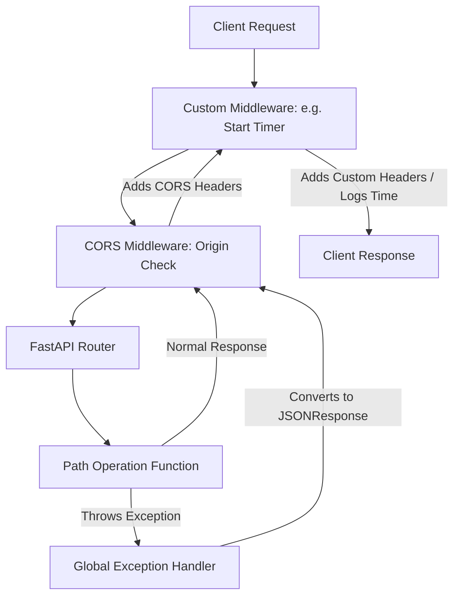

### 🎯 Learning Objectives
- Explain the role of middleware in the HTTP request-response lifecycle.
- Intercept and modify incoming requests and outgoing responses using custom middleware.
- Configure Cross-Origin Resource Sharing (CORS) headers to secure and enable cross-domain requests.
- Define custom Python exceptions to represent application-specific validation or business errors.
- Register global exception handlers in FastAPI to return structured, user-friendly JSON responses.

### 🧩 Core Concepts (Why)
Web applications often need to execute logic consistently across all incoming requests and outgoing responses. For instance, you might want to log the execution time of every request, verify headers, or compress responses. Writing this logic inside every single path operation function leads to code duplication. **Middlewares** solve this by intercepting requests before they reach your routes, and modifying responses before they go back to the client.

Another critical middleware function is managing **CORS (Cross-Origin Resource Sharing)**. For security reasons, modern web browsers enforce the same-origin policy, which blocks a front-end application hosted on one domain (e.g., `https://frontend.com`) from sending AJAX requests to an API hosted on another domain (e.g., `https://api.com`). CORS headers tell the browser that the server explicitly trusts specific origins, enabling safe cross-domain communication.

Finally, during request execution, things can go wrong—a database query might fail, or a requested resource might not exist. If your application raises a standard Python exception that goes uncaught, FastAPI will crash the request pipeline and return a generic 500 Internal Server Error. By defining **custom exceptions** and registering global **exception handlers**, you can capture these specific errors and translate them into clean, structured JSON responses (e.g., a 404 Not Found response containing an error explanation), improving API usability and debugging.

### 🔁 Logic and Operation

Below is the request-response lifecycle illustrating how Middlewares, Routers, and Exception Handlers interact:



When an exception is raised, the router bypasses normal processing and searches for a registered exception handler matching that exception class. The handler formats a standard HTTP response, which still passes back through the middleware layers before reaching the client.

### 📝 Annotated Examples

#### 1. Custom HTTP Middleware
We can create a custom middleware using `@app.middleware("http")` to calculate request processing time.
```python
import time
from fastapi import FastAPI, Request

app = FastAPI()

@app.middleware("http")
async def add_process_time_header(request: Request, call_next):
    # 1. Logic executed before the request reaches the path operation
    start_time = time.time()
    
    # 2. Pass the request downstream to get the response
    response = await call_next(request)
    
    # 3. Logic executed after the route finishes, modifying the response
    process_time = time.time() - start_time
    response.headers["X-Process-Time"] = str(process_time)
    
    return response
```

#### 2. Configuring CORS Middleware
FastAPI provides a built-in `CORSMiddleware` to manage cross-origin headers easily.
```python
from fastapi.middleware.cors import CORSMiddleware

# Define the list of origins that are allowed to make cross-site requests
origins = [
    "http://localhost:3000",
    "https://myfrontendapp.com",
]

app.add_middleware(
    CORSMiddleware,
    allow_origins=origins,            # Allows requests from these origins
    allow_credentials=True,           # Allows cookies to be included in requests
    allow_methods=["*"],              # Allows all HTTP methods (GET, POST, etc.)
    allow_headers=["*"],              # Allows all HTTP headers
)
```

#### 3. Custom Exceptions and Global Handlers
We define custom domain exceptions and catch them globally using exception handlers.
```python
from fastapi import FastAPI, Request
from fastapi.responses import JSONResponse

# 1. Define a custom Python exception class
class ItemLimitExceededError(Exception):
    def __init__(self, limit: int):
        self.limit = limit

app = FastAPI()

# 2. Register the exception handler using the decorator
@app.exception_handler(ItemLimitExceededError)
async def item_limit_exception_handler(request: Request, exc: ItemLimitExceededError):
    # 3. Return a structured JSONResponse with the appropriate status code
    return JSONResponse(
        status_code=400,
        content={"error": "Invalid request", "detail": f"Cannot add more than {exc.limit} items."}
    )

@app.get("/items/add")
def add_item(count: int):
    if count > 10:
        # Triggering the custom exception
        raise ItemLimitExceededError(limit=10)
    return {"message": "Items added successfully"}
```

### ❌ Common Mistakes

**Mistake 1: Forgetting to await `call_next(request)` in custom middleware**
```python
# Wrong: Calling call_next without await
@app.middleware("http")
async def process_time_middleware(request: Request, call_next):
    response = call_next(request)
    response.headers["X-Process-Time"] = "0.01"
    return response
```
```text
AttributeError: 'coroutine' object has no attribute 'headers'
```
```python
# Correct: Awaiting call_next to obtain the response object
@app.middleware("http")
async def process_time_middleware(request: Request, call_next):
    response = await call_next(request)
    response.headers["X-Process-Time"] = "0.01"
    return response
```
> `call_next` is an asynchronous coroutine that represents the downstream request execution pipeline. If you do not `await` it, Python returns a coroutine object rather than an actual `Response` instance. Trying to modify headers on a coroutine object will raise an `AttributeError` and crash the application.

**Mistake 2: Returning a dictionary instead of a Response instance in exception handlers**
```python
# Wrong: Returning a plain dictionary from the handler
@app.exception_handler(ItemLimitExceededError)
def exception_handler_wrong(request: Request, exc: ItemLimitExceededError):
    return {"error": "Limit exceeded"}
```
```text
AssertionError: The response returned by the exception handler must be an instance of starlette.responses.Response
```
```python
# Correct: Returning an explicit JSONResponse object
@app.exception_handler(ItemLimitExceededError)
def exception_handler_correct(request: Request, exc: ItemLimitExceededError):
    return JSONResponse(status_code=400, content={"error": "Limit exceeded"})
```
> FastAPI's exception handler mechanism (built on Starlette) requires handlers to return a valid instance of a `Response` subclass (such as `JSONResponse`, `HTMLResponse`, or `PlainTextResponse`). Returning a raw dictionary or string violates this contract and triggers a runtime assertion failure.

### 💡 Tips & Idioms
- **CORS Middleware Registration Order**: Always add `CORSMiddleware` near the top of your middleware stack to ensure it intercepts browser preflight requests before custom authentication or logging middlewares run.
- **Base App Exception Pattern**: If you have many custom exception classes, inherit them from a common base class (e.g. `class BaseAppException(Exception)`). You can then register a single handler for `BaseAppException` to capture and format all custom errors in a unified format:
  ```python
  @app.exception_handler(BaseAppException)
  def base_exception_handler(request: Request, exc: BaseAppException):
      return JSONResponse(status_code=400, content={"error": str(exc)})
  ```
- **Context Passing via `request.state`**: You can attach custom data to the request state in your middleware (e.g. `request.state.user_role = "admin"`) and read it later inside your path operation functions.

### 🧠 Deep Dive (Under the hood)
<details><summary>Middleware Execution Order and CORS Preflight</summary>

#### The ASGI Middleware Onion Model
FastAPI applications run on the Asynchronous Server Gateway Interface (ASGI) specification. Middlewares in ASGI operate like layers of an onion:
- Incoming requests travel from the outer layers to the inner layers.
- Outgoing responses travel from the inner layers back out.

When you call `app.add_middleware(MiddlewareClass)`, FastAPI registers them sequentially. Because of the onion model, the last middleware added is the first one to receive the incoming request (outermost layer), and the first middleware added is closest to the router (innermost layer). Keep this in mind if your middlewares depend on actions performed by one another.

#### CORS Preflight and OPTIONS Requests
When a frontend application hosted on `http://localhost:3000` attempts a request like `POST` with a JSON payload to `http://localhost:8000/api`, the browser automatically sends an HTTP `OPTIONS` request first. This is called a **Preflight Request**.
- The preflight request checks if the server allows the origin `http://localhost:3000` and the header `Content-Type`.
- If the server replies with headers like `Access-Control-Allow-Origin: http://localhost:3000` and `Access-Control-Allow-Methods: POST`, the browser proceeds to send the actual `POST` request.
- FastAPI's `CORSMiddleware` intercepts these incoming `OPTIONS` preflight requests immediately and returns the configured headers, preventing the requests from hitting your router and wasting application processing resources.
</details>

### 🏋️ Exercise
Create a custom exception `ResourceNotFoundError` that takes a resource `name` as an argument. Then, implement an exception handler that registers this exception in a FastAPI application, returning a HTTP 404 status code and a JSON payload formatted as `{"error": "<name> not found"}`.

```python
from fastapi import FastAPI, Request
from fastapi.responses import JSONResponse

class ResourceNotFoundError(Exception):
    def __init__(self, name: str):
        self.name = name

app = FastAPI()

# Implement custom exception handler for ResourceNotFoundError
```

### ✅ Self-Check
1. How does a middleware block a request from reaching a router if a validation check fails?
2. Why is CORS validation performed by the web browser instead of the FastAPI backend?
3. What is the difference between Starlette's `HTTPException` and standard Python exceptions when handled by FastAPI?
<details><summary>Self-Check Answers</summary>

1. A middleware can return a `JSONResponse` directly (e.g., return a 401 Unauthorized response) instead of calling `await call_next(request)`. This short-circuits the pipeline, and the request never reaches the router.
2. CORS is a browser security mechanism designed to protect the user from malicious scripts on one origin making unauthorized requests to another origin. The backend only cooperates by providing headers; the browser is what actually blocks or permits the request completion.
3. FastAPI has a built-in handler for Starlette's `HTTPException` which automatically converts it to a JSON response. Standard Python exceptions, unless explicitly handled by a custom exception handler, are not caught by this default handler and will default to a 500 Internal Server Error.
</details>

### 📌 Summary
- **Middlewares** intercept the entire request-response cycle, allowing global processing of requests and responses.
- **CORS headers** are crucial for authorizing cross-origin browser requests and ensuring frontend-backend connectivity.
- **Custom exceptions** isolate specific business errors and prevent unhandled server exceptions from leaking details.
- **Global exception handlers** map Python errors to clean, standardized HTTP responses like `JSONResponse`.
