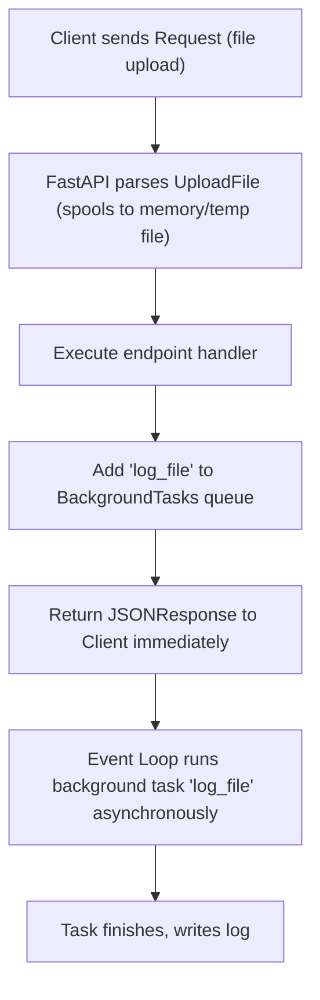

### 🎯 Learning Objectives
- Differentiate between uploading files via `bytes` and `UploadFile` in FastAPI.
- Implement file upload routes using the `UploadFile` and `File` components.
- Explain the request-response lifecycle when offloading tasks using `BackgroundTasks`.
- Configure background tasks to run long-running jobs without blocking client HTTP responses.
- Write end-to-end integration tests for routes that process file uploads and trigger background jobs.

### 🧩 Core Concepts (Why)
Web applications frequently need to receive files from clients (such as profile pictures, documents, or data sheets) and execute tasks that take several seconds or minutes to complete (such as sending confirmation emails, processing uploaded data, or generating reports). 

In traditional synchronous web frameworks, if a client uploads a file and the server processes it immediately inside the request handler, the connection remains open, and the client must wait for the entire process to finish before receiving a response. If many clients perform these slow tasks simultaneously, the server's worker processes become blocked, leading to timeouts and a degraded user experience.

FastAPI addresses these challenges with two powerful features:
1. **`UploadFile`**: Powered by Starlette, this class handles file uploads efficiently by streaming incoming data. Unlike reading raw `bytes` (which loads the entire file into the server's RAM), `UploadFile` stores files in memory only up to a size limit (1MB). If a file exceeds this limit, it is automatically written to a temporary file on the disk (spooled), preventing memory exhaustion (Out-of-Memory crashes).
2. **`BackgroundTasks`**: This class allows you to offload operations to be executed *after* returning the HTTP response. By adding a task to `BackgroundTasks`, FastAPI responds to the client immediately (e.g., returning `{"status": "queued"}`), and then executes the specified function asynchronously in a background thread or event loop, keeping the application fast and responsive.

### 🔁 Logic and Operation

The following flowchart illustrates the lifecycle of a file upload that initiates a background task:



When a request containing a background task is completed, FastAPI retrieves the registered task, returns the response payload and headers to the client, and immediately runs the registered function. If the background function is defined as a standard synchronous function (`def`), FastAPI runs it in an external thread pool. If it is defined as `async def`, FastAPI schedules it directly on the main ASGI event loop.

### 📝 Annotated Examples

#### 1. Uploading Files with `UploadFile`
Below is a route that accepts a file upload, retrieves metadata, and reads the content.
```python
from fastapi import FastAPI, File, UploadFile

app = FastAPI()

@app.post("/upload-metadata")
async def get_file_metadata(file: UploadFile = File(...)):
    # 1. Access metadata attributes
    filename = file.filename
    content_type = file.content_type
    
    # 2. Read the file contents asynchronously
    content = await file.read()
    
    # 3. Always close the file to free up system resources
    await file.close()
    
    return {
        "filename": filename,
        "content_type": content_type,
        "size_bytes": len(content)
    }
```

#### 2. Running a Task in the Background
Using `BackgroundTasks` to log messages or process data after sending a response.
```python
from fastapi import FastAPI, BackgroundTasks

app = FastAPI()

def write_notification(email: str, message: str):
    # Simulate a slow email sending operation
    with open("log.txt", mode="a") as log:
        log.write(f"Notification to {email}: {message}\n")

@app.post("/send-notification/{email}")
def send_notification(email: str, background_tasks: BackgroundTasks):
    # Add the function and its arguments to the queue
    background_tasks.add_task(write_notification, email, message="Welcome to our platform!")
    
    # Return a response immediately to the client
    return {"message": "Notification is being sent in the background"}
```

#### 3. Combining Uploads and Background Tasks
A route that accepts a file, returns a status of "processing", and logs the file name in the background.
```python
from fastapi import FastAPI, BackgroundTasks, UploadFile, File

app = FastAPI()
PROCESSED_FILES = []

def log_file(filename: str):
    # Simulated background task operation
    PROCESSED_FILES.append(filename)

@app.post("/upload")
def upload_file(background_tasks: BackgroundTasks, file: UploadFile = File(...)):
    # Add logging task to run after response is sent
    background_tasks.add_task(log_file, file.filename)
    
    # Return immediate feedback to the client
    return {"status": "queued"}
```

### ❌ Common Mistakes

**Mistake 1: Reading `UploadFile` content synchronously without `await` inside an `async def` function**
```python
# Wrong: Reading file in async route without await
@app.post("/upload")
async def upload(file: UploadFile = File(...)):
    content = file.read()
    return {"size": len(content)}
```
```text
RuntimeWarning: coroutine 'UploadFile.read' was never awaited
TypeError: object coroutine can't be used in 'len()'
```
```python
# Correct: Using await for UploadFile async methods
@app.post("/upload")
async def upload(file: UploadFile = File(...)):
    content = await file.read()
    return {"size": len(content)}
```
> `UploadFile.read()` is an asynchronous method because it performs non-blocking disk I/O under the hood. In `async def` routes, you must prepend `await` to get the actual bytes content. Otherwise, it returns a coroutine object, which will trigger a warning and cause errors like `TypeError` when you try to access its length or content.

**Mistake 2: Forgetting to declare `File(...)` in the route parameter, causing FastAPI to expect a query parameter**
```python
# Wrong: Missing File() default value
@app.post("/upload")
def upload(file: UploadFile):
    return {"filename": file.filename}
```
```text
pydantic_core._pydantic_core.ValidationError: 1 validation error for Request
query -> file
  Field required [type=missing, input_value={}, input_type=dict]
```
```python
# Correct: Specifying File(...) to instruct FastAPI to parse as multipart form-data
@app.post("/upload")
def upload(file: UploadFile = File(...)):
    return {"filename": file.filename}
```
> By default, FastAPI treats non-body schema parameters (like simple types or single classes) as query or request body JSON parameters. If you don't explicitly assign `File(...)` or `File(None)` to the `UploadFile` argument, FastAPI will look for the file in the query parameters or request body JSON, leading to a validation error when a client uploads the file as a multipart form-data payload.

### 💡 Tips & Idioms
- **Stream vs Memory**: If you only need to check a file's headers or metadata, do not read its entire content using `file.read()`. Check `file.filename` and `file.content_type` directly to save memory.
- **Always Close Spooled Files**: If you read contents using `await file.read()`, call `await file.close()` to ensure the temporary file on disk is deleted and does not leak storage resources.
- **Def vs Async Def for Background Tasks**: 
  - If your background task involves synchronous, blocking I/O (e.g. standard file writes, database calls, or CPU-heavy calculations), declare it as a standard function `def`. FastAPI will run it in a separate thread.
  - If it performs asynchronous I/O (e.g. making HTTP requests using `httpx.AsyncClient`), declare it as `async def` so it runs directly on the main event loop without spawning new threads.

### 🧠 Deep Dive (Under the hood)
<details><summary>FastAPI's BackgroundTasks Threading Model</summary>

FastAPI's `BackgroundTasks` is inherited from Starlette. When a task is added, the server schedules it to run after the response is sent back over the network. The way Starlette runs these tasks depends on how the background function is defined:

1. **Synchronous Functions (`def`)**:
   If you define `def task_func()`, Starlette executes the function inside a separate thread pool managed by `anyio` (the backend asynchronous concurrency library). This ensures that the blocking operations (like standard database calls or file writes) do not block the single-threaded event loop, allowing the server to continue handling other incoming concurrent requests.
   
2. **Asynchronous Functions (`async def`)**:
   If you define `async def task_func()`, Starlette executes the function directly on the main event loop thread using `await`. If your asynchronous function contains CPU-bound code or blocking operations (such as `time.sleep()`), it will block the entire event loop, freezing the application for all users. Always ensure that `async def` background tasks only use non-blocking asynchronous calls.
</details>

### 🏋️ Exercise
Implement a FastAPI application that exposes a `POST /upload` endpoint. This endpoint must accept a file upload (multipart form data) and use `BackgroundTasks` to append the file's filename to a global list named `PROCESSED_FILES`. The client should receive an immediate response `{"status": "queued"}`.

```python
from fastapi import FastAPI, BackgroundTasks, UploadFile, File

app = FastAPI()
PROCESSED_FILES = []

def log_file(filename: str):
    PROCESSED_FILES.append(filename)

# Implement POST /upload route accepting UploadFile and appending filename to PROCESSED_FILES in background
```

### ✅ Self-Check
1. What is the main memory advantage of using `UploadFile` instead of raw `bytes` for file uploads?
2. What happens if a background task function is declared with `async def` but contains a blocking `time.sleep(10)` call?
3. How can you test background tasks using FastAPI's `TestClient`?
<details><summary>Self-Check Answers</summary>

1. `UploadFile` only stores files in memory up to 1MB. If the file is larger, it automatically writes it to a temporary file on disk. Raw `bytes` reads the entire file directly into RAM, which can crash the server if a user uploads a very large file.
2. Because the task is declared with `async def`, it will execute directly on the main event loop. If it contains a blocking call like `time.sleep(10)`, the event loop will freeze for 10 seconds, and the server will be completely unresponsive to any other requests during that time.
3. FastAPI's `TestClient` runs background tasks synchronously. When you make a request using `client.post()`, the client waits for the response and immediately executes the background task before the call returns, allowing you to assert the side-effects of the background task (e.g., checking if the filename was appended to the list) right after the request.
</details>

### 📌 Summary
- **File Uploads**: FastAPI's `UploadFile` provides a modern, streaming, disk-spooled interface for file uploads, preventing high memory usage on the server.
- **BackgroundTasks**: This built-in feature lets you run code after sending responses, which is ideal for tasks like sending emails or log-writing.
- **Threading Model**: Standard `def` background tasks are run in an external thread pool, while `async def` background tasks run directly on the event loop.
- **Testing**: Using `TestClient`, background tasks run synchronously during tests, making validation and assertion simple and straightforward.
