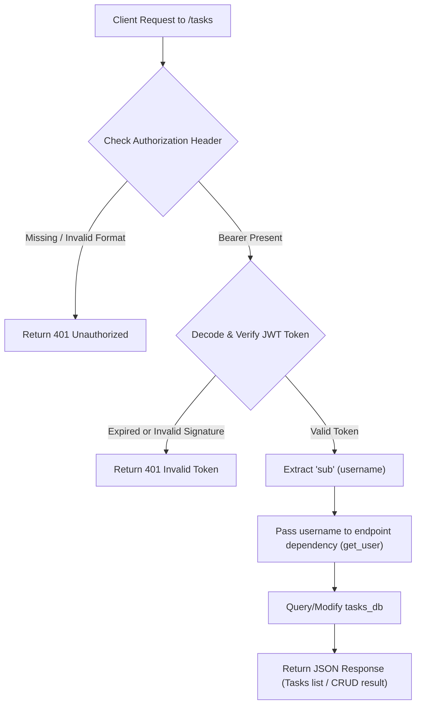

### 🎯 Learning Objectives
- Integrate multiple FastAPI components (validation, security, dependency injection, exception handling) into a single system.
- Secure API endpoints using JSON Web Tokens (JWT) authentication.
- Create custom Pydantic schemas to validate incoming client request bodies.
- Build reusable dependencies to extract, decode, and verify authentication tokens.
- Design comprehensive integration tests to verify the authentication and CRUD pipeline.

### 🧩 Core Concepts (Why)
In real-world software development, you rarely build features in isolation. A production-ready API requires several layers of cross-cutting concerns to work together seamlessly:
1. **Request Validation**: Ensuring client payloads are structured correctly before any business logic runs (using **Pydantic**).
2. **Security & Authentication**: Verifying who the client is and enforcing that only authorized users can access specific routes (using **JWT** and **OAuth2PasswordBearer**).
3. **Dependency Injection**: Decoupling authentication and validation logic from path operation functions, allowing you to secure routes with single, declarative statements (using **`Depends`**).
4. **Structured Error Handling**: Returning precise HTTP response status codes and clear details when authentication fails, data is invalid, or resources do not exist (using **`HTTPException`**).

This capstone pulls together these core components to construct a secure REST API for task management. Users must authenticate via a `/login` endpoint to obtain a token. This token must then be sent in the `Authorization` header of subsequent requests. The backend automatically extracts and verifies the token, handles decoding errors gracefully, and returns the requested resources only upon successful verification.

### 🔁 Logic and Operation

The following flowchart illustrates the secure API request-response lifecycle:



When the client makes a request to a protected endpoint like `GET /tasks`:
1. The request flows to the `OAuth2PasswordBearer` dependency, which searches for the `Authorization: Bearer <token>` header. If the header is missing, it automatically raises a 401 Unauthorized error.
2. The extracted token is passed to the custom dependency `get_user`.
3. The dependency decodes the token using the application's signature secret and algorithm.
4. If valid, the user's identity is extracted and passed to the route handler as an argument.
5. If decoding fails (due to token expiration, signature tampering, or invalid format), the dependency raises an `HTTPException(status_code=401)`.

### 📝 Annotated Examples

Below is a complete implementation of a secure REST API with Pydantic validation, JWT token signing, and dependency injection:

```python
import jwt
from fastapi import FastAPI, Depends, HTTPException, status
from fastapi.security import OAuth2PasswordBearer
from pydantic import BaseModel

# 1. Define signature secret and algorithm
SECRET = "capstone-secret-key"
ALGORITHM = "HS256"

app = FastAPI()

# 2. Define OAuth2 security scheme pointing to the login endpoint
oauth2_scheme = OAuth2PasswordBearer(tokenUrl="login")

# 3. Define Pydantic request models
class LoginRequest(BaseModel):
    username: str
    password: str

class TaskCreate(BaseModel):
    title: str

class Task(BaseModel):
    id: int
    title: str

# In-memory database simulation
tasks_db = []
task_id_counter = 1

# 4. Implement Login endpoint generating JWT token
@app.post("/login")
def login(req: LoginRequest):
    # Simulated credential check
    if req.username == "alice" and req.password == "password123":
        # Encode user identity into JWT payload
        token = jwt.encode({"sub": req.username}, SECRET, algorithm=ALGORITHM)
        return {"token": token, "token_type": "bearer"}
    
    raise HTTPException(
        status_code=status.HTTP_401_UNAUTHORIZED,
        detail="Incorrect username or password"
    )

# 5. Create dependency function to verify JWT and extract user
def get_user(token: str = Depends(oauth2_scheme)):
    try:
        # Decode and verify the token signature
        payload = jwt.decode(token, SECRET, algorithms=[ALGORITHM])
        user = payload.get("sub")
        if user is None:
            raise HTTPException(status_code=401, detail="Invalid token payload")
        return user
    except jwt.InvalidTokenError:
        raise HTTPException(
            status_code=status.HTTP_401_UNAUTHORIZED,
            detail="Invalid or expired token"
        )

# 6. Implement Protected endpoints using Depends(get_user)
@app.get("/tasks")
def get_tasks(user: str = Depends(get_user)):
    # Returns tasks database (only reached if user is authenticated)
    return tasks_db

@app.post("/tasks")
def create_task(task_in: TaskCreate, user: str = Depends(get_user)):
    global task_id_counter
    new_task = Task(id=task_id_counter, title=task_in.title)
    tasks_db.append(new_task.model_dump())
    task_id_counter += 1
    return new_task
```

### ❌ Common Mistakes

**Mistake 1: Hardcoding sensitive secrets inside the source code files in production**
```python
# Wrong: Storing security secret directly in the code
SECRET = "capstone"
```
```text
(Security vulnerability warning: hardcoded secrets detected in source file)
```
```python
# Correct: Retrieving configuration secrets from environment variables
import os
SECRET = os.getenv("JWT_SECRET_KEY", "default-fallback-insecure-dev-key")
```
> Hardcoding secret keys directly in the codebase makes them vulnerable to exposure if the code is committed to public version control systems (like GitHub). Anyone who obtains the secret can forge valid JWT tokens and bypass authentication entirely. Always read secrets from environment variables.

**Mistake 2: Failing to handle decoding exceptions raised by the JWT library**
```python
# Wrong: Decoding token without catching InvalidTokenError
def get_user(token: str = Depends(oauth2_scheme)):
    payload = jwt.decode(token, SECRET, algorithms=["HS256"])
    return payload["sub"]
```
```text
jwt.exceptions.DecodeError: Signature verification failed
```
```python
# Correct: Wrapping token decoding in try-except block and raising HTTPException
def get_user(token: str = Depends(oauth2_scheme)):
    try:
        payload = jwt.decode(token, SECRET, algorithms=["HS256"])
        return payload["sub"]
    except jwt.InvalidTokenError:
        raise HTTPException(status_code=401, detail="Invalid token")
```
> The `jwt.decode` function raises various exceptions (like `DecodeError` or `ExpiredSignatureError`) if the signature fails, the format is invalid, or the token is expired. Failing to catch these exceptions in your dependency function will cause them to bubble up to the ASGI server, crashing the request pipeline and returning an unhandled 500 Internal Server Error instead of a 401 Unauthorized client response.

### 💡 Tips & Idioms
- **Stateless Tokens**: JWTs are stateless, meaning the server does not need to look up a session database to verify user identity. All necessary assertions (identity, claims, expiry) are contained within the cryptographically signed payload.
- **Dependency Reusability**: You can define multiple authorization dependencies (e.g., `get_active_user`, `get_admin_user`) that build upon `get_user` to easily enforce different role permissions across your application.
- **Test Headers Prefix**: When querying protected endpoints with the `TestClient`, always include the `Authorization` header with the correct `Bearer ` prefix (e.g., `{"Authorization": f"Bearer {token}"}`).

### 🧠 Deep Dive (Under the hood)
<details><summary>JWT Signature Verification & Algorithm Security</summary>

A JSON Web Token consists of three parts separated by dots (`.`):
1. **Header**: Contains the type of token (JWT) and the signing algorithm (e.g., HS256).
2. **Payload**: Contains the claims (e.g., `sub` for subject, `exp` for expiration time).
3. **Signature**: Validates the authenticity of the token.

The signature is computed using the following pseudo-algorithm:
```text
Signature = HMAC-SHA256(base64UrlEncode(Header) + "." + base64UrlEncode(Payload), SECRET_KEY)
```
When a client sends the JWT to the server:
- The server splits the token into the three parts.
- The server computes a new signature using the received Header, received Payload, and the server's private `SECRET_KEY`.
- The server compares the computed signature with the Signature part provided in the token.
- If they match, the server knows the payload was not modified by the client or any middleman, and that the token was generated by someone possessing the `SECRET_KEY`.
- If the algorithms parameter is not specified or is dynamically read from the header (e.g., enabling the "none" algorithm), malicious clients can bypass signature verification entirely. Always specify allowed algorithms explicitly (e.g., `algorithms=["HS256"]`) when decoding.
</details>

### 🏋️ Exercise
Build a fully integrated REST API with Pydantic validation, ORM operations (simulated using lists), and JWT security. You must implement a `/login` endpoint that authenticates a user (`alice` / `password123`) and returns a JWT token, a `get_user` dependency function that extracts and validates the user identity, and a protected `GET /tasks` endpoint.

```python
import jwt
from fastapi import FastAPI, Depends, HTTPException, status
from fastapi.security import OAuth2PasswordBearer
from pydantic import BaseModel

# Implement full JWT authentication, pydantic validation, and simulated CRUD REST API endpoints.
```

### ✅ Self-Check
1. How does the server verify that the client has not tampered with the payload data inside a JWT token?
2. What is the role of `OAuth2PasswordBearer` in FastAPI dependency injection?
3. Why does the API return a 500 error instead of a 401 error if you do not handle `jwt.InvalidTokenError`?
<details><summary>Self-Check Answers</summary>

1. The server recalculates the signature using the received Header, Payload, and the server's secret key. If it matches the signature sent with the token, it proves the payload has not been tampered with.
2. `OAuth2PasswordBearer` is a class that informs FastAPI that a security scheme is in place. It automatically checks the request headers for an `Authorization` header containing a `Bearer <token>` value, extracts the token, and passes it to the dependency.
3. If an exception is raised in Python and not caught by a `try-except` block, it propagates up the call stack. Unhandled exceptions are caught by the FastAPI/Starlette framework's root handler, which assumes a server crash and returns a generic 500 Internal Server Error response.
</details>

### 📌 Summary
- **Capstone Integration**: Securing real APIs involves coordinating Pydantic schemas, dependency injection, and JWT signature verification.
- **JWT Verification**: Decoded using a secret key on the server to cryptographically verify client claims without database lookups.
- **Error Handling**: Custom exception handling inside dependencies ensures client errors return standard 401 codes instead of crashing the server (500).
- **Testing**: Using `TestClient` allows sending custom authentication headers to assert access control logic is working correctly.
