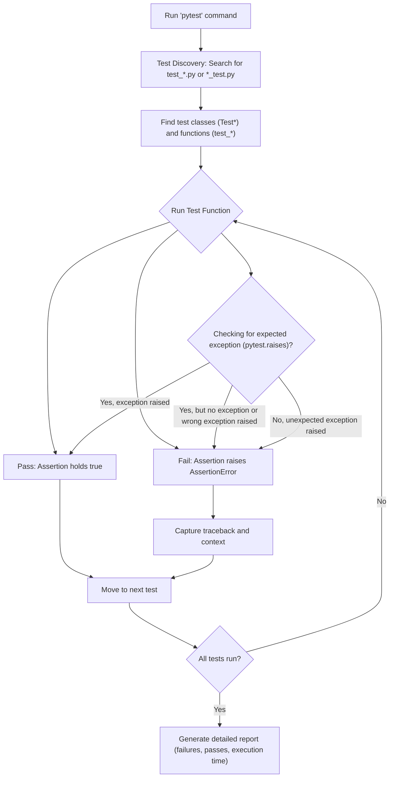

### 🎯 Learning Objectives
- Understand the benefits of automated testing and why `pytest` is widely preferred over Python's built-in `unittest` module.
- Run tests using the `pytest` command-line interface and understand automatic test discovery rules.
- Write standard test functions and use standard Python `assert` statements to verify behaviors.
- Leverage `@pytest.mark.parametrize` to run a single test function across multiple test inputs and outputs.
- Test failure conditions and assert that specific exceptions are raised using the `pytest.raises` context manager.

### 🧩 Core Concepts (Why)
Testing is an essential practice in professional software development. Automated tests verify that your application behaves correctly, prevent old bugs from returning (regressions), and provide safety nets when refactoring or extending code.

While Python's standard library includes the `unittest` framework, the open-source **`pytest`** library has become the industry standard. `pytest` is favored because:
1. **Simple Assertions**: Rather than memorizing specialized assertions like `self.assertEqual(a, b)` or `self.assertRaises(ValueError)`, you write standard Python `assert a == b`. `pytest` intercepts these calls and rewrites them under the hood to provide rich, detailed failure diagnostics.
2. **Automatic Test Discovery**: You do not need to register tests manually. Running the `pytest` command scans your workspace, collects all test files, and executes the tests automatically.
3. **Data-Driven Parameterization**: It simplifies testing multiple scenarios (success, edge cases, boundaries) by passing lists of inputs directly into a single test function, reducing duplicate test code.
4. **Contextual Exception Checking**: It provides clean context managers (`with pytest.raises(...)`) to assert that the code raises the correct errors under incorrect inputs.

### 🔁 Logic and Operation

The following flowchart illustrates how `pytest` executes test discovery, checks assertions, and generates the final test run report:



When you execute `pytest`:
1. It scans your directories recursively.
2. It targets files matching `test_*.py` or `*_test.py`.
3. Inside those files, it gathers functions prefixed with `test_` and classes prefixed with `Test`.
4. It executes each function. If an `AssertionError` or unhandled exception occurs, the test is marked as failed and `pytest` prints a detailed diff. If no exceptions occur, the test passes.

### 📝 Annotated Examples

Here is a simple python module `calculator.py` and its corresponding test suite `test_calculator.py`.

**`calculator.py`**
```python
def add(a, b):
    return a + b

def divide_numbers(a, b):
    if b == 0:
        raise ValueError("Cannot divide by zero.")
    return a / b
```

**`test_calculator.py`**
```python
import pytest
from calculator import add, divide_numbers

# 1. Standard unit test verifying a success path
def test_addition_simple():
    # A standard Python assert is all that is needed
    assert add(2, 3) == 5
    assert add(-1, 1) == 0

# 2. Testing error pathways using pytest.raises
def test_divide_by_zero_raises_error():
    # Tells pytest that the block must raise a ValueError
    with pytest.raises(ValueError) as exc_info:
        divide_numbers(10, 0)
    
    # We can also assert against the string representation of the exception
    assert str(exc_info.value) == "Cannot divide by zero."

# 3. Using parameterized testing to test multiple scenarios in a clean, DRY format
@pytest.mark.parametrize(
    "a, b, expected",
    [
        (6, 2, 3.0),
        (5, 2, 2.5),
        (-10, 2, -5.0),
        (0, 5, 0.0)
    ]
)
def test_divide_numbers_parameterized(a, b, expected):
    # This function will run 4 times, substituting a, b, and expected from the list above
    assert divide_numbers(a, b) == expected
```

### ❌ Common Mistakes

**Mistake 1: Naming the test file or test function incorrectly, which causes pytest to skip it**
```python
# Wrong: Filename is run_tests.py, and test function doesn't start with test_
def check_addition():
    assert add(2, 3) == 5
```
```text
collected 0 items

============================= no tests ran in 0.01s =============================
```
```python
# Correct: Filename is test_calculator.py, and function starts with test_
def test_addition():
    assert add(2, 3) == 5
```
> Pytest relies on strict naming conventions for automatic discovery. Test files must be named `test_*.py` or `*_test.py`, test classes must be named `Test*` (without an `__init__` constructor), and test functions must start with the prefix `test_`.

**Mistake 2: Forgetting to wrap exception-throwing code in a `pytest.raises` context block**
```python
# Wrong: Calling the exception-throwing function directly, causing the test itself to crash
def test_divide_by_zero_crash():
    divide_numbers(5, 0)  # This throws ValueError, crashing the test
```
```text
calculator.py:6: in divide_numbers
    raise ValueError("Cannot divide by zero.")
E   ValueError: Cannot divide by zero.

=========================== FAILURES ===========================
___________________________ test_divide_by_zero_crash ___________________________
...
```
```python
# Correct: Using pytest.raises context manager to assert the exception
def test_divide_by_zero_handled():
    with pytest.raises(ValueError):
        divide_numbers(5, 0)
```
> If a function throws an expected exception and you do not wrap it inside `with pytest.raises(ExceptionType):`, Python treats it as an unhandled error. This aborts the test function prematurely, marking the test as a failure.

### 💡 Tips & Idioms
- **Run specific tests**: You can run a single test function by specifying its path and name: `pytest test_calculator.py::test_addition_simple`.
- **String Filtering**: Run all tests that contain a specific substring in their name using the `-k` option: `pytest -k "divide"`.
- **Introspection Details**: If an assertion fails, `pytest` will show the evaluation of variables at each step of the expression. You do not need to print values manually to see what failed.
- **Fail Fast**: Use the `-x` flag to stop the test suite execution immediately on the first failure.

### 🧠 Deep Dive (Under the hood)
<details><summary>Pytest Assertion Rewriting</summary>

Standard Python `assert` statements only raise a generic `AssertionError` with no additional contextual details when they fail. So how does `pytest` display the values of all variables in a failed assert?

Pytest achieves this through **Assertion Rewriting**. Before executing your test files, `pytest` intercepts Python's import system using an import hook. When loading a test module, `pytest` parses its source code into an Abstract Syntax Tree (AST). 

It then traverses the AST and locates all `assert` nodes. It rewrites these nodes in memory, translating standard binary assertions into more complex bytecode statements that inspect and cache local variable values. 

For example, a statement like:
```python
assert x == y
```
is rewritten internally into a block that compiles to something similar to:
```python
if not (x == y):
    explanation = f"assert {x} == {y}"
    raise AssertionError(explanation)
```
This AST manipulation happens transparently in the background, only affecting test files matching the discovery pattern.
</details>

### 🏋️ Exercise
Implement a function named `divide(a, b)` that returns `a / b`. If the divisor `b` is `0`, raise a `ValueError` with an appropriate message. Write your function below.

```python
import pytest

# Implement function divide(a, b) that returns a / b, raising ValueError if b == 0.
```

### ✅ Self-Check
1. What naming convention must you follow so that `pytest` automatically finds and runs your tests?
2. How does using `@pytest.mark.parametrize` help make your test code cleaner?
3. How do you assert that a specific exception is raised by your code?
<details><summary>Self-Check Answers</summary>

1. Test files must match the glob patterns `test_*.py` or `*_test.py`. Test functions must start with the prefix `test_`, and test classes must be named `Test*` (without an `__init__` constructor).
2. It allows you to run the same test logic multiple times with different sets of inputs and expected outputs without duplicating the test function boilerplate.
3. You wrap the code executing the exception-throwing logic inside a `with pytest.raises(ExceptionClass):` context manager.
</details>

### 📌 Summary
- **Automated Testing**: Essential for verifying correctness, catching regressions, and facilitating safe refactoring.
- **Simple Assertions**: Pytest leverages the standard Python `assert` statement instead of legacy framework methods, making tests readable.
- **Test Discovery**: Automatic scanning of files matching `test_*.py` or `*_test.py` executing all `test_` prefixed functions.
- **Parameterization**: `@pytest.mark.parametrize` enables dry, data-driven tests running a single template function against collections of parameters.
- **Exception Checks**: `pytest.raises` intercepts and validates expected exceptions, preventing tests from failing on expected errors.
