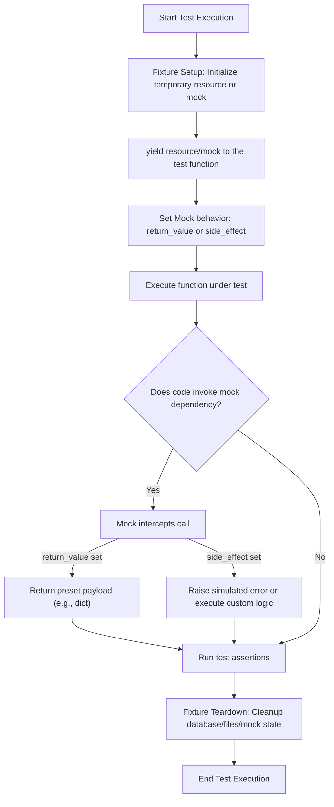

### 🎯 Learning Objectives
- Write reusable `pytest` fixtures using the `yield` statement to handle test setup and teardown tasks.
- Manage fixture scopes (`function`, `module`, etc.) to optimize execution speed while ensuring test isolation.
- Use `unittest.mock.MagicMock` to isolate components under test from external API calls and side-effects.
- Configure mock behaviors using `return_value` and `side_effect` to simulate success and failure execution paths.
- Leverage pytest's `monkeypatch` fixture and `unittest.mock.patch` context managers to dynamically replace attributes and environments.

### 🧩 Core Concepts (Why)
As applications grow, units of code rarely run in isolation. They interact with databases, read files, or communicate with external APIs. Testing code that depends on these side-effects introduces latency, complexity, and unpredictability into unit tests. 

To solve these problems, advanced testing relies on two main concepts:
1. **Fixtures**: A mechanism to provide a fixed, predictable baseline of resources (like a database connection, a temp folder, or preset mock configurations) before a test runs, and clean them up afterward. By separating setup/teardown logic from assertions, fixtures keep your tests DRY (Don't Repeat Yourself).
2. **Mocks**: Simulated objects that mimic the behavior of real dependencies in a controlled way. By replacing slow or unpredictable external resources (e.g. an HTTP client calling a third-party weather API) with a Mock, you can test how your code handles specific responses (like JSON payloads or HTTP timeouts) instantly and reliably.

`unittest.mock.MagicMock` is a subclass of `Mock` that automatically supports Python's magic methods (like checking `len()`, accessing indices `obj['key']`, or using `with` context managers), making it the default choice for mocking interfaces in Python.

### 🔁 Logic and Operation

The following flowchart illustrates the lifecycle of a test execution combining a pytest fixture (with setup and teardown phases) and a Mock dependency:



When executing a test with fixtures and mocks:
1. `pytest` identifies the fixtures requested in the test function's arguments.
2. The code inside the fixture runs up to the `yield` statement (the Setup phase).
3. The yielded resource (which can be a mock object) is injected into the test.
4. The test specifies what the mock should return (`return_value`) or throw (`side_effect`).
5. The function under test executes, calling the mock instead of real side-effects.
6. The test asserts the output.
7. Once the test exits, the fixture resumes execution after the `yield` statement to release resources (the Teardown phase).

### 📝 Annotated Examples

Here is a module `service.py` that depends on a database connection and a mail client, and its corresponding test file `test_service.py` showing fixtures, mocks, and monkeypatching.

**`service.py`**
```python
import os

class UserProcessor:
    def __init__(self, db_client, email_client):
        self.db = db_client
        self.email = email_client

    def process_user_registration(self, user_id, email_address):
        # 1. Check if user is active in DB
        user = self.db.find_user(user_id)
        if not user or not user.get("active"):
            return "User Not Eligible"
        
        # 2. Check environment flag via environment variable
        env = os.getenv("APP_ENV", "development")
        
        # 3. Send email and return status
        try:
            status = self.email.send(email_address, f"Welcome! Env: {env}")
            return "Success" if status else "Email Failed"
        except Exception:
            return "Notification System Error"
```

**`test_service.py`**
```python
import pytest
from unittest.mock import MagicMock, patch
from service import UserProcessor

# 1. Defining a fixture to initialize the processor with mocked dependencies
@pytest.fixture
def mock_dependencies():
    # Setup phase: Initialize MagicMocks for DB and Email clients
    db_mock = MagicMock()
    email_mock = MagicMock()
    
    # Yield the mocks as a dictionary to the test function
    yield {
        "db": db_mock,
        "email": email_mock
    }
    
    # Teardown phase: We can clean up records or reset mocks here if needed
    db_mock.reset_mock()
    email_mock.reset_mock()

# 2. Test case verifying the successful registration path using mock return values
def test_registration_success(mock_dependencies):
    db = mock_dependencies["db"]
    email = mock_dependencies["email"]
    
    # Configure mock responses using return_value
    db.find_user.return_value = {"id": 101, "active": True}
    email.send.return_value = True
    
    processor = UserProcessor(db, email)
    result = processor.process_user_registration(101, "test@example.com")
    
    assert result == "Success"
    # Verify that self.db.find_user was called exactly once with 101
    db.find_user.assert_called_once_with(101)

# 3. Test case verifying exception handling path using mock side_effect
def test_registration_email_throws_exception(mock_dependencies):
    db = mock_dependencies["db"]
    email = mock_dependencies["email"]
    
    db.find_user.return_value = {"id": 101, "active": True}
    
    # Configure mock to raise an exception using side_effect
    email.send.side_effect = Exception("SMTP server down")
    
    processor = UserProcessor(db, email)
    result = processor.process_user_registration(101, "test@example.com")
    
    assert result == "Notification System Error"

# 4. Using monkeypatch fixture to mock environment variables
def test_registration_with_monkeypatch(mock_dependencies, monkeypatch):
    db = mock_dependencies["db"]
    email = mock_dependencies["email"]
    
    db.find_user.return_value = {"id": 102, "active": True}
    email.send.return_value = True
    
    # Dynamically patch os.getenv to return "production" during this test
    monkeypatch.setenv("APP_ENV", "production")
    
    processor = UserProcessor(db, email)
    processor.process_user_registration(102, "prod@example.com")
    
    # Assert that the email client received the correct environment string
    email.send.assert_called_once_with("prod@example.com", "Welcome! Env: production")
```

### ❌ Common Mistakes

**Mistake 1: Shared mutable states across tests due to incorrect fixture scopes**
```python
# Wrong: Setting a module-level fixture scope that preserves modifications across tests
@pytest.fixture(scope="module")
def shared_list():
    yield []
```
```text
test_service.py:12: AssertionError: assert [1, 2] == [2]
```
```python
# Correct: Keep scope as "function" (default) so each test gets a clean, isolated list
@pytest.fixture(scope="function")
def clean_list():
    yield []
```
> If you set a fixture's scope to `module` or `session`, that fixture executes once for the entire file or session. If one test function mutates the yielded object (like inserting records into a database or appending to a list), subsequent tests will inherit that polluted state, leading to order-dependent test failures (flaky tests).

**Mistake 2: Storing an Exception instance in `return_value` instead of `side_effect` when trying to throw errors**
```python
# Wrong: The mock will return the exception object as a regular value instead of raising it
mock_email.send.return_value = Exception("SMTP Connection Failed")
```
```text
E   AssertionError: assert 'Success' == 'Notification System Error'
E     - Success
E     + Notification System Error
```
```python
# Correct: Use side_effect to instruct the mock to raise the exception object
mock_email.send.side_effect = Exception("SMTP Connection Failed")
```
> Setting `return_value = Exception()` tells Python to treat the Exception as a normal return value. The calling function will receive the Exception object as a variable (which evaluates to truthy), meaning no `try-except` block will catch it as a raised error. To simulate exceptions, you must use `side_effect`.

### 💡 Tips & Idioms
- **Mock call inspection**: Use `mock_obj.assert_called_once()` or `mock_obj.assert_called_with(*args, **kwargs)` to verify your functions interact with dependencies using the correct signatures.
- **Spec Mocking**: Use `spec=True` or `autospec=True` during patching. This ensures the mock raises an `AttributeError` if your test tries to call a method that does not exist on the real object, preventing mocks from getting out of sync with real code updates.
- **Local Patching**: When using `unittest.mock.patch`, patch the target where it is *imported*, not where it is *defined*. If `service.py` imports `from database import Client`, write `patch('service.Client')` instead of `patch('database.Client')`.

### 🧠 Deep Dive (Under the hood)
<details><summary>How pytest resolves and executes Fixture Dependency Injection</summary>

Pytest resolves dependencies using a Directed Acyclic Graph (DAG) construction algorithm.

When a test function is loaded:
1. Pytest examines the function's signature and extracts the names of its parameters (arguments).
2. It looks up registered fixtures matching those parameter names.
3. If a fixture itself requires other fixtures (nested dependencies), pytest recursively traverses these dependencies to build a DAG of fixture executions.
4. It resolves the execution order. If it detects a cycle (e.g. Fixture A depends on Fixture B, which depends on Fixture A), it aborts execution and throws a `FixtureLookupError`.
5. It executes the fixtures sequentially according to the graph. For each fixture:
   - It runs all statements up to the `yield` statement.
   - It caches the yielded object.
   - It passes the cached object to the dependent fixture or test.
6. Once the test function completes (or fails), pytest walks backward through the execution path. For each fixture that yielded a value, it executes the statements *after* the `yield` keyword in reverse order of initialization, ensuring safe teardown.
</details>

### 🏋️ Exercise
Write a function `fetch_data(api_client)` which calls `api_client.get()` and returns the `"data"` field from the response JSON dictionary. If `api_client.get()` raises an exception, handle it and return the string `"fallback"`.

```python
from unittest.mock import MagicMock

# Write fetch_data(api_client) which calls api_client.get() and returns the "data" field from response json.
# Handle exceptions by returning "fallback".
```

### ✅ Self-Check
1. How does the lifecycle of a fixture handle setup and teardown tasks using the `yield` keyword?
2. What is the difference between `return_value` and `side_effect` when configuring a mock?
3. What is the danger of using a `module` scope for fixtures that contain mutable states?
<details><summary>Self-Check Answers</summary>

1. Statements before the `yield` run during the setup phase. The object yielded is injected into the test. Statements after the `yield` run during the teardown phase after the test completes.
2. `return_value` defines a static return value when the mock is called. `side_effect` allows you to raise exceptions, return different values on consecutive calls, or execute a custom helper function.
3. The state can be modified by one test and leak into subsequent tests in the same module. This makes tests dependent on each other, causing flaky tests that fail depending on their execution order.
</details>

### 📌 Summary
- **Fixtures**: Simplify setup and teardown operations, creating clean, predictable states and maintaining DRY standards.
- **Fixture Scopes**: Ranging from `function` to `session`, they balance test performance with strict state isolation.
- **Mocking**: Replaces slow, unpredictable, or complex dependencies with dummy objects, ensuring test suites are fast and deterministic.
- **MagicMock**: Automatically simulates Python magic methods, making it highly effective at mocking APIs, indices, and contexts.
- **Interception utilities**: pytest's `monkeypatch` and `unittest.mock.patch` dynamically inject mock objects or configure environment variables without permanent codebase changes.
