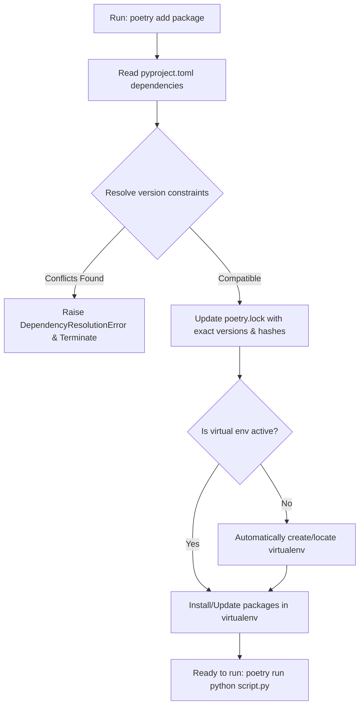

### 🎯 Learning Objectives
- Explain the architectural limitations of global pip installs and raw `requirements.txt` lists.
- Describe how virtual environments isolate project dependencies and avoid environment pollution.
- Write, configure, and maintain `pyproject.toml` metadata files to define package scopes.
- Apply Poetry commands (`init`, `add`, `install`, `run`, `build`) to manage project lifecycles.
- Manage dependency groups (`main` vs `dev`) to distinguish production runtimes from local dev environments.
- Explain the locking mechanism of `poetry.lock` and how it guarantees reproducible builds across machines.

### 🧩 Core Concepts (Why)
In modern software development, applications depend on third-party libraries. Managing these libraries effectively is critical for project stability and developer productivity.

#### 1. Pip Limitations and Global Environments
By default, Python's package manager (`pip`) installs packages globally or user-wide. If two projects require different versions of the same package (e.g., Project A needs `Django==3.2` and Project B needs `Django==4.2`), they cannot coexist in the same environment. Installing one will overwrite the other.

To solve this, developers historically used a `requirements.txt` file along with manual virtual environments. However, `requirements.txt` has severe issues:
- **No Lockfile**: It lists top-level dependencies, but doesn't lock transitive dependencies (dependencies of dependencies). If a sub-dependency releases a breaking update, your build will fail.
- **Flat Namespace**: It mixes packages you chose intentionally with packages installed automatically as sub-dependencies.
- **No Integrity Verification**: It does not record package hashes, making builds vulnerable to source manipulation.

#### 2. Virtual Environments
A virtual environment is a self-contained directory tree that contains a Python installation for a particular version of Python, plus a number of additional packages. It isolates your project dependencies from other projects and the system-wide Python.

#### 3. What Poetry Resolves
Poetry is a modern tool for dependency management and packaging in Python. It replaces `pip`, `virtualenv`, `setup.py`, and `requirements.txt` with a unified workflow.
- **Deterministic Resolution**: It uses a advanced conflict solver to find compatible versions for all dependencies.
- **Strict Locking**: It generates a `poetry.lock` file containing the exact versions and cryptographic hashes of all packages.
- **Single Source of Truth**: All configurations, metadata, dependencies, and build scripts are stored in a standard file named `pyproject.toml`.

### 🔁 Logic and Operation

The flowchart below demonstrates the workflow of adding a dependency using Poetry and how the environment is managed:



When you use Poetry:
1. You run a command (like `poetry add fastapi`).
2. Poetry parses version requirements from `pyproject.toml` and checks for conflicts across all dependencies.
3. If valid, Poetry downloads the files, computes their hashes, and stores the details in `poetry.lock`.
4. It checks for a virtual environment. If none exists, Poetry automatically creates one in its cache directory (or in your project folder, if configured).
5. It installs the exact versions recorded in the lock file to the virtual environment.

### 📝 Annotated Examples

#### 1. Standard `pyproject.toml` Layout
Here is an annotated example of a modern Poetry configuration file:

```toml
[tool.poetry]
name = "my-awesome-app"
version = "0.1.0"
description = "A FastAPI application with dependency management"
authors = ["Your Name <you@example.com>"]
readme = "README.md"
packages = [{include = "my_awesome_app"}] # Defines the packages to be distributed

[tool.poetry.dependencies]
python = "^3.10" # Requires Python version >= 3.10 and < 4.0
fastapi = "^0.100.0" # Installs FastAPI >=0.100.0 and <0.101.0 (semantic versioning)
uvicorn = {extras = ["standard"], version = "^0.22.0"} # Dependency with optional features

[tool.poetry.group.dev.dependencies]
# Dependencies only required during development or testing
pytest = "^7.4.0"
black = "^23.7.0"
httpx = "^0.24.1"

[build-system]
# Declares the PEP 517 build backend (how Python installs the package)
requires = ["poetry-core"]
build-backend = "poetry.core.masonry.api"
```

#### 2. Essential Command Walkthrough

To create a new project structure:
```bash
poetry new my-project
```

To initialize Poetry inside an existing project:
```bash
poetry init
```
*This starts an interactive prompt that guides you through creating the `pyproject.toml` file.*

To add a production dependency:
```bash
poetry add requests
```

To add a development-only dependency:
```bash
poetry add pytest --group dev
```

To execute a script within the virtual environment context (without manually activating it):
```bash
poetry run python main.py
```

To manually spawn a shell within the virtual environment:
```bash
poetry shell
```

To install all dependencies declared in `poetry.lock` (perfect for cloning a repo onto a new machine):
```bash
poetry install
```

To package your project into distribution-ready wheels and source archives:
```bash
poetry build
```

### ❌ Common Mistakes

**Mistake 1: Using relative path hacks from `__file__` to read package resources in a distributed Poetry package**
```python
# my_package/reader.py
import os
def read_config():
    # Fails when installed as a wheel in some environments or zip imports
    config_path = os.path.join(os.path.dirname(__file__), "data/config.json")
    with open(config_path, "r") as f:
        return f.read()
```
```text
Traceback (most recent call last):
  File "reader.py", line 5, in read_config
FileNotFoundError: [Errno 2] No such file or directory: '/usr/local/lib/python3.10/site-packages/my_package/data/config.json'
```
```python
# my_package/reader.py
from importlib import resources
def read_config():
    # Correctly accesses package resource files across all distribution types
    return resources.files("my_package").joinpath("data/config.json").read_text()
```
> Using file-system paths like `__file__` assumes the package is installed as an unzipped directory on the disk. When packages are compiled into wheels or zipped distributions, or run in certain sandboxes, direct file system access will fail. The `importlib.resources` library is the standard modern Python way to read package data files safely.

**Mistake 2: Using manual `sys.path.append` hacks to import local package files during testing**
```python
# tests/test_core.py
import sys
import os
# Hack to import local src code
sys.path.append(os.path.abspath("../src"))
import my_package
```
```text
Traceback (most recent call last):
  File "test_core.py", line 5, in <module>
    import my_package
ModuleNotFoundError: No module named 'my_package'
```
```python
# tests/test_core.py
# No sys.path hacks needed. Run `poetry install` to install in editable mode.
import my_package
```
> Hardcoding `sys.path.append` hacks makes your codebase brittle and environment-dependent. Poetry solves this by installing the package in editable mode (`poetry install`), allowing you to import your package and modules seamlessly during development and testing from any directory.

### 💡 Tips & Idioms
- **In-Project Virtual Environments**: Tell Poetry to create virtual environments inside your project directory under `.venv` instead of its central cache directory. This makes it easier for IDEs (like VS Code) to auto-detect the interpreter.
  ```bash
  poetry config virtualenvs.in-project true
  ```
- **Commit your Lockfile**: Always commit `poetry.lock` to git. This guarantees that your team, CI/CD runners, and deployment servers install the exact same dependency tree.
- **Exporting dependencies**: If you need to generate a `requirements.txt` for platforms that do not support Poetry directly (like legacy Elastic Beanstalk), export it using:
  ```bash
  poetry export -f requirements.txt --output requirements.txt
  ```

### 🧠 Deep Dive (Under the hood)
<details><summary>How Poetry's PubGrub Algorithm Resolves Dependency Versions</summary>

Poetry uses a version of the **PubGrub** algorithm for dependency resolution. Unlike simple resolvers that recursively look up packages and fail on first version mismatches, PubGrub operates on the concept of **conflict resolution through backtrack-free search** and **derivation**.

When you request packages:
1. **Constraint Compilation**: Poetry reads constraints from `pyproject.toml` and queries package repositories (like PyPI) to obtain a graph of packages, their versions, and their dependencies.
2. **Decision Making**: It makes decisions by selecting a package, choosing its latest compatible version, and adding its dependencies to the queue.
3. **Conflict Detection**: If a contradiction occurs (e.g., package A needs `urllib3 >= 2.0` but package B needs `urllib3 < 2.0`), PubGrub does not just throw an error.
4. **Derivation**: It traces the chain of choices that led to the conflict. It derives a "cause" (a logical proof showing why the current set of decisions is invalid).
5. **Backtracking**: It rolls back only the decisions related to that cause and registers the conflict cause as a new constraint. This prevents the solver from evaluating the same dead-ends again, dramatically speeding up resolution times and providing clear, actionable error messages when conflict resolutions fail.
</details>

### 🏋️ Exercise
Write a function `validate_poetry_config(config_text)` that parses a `pyproject.toml` config text. Return `True` if it contains the dependencies section `[tool.poetry.dependencies]` and declares a `python` version, and `False` otherwise.

```python
# Write a parser that checks a pyproject.toml config text.
# Return True if [tool.poetry.dependencies] exists and contains "python" version declaration.
def validate_poetry_config(config_text):
    pass
```

### ✅ Self-Check
1. Why should you always commit `poetry.lock` to source control?
2. What command allows you to execute commands in the virtual environment without running `poetry shell`?
3. How do you declare a package as a development-only dependency in `pyproject.toml`?
<details><summary>Self-Check Answers</summary>

1. Committing `poetry.lock` ensures that every developer, test suite, and deployment environment installs the exact same packages, protecting against version drift and unexpected transitive dependency updates.
2. You can use the `poetry run <command>` syntax (e.g., `poetry run python main.py` or `poetry run pytest`).
3. You add it under the `[tool.poetry.group.dev.dependencies]` section, or run the CLI command `poetry add <package> --group dev`.
</details>

### 📌 Summary
- **Pip Limitations**: Global installations cause version collisions. `requirements.txt` fails to lock sub-dependencies.
- **Poetry**: A comprehensive package and dependency manager that unifies package metadata, isolation, and publishing.
- **pyproject.toml**: The single configuration file format defined by PEP 518/621 containing metadata and dependencies.
- **poetry.lock**: Cryptographically locks the dependency graph to guarantee reproducible builds across environments.
- **Command Basics**: `poetry init` configures a project; `poetry add` modifies dependencies; `poetry install` restores them; `poetry run` executes code within the environment context.
