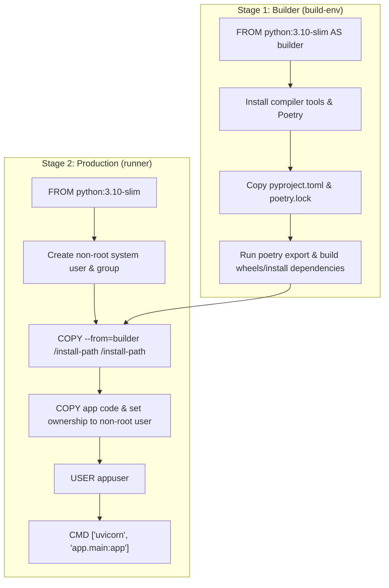

### 🎯 Learning Objectives
- Explain the architectural differences between virtual machines and containers.
- Evaluate and select appropriate Python base images (default, slim, alpine) based on project needs.
- Author secure, production-grade `Dockerfile` scripts for Python web services.
- Implement multi-stage builds to optimize image sizes and reduce production security vulnerabilities.
- Configure containers to run securely under non-root contexts using the `USER` instruction.
- Coordinate multi-container architectures (Python web app + Database) using `docker-compose.yml`.

### 🧩 Core Concepts (Why)
As software systems grow in complexity, the phrase "it works on my machine" becomes a significant bottleneck. Differences in operating systems, system libraries, and local configurations cause subtle bugs. Containerization solves this by packaging an application and all its dependencies together into a standardized unit.

#### 1. Containers vs. Virtual Machines
- **Virtual Machines (VMs)**: Package the application, necessary binaries, and an *entire guest operating system*. They run on top of a hypervisor, which emulates hardware. VMs are heavy (gigabytes in size), slow to boot (minutes), and consume substantial CPU and RAM overhead.
- **Containers**: Share the host operating system's kernel. They use Linux kernel features called **namespaces** (to isolate process trees, network adapters, mount points, etc.) and **control groups (cgroups)** (to limit resources like CPU and memory). Containers are extremely lightweight (megabytes in size), boot almost instantly (seconds), and have near-zero performance overhead.

#### 2. Base Image Strategy
When writing a `Dockerfile` for Python, your choice of base image dictates performance, size, and compilation compatibility:
- `python:3.10`: Built on Debian. Includes a full suite of build tools, compilers (like GCC), and development headers. It is large (~900MB), which increases deployment times.
- `python:3.10-slim`: Built on Debian but stripped of build-essential toolchains and unnecessary packages. It is lightweight (~120MB) and highly recommended for production applications that do not require on-the-fly C compilations.
- `python:3.10-alpine`: Built on Alpine Linux. It is tiny (~50MB) and uses `musl libc` instead of GNU C Library (`glibc`). While appealing, Alpine can make installing packages with C-extensions (like `numpy`, `pandas`, or `cryptography`) extremely slow because pre-compiled Python wheels are typically built for `glibc`. Alpine must compile these packages from source, which requires installing heavy compilers anyway.

#### 3. Multi-Stage Builds
In standard builds, you need compilers (like GCC) and package managers (like Poetry) to fetch and build dependencies. If you keep these build tools in your final image, you bloat the size and expose your production runtime to security threats (compilers make it easier for attackers to execute exploits if the container is compromised).

A **multi-stage build** uses multiple `FROM` instructions in a single `Dockerfile`. You compile your app in the first stage ("builder"), and then copy *only* the compiled artifacts (wheels, libraries, site-packages) into the second stage ("runner"). The compiler tools are left behind, producing a small and highly secure production image.

#### 4. Non-Root Execution
By default, Docker container processes execute as the `root` user (administrator). If an attacker exploits a remote code execution vulnerability in your application, they gain root access *inside* the container, which increases the likelihood of breaking out of the container and compromising the host system. Declaring a non-privileged `USER` limits the damage an attacker can do.

### 🔁 Logic and Operation

The flowchart below demonstrates the pipeline of a multi-stage Docker build, separating the development/compiler tools from the clean production runner environment:



In a multi-stage build:
1. Docker starts Stage 1, installing build dependencies (e.g. compilers and package manager).
2. The dependencies are compiled or built into a local folder (e.g., Python site-packages).
3. Docker starts Stage 2 using a fresh, clean base image.
4. A non-root system user and group are created inside Stage 2.
5. The compiled dependencies (and only the dependencies) are copied from Stage 1 into Stage 2.
6. The application source code is copied, directory ownership is adjusted, and the user context switches to the non-root user.
7. The container executes, secure and lightweight.

### 📝 Annotated Examples

#### 1. Secure, Multi-Stage `Dockerfile` using Poetry
Here is a production-ready `Dockerfile` implementing the multi-stage pattern and non-root execution:

```dockerfile
# --- Stage 1: Build & Compile dependencies ---
FROM python:3.10-slim AS builder

WORKDIR /app

# Install build dependencies required for compiling C-extensions
RUN apt-get update && apt-get install -y --no-install-recommends \
    build-essential \
    && rm -rf /var/lib/apt/lists/*

# Install Poetry for dependency management
RUN pip install --no-cache-dir poetry

COPY pyproject.toml poetry.lock ./

# Export to standard requirements.txt and compile dependencies into user space
RUN poetry export --without-hashes -f requirements.txt --output requirements.txt \
    && pip install --no-cache-dir --user -r requirements.txt

# --- Stage 2: Final lightweight runner image ---
FROM python:3.10-slim AS runner

WORKDIR /app

# Create a system group and user to run the application safely
RUN groupadd -r appgroup && useradd -r -g appgroup -d /home/appuser -m appuser

# Copy only the pre-compiled user packages from the builder stage
COPY --from=builder /root/.local /home/appuser/.local
COPY . .

# Adjust folder permissions so the non-root user can read files
RUN chown -R appuser:appgroup /app

# Add local packages to the PATH variable
ENV PATH=/home/appuser/.local/bin:$PATH
ENV PYTHONUNBUFFERED=1

# Switch security context to the non-root user
USER appuser

EXPOSE 8080

CMD ["uvicorn", "main:app", "--host", "0.0.0.0", "--port", "8080"]
```

#### 2. Orchestration with `docker-compose.yml`
Here is a companion `docker-compose.yml` configuration mapping the web application to a PostgreSQL database on an isolated bridged network:

```yaml
version: '3.8'

services:
  web:
    build: 
      context: .
      dockerfile: Dockerfile
    ports:
      - "8080:8080" # Maps port 8080 on the host to port 8080 in the container
    environment:
      - DB_HOST=db # Connects to PostgreSQL container using Docker's internal DNS
      - DB_PORT=5432
      - DB_USER=postgres
      - DB_PASSWORD=secret
    depends_on:
      - db # Ensures DB starts before the web application container starts

  db:
    image: postgres:15-alpine
    environment:
      - POSTGRES_DB=mydb
      - POSTGRES_USER=postgres
      - POSTGRES_PASSWORD=secret
    volumes:
      - pgdata:/var/lib/postgresql/data # Persists database records on host machine

volumes:
  pgdata: # Declares a persistent volume for storage survival across container lifecycles
```

### ❌ Common Mistakes

**Mistake 1: Running a web server inside a Docker container on port 80 as a non-root user**
```python
# app.py
# Running as a non-root USER in the Dockerfile
from http.server import HTTPServer, SimpleHTTPRequestHandler
server = HTTPServer(("0.0.0.0", 80), SimpleHTTPRequestHandler)
server.serve_forever()
```
```text
Traceback (most recent call last):
  File "app.py", line 4, in <module>
    server = HTTPServer(("0.0.0.0", 80), SimpleHTTPRequestHandler)
PermissionError: [Errno 13] Permission denied
```
```python
# app.py
# Running as a non-root USER on an unprivileged port (8080)
from http.server import HTTPServer, SimpleHTTPRequestHandler
server = HTTPServer(("0.0.0.0", 8080), SimpleHTTPRequestHandler)
server.serve_forever()
```
> In Linux, binding to ports below 1024 (privileged ports) requires root privileges. When adhering to security best practices by running your container under a non-root user (e.g. using `USER appuser`), the application must bind to an unprivileged port like 8080 and then be mapped to port 80 at the host level.

**Mistake 2: Hardcoding local loopback IP 127.0.0.1 for database connections inside a container**
```python
# db.py
import psycopg2
# Hardcoding local loopback IP which resolves inside the container itself, not the host database
conn = psycopg2.connect(host="127.0.0.1", database="mydb", user="postgres")
```
```text
Traceback (most recent call last):
  File "db.py", line 4, in <module>
    conn = psycopg2.connect(host="127.0.0.1", ...)
psycopg2.OperationalError: connection to server at "127.0.0.1", port 5432 failed: Connection refused
```
```python
# db.py
import os
import psycopg2
# Load the database host name from environment variable or docker-compose service name
db_host = os.getenv("DB_HOST", "db")
conn = psycopg2.connect(host=db_host, database="mydb", user="postgres")
```
> Inside a container, `127.0.0.1` refers to the container itself, not the host machine or another container running the database. In a Docker bridged network, containers must connect to each other using the service names resolved by Docker's built-in DNS (e.g. `db`), or configure the network to fetch the correct host from an environment variable.

### 💡 Tips & Idioms
- **Optimize Docker Cache Layers**: Docker caches image build layers. Order instructions from *least frequently changed* to *most frequently changed*.
  - *Bad*: Copying source code (`COPY . .`) *before* installing dependencies (`pip install`). Any source code change invalidates all subsequent steps, forcing dependencies to re-install.
  - *Good*: Copy dependency lists, install packages, and then copy source code.
- **Use `.dockerignore`**: Create a `.dockerignore` file in your root to block uploading large or sensitive directories (like `.venv/`, `.git/`, `__pycache__/`, and `.env` files) into the Docker build context.
- **Pin Base Images**: Never build production containers using `FROM python:latest` or `FROM python:3.10`. Minor version changes can break configurations. Always pin specific versions (e.g., `FROM python:3.10.12-slim`).

### 🧠 Deep Dive (Under the hood)
<details><summary>How Linux Namespaces and Control Groups (Cgroups) Isolate Containers</summary>

Unlike virtual machines that rely on hypervisors to simulate physical hardware, Docker containers run natively on the host Linux kernel. Isolation is achieved at the operating system level using two main kernel features:

#### 1. Linux Namespaces (Virtualizing Resources)
Namespaces wrap a global system resource in an abstraction that makes it appear to the processes within the namespace that they have their own isolated instance of the resource.
- **PID Namespace**: Isolates process ID numbers. The application running inside the container thinks it is Process ID 1, while on the host machine, it is just a normal high-numbered process (e.g. PID 48210).
- **NET Namespace**: Isolates network controllers, routing tables, and ports. Each container gets its own virtual loopback interface and IP addresses.
- **MNT Namespace**: Isolates filesystem mount points. The container sees only its own filesystem mount, blind to the host's root system.
- **UTS Namespace**: Isolates hostname and NIS domain name.
- **IPC Namespace**: Isolates Inter-Process Communication resources.
- **USER Namespace**: Maps user IDs. User ID 0 (root) inside the container can be mapped to an unprivileged user ID on the host, preventing host root access even during container escapes.

#### 2. Control Groups / Cgroups (Limiting Resources)
While namespaces prevent containers from *seeing* each other, **cgroups** prevent containers from *exhausting* the host's resources. Cgroups allocate and monitor hardware resource consumption:
- Limits maximum memory allocation (e.g., stopping a memory-leaking container before it triggers the host's Out-Of-Memory killer).
- Restricts CPU core utilization and execution cycles.
- Caps disk input/output (I/O) read/write speeds.
- Measures and audits network traffic per container.
</details>

### 🏋️ Exercise
Write a validation script that parses a `Dockerfile` string. Ensure the `Dockerfile` contains a `USER` instruction to execute processes as a non-root user (security protection). Return `True` if it contains a `USER` statement, and `False` otherwise.

```python
# Write a validation script that parses a Dockerfile string.
# Ensure the Dockerfile has a USER statement to execute as non-root user (security).
def validate_dockerfile(dockerfile_text):
    pass
```

### ✅ Self-Check
1. Why does running a web server inside a container on port 80 fail when the Dockerfile specifies a non-root user like `USER appuser`?
2. What are the pros and cons of using a `python:3.10-alpine` image over `python:3.10-slim`?
3. How do you prevent local development folders like `__pycache__` and `.git` from being sent to the Docker daemon during building?
<details><summary>Self-Check Answers</summary>

1. In Linux-based operating systems, only the root user can bind to privileged ports below 1024. Running under a non-root user requires binding to an unprivileged port (e.g., 8080) and mapping it to port 80 at the host level using Docker.
2. `alpine` is smaller (50MB vs 120MB), but it uses `musl libc` instead of `glibc`. Packages requiring C compilation (like `numpy` or `cryptography`) cannot use pre-built wheels and must compile from source, which takes a long time and requires installing compiler tools. `slim` is highly compatible and faster for installations.
3. You write them in a `.dockerignore` file located in the same directory as the `Dockerfile`.
</details>

### 📌 Summary
- **Containers**: Share the host OS kernel, using namespaces and cgroups for lightweight isolation, unlike VMs which run full guest OSes.
- **Base Images**: Prefer `slim` over `default` (for size) and `alpine` (for compatibility with pre-built C wheels).
- **Multi-Stage Builds**: Optimize sizes and security by building dependencies in a build stage and copying only raw artifacts to a runner stage.
- **Non-Root USER**: Enforces security boundaries by preventing container exploits from accessing the host kernel as root.
- **Docker Compose**: Simplifies multi-container setup by declaring applications, networks, and databases in a single YAML file.
