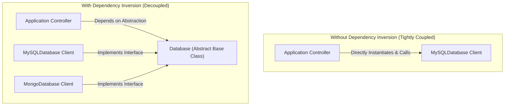

### 🎯 Learning Objectives
- Define the 5 SOLID software design principles and explain their impact on codebase maintainability.
- Apply the Single Responsibility Principle (SRP) to decompose large classes into cohesive units.
- Design open-to-extension, closed-to-modification systems (OCP) using Python's Abstract Base Classes (ABC).
- Validate class hierarchies against the Liskov Substitution Principle (LSP) to prevent runtime type errors.
- Segregate bloated interfaces into narrow, client-specific contracts (ISP) using multiple inheritance.
- Deconstruct tightly coupled systems into decoupled architectures using the Dependency Inversion Principle (DIP).

### 🧩 Core Concepts (Why)
Writing code that works is only the first step. As systems evolve, software must be easily readable, maintainable, and adaptable to change. Without structured guidelines, codebases suffer from **rigidity** (hard to change), **fragility** (changes break unrelated parts), and **immobility** (hard to reuse). 

The **SOLID** principles, introduced by Robert C. Martin (Uncle Bob), are five design guidelines that combat these issues:

#### 1. Single Responsibility Principle (SRP)
*A class should have one, and only one, reason to change.*
- **Analogy**: A professional chef only cooks food. They do not clean tables, handle payments, or manage building security. If you need to change how security is managed, the chef's job description should remain unaffected.
- **Python context**: Instead of a "God Class" that manages database access, formats data, and sends emails, write three focused classes.

#### 2. Open/Closed Principle (OCP)
*Software entities (classes, modules, functions) should be open for extension, but closed for modification.*
- **Analogy**: A wall outlet. You can plug in any electrical appliance (extension) without breaking open the wall to rewire the building (modification).
- **Python context**: Instead of using long `if/elif` chains checking data types to alter behavior, use polymorphism and Abstract Base Classes (ABCs).

#### 3. Liskov Substitution Principle (LSP)
*Subtypes must be completely substitutable for their base types without breaking client execution.*
- **Analogy**: A toy duck. If it looks like a duck and quacks like a duck, but needs batteries to run, it cannot replace a real living duck in an ecosystem without causing errors.
- **Python context**: Subclasses must not narrow parameter types, widen return types, or raise undocumented exceptions that aren't defined by the parent class.

#### 4. Interface Segregation Principle (ISP)
*Clients should not be forced to depend on interfaces they do not use.*
- **Analogy**: A multi-function printer with print, scan, and fax. A user who only wants to print shouldn't need to understand or configure scanning modules.
- **Python context**: Since Python doesn't have native `interface` keywords, we use small, focused Abstract Base Classes. A class can inherit from multiple specific ABCs rather than one bloated interface.

#### 5. Dependency Inversion Principle (DIP)
*High-level modules should not depend on low-level modules. Both should depend on abstractions.*
- **Analogy**: Your computer's USB port. The motherboard (high-level) doesn't know details about a flash drive or a keyboard (low-level). Both conform to the USB protocol (abstraction).
- **Python context**: Inject abstract dependencies into a class constructor instead of instantiating concrete database or API clients inside the class.

### 🔁 Logic and Operation

The flowchart below demonstrates the difference in system coupling before and after applying the Dependency Inversion Principle:



In the decoupled design:
1. The `Application Controller` depends only on the contract defined by `Database (ABC)`.
2. Different database engines implement this contract.
3. Swapping database technologies requires zero changes to the `Application Controller` code.

### 📝 Annotated Examples

Here is a comprehensive notification and user management system designed using SOLID principles:

```python
from abc import ABC, abstractmethod

# --- 1. Interface Segregation Principle (ISP) ---
# We define distinct, single-purpose interfaces rather than one monolithic interface.

class Sender(ABC):
    @abstractmethod
    def send(self, recipient: str, message: str) -> None:
        pass

class Logger(ABC):
    @abstractmethod
    def log_status(self, message: str) -> None:
        pass

# --- 2. Open/Closed Principle (OCP) & Dependency Inversion Principle (DIP) ---
# Concrete notification systems implement the Sender abstraction.

class EmailSender(Sender):
    def send(self, recipient: str, message: str) -> None:
        # Simulate sending an email
        print(f"Email sent to {recipient}: {message}")

class SMSSender(Sender):
    def send(self, recipient: str, message: str) -> None:
        # Simulate sending an SMS
        print(f"SMS sent to {recipient}: {message}")

# --- 3. Single Responsibility Principle (SRP) ---
# Each class has a single responsibility: User holds data, UserNotifier handles messages, SystemLogger handles logs.

class User:
    def __init__(self, username: str, email: str, phone: str):
        self.username = username
        self.email = email
        self.phone = phone

class ConsoleLogger(Logger):
    def log_status(self, message: str) -> None:
        print(f"[LOG]: {message}")

class UserNotifier:
    # DIP: We inject the abstractions (Sender and Logger), not concrete implementations.
    def __init__(self, sender: Sender, logger: Logger):
        self.sender = sender
        self.logger = logger

    def notify_user(self, user: User, message: str) -> None:
        # LSP: We can substitute EmailSender or SMSSender safely.
        self.logger.log_status(f"Attempting notification to {user.username}")
        
        # Decide which communication channel to use based on target information
        if "@" in user.email:
            self.sender.send(user.email, message)
        else:
            self.sender.send(user.phone, message)
            
        self.logger.log_status("Notification process complete")

# --- Verification of execution ---
if __name__ == "__main__":
    # Setup dependencies
    email_channel = EmailSender()
    logger_service = ConsoleLogger()
    
    # Inject dependencies into high-level orchestrator
    notifier = UserNotifier(sender=email_channel, logger=logger_service)
    
    user = User("alice_dev", "alice@example.com", "+1234567890")
    notifier.notify_user(user, "Welcome to SOLID Python design!")
```

### ❌ Common Mistakes

**Mistake 1: Violating abstract interfaces by calling subclass-specific methods**
```python
# Wrong: Directly invoking class-specific methods instead of using abstract interface
class PaymentManager:
    def process_payment(self, processor, amount):
        # Assumes processor is always PaypalProcessor
        processor.make_paypal_charge(amount)
```
```text
Traceback (most recent call last):
  File "main.py", line 4, in process_payment
    processor.make_paypal_charge(amount)
AttributeError: 'StripeProcessor' object has no attribute 'make_paypal_charge'
```
```python
# Correct: Use the abstract method defined in interface PaymentProcessor
class PaymentManager:
    def process_payment(self, processor: PaymentProcessor, amount: float):
        processor.process(amount)
```
> By calling subclass-specific methods (`make_paypal_charge`) directly instead of relying on the abstract interface (`process`), the calling class becomes highly coupled to concrete subclasses. When a new payment processor is added, it will raise an `AttributeError` at runtime, violating the Dependency Inversion and Open/Closed principles.

**Mistake 2: Violating LSP by altering method signatures in subclasses**
```python
class BasicStorage:
    def save(self, data: str) -> None:
        print(f"Saved: {data}")

class SecureFileStorage(BasicStorage):
    # Violates LSP: Changing method signature by adding a required parameter
    def save(self, data: str, encryption_key: str) -> None:
        print(f"Encrypted and saved with {encryption_key}: {data}")
```
```text
Traceback (most recent call last):
  File "main.py", line 8, in <module>
    storage.save("Confidential Data")
TypeError: save() missing 1 required positional argument: 'encryption_key'
```
```python
class BasicStorage:
    def save(self, data: str) -> None:
        print(f"Saved: {data}")

class SecureFileStorage(BasicStorage):
    def __init__(self, encryption_key: str):
        self.encryption_key = encryption_key

    # Keeps base class signature intact
    def save(self, data: str) -> None:
        print(f"Encrypted and saved with {self.encryption_key}: {data}")
```
> Changing a method's parameters in a subclass breaks client code that expects the base class interface. All subclass-specific dependencies (such as keys, files, or connections) should be injected via the constructor (`__init__`), leaving overridden methods matching the parent class signature.

### 💡 Tips & Idioms
- **Keep ABCs Minimal**: Do not pack dozens of methods into a single Abstract Base Class. A design with single-method ABCs (e.g. `Renderable`, `Serializable`) conforms best to both ISP and SRP.
- **Duck Typing vs. ABCs**: While Python does not enforce interface implementation at runtime unless using ABCs, you should explicitly inherit from `abc.ABC` in large projects to enable robust static analysis with `mypy` and clarify intent for other developers.
- **Avoid Premature Optimization**: Do not apply SOLID patterns to trivial code. Refactoring is a response to growth. Only abstract when you anticipate writing multiple concrete implementations of a subsystem.

### 🧠 Deep Dive (Under the hood)
<details><summary>Metaclass Interception: How CPython Enforces Abstract Base Classes</summary>

In Python, abstract base classes are not built-in primitives like in Java or C#. Instead, they are implemented dynamically using Python's metaclass system. 

When you define a class that inherits from `abc.ABC`, it sets `ABCMeta` as its metaclass:

```python
class ABC(metaclass=ABCMeta):
    __slots__ = ()
```

During class creation, the `ABCMeta` metaclass scans the class dictionary for functions decorated with `@abstractmethod`. It registers these method names inside a internal set named `__abstractmethods__`.

When a client tries to instantiate the class:
1. Python calls the class's `__new__` allocator method.
2. CPython's internal object creation implementation checks if the class has a non-empty `__abstractmethods__` attribute.
3. If it contains even a single abstract method name, Python blocks allocation and throws a `TypeError`.

```python
# Under the hood lookup representation
class ConcreteSubclass(ParentABC):
    def my_method(self):
        return "Implemented"

# If the subclass does not implement all abstract methods:
# ConcreteSubclass.__abstractmethods__ will still contain missing methods,
# preventing instantiation.
```
</details>

### 🏋️ Exercise
Create an abstract base class `PaymentProcessor` that defines an abstract method `process(amount: float) -> str`. Then, write a concrete subclass `PaypalProcessor` that implements the `process` method, returning the string formatted as `"Processed {amount} via Paypal"`.

```python
from abc import ABC, abstractmethod

# Define Abstract Class PaymentProcessor with abstract method process(amount: float) -> str.
# Implement concrete class PaypalProcessor using PaymentProcessor.
```

### ✅ Self-Check
1. What is the difference between SRP (Single Responsibility Principle) and OCP (Open/Closed Principle)?
2. If a subclass throws a `NotImplementedError` for one of its parent class's public methods, which principle is violated?
3. How can you combine multiple abstract interfaces in Python safely?
<details><summary>Self-Check Answers</summary>

1. SRP is about reducing class complexity and ensuring a class only has one reason to change. OCP is about structural extensibility, ensuring you can add new features via inheritance/polymorphism without changing existing, tested code.
2. The Liskov Substitution Principle (LSP). If client code expects the parent class, it expects all public methods to execute successfully. Throwing `NotImplementedError` breaks the contract.
3. Since Python supports multiple inheritance, you can define small, focused abstract base classes and inherit from multiple ABCs (e.g. `class ModernPrinter(Printer, Scanner):`).
</details>

### 📌 Summary
- **Single Responsibility (SRP)**: Keep classes small and focused on a single task to minimize codebase fragility.
- **Open/Closed (OCP)**: Write code that supports extension via inheritance/polymorphism without requiring modifications to existing code.
- **Liskov Substitution (LSP)**: Ensure subclasses conform exactly to the signatures and behavioral expectations of their base classes.
- **Interface Segregation (ISP)**: Create small, modular interfaces rather than large, monolithic ones.
- **Dependency Inversion (DIP)**: Rely on abstractions (ABCs) rather than concrete implementations to achieve a decoupled architecture.
