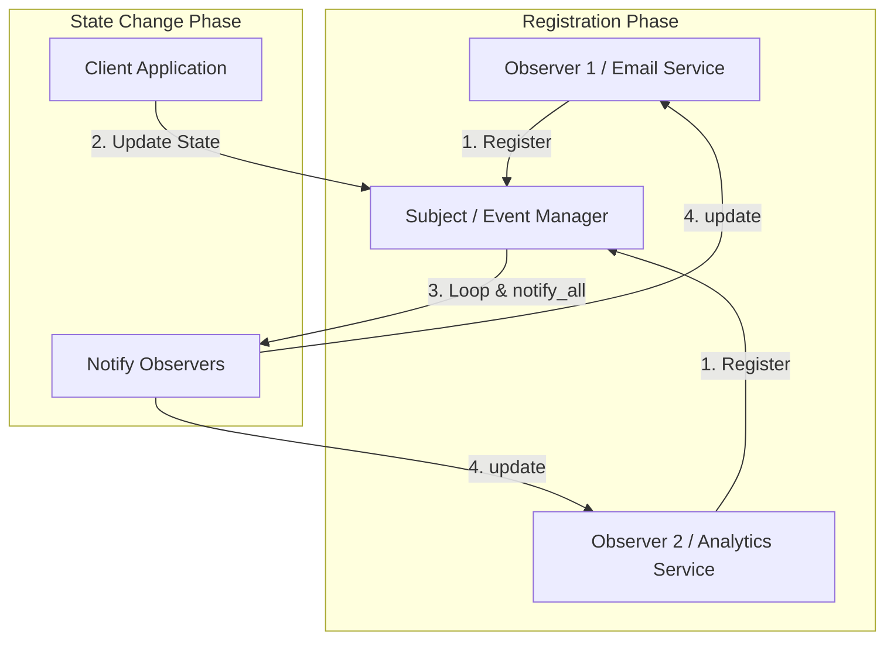

### 🎯 Learning Objectives
- Classify design patterns into Creational, Structural, and Behavioral categories.
- Implement a thread-safe **Singleton** pattern using Python metaclasses.
- Build flexible, decoupled instantiation layers using the **Factory Method** pattern.
- Formulate dynamic, interchangeable algorithm systems using the **Strategy** pattern.
- Construct event-driven publishing architectures using the **Observer** pattern.
- Leverage Python-specific features (first-class functions, decorators, closures) to write clean, minimal patterns.

### 🧩 Core Concepts (Why)
A **design pattern** is a repeatable, structured template used to solve common software engineering problems. Rather than inventing solutions from scratch, design patterns offer tested blueprints that improve code readability and extensibility. 

We categorize design patterns into three types:
1. **Creational**: Focus on object creation mechanisms (e.g., Singleton, Factory).
2. **Structural**: Focus on assembling classes and objects into larger structures (e.g., Decorator, Adapter).
3. **Behavioral**: Focus on algorithm coordination and responsibilities between objects (e.g., Strategy, Observer).

While classic design patterns originated in statically typed languages like C++ and Java, Python's dynamic nature and support for first-class functions allow us to implement these patterns with significantly less boilerplate.

#### Key Patterns in Python
- **Singleton**: Ensures a class has only one instance globally and provides a global access point to it. (Use cases: Database connection pools, loggers, global configurations).
- **Factory Method**: Defines an interface for creating objects but allows subclasses to alter the type of objects that will be created. (Use cases: File parsers, database client generators).
- **Strategy**: Encapsulates a family of algorithms, making them interchangeable at runtime. In Python, first-class functions can be passed directly, removing the need for classic OOP strategy classes.
- **Observer**: Defines a one-to-many relationship where multiple "observers" watch a "subject" and receive automated updates whenever its state changes. (Use cases: Event systems, pub/sub architectures).

### 🔁 Logic and Operation

The flowchart below illustrates the event-driven publishing mechanism of the **Observer Pattern**:



In this system:
1. Observers register themselves to be notified by the Subject.
2. When the Subject's state changes, it iterates over its registered observers.
3. The Subject calls a standard hook method (like `update()`) on each observer, sending the updated state details.

### 📝 Annotated Examples

Here is a Python script demonstrating metaclass-based **Singleton**, **Factory Method**, function-based **Strategy**, and **Observer** patterns:

```python
from abc import ABC, abstractmethod
from typing import Callable, List, Dict

# ==========================================
# 1. CREATIONAL: Singleton Pattern (Metaclass)
# ==========================================
class SingletonMeta(type):
    # A dictionary to cache class instances
    _instances: Dict = {}

    def __call__(cls, *args, **kwargs):
        # Intercept class instantiation: create only if it doesn't exist
        if cls not in cls._instances:
            cls._instances[cls] = super().__call__(*args, **kwargs)
        return cls._instances[cls]

class DatabaseConnectionPool(metaclass=SingletonMeta):
    def __init__(self):
        self.connection_string = "postgresql://db.local:5432"
        print("Database Connection Pool Initialized.")

# ==========================================
# 2. CREATIONAL: Factory Method Pattern
# ==========================================
class Document(ABC):
    @abstractmethod
    def read(self) -> str:
        pass

class JSONDocument(Document):
    def read(self) -> str:
        return '{"key": "value"}'

class CSVDocument(Document):
    def read(self) -> str:
        return "header1,header2\nvalue1,value2"

class DocumentFactory:
    # Generates different concrete classes depending on the file format
    @staticmethod
    def get_document(file_type: str) -> Document:
        if file_type == "json":
            return JSONDocument()
        elif file_type == "csv":
            return CSVDocument()
        raise ValueError(f"Unknown document format: {file_type}")

# ==========================================
# 3. BEHAVIORAL: Strategy Pattern (Pythonic)
# ==========================================
# Instead of abstract classes for strategies, we define functions (Callable)
DiscountStrategy = Callable[[float], float]

def regular_discount(price: float) -> float:
    return price * 0.95

def holiday_discount(price: float) -> float:
    return price * 0.80

class Order:
    def __init__(self, price: float, discount_strategy: DiscountStrategy):
        self.price = price
        self.discount_strategy = discount_strategy

    def calculate_total(self) -> float:
        # Dynamically apply the strategy
        return self.discount_strategy(self.price)

# ==========================================
# 4. BEHAVIORAL: Observer Pattern
# ==========================================
class Observer(ABC):
    @abstractmethod
    def update(self, message: str) -> None:
        pass

class Subject:
    def __init__(self):
        self._observers: List[Observer] = []

    def attach(self, observer: Observer) -> None:
        self._observers.append(observer)

    def notify(self, message: str) -> None:
        for observer in self._observers:
            observer.update(message)

class EmailNotifier(Observer):
    def update(self, message: str) -> None:
        print(f"[Email Notification] sending event: {message}")

# --- Execution Validation ---
if __name__ == "__main__":
    # Test Singleton
    db1 = DatabaseConnectionPool()
    db2 = DatabaseConnectionPool()
    print(f"Are DB instances identical? {db1 is db2}") # Expected: True

    # Test Factory Method
    doc = DocumentFactory.get_document("json")
    print(f"Read Document: {doc.read()}")

    # Test Strategy
    order_regular = Order(100.0, regular_discount)
    order_holiday = Order(100.0, holiday_discount)
    print(f"Regular Total: {order_regular.calculate_total()}") # Expected: 95.0
    print(f"Holiday Total: {order_holiday.calculate_total()}") # Expected: 80.0

    # Test Observer
    pub = Subject()
    sub = EmailNotifier()
    pub.attach(sub)
    pub.notify("System deployment complete!")
```

### ❌ Common Mistakes

**Mistake 1: Thread-unsafe Singleton in multi-threaded environments**
```python
class SimpleSingleton:
    _instance = None
    # Basic implementation without locks
    def __new__(cls):
        if not cls._instance:
            cls._instance = super().__new__(cls)
        return cls._instance
```
```text
Traceback (most recent call last):
  # In concurrent contexts, testing identity asserts false:
  AssertionError: db1 is db2 is False
```
```python
import threading

class SafeSingleton:
    _instance = None
    _lock = threading.Lock()

    def __new__(cls):
        # Double-checked locking pattern for optimal performance
        if not cls._instance:
            with cls._lock:
                if not cls._instance:
                    cls._instance = super().__new__(cls)
        return cls._instance
```
> In a multi-threaded system, two threads might evaluate `if not cls._instance` at the same time before either has allocated memory. This leads to both threads creating separate objects. Using double-checked locking with `threading.Lock` guarantees thread safety while preventing performance bottlenecking once the instance exists.

**Mistake 2: Over-complicating Python's Strategy pattern with class-based boilerplates**
```python
from abc import ABC, abstractmethod

# Violates Pythonic simplicity by wrapping single-line logic in classes
class Strategy(ABC):
    @abstractmethod
    def run(self, a, b): pass

class AddStrategy(Strategy):
    def run(self, a, b): return a + b

class Calculator:
    def __init__(self, strategy: Strategy):
        self.strategy = strategy
```
```text
Traceback (most recent call last):
  File "main.py", line 12, in <module>
    calc = Calculator(AddStrategy) # Pass class instead of instantiated object
  File "main.py", line 8, in calculate
    return self.strategy.run(a, b)
TypeError: run() missing 1 required positional argument: 'b'
```
```python
from typing import Callable

# Clean and idiomatic: Use functions as strategies
class Calculator:
    def __init__(self, strategy: Callable[[int, int], int]):
        self.strategy = strategy

    def calculate(self, a: int, b: int) -> int:
        return self.strategy(a, b)
```
> Java-style class strategy wrappers are unnecessary boilerplate in Python. Python functions are first-class citizens, meaning they can be stored in variables, passed to constructors, and invoked directly.

### 💡 Tips & Idioms
- **Module as a Singleton**: Python modules are imported and executed only once; subsequent imports reference the same namespace inside `sys.modules`. In many cases, you don't need a Singleton class—simply declare variables and functions in a module.
- **Factory using Dict Mapping**: Avoid long `if/elif/else` blocks in factories. You can store class types in a dictionary for elegant dispatching:
  ```python
  CREATORS = {"json": JSONDocument, "csv": CSVDocument}
  # Instantiation is dynamic
  doc = CREATORS[file_type]()
  ```
- **Use Closures to Hold Strategy State**: If a strategy needs to hold state, use a closure instead of a class:
  ```python
  def make_multiplier(factor: float):
      return lambda x: x * factor # Returns a strategy function
  ```

### 🧠 Deep Dive (Under the hood)
<details><summary>Metaclass Interception: Controlling Class Calls via __call__</summary>

When you instantiate a class in Python, such as `conn = DatabaseConnectionPool()`, Python does not invoke `__new__` directly on `DatabaseConnectionPool`. Instead, it invokes the `__call__` method on the *class's class* (its metaclass).

Let's look at the object invocation pipeline:
1. `DatabaseConnectionPool` is an instance of `SingletonMeta`.
2. Evaluating `DatabaseConnectionPool()` executes `SingletonMeta.__call__(DatabaseConnectionPool)`.
3. The custom `__call__` implementation intercepts this request:
   - If the class is already stored in `_instances`, it returns that cached instance.
   - If it is not, it executes `super().__call__()` (which in turn calls `__new__` and `__init__` on `DatabaseConnectionPool`), stores it, and returns the newly instantiated object.

```python
# The metaclass interception model
class SingletonMeta(type):
    _instances = {}
    
    def __call__(cls, *args, **kwargs):
        # Intercept before memory allocation
        if cls not in cls._instances:
            cls._instances[cls] = super().__call__(*args, **kwargs)
        return cls._instances[cls]
```

This guarantees that a Singleton implemented via metaclass is robust against developer mistakes, as calling the class standardly will always return the identical instance.
</details>

### 🏋️ Exercise
Implement a `Calculator` class that conforms to the Strategy pattern. The constructor should accept a strategy function. The `Calculator` must provide a method `calculate(self, a, b)` which dynamically executes the injected strategy on `a` and `b`.

```python
# Implement a Strategy pattern for calculation.
# Create a Calculator class that accepts a dynamic operation strategy (add, multiply).
class Calculator:
    pass
```

### ✅ Self-Check
1. Why is a metaclass-based Singleton generally preferred over a custom `__new__` method implementation?
2. How can you implement a lightweight Observer pattern in Python using first-class functions?
3. When should you use a Factory Method pattern instead of directly calling constructors?
<details><summary>Self-Check Answers</summary>

1. A metaclass-based Singleton separates instantiation control from class logic. Subclasses inheriting from a class with a custom `__new__` Singleton implementation can easily break the singleton behavior or initialize multiple times.
2. Instead of defining an abstract `Observer` class, you can store a list of functions (`List[Callable[[str], None]]`) and execute them directly when notifying.
3. You should use a Factory Method when the exact type of object cannot be determined before runtime, or when you want to isolate complex setup logic (e.g. database client setups) away from the business layer using the object.
</details>

### 📌 Summary
- **Singleton**: Restricts class instantiation to a single global instance. Metaclasses provide a clean implementation.
- **Factory Method**: Decouples instantiation logic, mapping keys or formats dynamically to subclasses.
- **Strategy**: Uses interchangeable behaviors. Python functions eliminate GoF class hierarchies for stateless strategies.
- **Observer**: Implements pub/sub models, letting subjects broadcast state updates to decoupling listeners.
