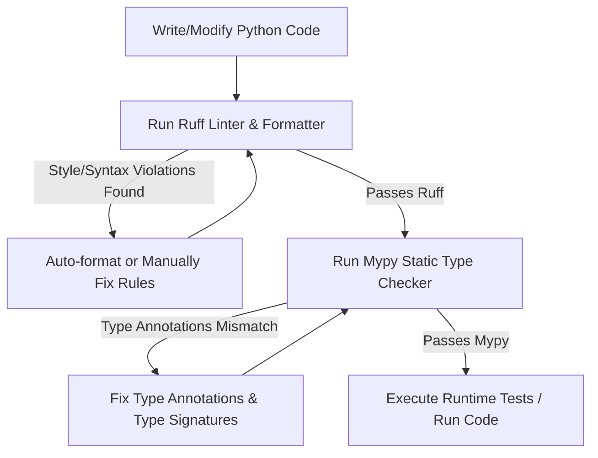

### 🎯 Learning Objectives
- Formulate the core differences between static analysis and runtime checks.
- Categorize code validators into linters (structural/style bugs) and formatters (styling aesthetics).
- Recognize standard PEP 8 requirements for readable Python development.
- Configure and execute **Ruff** for high-performance linting and formatting.
- Set up and run **Mypy** to perform strict static type checking validations.
- Integrate type annotations (`typing` module) to construct self-documenting, type-safe functions.

### 🧩 Core Concepts (Why)

In large-scale software development, maintaining code quality and consistency is critical. As codebases grow, manually checking for style violations, missing imports, or subtle type bugs becomes unsustainable. Static analysis tools solve this by evaluating code before it is run.

#### 1. Static Analysis vs. Runtime Checks
- **Static Analysis**: Analyzing source code without executing it. It checks logic structure, syntax conformity, styling rules, and type consistency. It identifies potential errors early in the development lifecycle.
- **Runtime Checks**: Errors caught during program execution (e.g., throwing a `TypeError` when adding a string and an integer). While runtime tests (like unit testing) are vital, they can only catch bugs in executed code paths.

#### 2. Linters vs. Formatters
- **Linters**: Analyze code for syntax errors, structural bug-prone patterns, styling rules (like PEP 8), complexity, and potential security issues. Examples: Flake8, Pylint, Pycodestyle.
- **Formatters**: Automatically rewrite code to adhere to strict stylistic standards (spacing, line lengths, quotation marks). They eliminate debates over formatting preferences. Examples: Black, YAPF.

#### 3. PEP 8 & Typing Requirements
PEP 8 is the official Style Guide for Python Code. It details spacing, naming conventions (snake_case for functions, PascalCase for classes), and maximum line lengths (traditionally 79 characters, though modern setups often use 88 or 100). Python is dynamically typed, but PEP 484 introduced **type hinting** to allow static analysis tools to verify type safety.

#### 4. The Modern Standard: Ruff & Mypy
Historically, Python projects required installing several tools: Black (formatting), Flake8 (linting), isort (import sorting), and autoflake (removing unused imports). 
- **Ruff**: An extremely fast, all-in-one linter and formatter written in Rust. It is 10x-100x faster than legacy tools and natively replaces Black, Flake8, isort, and more.
- **Mypy**: The standard static type checker for Python. It verifies that variables, arguments, and return types conform to their annotations.

---

### 🔁 Logic and Operation

Static validation operates as an automated gatekeeper. The flowchart below shows the developer workflow utilizing Ruff and Mypy before code is executed or deployed:



In this pipeline:
1. **Ruff** cleans up layout, formatting, syntax violations, and dead imports.
2. **Mypy** performs semantic analysis, tracing variable scopes and function signatures to ensure type safety.
3. Once both checks pass, the code is guaranteed to meet style guidelines and type rules before runtime tests run.

---

### 📝 Annotated Examples

To utilize Ruff and Mypy, developers typically write configurations in a `pyproject.toml` file at the project root.

#### 1. Configuration (`pyproject.toml`)
```toml
# Configuration for Ruff
[tool.ruff]
line-length = 88
target-version = "py310"

[tool.ruff.lint]
# Enable Pyflakes (F), Autopep8/Pycodestyle (E, W), isort (I), and Bugbear (B)
select = ["E", "F", "W", "I", "B"]
ignore = []

[tool.ruff.format]
quote-style = "double"
indent-style = "space"

# Configuration for Mypy
[tool.mypy]
python_version = "3.10"
warn_return_any = true
warn_unused_configs = true
disallow_untyped_defs = true  # Force all functions to have type signatures
```

#### 2. Before Static Analysis (PEP 8 Violations, Unused Imports, Type Bugs)
```python
# bad_code.py
import sys  # Unused import (Ruff F401)
import os

def calculate_average(numbers):  # Missing type annotations (Mypy disallow_untyped_defs)
    total = sum(numbers)
    # Incorrect indentation and style issues
    return total/len(numbers)

# Passing a string instead of a list of numbers
print(calculate_average("not-a-list")) # Runtime TypeError, but passes dynamic parser!
```

#### 3. Refactored and Type-Annotated Code (Passing Ruff and Mypy)
```python
# good_code.py
from typing import List

# Type annotations ensure 'numbers' must be a list of floats/ints, returning a float
def calculate_average(numbers: List[float]) -> float:
    # Handle division by zero edge-case to avoid runtime Crash
    if not numbers:
        return 0.0
    return sum(numbers) / len(numbers)

# Mypy flag triggers error here before execution if we pass a string!
valid_numbers: List[float] = [10.0, 20.0, 30.0]
print(calculate_average(valid_numbers))
```

---

### ❌ Common Mistakes

**Mistake 1: Declaring mutable structures as default parameter arguments**
```python
# Ruff triggers B006: Do not use mutable data structures for argument defaults
def add_user(username: str, roles: list[str] = []) -> dict:
    roles.append(username)
    return {"user": username, "roles": roles}
```
```text
bad_code.py:2:45: B006 Do not use mutable data structures for argument defaults
```
```python
from typing import Optional

def add_user(username: str, roles: Optional[list[str]] = None) -> dict:
    if roles is None:
        roles = []
    roles.append(username)
    return {"user": username, "roles": roles}
```
> Mutable default arguments in Python are evaluated once at function definition time, meaning all invocations without an explicit `roles` parameter share the same list instance. Ruff catches this static code bug immediately using code rule `B006`.

**Mistake 2: Missing type declarations on variable initializations causing fallback to `Any`**
```python
# Mypy fails: Function is missing a type annotation for dynamic lookup
def process_data(data) -> str:
    return data.strip()
```
```text
error: Function is missing a type annotation  [no-untyped-def]
```
```python
def process_data(data: str) -> str:
    return data.strip()
```
> Under strict static type configurations (`disallow_untyped_defs = true`), Mypy mandates type signatures for all arguments and return values. Neglecting these parameters defaults them to `Any`, bypassing static validation checks.

---

### 💡 Tips & Idioms

- **Run Ruff Automatically**: Configure your IDE to run Ruff's formatter on save. You can also run it via CLI:
  ```bash
  ruff format .   # Formats files in place
  ruff check .    # Checks for lint rules
  ruff check --fix .  # Automatically fixes repairable lint errors (e.g. unused imports)
  ```
- **Modern Collections Hinting**: In Python 3.9+, you no longer need to import `List`, `Dict`, `Tuple` from the `typing` module. You can use standard lowercase collections directly:
  ```python
  def count_words(phrases: list[str]) -> dict[str, int]:
      return {}
  ```
- **Ignoring Warnings Safely**: If you must bypass a validator check, append a localized comment. For Ruff, use `# noqa: <RULE_ID>`; for Mypy, use `# type: ignore`:
  ```python
  import unused_lib  # noqa: F401
  bad_types: int = "string"  # type: ignore
  ```

---

### 🧠 Deep Dive (Under the hood)
<details><summary>Abstract Syntax Trees (AST) & Type Inference Systems</summary>

How do these tools evaluate code without running it?

#### Ruff's AST Analysis
When you run Ruff, it executes a Rust parser to convert your raw Python source files into an **Abstract Syntax Tree (AST)**. An AST is a hierarchical tree representation of your code's syntactic structure.
For example, the line `a = 1 + 2` is structured as:
```text
Assign
  ├── targets: Name(id="a")
  └── value: BinOp(left=Num(1), op=Add, right=Num(2))
```
Ruff walks this tree using custom lint rules to find inefficient patterns, formatting issues, or logic gaps in parallel across your CPU cores.

#### Mypy's Semantic Type Inference
Unlike compiled languages where typing is checked during compilation, Mypy performs type checking by parsing your files, resolving scopes (symbol tables), and executing **type inference**. Mypy traces:
1. **Assignments**: Ensuring a variable assigned a string isn't later assigned an integer.
2. **Function Boundaries**: Checking that arguments passed into a function match its annotated parameter types.
3. **Generics & Subtypes**: Validating covariance and contravariance constraints in complex collections or class inheritance structures.

Because Python remains dynamic at runtime, these tools compile no code; they purely validate code rules to guarantee software engineering stability.
</details>

---

### 🏋️ Exercise
Implement type annotations for the function `process_values`. The function takes a list of integers and returns a list of floats. Fix the dynamic signature to satisfy strict static type validations.

```python
# Fix dynamic type signatures to pass strict static type check validations.
# The function process_values takes a list of integers and returns a list of floats.
def process_values(values):
    pass
```

---

### ✅ Self-Check
1. What is the fundamental difference between a code formatter and a code linter?
2. Why is Ruff preferred over combining legacy tools like Flake8, Black, and isort?
3. How can you perform strict type validation checks using Mypy in your project?
<details><summary>Self-Check Answers</summary>

1. A **linter** checks code structure and syntax rules to catch bugs, unused imports, or bad design patterns. A **formatter** automatically cleans and restructures code layouts (spacing, line wrapping, quotes) to maintain style consistency.
2. **Ruff** is written in Rust, executing checks up to 100x faster than legacy Python-based tools. It also consolidates format, lint, and import sorting tasks into a single tool and configuration file (`pyproject.toml`).
3. By running `mypy <target_directory>` and enabling strict flags in `pyproject.toml`, such as `disallow_untyped_defs = true`, which enforces that every function contains explicit type annotations.
</details>

---

### 📌 Summary
- **Static Analysis** validates code syntax and types before runtime, preventing issues before they hit production.
- **Ruff** provides ultra-fast formatting and linting rules, replacing Black, Flake8, and isort.
- **Mypy** checks type safety across variables, collections, and functions using type annotations.
- Integrating these checkers ensures consistency, formatting standards, and type safety.
