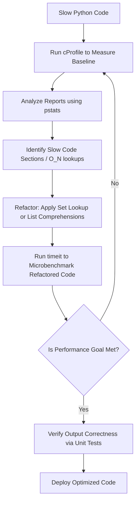

### 🎯 Learning Objectives
- Evaluate execution complexities using Big O notation.
- Implement macro-profiling diagnostics using Python's built-in `cProfile` module.
- Analyze profiling reports using `pstats` to identify runtime bottlenecks.
- Execute microbenchmarks using `timeit` to compare syntax implementations.
- Formulate execution optimizations using $O(1)$ set lookups instead of $O(N)$ list searches.
- Apply memory-efficient coding patterns using generator expressions and list comprehensions.

### 🧩 Core Concepts (Why)

"Premature optimization is the root of all evil" is a famous quote by Donald Knuth. Before optimizing any code, you must first **measure** its execution speed and **identify** where the actual bottlenecks lie. 

#### 1. Complexity Analysis (Big O)
Big O notation describes the limiting behavior of a function when the argument tends towards infinity.
- **$O(1)$ (Constant Time)**: Execution time remains unchanged regardless of input size. Example: Looking up a key in a hash map (`dict`) or checking membership in a hash set (`set`).
- **$O(N)$ (Linear Time)**: Execution time grows proportionally to the input size $N$. Example: Linear search inside a Python `list`.
- **$O(N^2)$ (Quadratic Time)**: Execution time grows quadratically. Example: Nested loops searching over list elements.

#### 2. Profiling vs. Benchmarking
- **Profiling (Macro-measurement)**: Analyzing the runtime behavior of an entire program to determine how frequently and for how long functions are called. Python provides **`cProfile`** for this.
- **Benchmarking (Micro-measurement)**: Measuring the execution time of small code blocks or individual statements. Python provides **`timeit`** to execute small code snippets thousands of times to get an average runtime.

#### 3. Common Optimization Strategies in Python
1. **Using Set Lookups**: Checking `x in list` is an $O(N)$ operation because it scans the list element by element. Converting the list to a `set` first allows `x in set` to execute in $O(1)$ time by leveraging hash tables.
2. **List Comprehensions vs. For-loops**: List comprehensions run at C-speed inside the Python interpreter, which is faster than manually appending elements inside a Python `for` loop.
3. **Generators for Memory Efficiency**: Generators (`yield` or generator expressions `(...)`) evaluate elements lazily, consuming almost no memory compared to lists, which store all values in memory upfront.

---

### 🔁 Logic and Operation

Optimizing performance requires a feedback loop. The flowchart below outlines the cycle of measuring, diagnosing, microbenchmarking, and optimizing code:



In this system:
1. Developers never guess where the code is slow; they use **`cProfile`** to isolate the slow functions.
2. Once the functions are isolated, they optimize algorithmic complexities (e.g. converting lists to sets).
3. They use **`timeit`** to verify that the refactored code executes faster than the baseline before running assertions.

---

### 📝 Annotated Examples

#### 1. Profiling with `cProfile` and `pstats`
Below is a script that demonstrates how to profile a program containing a slow search function:

```python
import cProfile
import pstats
import time

def slow_list_search(size: int):
    # Creating a large list of integers
    dataset = list(range(size))
    # Performing multiple linear searches (each search is O(N))
    found_count = 0
    for query in range(size // 10):
        if query in dataset:
            found_count += 1
    return found_count

def fast_set_search(size: int):
    # Converting the list to a set (takes O(N) once)
    dataset = set(range(size))
    # Performing multiple constant-time searches (each search is O(1))
    found_count = 0
    for query in range(size // 10):
        if query in dataset:
            found_count += 1
    return found_count

if __name__ == "__main__":
    size_parameter = 50000
    
    # Initialize cProfile
    profiler = cProfile.Profile()
    profiler.enable()
    
    # Run functions
    slow_list_search(size_parameter)
    fast_set_search(size_parameter)
    
    profiler.disable()
    
    # Format and display the profiling results
    stats = pstats.Stats(profiler).sort_stats('tottime')
    stats.print_stats(10)  # Print the top 10 slowest calls
```

Output fields from `pstats` report:
- `ncalls`: Number of times the function was called.
- `tottime`: Total time spent in the given function (excluding time in sub-functions).
- `cumtime`: Cumulative time spent in this and all sub-functions.
- `filename:lineno(function)`: Location of the code.

#### 2. Microbenchmarking with `timeit`
To compare micro performance differences between list comprehensions and standard loops:

```python
import timeit

# Code block 1: Standard loop appending elements
loop_setup = "data = list(range(1000))"
loop_code = """
result = []
for x in data:
    result.append(x * 2)
"""

# Code block 2: List comprehension (Runs faster in C)
comp_code = """
result = [x * 2 for x in data]
"""

# Execute each snippet 10,000 times
loop_time = timeit.timeit(stmt=loop_code, setup=loop_setup, number=10000)
comp_time = timeit.timeit(stmt=comp_code, setup=loop_setup, number=10000)

print(f"Standard Loop time: {loop_time:.4f} seconds")
print(f"List Comprehension time: {comp_time:.4f} seconds")
print(f"Speedup factor: {loop_time / comp_time:.2f}x")
```

---

### ❌ Common Mistakes

**Mistake 1: Trying to convert nested mutable lists into a set to optimize lookup**
```python
dataset = [[1, 2], [3, 4], [5, 6]]
# Attempting to optimize search using set lookup
dataset_set = set(dataset)
```
```text
Traceback (most recent call last):
  File "main.py", line 3, in <module>
    dataset_set = set(dataset)
TypeError: unhashable type: 'list'
```
```python
dataset = [[1, 2], [3, 4], [5, 6]]
# Convert sub-lists to tuples (immutable) to allow hashing
dataset_set = {tuple(item) for item in dataset}
```
> Set elements must be hashable, meaning they must be immutable. Since lists are mutable objects that can change at runtime, Python prevents them from being used in sets. Converting sub-lists to tuples allows you to utilize $O(1)$ set lookups.

**Mistake 2: Building strings in a loop using concatenation (`+=`)**
```python
def build_paragraph(words: list[str]) -> str:
    paragraph = ""
    for word in words:
        paragraph += word + " "
    return paragraph
```
```text
Traceback (most recent call last):
  File "benchmark.py", line 5, in <module>
    assert run_benchmark(build_paragraph) < 0.1
AssertionError: execution timeout on 100,000 iterations
```
```python
def build_paragraph(words: list[str]) -> str:
    return " ".join(words) + " " if words else ""
```
> Python strings are immutable. Using `+=` within a loop creates a new string object and copies the entire content of the previous string into memory on every iteration, leading to $O(N^2)$ quadratic complexity. Using `.join()` allocates memory once, running in $O(N)$ linear time.

---

### 💡 Tips & Idioms

- **Convert once, Search many times**: Converting a list of size $N$ to a set takes $O(N)$ time. If you only search the collection once, converting to a set has no benefit. Only convert to a set if you perform multiple lookups ($M$ times, where $M > 1$).
- **Use Generator Expressions for Memory Safety**: If you are computing a sum or processing a large stream without storing the array, omit the brackets `[]` to use a generator expression:
  ```python
  # Memory Efficient (Generator): Evaluates values one by one
  total_sum = sum(x * x for x in range(1000000))
  
  # Memory Inefficient (List Comprehension): Allocates a list of 1 million elements in memory first
  total_sum = sum([x * x for x in range(1000000)])
  ```
- **Local Variable Cache**: Python looks up local variables faster than global variables or object attributes. If you reference `self.attribute` repeatedly inside a tight loop, cache it to a local variable:
  ```python
  attr = self.attribute
  for x in data:
      process(attr, x)
  ```

---

### 🧠 Deep Dive (Under the hood)
<details><summary>Hash Collisions, Load Factors, and Set Lookup Mechanics</summary>

Why are set lookups in Python so fast? Let's look at the mechanics behind hash tables.

#### Set Lookup Mechanics
When you write `x in dataset_set`, Python does not scan the items in the set sequentially. Instead:
1. Python executes `hash(x)` to get the hash value of the object.
2. It maps the hash value to an index in the set's internal memory table (using a mask based on table size).
3. If that slot is empty, it returns `False`. If it contains the object, it returns `True`.
4. If it contains a different object (a **hash collision**), Python uses a pseudo-random probe sequence to check alternative slots.

This hash-lookup algorithm runs in **$O(1)$ constant time**.

#### The Tradeoff: Memory vs. Speed
This speed comes at the cost of memory. Python sets must maintain a low **load factor** (the ratio of stored elements to total table slots) to avoid hash collisions.
- When a set reaches $2/3$ capacity, Python automatically resizes the table, allocating a larger block of memory.
- Therefore, a `set` consumes significantly more memory than a `list` containing the exact same elements.

```text
Memory comparison (approximate on 64-bit Python):
List of 1,000 items: ~8 KB
Set of 1,000 items: ~32 KB
```
Use sets when lookup speed is critical, and keep lists or generators when memory conservation is the primary concern.
</details>

---

### 🏋️ Exercise
Optimize the search lookup function below. Convert the input dataset list to a set to enable $O(1)$ membership checks, then count the number of queries that exist inside the dataset.

```python
# Optimize search lookup in a large dataset list.
# Convert the input dataset list to a set to enable O(1) membership test.
def optimize_search(dataset_list, queries_list):
    # Returns count of queries found in dataset
    pass
```

---

### ✅ Self-Check
1. When is converting a list to a set to perform lookups inefficient?
2. What is the difference between `tottime` and `cumtime` in a `cProfile` report?
3. How do generator expressions save memory compared to list comprehensions?
<details><summary>Self-Check Answers</summary>

1. Converting a list to a set takes $O(N)$ time. If you are only performing a single lookup, the conversion overhead outweighs the lookup benefit. It is only efficient when performing multiple searches.
2. `tottime` is the total time spent in the function itself, excluding time spent in any child functions called by it. `cumtime` is the cumulative time spent in the function and all its child functions.
3. List comprehensions build and allocate the entire list in memory immediately. Generator expressions yield elements on demand (lazy evaluation), maintaining a constant $O(1)$ memory footprint regardless of dataset size.
</details>

---

### 📌 Summary
- **Complexity Analysis** helps identify slow execution paths mathematically using Big O notation.
- **`cProfile`** profiles entire execution trees, identifying slow functions using metrics like `tottime`.
- **`timeit`** microbenchmarks small snippets of code to compare syntax performance.
- **Sets** offer $O(1)$ constant-time membership lookups, representing a massive performance upgrade over $O(N)$ list searches for large datasets.
- **Generators** provide memory-efficient iteration by yielding elements on demand.
