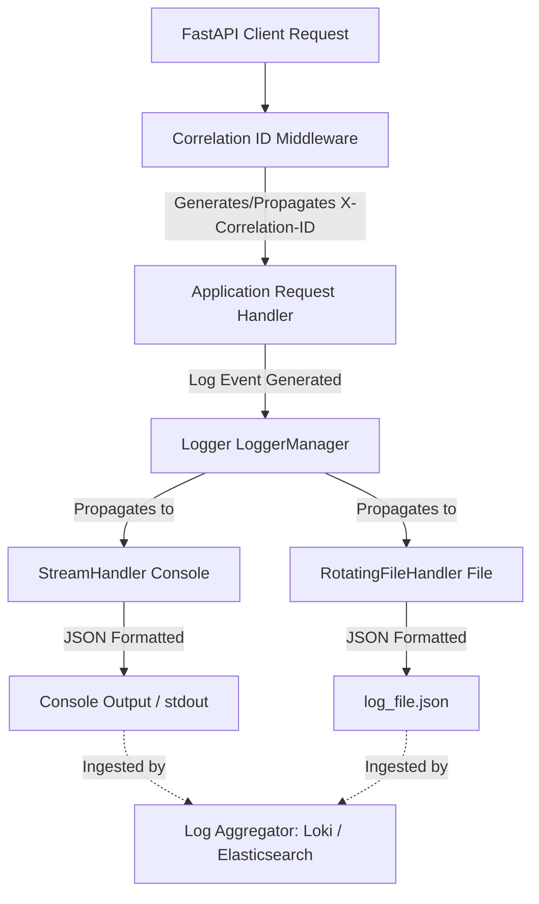

### 🎯 Learning Objectives
- Differentiate between the 5 standard logging levels and apply them to appropriate system events.
- Configure loggers, handlers, formatters, and propagation rules using standard Python configurations.
- Design dynamic configurations using `dictConfig` to decouple code from logging environments.
- Implement structured logging with JSON outputs to support log indexing systems like Loki or Elasticsearch.
- Configure log rotation using `RotatingFileHandler` to prevent disk space exhaustion.
- Integrate request-bound correlation IDs in FastAPI middleware to establish end-to-end request tracing.

### 🧩 Core Concepts (Why)

#### 1. Why `print()` is Not Logging
In production applications, using `print()` for debugging is an anti-pattern:
- **No Levels**: `print()` cannot differentiate between an informational trace, a warning, or a critical system error.
- **No Destination Management**: `print()` outputs to `stdout` by default. It is hard to route specific messages to log files, emails, or alerting systems.
- **Performance**: Eager `print()` statements block IO operations and degrade application performance under heavy load.
- **No Metadata**: `print()` outputs lack context (timestamps, thread IDs, module names, line numbers).

#### 2. Logging Levels
Python's standard library defines five integer-based logging levels:
- **DEBUG (10)**: Low-level diagnostic details for debugging.
- **INFO (20)**: General system events confirming normal operation (e.g. startup, request completion).
- **WARNING (30)**: Indications of minor anomalies or deprecated behaviors that do not interrupt execution.
- **ERROR (40)**: Major exceptions that cause a specific operation to fail.
- **CRITICAL (50)**: Severe system failure requiring immediate intervention (e.g. database connection lost, out of memory).

#### 3. Handlers and Formatters
- **Logger**: The entry point interface used by application code to submit log messages.
- **Handler**: Directs log messages to target destinations (console, local files, sockets, network streams). Common handlers include `StreamHandler`, `FileHandler`, and `RotatingFileHandler`.
- **Formatter**: Defines the final string layout of the log records.
- **Propagation**: Determines whether a child logger passes its logs up to parent loggers (e.g. the root logger).

#### 4. Observability and Structured Logging
Observability is the ability to understand a system's internal state solely from its external outputs (metrics, logs, traces).
- **Structured JSON Logging**: Standard text logs are difficult to parse with regex. Formatting logs as JSON objects makes them machine-readable. Cloud-native log aggregators (e.g., Elasticsearch, Loki, Datadog) can instantly index JSON properties, enabling developers to query logs by fields (like level, response time, or user ID) efficiently.
- **Correlation IDs (Tracing)**: A Correlation ID (or Request ID) is a unique string generated for every incoming HTTP request. By attaching this ID to every log statement executed during that request's lifecycle, developers can stitch together the exact execution path across multiple microservices or database queries.

---

### 🔁 Logic and Operation

Below is the execution flow of an incoming HTTP request in a FastAPI application, demonstrating how correlation IDs are generated, propagated, formatted, and indexed:



1. **Request Reception**: The middleware intercepts the request, extract/generate a correlation ID, and stores it in context-local storage.
2. **Execution Logging**: The handler processes business logic, logging milestones along the way.
3. **Propagation & Formatting**: The logging manager receives the event and sends it to configured handlers. The JSON Formatter attaches the correlation ID from context to the final JSON record.
4. **Log Aggregation**: The log collector reads `stdout` or log files and indexes them in a centralized dashboard.

---

### 📝 Annotated Examples

#### 1. Decoupled Configuration via `dictConfig`
Rather than configuring logging imperatively with code, use a configuration dictionary (often loaded from JSON or YAML). This allows quick switches between development (console-focused) and production (file/JSON-focused) profiles.

```python
import logging.config

LOGGING_CONFIG = {
    "version": 1,
    "disable_existing_loggers": False,
    "formatters": {
        "standard": {
            "format": "%(asctime)s [%(levelname)s] %(name)s: %(message)s"
        },
    },
    "handlers": {
        "console": {
            "class": "logging.StreamHandler",
            "level": "DEBUG",
            "formatter": "standard",
            "stream": "ext://sys.stdout",
        },
        "file": {
            "class": "logging.handlers.RotatingFileHandler",
            "level": "INFO",
            "formatter": "standard",
            "filename": "app.log",
            "maxBytes": 1048576,  # 1 MB
            "backupCount": 3,
            "encoding": "utf8",
        },
    },
    "root": {
        "handlers": ["console", "file"],
        "level": "DEBUG",
    },
}

# Apply configuration dictionary
logging.config.dictConfig(LOGGING_CONFIG)
logger = logging.getLogger("app.module")

logger.info("Application initialized successfully.")
logger.warning("Configuration override detected.")
```

#### 2. Writing a Custom JSON Log Formatter
To output logs in JSON format for production indexers, we can subclass `logging.Formatter` and override the `format()` method.

```python
import logging
import json
import datetime

class StructuredJSONFormatter(logging.Formatter):
    def format(self, record: logging.LogRecord) -> str:
        log_entry = {
            "timestamp": datetime.datetime.utcnow().isoformat(),
            "level": record.levelname,
            "logger": record.name,
            "message": record.getMessage(),
        }
        
        # Include exception tracebacks if present
        if record.exc_info:
            log_entry["exception"] = self.formatException(record.exc_info)
            
        return json.dumps(log_entry)

# Setup handler with JSON formatter
handler = logging.StreamHandler()
handler.setFormatter(StructuredJSONFormatter())
logger = logging.getLogger("structured_logger")
logger.addHandler(handler)
logger.setLevel(logging.INFO)

logger.info("JSON structured log example.")
```

#### 3. Contextual Request Tracing in FastAPI (Correlation ID Middleware)
Using `contextvars` to store correlation IDs safely across asynchronous tasks, then fetching it inside the custom logger:

```python
import logging
import json
import datetime
import uuid
import contextvars
from fastapi import FastAPI, Request
from starlette.middleware.base import BaseHTTPMiddleware

# Context variable to hold request-scoped correlation ID
correlation_id_ctx = contextvars.ContextVar("correlation_id", default="N/A")

class ContextualJSONFormatter(logging.Formatter):
    def format(self, record: logging.LogRecord) -> str:
        log_entry = {
            "timestamp": datetime.datetime.utcnow().isoformat(),
            "level": record.levelname,
            "message": record.getMessage(),
            "correlation_id": correlation_id_ctx.get() # Pull correlation ID from contextvars
        }
        return json.dumps(log_entry)

# Setup FastAPI App
app = FastAPI()

class CorrelationIDMiddleware(BaseHTTPMiddleware):
    async def dispatch(self, request: Request, call_next):
        # Extract ID from request headers or generate a new one
        correlation_id = request.headers.get("X-Correlation-ID", str(uuid.uuid4()))
        token = correlation_id_ctx.set(correlation_id)
        try:
            response = await call_next(request)
            response.headers["X-Correlation-ID"] = correlation_id
            return response
        finally:
            correlation_id_ctx.reset(token)

app.add_middleware(CorrelationIDMiddleware)

# Setup Logging
logger = logging.getLogger("api")
handler = logging.StreamHandler()
handler.setFormatter(ContextualJSONFormatter())
logger.addHandler(handler)
logger.setLevel(logging.INFO)

@app.get("/items")
async def read_items():
    logger.info("Fetching item list requested by user")
    return {"items": ["item1", "item2"]}
```

---

### ❌ Common Mistakes

**Mistake 1: Eager string interpolation inside logger calls**
```python
import logging
# Inefficient logger call with eager string interpolation
logging.debug(f"Calculated expensive value: {run_expensive_calculation()}")
```
```text
Traceback (most recent call last):
  File "app.py", line 5, in <module>
    logging.debug(f"Calculated expensive value: {run_expensive_calculation()}")
NameError: name 'run_expensive_calculation' is not defined
```
```python
import logging
# Lazy string formatting using logger placeholders
logging.debug("Calculated expensive value: %s", run_expensive_calculation())
```
> Eager string formatting (like f-strings) resolves variables immediately, even if the current logging level is set higher (e.g. WARNING), meaning `run_expensive_calculation()` is executed pointlessly. Using percentage placeholders lets the logging module evaluate the expression lazily only if the message is actually written.

**Mistake 2: Missing traceback in exception logging**
```python
import logging
try:
    1 / 0
except ZeroDivisionError as e:
    logging.error(f"An error occurred: {e}")
```
```text
ERROR:root:An error occurred: division by zero
```
```python
import logging
try:
    1 / 0
except ZeroDivisionError:
    logging.exception("An error occurred during division")
```
> Calling `logging.error()` with just the exception string discards the traceback context. Using `logging.exception()` (or setting `exc_info=True`) automatically grabs the system exception context and appends the complete stack trace to the log message, which is vital for production debugging.

---

### 💡 Tips & Idioms

- **Use `__name__` for Loggers**: Always instantiate loggers using `logging.getLogger(__name__)`. This scopes log names matching your module paths, allowing granular configuration of log levels per folder or class.
- **Log Rotation Is Non-Negotiable**: Never use a plain `FileHandler` in production. Uncapped logs will consume all available storage and crash the OS. Always use `RotatingFileHandler` (size-based) or `TimedRotatingFileHandler` (time-based) with a strict `backupCount`.
- **Stdout redirection**: In containerized environments like Docker/Kubernetes, write logs to stdout/stderr. Do not handle files inside the container; let the orchestration layer capture streams and forward them to collectors.

---

### 🧠 Deep Dive (Under the hood)
<details><summary>Thread-Safety, Log propagation, and ContextVars in Async Code</summary>

#### 1. Thread-Safety in Python Logging
The standard Python logging module is thread-safe. Log handlers use internal threading locks (`threading.RLock`) to serialize access to shared IO resources. This ensures that logs outputted concurrently by multiple threads do not overlap or corrupt. However, acquiring locks introduces minor synchronization latency under high multi-threading workloads.

#### 2. Logging Propagation Mechanics
When a logger receives a log record:
1. It checks its own level. If the record's level is less than the logger's, the record is discarded.
2. If it passes, the record is passed to all handlers registered directly on the logger.
3. If `propagate` is set to `True` (default), the record is forwarded to the parent logger in the logger name hierarchy (e.g., `app.submodule` propagates to `app`, which propagates to the root logger).
4. Handlers of parent loggers will process the record *regardless* of the parent logger's level settings. If you want to avoid double logging, set `logger.propagate = False`.

#### 3. ContextVars vs Thread-Local Storage
In standard multi-threaded applications, `threading.local()` is used to isolate request state. However, async applications (like FastAPI / Starlette) share a single OS thread across multiple interleaved asynchronous tasks.
- Using `threading.local` in async code leads to race conditions, as variables leak between task context switches.
- `contextvars` provides task-local context isolation. Each async task maintains its own state copy. When a coroutine suspends at an `await` statement, `contextvars` switches variables safely, enabling correct correlation ID lookups inside logger callbacks.
</details>

---

### 🏋️ Exercise
Write a log formatter function `format_json_log(level: str, message: str) -> str` returning a structured JSON string containing fields: `level`, `message`, and `timestamp` (UTC in ISO format).

```python
import json

# Write a log formatter function `format_json_log(level: str, message: str) -> str`
# returning a structured JSON string containing fields: level, message, and timestamp.
def format_json_log(level: str, message: str) -> str:
    pass
```

---

### ✅ Self-Check
1. Which handler protects system disks from filling up with infinite log files?
2. What happens if `propagate` is set to `True` on a child logger that also has its own handlers?
3. Why is `threading.local` unreliable in FastAPI async applications?
<details><summary>Self-Check Answers</summary>

1. `RotatingFileHandler` (or `TimedRotatingFileHandler`) limits file sizes and automatically rotates and deletes old backups based on `backupCount`.
2. The log message will be printed twice: once by the child logger's handlers, and once by the parent/root logger's handlers.
3. Async applications run multiple concurrent tasks on a single OS thread. `threading.local` isolates variables per thread, not per task, leading to state leakage between asynchronous request routines.
</details>

---

### 📌 Summary
- **Logging** is preferred over `print()` because it provides levels, destination routing, dynamic configurations, and structured formats.
- **`dictConfig`** separates logging layout configuration from system application logic.
- **Structured JSON Logs** allow remote search engines (Loki/Elasticsearch) to query logs by attributes without raw parsing.
- **Correlation IDs** are critical for tracing the request flow through asynchronous middleware and services.
- **`contextvars`** isolates request state inside asynchronous coroutine event loops.
