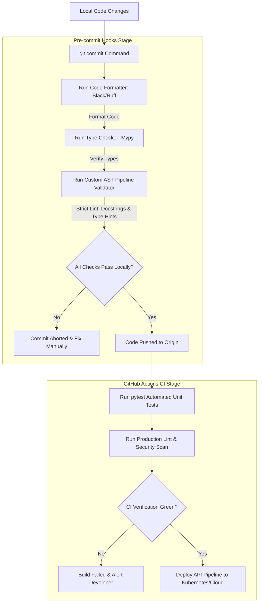

### 🎯 Learning Objectives
- Design and integrate a Continuous Integration (CI) static verification workflow.
- Set up local pre-commit hooks to automate formatting, linting, and type checking before committing code.
- Analyze the internal structure of Python code using Abstract Syntax Trees (AST).
- Build a custom Python validator using `ast` to enforce architectural constraints (such as missing type hints or docstrings).
- Establish exit-code-based gatekeeping mechanisms to block non-compliant code from entering branch histories.

### 🧩 Core Concepts (Why)

#### 1. Why Automation in CI Matters
In professional software development, manual code review is prone to human error. Continuous Integration (CI) systems automate the verification process:
- **Consistency**: Guarantees that all merged code adheres to the same style, quality standards, and type annotations.
- **Fail Fast**: Identifies regressions, formatting issues, and type errors within minutes, preventing bugs from reaching production.
- **Zero Human Overhead**: Frees up senior developers' review time by offloading syntax, format, and static analysis verification to automated checks.

#### 2. Pre-Commit Hooks vs. CI Pipelines
A reliable workflow implements verification at two layers:
- **Local Pre-commit Hooks**: Executed on the developer's machine *before* a Git commit is finalized. If checks fail, the commit is blocked. This saves CPU time on the remote build server and maintains a clean commit history.
- **CI Pipelines (Remote)**: Run on the Git server (e.g., GitHub Actions, GitLab CI) *after* code is pushed. This acts as the final source-of-truth gatekeeper, verifying code correctness before merging a Pull Request.

#### 3. Core Verification Tools
- **Linters/Formatters (Ruff / Black)**: Standardize styling, delete unused imports, and correct format anomalies.
- **Static Type Checkers (Mypy)**: Trace type definitions and flag variables violating annotations.
- **Custom Validators (AST)**: Sometimes off-the-shelf linters cannot enforce project-specific rules (e.g., "Every API endpoint function must contain a docstring" or "Every database model must inherit from a specific base class"). Writing custom validators using Abstract Syntax Trees allows teams to programmatically parse and inspect code structures.

---

### 🔁 Logic and Operation

Below is the complete architectural flowchart showing the lifecycle of code, from local git commits to remote CI verification and production deployment:



1. **Local Commit Interception**: Running `git commit` triggers the pre-commit script.
2. **Local Lint & Format**: The code is reformatted, type checked, and passed to a custom AST scanner.
3. **Push & CI**: If local checks pass, the commit succeeds and can be pushed. The CI server clones the code, spins up clean environments, executes test suites via `pytest`, and runs security audits.
4. **Deployment**: If all CI stages return exit code `0`, the API is compiled and deployed.

---

### 📝 Annotated Examples

#### 1. Custom Code Validator using Abstract Syntax Trees (AST)
An AST parses source code text into a tree of nodes representing the grammar of the programming language. The following script walks through a file's AST and checks that all functions have both type hints and docstrings.

```python
import ast

def inspect_source_code(source_code: str) -> dict:
    # Parse source string into an AST tree
    tree = ast.parse(source_code)
    
    report = {
        "missing_docstrings": [],
        "missing_annotations": [],
        "errors": 0
    }
    
    # Traverse all nodes in the tree
    for node in ast.walk(tree):
        # We are only interested in function definitions
        if isinstance(node, ast.FunctionDef):
            func_name = node.name
            
            # Check for docstring
            docstring = ast.get_docstring(node)
            if not docstring:
                report["missing_docstrings"].append(func_name)
                report["errors"] += 1
                
            # Check arguments for type annotations
            for arg in node.args.args:
                # In Python methods, skip checking 'self' or 'cls'
                if arg.arg in ("self", "cls"):
                    continue
                if arg.annotation is None:
                    report["missing_annotations"].append(f"{func_name}.{arg.arg}")
                    report["errors"] += 1
                    
            # Check return type annotation
            if node.returns is None:
                report["missing_annotations"].append(f"{func_name}.returns")
                report["errors"] += 1
                
    return report

# Test codebase snippet
snippet = """
def add(x: int, y: int) -> int:
    '''Add two numbers.'''
    return x + y

def log_message(msg):
    print(msg)
"""

results = inspect_source_code(snippet)
print(results)
# Output: {'missing_docstrings': ['log_message'], 'missing_annotations': ['log_message.msg', 'log_message.returns'], 'errors': 3}
```

#### 2. Mocking a Pre-commit Gatekeeper Script
Pre-commit hooks and CI steps rely on process exit codes. Returning `sys.exit(0)` signals success, while any non-zero exit code (e.g., `sys.exit(1)`) aborts the git commit or fails the CI build.

```python
import sys
import ast

def run_gatekeeper(file_path: str) -> None:
    print(f"[*] Analyzing file: {file_path}...")
    try:
        with open(file_path, "r", encoding="utf-8") as f:
            source = f.read()
            
        tree = ast.parse(source)
        errors_found = 0
        
        for node in ast.walk(tree):
            if isinstance(node, ast.FunctionDef):
                # Verify that no function has missing return annotation
                if node.returns is None:
                    print(f"[!] Error: Function '{node.name}' has no return type annotation.")
                    errors_found += 1
                    
        if errors_found > 0:
            print("[-] Gatekeeper failed. Please resolve static errors.")
            sys.exit(1) # Fail the git hook or CI pipeline
            
        print("[+] Gatekeeper passed successfully.")
        sys.exit(0) # Success
        
    except SyntaxError as e:
        print(f"[-] Syntax Error in code: {e}")
        sys.exit(1)
```

#### 3. Simulating a CI Pipeline Runner
A Python script simulating a remote orchestrator executing sequential verification jobs:

```python
import subprocess
import sys

def run_step(command: list[str]) -> bool:
    print(f"[*] Running: {' '.join(command)}")
    result = subprocess.run(command, capture_output=True, text=True)
    if result.returncode != 0:
        print(f"[-] Command failed. Error:\n{result.stderr or result.stdout}")
        return False
    print("[+] Step passed.")
    return True

def run_pipeline() -> None:
    # 1. Format Check (using black or ruff)
    if not run_step(["black", "--check", "."]):
        sys.exit(1)
        
    # 2. Type Check (using mypy)
    if not run_step(["mypy", "."]):
        sys.exit(1)
        
    # 3. Unit Tests (using pytest)
    if not run_step(["pytest", "tests/"]):
        sys.exit(1)
        
    print("[SUCCESS] All pipeline stages successfully verified. Release is ready.")
    sys.exit(0)
```

---

### ❌ Common Mistakes

**Mistake 1: Parsing raw files without handling SyntaxError**
```python
import ast
def check_syntax(code: str):
    # Eager parsing without exception handling
    tree = ast.parse(code)
    return "VALID"
```
```text
Traceback (most recent call last):
  File "validator.py", line 4, in check_syntax
    tree = ast.parse(code)
  File "/usr/lib/python3.10/ast.py", line 50, in parse
    return compile(source, filename, mode, flags,
  File "<unknown>", line 1
    def bad_func(x
                 ^
SyntaxError: unexpected EOF while parsing
```
```python
import ast
def check_syntax(code: str) -> str:
    try:
        ast.parse(code)
        return "VALID"
    except SyntaxError:
        return "INVALID"
```
> `ast.parse()` raises a `SyntaxError` if the input string is not valid Python code. Running a validator inside a pipeline must gracefully catch syntax errors as verification failures rather than crashing the pipeline execution itself.

**Mistake 2: Missing annotation validation for self/cls method arguments**
```python
import ast
def verify_no_missing_annotations(src: str) -> bool:
    tree = ast.parse(src)
    for node in ast.walk(tree):
        if isinstance(node, ast.FunctionDef):
            for arg in node.args.args:
                if arg.annotation is None:
                    return False
    return True
```
```text
Traceback (most recent call last):
  File "test_pipeline.py", line 6, in <module>
    # Fails validation for valid classes containing standard 'self' parameters
    assert verify_no_missing_annotations("class User:\n    def run(self):\n        pass") == True
AssertionError
```
```python
import ast
def verify_no_missing_annotations(src: str) -> bool:
    tree = ast.parse(src)
    for node in ast.walk(tree):
        if isinstance(node, ast.FunctionDef):
            for i, arg in enumerate(node.args.args):
                # Skip 'self' or 'cls' for instance/class methods if they are first arguments
                if i == 0 and arg.arg in ("self", "cls"):
                    continue
                if arg.annotation is None:
                    return False
    return True
```
> In Python OOP, `self` (for instance methods) and `cls` (for class methods) do not require explicit type annotations, as their type is contextually understood by type checkers. Failing to skip them will cause standard classes to fail validation check.

---

### 💡 Tips & Idioms

- **Leverage the `pre-commit` Framework**: Instead of writing manual Bash scripts under `.git/hooks/pre-commit`, use the Python-based `pre-commit` library. It manages script dependencies, triggers checks only on staged files, and caches environments cleanly.
- **Fail Fast, Run Cheap First**: In your CI workflow, run fast, static formatting checks (Ruff, Black) first. Run slow integration tests (pytest, DB migrations) last. This saves server costs and provides instant developer feedback.
- **Use AST instead of Regex**: Never use regular expressions to search for syntax rules or check imports. Regex is easily tripped up by string contents or indentation changes. Use Python's built-in `ast` module to read code grammar robustly.

---

### 🧠 Deep Dive (Under the hood)
<details><summary>Abstract Syntax Trees, Node Visitors, and Exit Codes in CI Processes</summary>

#### 1. What is an Abstract Syntax Tree?
Before compilers or interpreters run code, they tokenize source strings and construct an Abstract Syntax Tree (AST).
- Each node in the tree corresponds to a code token (e.g. `FunctionDef` represents a function definition, `BinOp` represents a binary operator like `+`, `Call` represents a function call).
- By traversing this tree, tools can understand the code structure semantically without running it.
- Python provides the built-in `ast` module to read, analyze, and even modify these nodes.

#### 2. Traversing with Node Visitors
Instead of using manual nested loops with `ast.walk()`, a cleaner pattern is subclassing `ast.NodeVisitor`:

```python
import ast

class MethodAnnotationValidator(ast.NodeVisitor):
    def visit_FunctionDef(self, node: ast.FunctionDef):
        # This method is automatically called for every FunctionDef node found
        if node.returns is None:
            print(f"[-] Missing return type for method: {node.name}")
        # Continue traversing children of this node
        self.generic_visit(node)

# Usage:
# validator = MethodAnnotationValidator()
# validator.visit(tree)
```

#### 3. Operating System Exit Codes
Every terminal command returned in standard shells ends with an exit status code (an integer from `0` to `255`).
- **`0`**: The command finished successfully.
- **Non-zero (e.g., `1`, `2`, `127`)**: An error occurred.
Continuous Integration runners (like GitHub Actions runners) execute steps sequentially. If any step yields a non-zero exit code, the runner stops, flags the build as red, sends alerts, and blocks deployment. This is why gatekeeper scripts must always run `sys.exit(1)` when verification fails.
</details>

---

### 🏋️ Exercise
Implement a pipeline validator `verify_pipeline(code_module_src: str) -> str` checking:
1. Type annotations: all functions must have type hints. Returns "PASS" or "FAIL".

```python
import sys

# Implement a pipeline validator `verify_pipeline(code_module_src: str) -> str` checking:
# 1. Type annotations: all functions must have type hints. Returns "PASS" or "FAIL".
def verify_pipeline(code_module_src: str) -> str:
    pass
```

---

### ✅ Self-Check
1. Why are local pre-commit hooks preferred over only relying on remote CI servers?
2. What Python exception is raised if you pass invalid syntax code to `ast.parse()`?
3. How does a CI engine determine if a step in a shell script failed?
<details><summary>Self-Check Answers</summary>

1. Local hooks identify and block formatting or type errors immediately on the developer's machine, keeping the repository's git commits clean and avoiding unnecessary wait times on CI servers.
2. It raises a `SyntaxError` exception.
3. It inspects the process exit code. Any value other than `0` signifies a failure and stops the execution pipeline.
</details>

---

### 📌 Summary
- **CI Pipelines** automate verification to guarantee consistent code quality across team members.
- **Pre-commit hooks** block non-compliant commits locally, saving server computation costs.
- **Abstract Syntax Trees (AST)** allow tools to programmatically parse and inspect Python code grammar and patterns.
- **`ast.parse` and `ast.walk`** enable custom validators that enforce strict standards (like docstrings and return type hints).
- **Shell exit status codes** are the mechanism used by automated systems to gatekeep and block bad code.
