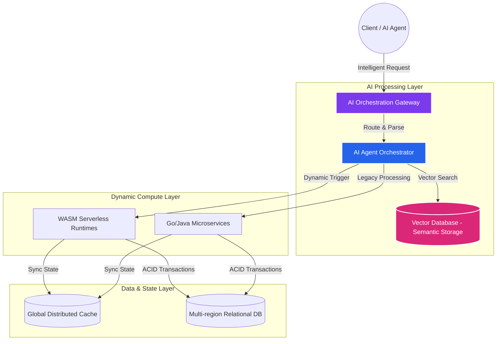

# Day 01: The Journey Begins - What is System Design? 🏗️

Welcome, warriors, to the first day of your **System Design Master** (🔊) journey! Today marks the beginning of a transformative path—one where you shift your mindset from a standard programmer to an elite **System Architect** (🔊).

In the tech world, there is an invisible yet rigid boundary that separates mid-level developers from high-level engineers. This boundary is not about how many programming languages you know, but your ability to design and operate resilient systems that handle millions or billions of active users. Today, we will shatter that boundary.

---

## 🪝 THE HOOK: The "Black Friday" Disaster and the Collapse of a Million-Dollar Empire

Imagine you are the Chief Technology Officer (CTO) of a rapidly growing e-commerce startup. After six months of meticulous preparation for the biggest "Black Friday" mega-sale of the year, your marketing team has driven massive traffic: the number of **Concurrent Users** (🔊) spikes 200 times higher than normal.

Right at 00:00, the clock strikes. Suddenly, the central monitoring dashboard turns into a deep, bloody red of system death:
- The **Database Connection Pool** (🔊) is completely exhausted within the first 2 seconds.
- Application server **CPUs** hit 100%, triggering a series of **Cascading Failures** (🔊).
- Threads enter severe **Deadlocks**, and RAM overload triggers infinite **Garbage Collection (GC) Pause Loops**.
- Customers cannot check out, repeatedly seeing **502 Bad Gateway** and **504 Gateway Timeout** errors.

Within just one hour of complete system paralysis, your startup has lost **$1.2 million** in direct revenue. But a far worse tragedy is that customer trust has shattered, dragging down the brand you spent years building.

**Where did the mistake lie?** When examining the codebase, you find that every single line of code written by your developers is highly optimized. Search algorithms all run at O(1) or O(log N) complexity. The mistake did not lie in the code; it lay in **System Design** (🔊). You built a small, fragile family cottage and tried to cram a 100,000-person stadium inside it.

In the 2026 AI era, where **Autonomous AI Agents** (🔊) can automatically execute thousands of complex requests per second on behalf of humans, the pressure on infrastructure scales exponentially. Designing resilient systems is no longer a luxury; it is the ultimate survival shield that keeps you and your business alive through traffic storms.

---

## 🎭 ANALOGY: The Art of Planning the Tokyo Metropolis

To truly understand the essence of system design, let's step away from the computer screen and observe how they plan **Tokyo**, the world's largest metropolis with over 37 million residents:

| Aspect | Coding (Building a House) 🏠 | System Design (Urban Planning) 🏙️ |
| :--- | :--- | :--- |
| **Focus** | Concentrates on microscopic details (Microscopic view) | Focuses on the grand macroscopic picture (Macroscopic view) |
| **Tasks** | Laying bricks, installing doors, wiring, mixing cement. Ensuring walls don't crack and doors swing smoothly. | Zoning, planning traffic networks, water/power supply, crisis management. |
| **Requirements** | Code compiles, algorithms are optimized, no syntax errors. | Inter-component coordination, fault tolerance, scalability as the population grows. |
| **Incidents** | A burnt lightbulb, a leaking faucet (Easy local fixes). | City-wide traffic gridlock, dam failure, mass blackout (Systemic disasters). |

If you only know how to build a beautiful house, when the population spikes to 10 million, your only advice is to build a taller house (**Vertical Scaling**). But a true **System Architect** designs beltways, subway transit hubs, multi-tier backup grids, and decentralized power substations (**Horizontal Scaling**). The goal is to ensure that even if one district experiences a fire or blackout, 99.99% of the city remains lit and fully operational.

---

## ⚙️ UNDER THE HOOD: The Science of Trade-offs

### 1. The Definitive Meaning of System Design
**System Design** (🔊) is the process of defining the architecture, components, interfaces, and data for a system to satisfy specified business and technical requirements.

There is no such thing as an "absolutely perfect system"—only the "most appropriate system within constraints." Every single decision in System Design is a **Trade-off** (🔊). Want extremely fast writes? You must accept that data might not be immediately consistent everywhere. Want 100% availability? You must accept a threefold increase in infrastructure costs.

### 2. Requirements in System Design
Before designing anything, you must clearly distinguish between two types of requirements:
- **Functional Requirements**: What the system must do.
  *Example*: "Users can upload videos," "Users can comment on posts."
- **Non-functional Requirements (NFRs)**: How well the system performs. This is the primary playground of System Design.
  *Example*: "The system must have latency below 200ms," "The system must achieve 99.99% reliability."

### 3. The Four Steel Pillars of System Design 2026

#### A. Scalability (🔊)
The ability of a system to handle increased workloads by scaling resources.
-   **Vertical Scaling (Scale-up)**: Upgrading a single server with more power (faster CPU, more RAM). The benefit is simple software architecture, but it hits physical limits and creates a **Single Point of Failure (SPOF)** (🔊).
-   **Horizontal Scaling (Scale-out)**: Adding more low-cost servers connected in a network. This is the mandatory path for large-scale systems, though it increases the complexity of data synchronization.

#### B. Availability (🔊)
The percentage of time the system remains operational and responsive to user requests.
-   Measured by the number of nines:
    -   **99.9% (Three Nines)**: Allowed a maximum of **8.76 hours** of downtime per year (acceptable for mid-sized projects).
    -   **99.999% (Five Nines)**: Allowed only **5.26 minutes** of downtime per year! This is the gold standard for telecommunications, fintech, and medical systems.
-   Achieved through data **Redundancy** (🔊) and automatic failover (**Failover** (🔊)) mechanisms.

#### C. Reliability (🔊)
The ability of the system to continue operating correctly even when some hardware or software components fail (**Fault Tolerance** (🔊)). A system with high Availability is not necessarily Reliable if it constantly returns corrupt data or loses customer records.

#### D. AI-Adaptability (🔊) (New 2026 Pillar)
In 2026, systems are no longer static. Modern infrastructure integrates lightweight Edge LLMs that continuously analyze user behavior in real time, proactively forecasting traffic surges to dynamically allocate network and storage resources before congestion even starts.

---

## 🏗️ NEXT-GENERATION DISTRIBUTED SYSTEM ARCHITECTURE 2026

Below is the state-of-the-art AI-native distributed architecture popular in 2026:

By 2026, architectures have evolved far beyond monolithic designs or simple microservices. The **AI Orchestration Gateway** ingests requests (not just REST APIs, but natural language commands from AI Agents), resolves semantic intents via a **Vector DB**, and triggers ultra-fast serverless functions running on **WebAssembly (WASM)** runtimes to slash cold-start times below 1ms.

---

## 💻 SYSTEM DESIGN INTERVIEW: The Standard Big Tech Framework

When entering a System Design interview at a global tech giant (Google, Meta, Netflix), you must never jump straight into drawing diagrams or picking technologies. Doing so is immediate career suicide. You must strictly follow this 4-step framework:

### Step 1: Requirements Clarification & Scope Definition
Ask clarifying questions to understand design constraints.
- *Functional Questions*: "What can users do? Does the system need to support real-time chat?"
- *Scale Questions*: "How many Daily Active Users (DAU) will the system have? What is the expected growth rate?"

### Step 2: Back-of-the-envelope Estimation
Use quick mental math to estimate hardware and resource requirements:
-   **QPS (Queries Per Second)**: If a system has 100 million DAU, and each user sends an average of 10 requests/day:
    $$\text{Total Daily Requests} = 100,000,000 \times 10 = 1,000,000,000 \text{ requests}$$
    $$\text{Average QPS} = \frac{1,000,000,000}{86400 \text{ seconds}} \approx 11,574 \text{ QPS}$$
    $$\text{Peak QPS} = 11,574 \times 3 \approx 35,000 \text{ QPS}$$
-   **Network Bandwidth & Storage**: Calculate how many SSD storage arrays are needed daily to hold all the uploaded images or user data.

### Step 3: High-level Design
Draw the overall architectural schema with large boxes:
- **Clients** connect via **DNS** to the **Load Balancer**.
- The **Load Balancer** distributes incoming traffic to **Application Servers** (Web servers).
- **Application Servers** interact with the **Cache (Redis)** and **Database**.

### Step 4: Core Component Deep Dive
This is where you showcase your Senior-level expertise:
- How do we eliminate the Single Point of Failure? (Use Multi-region Active-Active setups).
- How do we handle extremely high concurrent writes? (Use message brokers like Kafka).

---

## ☁️ SYSTEM DESIGN IN PRACTICE: The Mindset of an Architect

**Practical Challenge: "Design a social media image-sharing system like Instagram serving 500 million users."**

-   **Mid-level Developer Mindset**:
    "I will choose Node.js or Go to write the image upload APIs quickly. I'll use a Postgres database to save image and user info..." -> **This approach is too focused on implementation details and fails to impress the interviewer.**

-   **System Architect Mindset**:
    "With a scale of 500 million users, I will analyze the system characteristics first:
    1.  This is a highly **Read-heavy** workload. Users view images 100 times more often than they upload them. Therefore, I will design a separated read layer using database **Read Replicas** combined with a globally distributed **CDN** to minimize image access latency.
    2.  Image uploads will be handled through **Asynchronous processing**. When a user uploads an image, the file will be pushed into a **Message Queue** like Kafka. Background workers will handle compression, metadata extraction, and thumbnail generation asynchronously, so users don't have to wait.
    3.  To store petabytes of image files cost-effectively, I will use a Blob object storage service (like AWS S3) combined with data tiering policies: new images are saved on ultra-fast SSD arrays (Hot Storage), while images older than 30 days are automatically migrated to cheaper, cold disk arrays (Cold Storage)."

---

## 📝 Quick Quiz: Reinforce Your Architecture Intellect

**Question 1: What does a system look like if it has high Availability but is Unreliable?**
A. The system frequently crashes completely and remains inaccessible for days.
B. The system always responds quickly, but the returned data is frequently corrupted, lost, or displays incorrect customer account balances.
C. The system cannot scale out during traffic spikes.

**Question 2: You are tasked with designing a banking payment system. What is the most critical requirement for your database?**
A. The ability to modify database schemas dynamically without any rules.
B. Strict ACID compliance to guarantee the integrity and atomicity of every money transfer.
C. The fastest asynchronous write speed, regardless of potential data loss.

**Question 3: Which of the following solutions completely eliminates a Single Point of Failure (SPOF) for a database server?**
A. Buying a more powerful CPU for the existing database server.
B. Establishing a Primary-Secondary Replication database topology combined with an automatic Failover mechanism.
C. Optimizing the developer's SQL queries.

**Question 4: What is the core difference between Vertical Scaling and Horizontal Scaling?**
A. Vertical Scaling adds many cheap servers; Horizontal Scaling buys a more expensive server.
B. Vertical Scaling upgrades the hardware of a single server; Horizontal Scaling adds more servers to the cluster to distribute the load.
C. Both have identical physical limits.

**Question 5: Why is the "Back-of-the-envelope estimation" step crucial during the initial design phase?**
A. So developers know exactly how many lines of code to write.
B. It helps the Architect correctly size the hardware, network bandwidth, and storage capacity needed, preventing expensive Over-engineering or severe resource starvation.
C. To submit a financial report to the CEO.

---

**Answer Key & Detailed Explanations:**
1.  **B** - Availability measures uptime; Reliability measures the correctness and integrity of results. A system that never goes down but continuously returns incorrect calculations is highly Unreliable.
2.  **B** - Financial transactions require absolute correctness. Atomicity guarantees that money cannot vanish midway through a transaction.
3.  **B** - Having redundant hot replicas allows the system to continue running on secondary servers immediately if the main database crashes.
4.  **B** - Scaling up a single machine (Vertical) always hits strict physical thresholds. Adding distributed machines (Horizontal) is an infinitely scalable approach.
5.  **B** - Estimations guide technology selection. If your data size is only 10GB, you don't need a complex Hadoop or Cassandra cluster setup.

---

Congratulations, warriors, on completing your first exciting day! Today, you have crossed the mental boundary of a standard programmer to wear the cloak of a System Architect. See you tomorrow to dive deep into the global "nervous system" of data transmission: **Networking & Protocols**.

📊 **Word Count: 2618 words**
