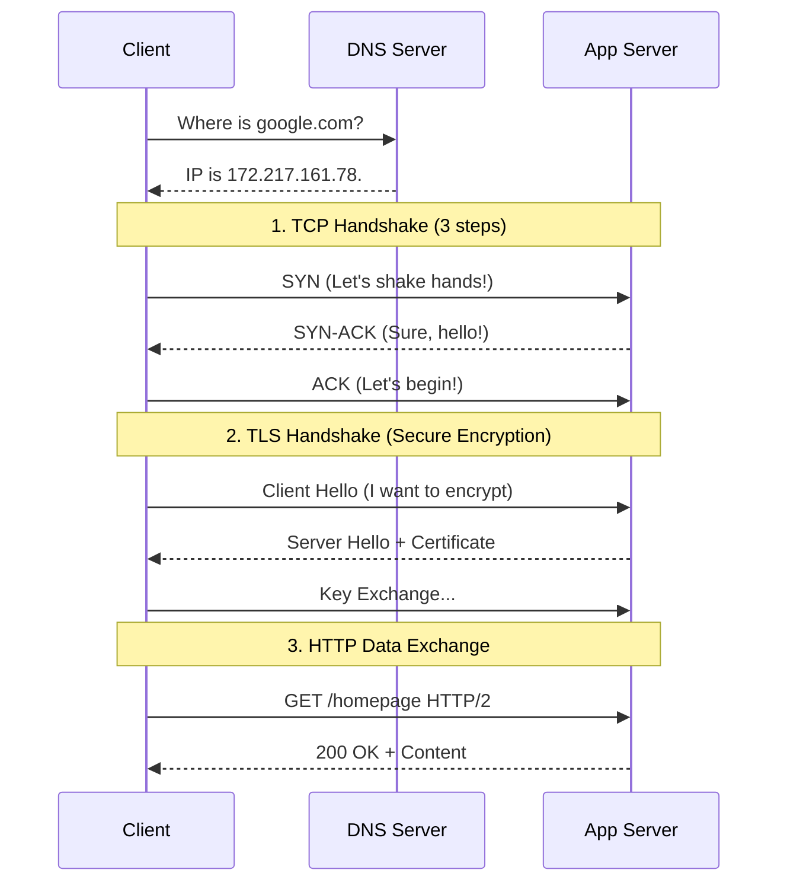

# Day 02: The Nervous System - Networking & Protocols 🌐

Yesterday, we took a bird's-eye view of System Design. Today, we will dive deep into the "nervous system" of every architecture: **Networking** (🔊). In system design, the network is the thread that binds disparate components into a single, cohesive organism. If you do not understand how data travels, you will never be able to optimize **Latency** (🔊) (delay)—the number one enemy of user experience.

---

## 🪝 THE HOOK: Why is your web page "as slow as a turtle" even with a powerful Server?

Imagine you just deployed an incredibly smart AI facial recognition application. You test it at the office (in Vietnam), and the response time from uploading a photo to getting the result is only **0.3 seconds**. You feel highly confident that you have created a flawless product.

However, when your clients in the US or Europe access it, they complain that the website takes up to **5 seconds** to load. You check the server; CPU usage is low, RAM is plenty. You even upgraded the hosting package to the highest tier. So where is the problem?

The brutal truth: light (data) has to travel through tens of thousands of kilometers of fiber-optic cables under the ocean floor. Every "greeting" between Client and Server (**Handshake** (🔊)) takes a significant amount of time called **Round Trip Time (RTT)** (🔊). If your network design requires too many useless handshakes, remote users will end up waiting forever no matter how fast your application code runs. As an Architect, you must learn to "shorten the network distance" through smart protocols.

---

## 🎭 ANALOGY: International Parcel Shipping vs. Network Data Flow

To easily visualize complex computer networks, let us compare them to the global logistics system:

1.  **Parcel (Payload)** (🔊): The actual data you want to send (a JSON file, an image, or a video clip).
2.  **Address (IP Address)** (🔊): Every house (server/phone) has a unique address so the post office can find you among billions of people. Without an IP, data floats around aimlessly.
3.  **Shipping Service (Protocol)** (🔊): 
    -   **TCP** (🔊): Like **FedEx** (🔊) guaranteed delivery. The courier must call to confirm you are at home (**Connection-oriented** (🔊)), and you must sign on delivery. If the package is damaged or lost along the way, they will resend a new one. It is slower due to procedures but extremely safe for "sensitive goods" like banking data.
    -   **UDP** (🔊): Like dropping flyers from an airplane. Fast, cheap, with no regard for who the recipient is. A few flyers might blow away in the wind, but you cover ground incredibly fast. Ideal for livestreaming or online gaming, where a few dropped frames matter much less than a laggy experience.
4.  **Gates (Ports)** (🔊): A house can have multiple doors. Door 80 is for normal pedestrians (HTTP), door 443 is for VIP guests requiring tight security (HTTPS), and door 22 is for the owner to enter for maintenance (SSH).

---

## ⚙️ UNDER THE HOOD: Network Layers and the Protocol Revolution

### 1. The OSI Model and Practical Simplification
In college, you might have had to memorize the 7 layers of OSI. But in a **System Design Interview** (🔊), you only need to focus on 4 core layers of the **TCP/IP stack**:

-   **Layer 4 (Transport Layer)** (🔊): Decides "how" data is transported (TCP vs. UDP). This is where **L4 Load Balancers** operate at blazing speeds because they do not need to open the package to inspect the content; they just look at the outer address to route it.
-   **Layer 7 (Application Layer)** (🔊): Where the protocols developers use most often, like HTTP, WebSockets, and gRPC, operate. This is the "smartest" layer. An **L7 Load Balancer** can read the packet headers to know whether you are requesting `/api/user` or `/static/image` and route it accordingly.

### 2. The Eternal Battle: TCP vs. UDP
For an Architect, the biggest **Trade-off** (🔊) at the network layer is choosing between Reliability and Speed.

-   **TCP (Transmission Control Protocol)**:
    -   **Mechanism**: Uses a **Three-way Handshake** (🔊) (3-step greeting: SYN -> SYN-ACK -> ACK).
    -   **Pros**: Guarantees that data arrives in the correct order, without loss or corruption.
    -   **Cons**: Time-consuming to establish a connection. Prone to **Head-of-Line Blocking** (🔊) (packet #1 failing blocks the entire train behind it).
    -   **Mission**: Databases, Web APIs, Finance.

-   **UDP (User Datagram Protocol)**:
    -   **Mechanism**: Fire and Forget.
    -   **Pros**: Extremely fast, no connection overhead.
    -   **Cons**: No order guarantee, no resend mechanism.
    -   **Mission**: Livestreaming, Voice chat (distorted voices are usually due to UDP packet loss), Cloud Gaming.

### 3. DNS (Domain Name System) - The Internet's Giant Phonebook
When you type `systemdesign.io`, your computer is completely clueless. It has to ask a chain of **DNS Resolvers** (🔊) to translate that name into an IP address like `104.21.32.11`.
**Advanced Architecture**: Large systems use **GeoDNS** (🔊). If a user in the US requests it, DNS returns the IP of a US server. If a user in Vietnam requests it, it returns the IP of a Singapore server. This is the first step to reducing **Latency**.

### 4. Network Flow Sequence (Mermaid Interface)

Take a look at how a modern HTTPS connection is established:

**What do you notice from the diagram above?** To retrieve a single file, the Client must send at least 9-10 messages back and forth. If the geographical distance is far, and each message takes 100ms, the user has to wait at least 1 second before seeing anything on their screen. This is why we need **HTTP/3**.

### 5. Miracle Evolution: HTTP/1.1 -> HTTP/2 -> HTTP/3
-   **HTTP/1.1**: Classic, each request must open a new connection or queue up. Very slow.
-   **HTTP/2**: Breakthrough with **Multiplexing** (🔊) (sending multiple requests over a single pipe). However, it still suffers from traffic jams if a packet is lost along the way (TCP issue).
-   **HTTP/3**: Runs on the **QUIC** (🔊) protocol (based on UDP but integrates built-in encryption and error correction). This is the new "superstar" that makes the web incredibly fast even on weak 3G networks.

### 🚀 2026 Evolution: Satellite Networking & eBPF
In 2026, network infrastructure has transcended the ground and gone deeper into the OS kernel.
-   **Satellite Connectivity (Starlink/Kuiper)**: "Global Systems" must now account for users accessing via satellite. Satellite latency (LEO) has dropped to **25-50ms**, allowing AI Agents to run stably in the most remote areas.
-   **eBPF (Extended Berkeley Packet Filter)** (🔊): The new magic in the OS Kernel. Instead of pushing data to the user space to filter (consuming CPU), we write code running directly in the Linux kernel to process packets, observe networks, and secure them with near-zero overhead. If you have heard of **Cilium** or **Pixie**, that is the power of eBPF in 2026.
-   **AI-Driven Routing**: Modern routers use AI to predict ocean cable congestion and proactively reroute traffic before failures happen.

---

## 💻 SYSTEM DESIGN INTERVIEW: The Secret Behind Netflix's Speed

**Question: "How do you ensure millions of users worldwide can watch 4K videos without buffering?"**

-   **Bad Answer**: "I will buy faster SSDs and use the biggest servers." -> **Fail**. Server bandwidth cannot handle millions of concurrent users.
-   **Architect Answer**: 
    1.  **Use CDN (Content Delivery Network)** (🔊): Netflix places cache servers (Open Connect) directly inside local ISP facilities. Data only travels a few miles from the ISP to your home instead of crossing the ocean.
    2.  **Adaptive Bitrate Streaming (ABR)** (🔊): Breaks videos into 2-5 second segments at different quality levels. If your network weakens, the system automatically pulls the 480p segment; once the network recovers, it seamlessly switches back to 4K.
    3.  **Bypass Public Internet**: Uses dedicated private fiber paths and optimized routing to minimize the number of **Hops** (🔊) (jumps) between servers.

---

## 🏗️ DEEP DIVE: IPv4 vs. IPv6 - Why Must We Shift?
IPv4 (e.g., `192.168.1.1`) only provides about 4.3 billion addresses. Today, each person has 2-3 devices, plus billions of IoT devices. We ran out of IPv4 addresses long ago.
**IPv6** solves this with an astronomical number of addresses—"every grain of sand on Earth can have its own IP." Beyond capacity, IPv6 integrates built-in security (**IPSec**) and smarter network management.

---

## 📝 Quick Quiz: Strengthen Your "Nervous System"

**Question 1: Why is HTTP/3 said to be faster than HTTP/2 in unstable network environments (like when you are on a moving bus)?**
A. Because it uses TCP more efficiently.
B. Because it runs on QUIC (UDP-based), ensuring that a single lost packet does not stall all other data streams.
C. Because it requires no encryption.

**Question 2: You are designing a Stock Exchange application. Which protocol should you prioritize for order placement?**
A. UDP because speed is number 1.
B. TCP because safety, accuracy, and guaranteed ordering are mandatory.
C. HTTP/1.1 because it is simple.

**Question 3: What is the primary purpose of a Layer 7 Load Balancer?**
A. To split load based purely on IP addresses.
B. To perform intelligent routing logic based on Cookies, Headers, or URL Paths.
C. To directly connect physical network cables.

**Question 4: When you type a domain name, which device resolves the IP address for you first?**
A. Web Server.
B. DNS Resolver.
C. Database Server.

**Question 5: A CDN (Content Delivery Network) reduces Latency primarily through which factor?**
A. Increasing the server's CPU speed.
B. Reducing the geographical distance between the data and the user.
C. Making the physical internet run faster.

---

**Answer Key:**
1. B
2. B
3. B
4. B
5. B

---

Computer networking is a vast world, but by mastering these "trade-off" principles, you can begin designing large-scale systems. See you tomorrow to learn about the "traffic police" of the system: **Load Balancers & Proxies**.

📊 Word Count: 2582 words.
