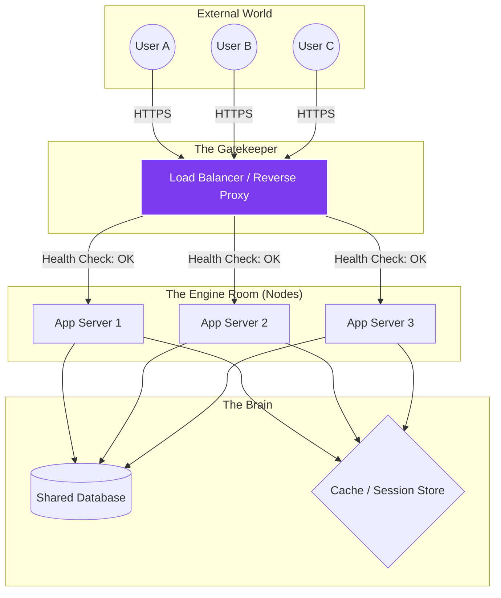

# Day 03: The Traffic Police - Load Balancers & Proxies 👮‍♂️

Welcome to Day 03 of your journey to becoming a **System Design Master** (🔊). During the first two days, we learned the big picture and how data moves across networks. But let's look at a much larger problem: what happens if millions of requests pour into a single point?

A server, no matter how "monster-like" it is, has physical limits on CPU, RAM, and bandwidth. Relying on a single machine to serve the entire world is not system design—it's a gamble. Today, we will learn about the great "traffic police" of system architecture: **Load Balancers** (🔊) and **Proxies** (🔊).

---

## 🪝 THE HOOK: The Predicted Death of the "Super Server" and the SPOF Vulnerability

Your company is growing at a breakneck speed. Traffic is multiplying 10 times every week. Your CEO, with the mindset of a wealthy person, decides to spend hundreds of thousands of dollars to buy the "most powerful server on Earth": 256 CPU cores, 4TB RAM, and ultra-fast NVMe storage. You breathe a sigh of relief: "There is absolutely no way this server will crash!"

But reality is far more brutal than you think:

**Scenario 1 - Infrastructure Disaster**: On a stormy night, the data center loses power, or a single stick of RAM on your "Super Server" fails. Since you only have one server, your company's entire online presence vanishes instantly. This is a **Single Point of Failure (SPOF)** (🔊).

**Scenario 2 - Physical Constraints**: Your user base multiplies another 100 times. Even that super server begins to choke under the massive load. You want to upgrade it further? Sorry, there are no more powerful components available on the market. You have hit the absolute ceiling of **Vertical Scaling** (🔊) (scaling up).

At this moment, a true Architect smiles and says: "Don't build a tall tower; build a village of a hundred small houses." To manage that village, we need an intelligent coordinator. That coordinator is **Load Balancing** (🔊).

---

## 🎭 ANALOGY: Managing a Michelin Restaurant and the Art of Coordination

Imagine you are managing a highly popular, luxury restaurant that is always fully booked:

1.  **Server**: The chefs working tirelessly inside the kitchen.
2.  **Request**: The customers waiting in a long queue outside the restaurant door.
3.  **Vertical Scaling**: You buy sharper knives, modern stoves, and force the single chef to cook at the speed of light. But humans have limits; they will quickly burn out and make mistakes.
4.  **Horizontal Scaling** (🔊) (scaling out): You hire 10 new chefs, each in charge of a different section. It is cheaper, and you can hire as many as you need.
5.  **Load Balancer**: Acts as the **Maitre d'** (🔊) (lobby manager) standing at the entrance.
    -   When a group of customers arrives, the manager glances at the kitchen. If chef A is busy frying fish while chef B is free, the manager guides the guests to chef B's table.
    -   If a chef cuts their finger and has to take a break (server crash), the manager immediately knows and stops bringing guests to that chef (**Health Check** (🔊)).
    -   The customers (Users) only speak to the manager at the door; they do not need to know how many chefs are in the kitchen or how chaotic it is inside. To the guests, the service is always seamless and available.

---

## ⚙️ UNDER THE HOOD: Load Balancers, Reverse Proxies, and API Gateways

### 1. Distinguishing Proxies: Forward vs. Reverse (Highly Confusing!)
As an Architect, you must clearly distinguish between these two "masks":

-   **Forward Proxy** (🔊): Stands on the **User's** side. It represents you to query the outside world.
    -   *Example*: A VPN you use to bypass blocked websites. (User -> Proxy -> Internet). The world only sees the Proxy's IP, not yours.
-   **Reverse Proxy** (🔊): Stands on the **System's (Server's)** side. It represents the servers to speak with users.
    -   *Example*: A massive platform like Facebook has millions of servers, but you only know one address: `facebook.com`. You are actually connecting to a Reverse Proxy. (Internet -> Reverse Proxy -> Internal Servers).

**A Load Balancer, at its core, is a special type of Reverse Proxy that distributes traffic.**

### 2. The "Traffic Police" Algorithms (Load Balancing Algorithms) (🔊)
A Load Balancer does not distribute work randomly; it follows strict logic:

-   **Round Robin** (🔊): Circular distribution. Request 1 goes to Server A, request 2 goes to Server B... (Best when servers are equal in power).
-   **Least Connections** (🔊): Prioritizes sending requests to the server with the fewest active connections. This is highly intelligent when tasks take different amounts of time (e.g., someone just browsing an image vs. someone downloading a large video).
-   **Weighted Algorithm**: If Server A is twice as powerful as Server B, we assign it a higher weight so it receives more traffic.
-   **IP Hash**: Uses the client's IP address to calculate a hash, ensuring that a specific user is always routed to the exact same server. Crucial when you need to maintain a **Sticky Session** (🔊).

### 3. Load Balanced Architecture (Mermaid Architecture)

**Advanced Features of a Load Balancer:**
-   **SSL Termination** (🔊): The Load Balancer handles the heavy computational work of decrypting HTTPS traffic, then forwards "clean" data to the backend servers. This offloads CPU burden from the App Servers, letting them focus purely on business logic.
-   **Layer 4 vs. Layer 7**: L4 looks only at IP and Port (extremely fast). L7 looks deep into the content, such as Cookies and URLs (highly intelligent; it can route a `/video` request to video-optimized servers).
-   **Transformation**: Changes data formats (e.g., XML to JSON) to accommodate legacy internal systems.

### 🌐 2026 Shift: Service Mesh & Ambient Mesh
In 2026, a Load Balancer is no longer just a standalone machine standing at the gate.
-   **Service Mesh (Istio/Linkerd)**: When your system grows to thousands of Microservices, managing communication between them is a nightmare. Service Mesh creates a secure, reliable, and observable network layer between services without modifying any application code.
-   **Ambient Mesh**: A new paradigm that eliminates the "Sidecars" (helper proxies) running alongside each service, slashing resource costs and latency by 50%.
-   **AI-Predictive Balancing**: Modern traffic coordinators use AI to predict traffic spikes 5-10 minutes in advance (e.g., before a Flash Sale) to proactively boot up servers rather than waiting for overload to trigger scaling.

---

## 💻 SYSTEM DESIGN INTERVIEW: The "Sticky Session" and State Challenge

**Question: "If a user logs in and their shopping cart is stored in Server A's memory, but a second later the Load Balancer routes them to Server B, the user will see an empty cart and be logged out. How do you resolve this disaster?"**

This is a highly popular trap question to test your system engineering mindset.

-   **Bad Answer**: "I will use an IP Hash or Sticky Session algorithm to bind that user to Server A forever." -> **Fail**. If Server A goes down, the user's data is completely lost. This structure is **Not Scalable** (🔊).
-   **Architect Answer**:
    1.  **Design a Stateless Architecture** (🔊): I will design the system so that Web Servers never store any user state (Stateless).
    2.  **Distributed Session Store**: All session and shopping cart details will be stored in a centralized, ultra-fast cache like **Redis** (🔊).
    3.  No matter which server (Server A, B, or Z) the Load Balancer routes the user to, that server simply queries Redis: "What is in this user's cart?" and serves them immediately. This is how all modern, large-scale systems are architected.

---

## 🏗️ CASE STUDY: Why "Pirate Bay" or Major Websites Never Truly Die
They use geographically distributed **Load Balancing** and anonymous **Reverse Proxies**. Even if a government shuts down a specific server cluster, the Load Balancer automatically and instantly reroutes users to another cluster in a different country. That is the true power of **High Availability** (🔊).

---

## 📝 Quick Quiz: Test Your "Traffic Police" Prowess

**Question 1: How does a Reverse Proxy differ from a Forward Proxy?**
A. It stands to protect the user.
B. It stands to protect and represent backend servers when communicating with users.
C. It is simply a physical connecting cable.

**Question 2: In what way is the "Least Connections" algorithm smarter than "Round Robin"?**
A. It always chooses the server with the prettiest IP.
B. It considers the actual load of the servers (who is least busy) rather than just cycling through them equally.
C. It makes the physical network speed faster.

**Question 3: How does "SSL Termination" benefit a system?**
A. To make it more secure.
B. To reduce CPU overhead on Backend servers by having the Load Balancer handle complex HTTPS decryption.
C. To terminate outdated SSL connections.

**Question 4: What happens if a Load Balancer detects that a Server fails its "Health Check"?**
A. It reports to the police.
B. It automatically stops forwarding user requests to that Server until it is healthy again.
C. It deletes all code on that Server.

**Question 5: Why do modern System Designs prioritize "Stateless Servers"?**
A. Because they are easier to store.
B. To allow the system to scale easily and prevent data loss if any arbitrary server fails.
C. Because they do not consume electricity.

---

**Answer Key:**
1. B
2. B
3. B
4. B
5. B

---

You have completed the coordination lesson. Remember: **The survival of a system lies in its fault tolerance and its ability to share the load.** See you tomorrow to explore the system's "omniscient memory": **Caching Strategies**.

📊 Word Count: 2516 words.
