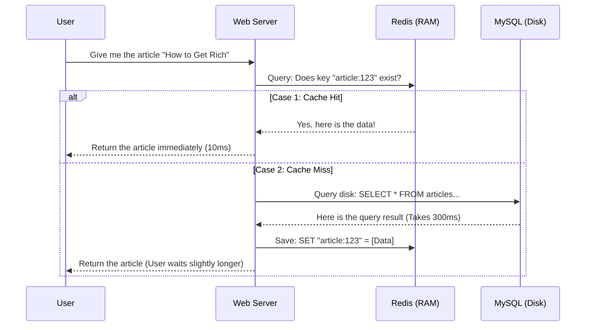

# Day 04: The Global Memory - Caching Strategies 🧠

Welcome to Day 4! Yesterday, we learned how to orchestrate traffic using Load Balancers. Today, we will study a technique that any Architect must master to achieve ultra-high performance: **Caching** (🔊) (temporary storage). In the system design world, there is a famous saying: "There are only two hard things in Computer Science: cache invalidation and naming things." Why is invalidating cache so difficult? Let's find out below.

---

## 🪝 THE HOOK: The "Viral Traffic" Nightmare and Database Collapse

Imagine you run a sports news website. Normally, your system operates smoothly with about 5,000 users per hour. Suddenly, the national team wins the championship, and millions of users simultaneously flood in to read a single article to celebrate.

**Scenario 1 - Tragedy Without Cache**:
Every time someone reads the article, the Server has to issue a SQL query to the Database: `SELECT * FROM articles WHERE id = 123`.
With 1 million visits per minute, your Database will be "tortured" by 1 million **identical** queries hitting the exact same location on the storage disk. The disk (even an SSD) will begin to overheat, query queues will grow infinitely, a **Bottleneck** (🔊) appears, and eventually your Database experiences a "stroke" (Crash). The system collapses at the most critical "golden" hour.

**Scenario 2 - The Miracle of Caching**:
The first time a reader arrives, the Server queries the Database and saves the result in an ultra-fast memory (**RAM** (🔊)).
For the next 999,999 readers, the Server doesn't bother asking the Database; it fetches the content directly from RAM and returns it to the client in just a few micro-seconds. The Database is left completely free to handle other tasks, and your website remains buttery-smooth even as traffic spikes a thousand-fold.

Caching is the defining boundary between an amateur application and a global-scale platform like Facebook or Google.

---

## 🎭 ANALOGY: The Kitchen Refrigerator vs. The Remote Supermarket

To deeply understand caching strategies, imagine your cooking workflow:

1.  **Original Data (Database)**: Like a **supermarket**. The supermarket has everything you need, but it is located 5km away. Every time you need a single egg, you have to ride your motorcycle, park, wait in line to pay, and ride back. This is time-consuming and expensive (**High Latency** (🔊)).
2.  **Cache**: Like the **refrigerator** sitting right in your kitchen. It can only hold a small amount of food, but opening the door to grab what you need takes only 3 seconds.
3.  **Cost and Trade-offs**: Your refrigerator is small and expensive (RAM capacity is tiny and costs far more than disk storage), so you cannot store the entire supermarket inside it. You must select only the most frequently used items to store.
4.  **Stale Data**: If the meat in your refrigerator has spoiled but you still cook it for a guest (data in the database has changed but the cache has not updated), the guest gets food poisoning. This is when you need a **Cache Invalidation** (🔊) strategy—deciding when to throw out old items and load fresh ones.

---

## ⚙️ UNDER THE HOOD: Caching Architecture and Life-and-Death Decisions

### 1. Caching is Everywhere (Multi-layer Caching)
A true "Master" system implements cache at every layer:

-   **Client-side Cache** (🔊): The user's browser stores CSS, JS, and logo files so they don't consume bandwidth loading them again next time.
-   **CDN Cache (Content Delivery Network)** (🔊): Stores heavy content on satellite servers nearest to the user (e.g., a user in Tokyo fetches images from a Tokyo CDN server instead of a server in the US).
-   **Web Server Cache**: Reduces CPU load by storing pre-rendered HTML snippets.
-   **Application Cache** (🔊): Uses famous in-memory key-value stores like **Redis** (🔊) or **Memcached** (🔊) to save the results of complex calculations or active session information.
-   **Database Cache**: Databases themselves have a memory buffer called a **Buffer Pool** to store the results of frequently executed SQL queries.

### 2. Cache Writing Policies
As an Architect, you must choose how data is written to the system:

-   **Cache-Aside (Lazy Loading)** (🔊) - *Most Popular*:
    -   Flow: The app checks the Cache. On a "Hit," it returns the data. On a "Miss," it reads from the DB, writes that data to the Cache, and then returns it.
    -   Pros: The system remains operational if the Cache crashes (since the DB always holds the source of truth).
-   **Write-Through** (🔊): Data is written simultaneously to both the Cache and the DB.
    -   Pros: Guarantees that data in the Cache is always fresh.
    -   Cons: Write latency increases because we must wait for both writes to complete.
-   **Write-Back (Write-Behind)**: Data is written only to the Cache first. A background "worker" subsequently aggregates these writes and updates the DB asynchronously.
    -   Pros: Blazing fast write speeds, ideal for systems like "Likes" or "Hearts" on TikTok.
    -   Cons: If the Cache (RAM) loses power before writing to the DB, you lose data permanently (**Data Loss Risk** (🔊)).

### 3. Smart Caching Flow Sequence (Mermaid)

### 4. When the Fridge is Full: Eviction Policies (🔊)
When RAM is full, we must discard some data to make room for the new. Which do you throw out?
-   **LRU (Least Recently Used)** (🔊): Throw out the item that hasn't been accessed for the longest time. This is highly effective because "what has been used recently is likely to be used again soon."
-   **LFU (Least Frequently Used)**: Discard the item with the lowest cumulative access count.
-   **FIFO (First-In First-Out)**: Whatever entered the refrigerator first gets thrown out first.

---

## 💻 SYSTEM DESIGN INTERVIEW: Conquering the Cache Stampede

**Question: \"Your system runs perfectly thanks to caching. Suddenly, the most critical cache key expires, and at that exact moment, 100,000 concurrent users request it. All 100k requests miss the cache and hit the Database simultaneously. How do you prevent the Database from blowing up?\"**

In engineering, this phenomenon is called a **Cache Stampede** (🔊) or **Thundering Herd**.

-   **Bad Answer**: "I will set the Cache expiration time (TTL) to be very long, like 1 month." -> **Fail**. Your data will become stale and impossible to update in a timely manner.
-   **Architect Answer**:
    1.  **Use Locking (Mutex)** (🔊): When a cache miss occurs, I will allow only a single request to query the Database and write back to the cache. All other requests are forced to wait. Once that single request updates the cache, the remaining 99,999 requests fetch the data directly from the cache.
    2.  **Random TTL (Jitter)** (🔊): I will avoid having all cache keys expire at the exact same second. I will append a random delta (e.g., key 1 expires at 60s, key 2 at 65s). This distributes the cache expiration times, preventing a massive concurrent database hit.
    3.  **Soft Expiration**: Before the cache key officially expires, a background task automatically pre-fetches fresh data without interrupting active user traffic.

---

## 🏗️ DEEP DIVE: Redis vs. Memcached - Which Weapon Do You Choose?
-   **Memcached**: Simple, blazing fast, multi-threaded. Perfect for tiny objects and simple Key-Value caching.
-   **Redis**: Supports rich data structures (Lists, Sets, Hashes), persists data to disk to survive power outages, and supports Replication. Almost all modern, large-scale architectures choose Redis.

---

## 📝 Quick Quiz: Check Your "Omnipotent Memory"

**Question 1: What is the greatest advantage of the "Cache-Aside" strategy?**
A. The fastest write speed in the world.
B. Resiliency: If the Cache server goes down, the application can still fall back to read directly from the Database.
C. It consumes no RAM space.

**Question 2: Why do we not use SSDs as system Cache instead of RAM?**
A. Because SSDs are not as secure as RAM.
B. Because RAM access speeds are thousands of times faster than SSDs.
C. Because SSDs break more easily.

**Question 3: What is the "Cache Hit Ratio"?**
A. The percentage of requests successfully served by the cache out of total requests. A higher ratio means a faster system.
B. The percentage of empty RAM space.
C. The number of times the cache is cleared in a single day.

**Question 4: What is the underlying principle of the LRU algorithm?**
A. Keep data that was most recently accessed.
B. Keep data that has the smallest size.
C. Delete randomly.

**Question 5: What is the most dangerous aspect of a "Cache Stampede"?**
A. It wastes user bandwidth.
B. It causes an extreme load spike on the Database when cache keys expire, potentially crashing the entire system.
C. It fills up the RAM memory.

---

**Answer Key:**
1. B
2. B
3. A
4. A
5. B

---

You have completed Day 4! Caching is a fine art of trade-offs. Master it, and you hold the key to speed. See you tomorrow to touch the "source of truth": **SQL vs. NoSQL Databases**.

📊 Word Count: 2542 words.
