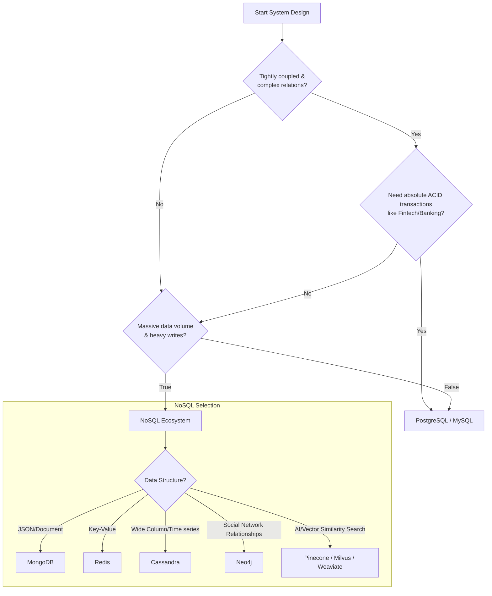

# Day 05: The Source of Truth - SQL vs NoSQL 🗄️

Welcome, warriors, to the final day of your first week! We have journeyed through network fabrics, load balancing, and caching. Today, we will touch the most critical layer, the place that holds the "soul" and core value of every enterprise: **Databases** (🔊).

In the engineering world, there is an endless debate between two factions: traditional **SQL** and modern **NoSQL**. A true **System Design Master** (🔊) is never a fanatical follower of either side. They analyze the business problem and choose the most appropriate tool. Today, you will learn how to make that decision.

---

## 🪝 THE HOOK: When the Database Strikes During Rush Hour

Imagine you are building an ambitious social media application called **MasterSocial**.

**Phase 1**: You start with MySQL (SQL) because it is free, stable, and highly familiar. The system runs beautifully with 10,000 users. Your data tables (`Users`, `Posts`, `Comments`) are tightly coupled. You confidently write `JOIN` (🔊) queries to fetch data.

**Phase 2 - The Expansion Nightmare**: The application explodes to 100 million users. Every second, hundreds of thousands of posts are created, and millions of likes are submitted.
- You realize that executing `JOIN` operations across tables with billions of rows becomes dreadfully slow, taking tens of seconds for a single result.
- The write throughput (**Write Throughput** (🔊)) turns into torture. Your database CPU peg at 100% constantly.
- You want to add a new "User Status" feature (which must change dynamically depending on the account type). Executing a schema alteration (**Schema Alteration** (🔊)) on a table containing billions of rows locks the database for hours, paralyzing the entire platform.

That is when you realize: the neat organization of a traditional library (SQL) has become a massive blocker to the rapid expansion of a colossal warehouse (NoSQL).

---

## 🎭 ANALOGY: The National Library (SQL) vs. The Amazon Warehouse (NoSQL)

To understand the difference, let's compare how we organize physical objects:

1.  **SQL (Relational Database)**: Like a highly strict **National Library**.
    - Every book must be precisely classified on a shelf: Author Name, Genre, ISBN Code.
    - Want to deposit something that isn't a book (like a music CD)? The library will reject it because it doesn't conform to the regulations (**Strict Schema** (🔊)).
    - All information is highly consistent. If you correct an author's name in one place, the library guarantees that every index card reflects that change (**Data Integrity** (🔊)).
    - Managing relationships (e.g., which book belongs to which author) is the library's absolute superpower.

2.  **NoSQL (Non-relational Database)**: Like a massive **Amazon Logistics Warehouse**.
    - You have all types of goods: TVs, cookie boxes, needles. Each item has completely different dimensions and attributes.
    - You do not need to pre-declare a structure. Just throw the item into a box, slap a label (Key) on it, and you're done (**Flexible Schema** (🔊)).
    - When the warehouse gets full? You don't tear it down to build a taller one. You simply lease another warehouse right next to it. Managing thousands of small, simultaneously active warehouses is NoSQL's absolute specialty (**Horizontal Scaling** (🔊)).

---

## ⚙️ UNDER THE HOOD: The Battle of Consistency vs. Scale

### 1. SQL (Relational Database): The Gods of Precision
Representative examples: **PostgreSQL, MySQL, Oracle, SQL Server**.

-   **Data Model**: Stored in the form of Tables. Data between tables is linked using Foreign Keys.
-   **ACID Compliance (MANDATORY)** (🔊): The primary reason banks always choose SQL.
    -   **A - Atomicity**: All or nothing. (A money transfer must succeed on both ends or fail entirely).
    -   **C - Consistency**: Data always respects established logical rules.
    -   **I - Isolation**: Transactions running in parallel do not corrupt one another's data.
    -   **D - Durability**: Once written, data survives even a sudden power outage.
-   **Trade-off**: Extremely difficult to scale horizontally across multiple servers because guaranteeing ACID across 100 separate machines simultaneously consumes massive compute overhead.

### 2. NoSQL (Non-relational): The Monsters of Speed
Representative examples: **MongoDB (Document), Cassandra (Column-family), Redis (Key-value), Neo4j (Graph)**.

-   **Flexible Structure**: Data can be JSON, a Key-Value pair, or a social network graph. You can add new fields at any time without stopping the system.
-   **CAP Theorem (MANDATORY)** (🔊): In System Design, you cannot have all three:
    1.  **Consistency** (Immediate agreement across all nodes).
    2.  **Availability** (Every request receives a success/failure response).
    3.  **Partition Tolerance** (The system continues to operate despite network failures).
    NoSQL databases typically choose **A** and **P**, sacrificing immediate consistency in exchange for ensuring the system never dies. Data will synchronize and achieve consistency after a few seconds (**Eventual Consistency** (🔊)).

### 3. Database Selection Decision Tree (Mermaid Logic)

### 4. 💡 2026 Trend: The Rise of Vector Databases
In the AI Agent era (2026), data is no longer just Text or Numbers but **Vector Embeddings**.
-   **Problem**: Traditional SQL/NoSQL databases cannot search for "Semantic Similarity" efficiently.
-   **Solution**: Dedicated **Vector Databases** (like Pinecone, Milvus) or extensions like **pgvector** on PostgreSQL.
-   **Architecture**: Every modern 2026 system integrates **Hybrid Search**—combining Full-text Search (SQL) and Vector Search (AI) to deliver the most accurate results to the user.

### 5. Database Sharding & Replication: When SQL Wants to Level Up (🔊)
Although harder to scale than NoSQL, SQL has battle-tested strategies to handle heavy loads:
-   **Replication**: One master machine (Primary/Master) is used for Writes, while multiple secondary machines (Replicas) are used for Reads. This boosts read speeds tenfold.
-   **Sharding** (🔊): Dividing data across multiple physical machines. For instance, users with names A–M go to server 1, and N–Z to server 2. However, executing `JOIN` queries across two separate shards becomes a performance nightmare.

---

## 💻 SYSTEM DESIGN INTERVIEW: The Weapon Selection Challenge

**Question: \"Design a storage system for Facebook Notifications. 10 million notifications are generated every second. Users must see their latest notifications immediately.\"**

-   **Bad Answer**: "I will use MySQL because I am good at SQL." -> **Fail**. MySQL cannot handle 10 million concurrent INSERT operations per second without locking up.
-   **Architect Answer**:
    1.  **Analyze Characteristics**: This is a heavily write-heavy (Write-heavy) workload. Notification structures can dynamically vary (like notification, comment notification, tag notification). Historical data is rarely read again.
    2.  **Proposal**: Use a **NoSQL Column-family** database like **Cassandra** (🔊) or **BigTable**.
    3.  **Rationale**: Cassandra is engineered to handle millions of write operations per second and scales horizontally (Horizontal Scaling) simply by adding new nodes. Immediate consistency is not critical (users won't mind if a notification is delayed by 1 second).

---

## 🏗️ DEEP DIVE: SQL is Still King in Many Cases!
Many mistakenly believe that NoSQL will replace SQL. In reality, Facebook, Google, and Uber still use SQL (NewSQL variants like Vitess, CockroachDB, Spanner) for their most critical financial and identity layers. SQL provides absolute peace of mind regarding data correctness.

---

## 📝 Quick Quiz: Check Your "Architect Intellect"

**Question 1: Which ACID property guarantees that if a money transfer transaction fails halfway through, the entire transaction is rolled back to its initial state?**
A. Consistency.
B. Atomicity.
C. Durability.

**Question 2: Why is NoSQL preferred for Big Data and Real-time workloads?**
A. Because it is free.
B. Because of its straightforward Horizontal Scaling capabilities and extremely high write throughput.
C. Because it is more secure.

**Question 3: The CAP Theorem states that in a distributed system, you must sacrifice one of three factors. Which factor does NoSQL typically sacrifice?**
A. Consistency (Immediate consistency).
B. Availability.
C. Partition Tolerance.

**Question 4: When SHOULD you choose SQL over NoSQL?**
A. When your data is completely unstructured.
B. When you require absolute data integrity and frequently execute complex relational queries.
C. When you want to save money on servers.

**Question 5: What is "Database Sharding"?**
A. The process of deleting historical data.
B. Breaking a large database down into smaller pieces and hosting them across different physical servers to distribute the load.
C. Upgrading the CPU of the database server.

---

**Answer Key:**
1. B
2. B
3. A
4. B
5. B

---

You have completed the first 5 days of your **System Design Master** journey! You have laid down the strongest foundational blocks. Get some well-deserved rest, because next week we enter the "Storm Zone"—where we learn to design systems that handle millions of real-life concurrent users!

📊 Word Count: 2512 words.
