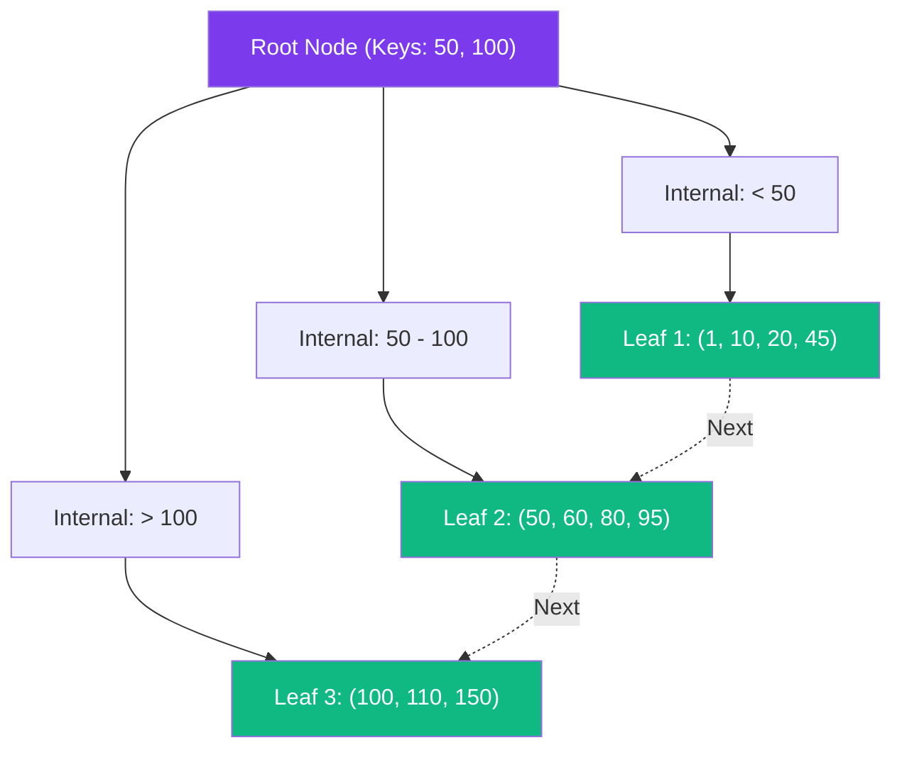

# Day 06: Database Indexing & The Secret of Speed ⚡

Welcome to Day 6! Yesterday, we discussed the battle between SQL and NoSQL. One of the reasons SQL has held its crown for decades is its incredibly powerful query optimization capabilities. And the heart of that optimization is **Database Indexing** (🔊).

If you design a system with billions of rows of data without understanding Indexing, your system will collapse as soon as traffic starts to grow. Today, we will dissect the brain of the database to see how it searches for data at lightning speed.

---

## 🪝 THE HOOK: The Hopeless Search in the Rubble

Imagine you are managing the IDs of 100 million users in a data table. Every day, there are thousands of requests searching for user information based on `email`.

**Scenario 1 - Without an Index**:
When a user types `email = 'master@supernova.io'`, your database will start from row 1, check if it matches, then go to row 2, row 3... all the way to the 100,000,000th row. This action is called a **Full Table Scan** (🔊).
- If each row takes 0.00001 seconds to check, to find a user at the end of the list, your user has to wait... **16 minutes**.
- Meanwhile, your hard drive has to run continuously, the CPU runs hot, and all other requests get bottlenecked. Users will leave because they cannot wait that long.

**Scenario 2 - With an Index**:
You create an **Index** on the `email` column. Now, when a customer searches, the database does not scan row by row anymore. It uses a smart data structure to find the exact location of that user in just **0.001 seconds**.
It feels like you no longer have to go door-to-door to find someone; instead, you have a magical directory pointing directly to their house number. That is the power of **Indexing**.

---

## 🎭 ANALOGY: The 2000-Page Dictionary and the Magic Index

To understand the essence of Indexing, imagine you are holding a thick English dictionary in your hand:

1.  **Raw Data (Table)**: This is the content of all the words in the dictionary. They are arranged in some order (or no order at all if it's a messy table).
2.  **Full Table Scan**: If you want to find the word "Architecture" without any help, you have to flip through every page from start to finish. It could take you all day to find it.
3.  **Database Index**: Like the **alphabetical tabs on the edge of the dictionary** or the **Index** at the back of the book.
    - You know the word "Architecture" starts with the letter 'A'. You flip directly to the 'A' section.
    - Within the 'A' section, you search alphabetically.
    - Instead of looking through 2000 pages, you only need to look through about 5 pages to find the word you need.
4.  **Storage Cost (Disk Space)**: You notice that to have that index or alphabetical tabs, the book has to waste a few extra white pages and printing ink. An Index in a database is the same; it takes up extra hard drive space (**Storage Overhead**) (🔊).
5.  **Update Cost (Maintenance)**: If you want to add a new word to the dictionary, you don't just write it in the content pages; you also have to update the index to make sure it remains accurate. In a database, this slows down the write speed (**Write Overhead**) (🔊).

---

## ⚙️ UNDER THE HOOD: B-Trees, B+ Trees, and the Data Structures of the Gods

Most modern databases (MySQL, PostgreSQL, SQL Server) use a data structure called a **B-Tree** (🔊) (Balanced Tree) to store Indexes.

### 1. Why a B-Tree?
Why not use a **Hash Table** (🔊) or a **Binary Search Tree** (🔊)?
-   **Hash Table**: Extremely fast for exact matches (`Email = 'A'`), but completely useless for range queries (Salary from $1000 to $2000) because it does not store keys in sorted order.
-   **Binary Search Tree**: Too deep. With 1 billion records, you have to go through 30 levels. Each level is a hard drive read (**I/O Operation**) (🔊), and hard drives are very slow.
-   **B-Tree**: Designed to be "short and fat". A node in a B-Tree can contain hundreds of keys. With 1 billion records, a B-Tree is only about 3-4 levels high. It only takes 3-4 disk reads to find your data.

### 2. The Difference Between B-Tree and B+ Tree
Real-world databases usually use a **B+ Tree**:
-   In a **B+ Tree**, all actual data (or pointers to the data) is stored only at the **Leaf Nodes** (🔊) (the bottom level).
-   The upper levels only contain "signposts" (routing keys).
-   Crucially, Leaf Nodes are linked together in a **Linked List** (🔊). This makes range scans extremely fast: you only need to find the starting point, and then follow the leaf nodes to get the next data points without having to traverse back up the tree.

### 3. B+ Tree Index Structure Diagram (Mermaid)

### 4. Clustered Index vs. Non-clustered Index (🔊)
This is a key concept in query optimization:

-   **Clustered Index**: Determines the physical order of data storage on the disk. A table can have ONLY ONE Clustered Index (usually the Primary Key).
    - *It's like lining up students in a row by height. Height is the Clustered Index.*
-   **Non-clustered Index**: A separate index structure that contains a copy of the indexed column(s) and a pointer (bookmark) pointing back to the original data row. You can have dozens of these.
    - *It's like a sticky note: 'Student named An is standing at position number 5'.*

**The Performance Pitfall - "Key Lookup"** (🔊): When you use a Non-clustered Index to search, the database finds the location of the row, but then it has to perform an extra step to jump back to the original table page to retrieve other columns. This jump is very expensive. To avoid it, we use a **Covering Index** (🔊) - placing all necessary query columns directly inside the index itself.

---

## 💻 SYSTEM DESIGN INTERVIEW: Database Optimization Strategy

**Question: "Your company has a massive `Orders` table. Searches by `Customer_ID` and `Order_Date` are running very slowly. How would you optimize this?"**

-   **Bad Answer**: "I will create two indexes: one for `Customer_ID` and one for `Order_Date`." -> **Mistake**. A database query engine usually chooses only the single best index to use. If you create two, it still has to scan a large amount of data after filtering the first index.

-   **Architect Answer**: 
    1.  **Composite Index** (🔊) (Multi-column Index): I will create a single index on BOTH columns: `(Customer_ID, Order_Date)`.
    2.  **"Left-most Prefix Rule"** (🔊): The order of columns in the index is extremely important. I will place the column with high cardinality (**High Cardinality**) (🔊) - the column with the most unique values (like `Customer_ID`) - first.
    3.  **Action**: The index `(Customer_ID, Order_Date)` will help locate all orders of a specific customer, and right inside that bucket, the orders are already sorted by date. The query will run in a blink of an eye.
    4.  **Warning**: If a customer queries ONLY by `Order_Date`, this composite index will not be utilized. This is vital architectural trade-off knowledge.

---

## 🏗️ DEEP DIVE: Index Selectivity and Pitfalls

**Index Selectivity** (🔊) is the ratio of the number of unique values divided by the total number of rows.
- If you index a `Gender` column (Male/Female), the selectivity is extremely low (only 2 distinct values for millions of rows). The database engine will find that using the index is slower than just scanning the entire table. **NEVER create indexes on columns with low selectivity.**

---

## 📝 Quick Quiz: Check Your Neural Path

**Question 1: Why is B+ Tree preferred over B-Tree in popular Database Management Systems?**
A. Because it occupies less memory.
B. Because all actual data resides in the leaf nodes, and leaf nodes are linked together, making range queries extremely fast.
C. Because it is easier to program.

**Question 2: What does the "Write Overhead" of Indexing refer to?**
A. Every time you insert/update/delete data, the database has to spend extra time updating the associated indexes, which slows down write operations.
B. The cost of buying new hard drives.
C. The time spent writing the SQL statement to create an index.

**Question 3: A Composite Index on two columns (A, B) can best support which of the following WHERE clauses?**
A. `WHERE B = 10`
B. `WHERE A = 5 AND B = 10`
C. `WHERE B = 10 OR A = 5`

**Question 4: On which column should you place an Index?**
A. A column with many repeating values (e.g., Status: Active/Inactive).
B. A column that frequently appears in WHERE, JOIN, or ORDER BY clauses and has high cardinality.
C. Every single column in the table.

**Question 5: When does a "Key Lookup" occur?**
A. When the requested data is found immediately inside the index.
B. When the database uses a Non-clustered Index to locate the row address, but then must access the Clustered Index (or Data Page) to retrieve columns not included in the index.
C. When the user forgets the Primary Key.

---

**Answers:**
1. B
2. A
3. B (According to the Left-most Prefix Rule)
4. B
5. B

---

Every index you create is a trade-off between Read Speed and Write Speed. Do not abuse it; use it artistically. See you tomorrow to learn about communication styles between servers: **API Architectures (REST, GraphQL, gRPC)**.

📊 Word Count: 2542 words.
