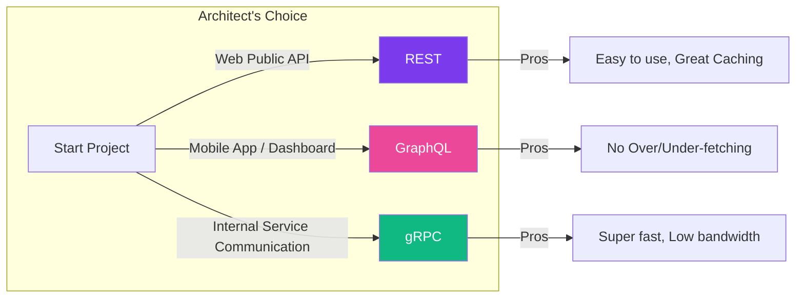

# Day 07: API Architectures - REST, GraphQL, gRPC 🔌

Welcome to Day 7! In the previous lesson, we optimized the "internal" workings of the server with Indexing. Today, we will learn how servers and applications talk to each other via **APIs** (🔊) (Application Programming Interfaces).

In the modern **Microservices** (🔊) landscape, a single user action can trigger dozens of conversations between background servers. If the communication "language" is inefficient, the entire system slows down, consumes excessive bandwidth, and becomes hard to maintain. We have three "kings" in the API world: **REST**, **GraphQL**, and **gRPC**. Let's see who wins in different scenarios.

---

## 🪝 THE HOOK: The Nightmare of "Over-fetching" and "Under-fetching"

Imagine you are building a mobile application like Instagram.

**Scenario 1: Over-fetching** (🔊)
You only want to display the `username` and `avatar` of 10 friends on the Home screen. You call the `/users` API. But ironically, this API returns **all** the information of those 10 people: date of birth, address, biography, a list of 500 old posts...
-   **Result**: Your app downloads 1MB of data just to display 10 names. Users complain because the app consumes too much 4G data and makes the phone very hot.

**Scenario 2: Under-fetching** (🔊)
You want to display a Post along with a list of the 5 most recent comments.
1.  You call `/posts/1` -> Returns the post content but no comments.
2.  You must call `/posts/1/comments` -> To get the list of comments.
3.  For each comment, you have to call `/users/[id]` to get the avatar of the commenter.
-   **Result**: The user's phone has to send 7-8 consecutive network requests (**Multiple Round-trips**) (🔊). On a weak 3G network, the webpage renders pieces slowly and lags painfully.

How do we communicate just enough, fast enough, and in an easily scalable way? That is why you need to understand API architectures deeply.

---

## 🎭 ANALOGY: Ordering Food - Set Menu vs. Buffet vs. Personal Omakase Chef

To easily visualize these three API types, imagine dining at a restaurant:

1.  **REST (Representational State Transfer)** (🔊): Like ordering a **Set Menu** (Fixed Combo).
    - You order "Combo No. 1" (Endpoint `/users/1`), and the waiter brings a tray containing: Rice, Chicken, Soup, and Vegetables.
    - Even if you don't eat soup, they still bring it out. You cannot ask to "give me Combo No. 1 but swap the soup for another piece of chicken." Want chicken? Order a separate plate of chicken.
    - It is very clear, everyone understands it, but it is sometimes a bit inflexible.

2.  **GraphQL** (🔊): Like a **Self-service Buffet**.
    - You are given a plate, and you pick exactly what you want: "Give me 1 piece of chicken and 2 slices of tomato."
    - The kitchen only brings out those exact items. Not a single grain of extra rice, not a drop of extra sauce.
    - You get everything you need in a **Single Request** (🔊).

3.  **gRPC (Google Remote Procedure Call)** (🔊): Like a **Personal Omakase Chef** at an extremely high-end, professional restaurant.
    - You and the chef talk in a super-fast sign language that outsiders don't understand (**Binary Protocol**) (🔊).
    - Instead of saying "Please give me a plate of honey roasted chicken...", you just raise 1 finger, the chef understands immediately, and executes the cooking action instantly.
    - Extremely fast service speed, no wasted movement, but newcomers will find it very hard to understand the sign language.

---

## ⚙️ UNDER THE HOOD: Dissecting Technical Strengths

### 1. REST: The Uncrowned King (Still the #1 Standard)
REST is built upon the principles of **HTTP** (🔊) and treats everything as **Resources** (🔊).

-   **Verbs**: Employs standard HTTP verbs: `GET` (read), `POST` (create), `PUT/PATCH` (update), `DELETE` (delete).
-   **Stateless** (🔊): Each request must contain all the information necessary for the Server to understand it. The Server does not store client session state. This makes the system highly **Scalable**.
-   **Caching**: Leverages browser and CDN caches incredibly well because each resource has a unique URL.
-   **Drawback**: The aforementioned Over-fetching and Under-fetching issues.

### 2. GraphQL: The Flexible Challenger
GraphQL is not a database type; it is a query language for your API.

-   **Typed Schema** (🔊): You must define the data structure clearly.
-   **Client-driven**: The client (Frontend) decides what data to receive back via a Query payload.
-   **Single Endpoint**: All requests are sent to `/graphql` (usually via POST). No more messy endpoints.
-   **Drawback**: Hard to implement Caching at the CDN level (since requests are typically POST and query contents change constantly). Overly complex queries can crash the server if not limited via **Query Depth** (🔊) protection.

### 3. gRPC: The Heart of Microservices Communication
gRPC was developed by Google, built on top of **HTTP/2** (🔊) and **Protocol Buffers** (🔊) (Protobuf).

-   **Binary Format**: Instead of sending bulky JSON text, gRPC transmits super-compact binary data.
-   **Streaming**: Supports continuous bidirectional streaming (Client and Server talking simultaneously).
-   **Code Generation**: Define the API contract once (`.proto` file), and gRPC automatically generates SDK code in dozens of languages (Java, Go, Python, JS).
-   **Drawback**: Traditional web browsers do not support gRPC natively (requires a Proxy layer like gRPC-Web). Hard for humans to read because it is binary.

### 4. Architectural Choice Matrix (Mermaid View)

### 5. Protocol Buffers (Protobuf) - Why is it so fast? (🔊)
Let's compare:
-   **JSON**: `{"id": 12345, "name": "Antigravity"}` -> Wastes a lot of bandwidth on curly braces, quotes, and repeating field names.
-   **Protobuf**: Only transmits `12345` and `Antigravity` along with extremely small numeric tags representing the field names. Bandwidth can be reduced by **5 to 10 times** compared to JSON.

---

## 💻 SYSTEM DESIGN INTERVIEW: When to use what?

**Question: "You are designing the architecture for a ride-sharing service like Uber. How should internal services (Location Service, Pricing Service, Driver Service) communicate with each other at high speed?"**

-   **Bad Answer**: "I will use REST because it is popular and easy to debug." -> **Mistake**. In a microservices system processing thousands of requests per second, the overhead of JSON serialization and HTTP/1.1 connection establishment will make the system slow and resource-heavy.

-   **Architect Answer**:
    1.  **gRPC for Internal Communication**: I will use gRPC for all internal (Service-to-Service) communications.
    2.  **Rationale**: gRPC runs on HTTP/2, supporting **Multiplexing** (🔊) (multiple requests over a single connection) and lightweight binary serialization to drastically reduce **Latency**.
    3.  **REST/GraphQL for Client**: On the public-facing side (mobile apps), I will expose GraphQL or REST through an **API Gateway** (🔊). The API Gateway will translate client requests into gRPC to talk to our internal services.

---

## 🏗️ DEEP DIVE: Idempotency in API Design

An incredibly important concept in system design interviews is **Idempotency** (🔊).
- An API is considered Idempotent if calling it 1 time or 100 times yields the exact same state outcome (e.g., a `PUT` request to update a user's name).
- `POST` (create) requests are generally NOT Idempotent (calling it 100 times creates 100 separate orders). As an Architect, you must design idempotency mechanisms to prevent a user clicking the "Pay" button twice from being double-charged.

---

## 📝 Quick Quiz: Check Your Neural Connection

**Question 1: What does "Over-fetching" mean in API architectures?**
A. The server crashes due to too many requests.
B. The client receives more data than it actually needs, wasting bandwidth.
C. The client does not receive enough data.

**Question 2: Why is gRPC typically used for internal service-to-service communication rather than public web clients?**
A. Because it is more secure.
B. Because it is extremely fast and bandwith-efficient, but web browsers do not support it natively.
C. Because it is free.

**Question 3: What is the most prominent feature of GraphQL compared to REST?**
A. It runs faster.
B. It is more secure.
C. It allows the client to specify exactly which fields it wants, eliminating over-fetching.

**Question 4: Which of the following HTTP methods is designed to be Idempotent?**
A. POST
B. PUT
C. LIST

**Question 5: How does Protocol Buffers (Protobuf) transmit data?**
A. JSON text
B. Binary format
C. XML

---

**Answers:**
1. B
2. B
3. C
4. B
5. B

---

Every API style is a tool in your toolbelt. Never say "GraphQL is better than REST"; instead say "GraphQL fits our mobile client better due to the complex page layouts." See you tomorrow to learn about a "must-know" algorithm in distributed systems: **Consistent Hashing**.

📊 Word Count: 2516 words.
