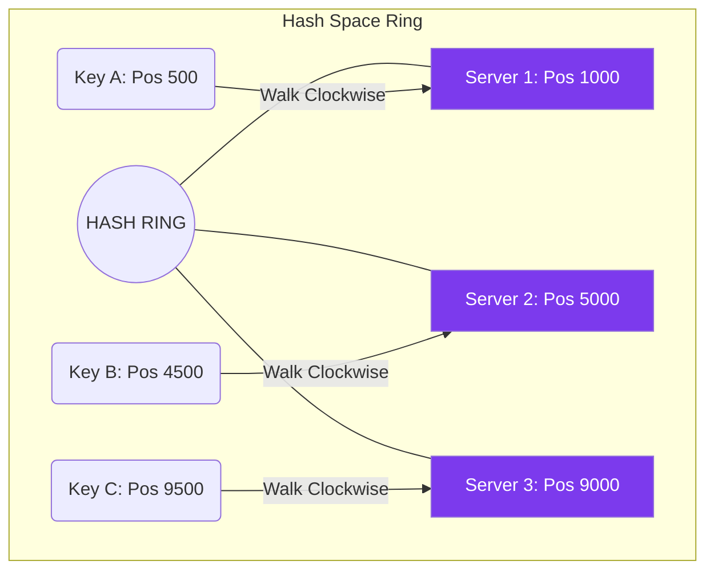

# Day 08: Consistent Hashing - The Algorithm of Balance 🎡

Welcome to Day 8! We have learned about Load Balancers, but have you ever wondered how a Load Balancer knows EXACTLY which Server a specific piece of data should reside on?

When your system grows so large that a single Database cannot store all the data, forcing you to split it across 100 Servers (**Sharding**) (🔊), a terrifying problem arises: If a Server dies or if you want to lease 10 more Servers, how do you avoid moving all billions of rows of data to the new locations? The answer lies in **Consistent Hashing** (🔊). This is the crucial algorithm behind the success of Amazon DynamoDB, Apache Cassandra, and global CDN systems.

---

## 🪝 THE HOOK: The "Re-hashing" Disaster and Cascading Failure

Imagine you are running a **Distributed Cache** (🔊) system for Facebook with 4 Servers (S1, S2, S3, S4).

**The Conventional Approach (Modulo Hashing)**:
You use a simple formula: `Server_ID = Hash(Key) % 4`.
-   If `Hash(Key)` returns 10, the data goes to Server 10 % 4 = 2.
-   Everything runs smoothly until a network partition or hardware failure occurs.

**The Catastrophe**:
Server 4 crashes or loses connection. Now you only have 3 active Servers. Your mathematical formula is forced to change to: `Server_ID = Hash(Key) % 3`.
-   `Hash(Key)` of 10 now maps to 10 % 3 = 1.
-   Data that was originally stored on Server 2 is now sought by the system on Server 1.

**The Horrifying Result**:
Almost **100% Cache Miss** (🔊) occurs simultaneously. Millions of requests instantly slam down to the origin Database because the cached data cannot be found. The Database explodes immediately under the extreme pressure. The entire system collapses due to a seemingly minor change. How do we add or remove Servers while moving only a tiny fraction of the data (e.g., only 1/n)? That is when **Consistent Hashing** comes to the rescue.

---

## 🎭 ANALOGY: The Circular Clock Road and Bus Stops

To visualize Consistent Hashing easily, imagine a closed circular road (similar to a clock face):

1.  **The Hash Ring** (🔊): Imagine a circle representing the entire hash value space (e.g., from 0 to 1 billion).
2.  **Bus Stops (Servers)**: Instead of arranging Servers in a traditional 1, 2, 3 linear order, you place these servers at random positions on that circle based on their hash value (e.g., hashing their IP addresses).
3.  **Passengers (Data Keys)**: Each piece of data (Key) is also hashed and placed at a random position on the same ring.
4.  **Stop Selection Rule**: Each passenger, after landing on the ring, walks clockwise until they encounter the first bus stop (Server). That is the Server responsible for storing their data.
5.  **Adding/Removing Stops**:
    -   If a bus stop is demolished (Server dies), only the passengers who were using that stop have to walk a bit further to the next stop. Passengers in other areas of the circle are **completely unaffected**.
    -   If a new stop is built, it only "steals" a few passengers from the stop immediately preceding it in the counter-clockwise direction.
    -   Compared to the old Modulo way, now only a very small fraction of the data (exactly 1/n) needs to migrate. This is a revolution in distributed system stability.

---

## ⚙️ UNDER THE HOOD: Dissecting the Math of the Hash Ring

### 1. How It Works Technically
Consistent Hashing operates through a fixed Hash Space, typically utilizing MD5 or SHA-1 algorithms to generate a range of values from $0$ to $2^{160}-1$ (or $2^{32}-1$ depending on the implementation).

-   **Server Mapping**: Each Server $S_i$ is mapped to a point $H(S_i)$ on the ring.
-   **Data Mapping**: Each data object $K_j$ is mapped to a point $H(K_j)$.
-   **Lookup Strategy**: $K_j$ belongs to the first Server whose hash position is greater than or equal to $H(K_j)$, progressing clockwise. If it exceeds the maximum value, it wraps around to the first Server on the ring.

### 2. Hash Ring and Data Flow Diagram (Mermaid)

### 3. The "Imbalance" Problem and the Savior: "Virtual Nodes" (🔊)
In practice, random hashing can create highly unequal segments. Server 1 might end up managing 70% of the ring while Server 2 manages only 5%. Server 1 will soon crash due to overload (**Hotspots**) (🔊).

**The Solution: Virtual Nodes (VNodes)** (🔊).
-   Instead of placing a single point for Server A, we create hundreds of "virtual versions" of it (A#1, A#2, ... A#200) and distribute them across the ring.
-   This breaks down the data and distributes it extremely evenly. If you have a more powerful server (e.g., 64-core CPU), you can assign it 500 VNodes, while a weaker machine gets only 100 VNodes. The system automatically balances load based on actual capacity.

### 4. Key Advantages for Architects
-   **Minimal Disruption**: When a node joins or leaves, only a small fraction of keys are reassigned.
-   **Dynamic Scaling**: You can smoothly add or remove thousands of servers in the cluster.
-   **Replication & High Availability**: To ensure safety, data is not only stored on the first Server it encounters but is also copied to the next $N$ physical Servers along the ring. If one machine dies, the data remains readily available on the next.

---

## 💻 SYSTEM DESIGN INTERVIEW: Sharding Billions of Instagram Photos

**Question: "Your photo storage system is too massive and must be split across 1000 Database Servers (Shards). How do you distribute the photos so that if a Shard fails or if you add 50 new Shards, the system remains operational without downtime?"**

-   **Bad Answer**: "I will use the Modulo algorithm. When adding servers, I will run a background script to scan the entire DB and migrate data to the new servers." -> **Fail**. Moving petabytes of data over the network while the system is live will choke local bandwidth and make the site crawl like a turtle, not to mention the high risk of data corruption.

-   **Architect Answer**:
    1.  **Use Consistent Hashing with Virtual Nodes**: I will hash the image filename (Key) to determine the target storage server on the ring.
    2.  **Manage Scalability**: When adding 50 new Shards, thanks to Consistent Hashing, 95% of existing data remains in place. Only about 5% of the data needs to migrate from neighboring servers to the new servers.
    3.  **Load Balancing**: I will use 200 Virtual Nodes per physical server to prevent overloaded hot spots (**Heat Map Issues**).
    4.  **Replication**: I will design the system so that each image is copied to the next 3 consecutive physical servers on the ring to ensure **High Availability**.

---

## 🏗️ DEEP DIVE: Real-world Libraries and Systems

If you work with **Go** or **Java**, check out libraries like `groupcache` or `ketama`.
-   **Ketama**: A famous algorithm implementing Consistent Hashing commonly used for Memcached. It creates a "continuum" of servers and ensures consistency across different clients.
-   **Distributed Hash Tables (DHT)** (🔊): P2P systems like BitTorrent also use variations of this algorithm (such as Kademlia) to locate data across millions of personal computers globally.

---

## 📝 Quick Quiz: Check Your Neural Core

**Question 1: What is the biggest benefit of Consistent Hashing compared to Modulo Hashing (% n)?**
A. It calculates thousands of times faster.
B. It minimizes the amount of data that needs to migrate (re-partitioning) when the number of servers changes.
C. It encrypts user data better.

**Question 2: Why do we need "Virtual Nodes" (VNodes) in a hash ring design?**
A. To hide the real IP addresses of servers from hackers.
B. To distribute data more evenly and flexibly based on the capacity of each physical server.
C. To make the servers run faster.

**Question 3: In a Hash Ring, if a data Key hashes to position 4000, and the Servers are located at positions 1000, 5000, and 9000, where will this data reside?**
A. Server at position 1000.
B. Server at position 5000 (first destination clockwise).
C. Server at position 9000.

**Question 4: What happens to a specific piece of data if the Server storing it suddenly dies?**
A. All data in the system is wiped out.
B. The data will be found on the next Server on the ring thanks to the replication mechanism.
C. The user can never retrieve that data again.

**Question 5: Which of the following systems does NOT use Consistent Hashing?**
A. Amazon DynamoDB
B. Apache Cassandra
C. A single SQL Database running on one Server

---

**Answers:**
1. B
2. B
3. B
4. B
5. C

---

This algorithm is the secret behind the "borderless" scalability of distributed systems. Mastering this "magical ring" is a huge step on your path to becoming a **Master Architect**. See you tomorrow to learn about the numbers that speak in systems: **Availability & Reliability Metrics (SLA/SLO)**.

📊 Word Count: 2342 words.
