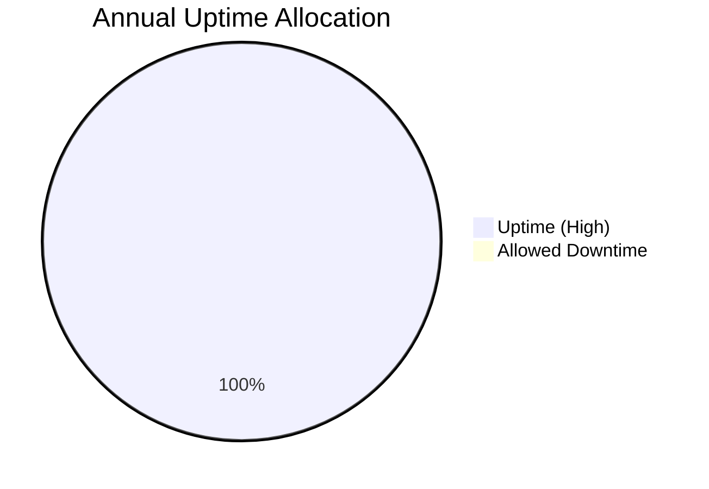

# Day 09: The Numbers of Trust - SLA, SLO, SLI 📊

Welcome to Day 9! We have built our systems, optimized databases, and distributed data using Consistent Hashing. But how do we know how "good" our system really is? How do we promise customers: "Rest assured, my service is always ready to serve you"?

In the professional world of **Software Engineering** (🔊), we do not use subjective words like "pretty stable," "extremely fast," or "rarely crashes." We speak the language of numbers and statistics. Today, we will introduce ourselves to the powerful trio: **SLI**, **SLO**, and **SLA**. These are the measures of trust between engineers and businesses, and between businesses and customers.

---

## 🪝 THE HOOK: The 100% Commitment - A Sweet Promise or Professional Suicide?

Imagine you are negotiating a cloud infrastructure service contract with a major bank. Their Chief Technology Officer (CTO) looks you dead in the eye and asks: "Does your system ever go down?"

**Scenario 1: The Naive Engineer**
You answer with roaring confidence: "No, never! We write code meticulously and have 100% test coverage. I guarantee **100% Uptime** (🔊)—it will never die!"
**Result**: You are immediately escorted out of the room.
**Why?** Because a real Architect knows that 100% is **unreasonable and physically impossible**. Undersea fiber optic cables get bitten by sharks, data centers get hit by natural disasters, and engineers make typos that wipe out entire storage clusters. Committing to 100% proves you do not understand the fundamental nature of distributed systems and risk probability.

**Scenario 2: The Elite Architect**
You answer calmly: "Our system targets **Four Nines** (🔊) (99.99%) availability. We monitor **SLIs** at the millisecond level, define monthly **SLOs** for our engineering teams to align on, and provide transparent **SLA** compensation clauses if incidents breach acceptable thresholds."
**Result**: You sign a million-dollar contract.
**Why?** Because you speak the language of truth and calculated risk. Those nines are the proof of your professionalism.

---

## 🎭 ANALOGY: Grab Rides and the Company's Promises

To understand the difference between SLI, SLO, and SLA clearly, let's look at the real-world experience of booking a ride:

1.  **SLI (Service Level Indicator)** (🔊) - **The Measured Reality**:
    -   When you open the app, sometimes you get a ride matched in 2 seconds; other times during peak hours, it takes up to a minute.
    -   Metrics like "Average Pickup Wait Time" or "Trip Cancellation Rate" are SLIs. This is live, raw data reflecting the actual performance of the running system.
2.  **SLO (Service Level Objective)** (🔊) - **The Internal Target**:
    -   Grab's management sets a goal for their engineers: "Over the next 30 days, 99.5% of booking requests must be successfully matched within 15 seconds."
    -   This is the target the team aims for. If the actual metric (SLI) drops below 99.5%, red alerts go off, and engineers must halt new feature development to focus on stabilizing the system.
3.  **SLA (Service Level Agreement)** (🔊) - **The Legal Agreement**:
    -   This is Grab's promise to VIP customers or enterprise partners: "We guarantee that 98% of trips will pick up passengers on time. If we fail, we will credit you with a 50% discount voucher for next month."
    -   An SLA always has a larger safety buffer than an SLO (e.g., if the internal SLO is 99.5%, the external SLA might only guarantee 98% to avoid excessive financial penalties).
4.  **Error Budget** (🔊) (Acceptable Margin of Error):
    -   If your SLO target is 99.9%, you have a 0.1% allowance for errors. This 0.1% is the development team's asset. You can spend it to experiment with risky new features. If the system fails within that 0.1% margin, no one gets blamed. But if you burn through this entire budget, you must freeze all deployments until the next month.

---

## ⚙️ UNDER THE HOOD: Dissecting the Metrics and SRE Culture

### 1. Availability vs. Reliability: Two Concepts, One Goal
As an Architect, you must distinguish between these two:
-   **Availability** (🔊): "Will you wake up and pick up the phone when I call?" This refers to whether the system is online and accessible.
-   **Reliability** (🔊): "When you pick up the phone, do you tell me the truth?" This refers to the system performing its intended function correctly over a long period without errors. A system can be online (Available) but return corrupted data (Unreliable).

### 2. The Mind-boggling Meaning of "The Nines" (Uptime Math)
Here is the maximum allowed **Downtime** (🔊) per year corresponding to each level:

-   **99% (Two Nines)**: Allowed to be down for **3.65 days** / year. (Suitable for personal blogs, small internal tools).
-   **99.9% (Three Nines)**: Allowed to be down for **8.77 hours** / year. (Standard for most startups and e-commerce websites).
-   **99.99% (Four Nines)**: Allowed to be down for **52.6 minutes** / year. (Global standard for payment systems, major e-commerce platforms like Amazon).
-   **99.999% (Five Nines)**: Allowed to be down for **5.26 seconds** / year. (Extremely difficult and expensive, reserved for telecommunications infrastructure, hospitals, satellite controls).

**Uptime Comparison (Mermaid)**

### 3. Golden Signals in Monitoring: MTBF and MTTR
-   **MTBF (Mean Time Between Failures)** (🔊): The average time between system failures. You want this to be as long as possible (system durability).
-   **MTTR (Mean Time To Repair)** (🔊): The average time it takes for engineers to recover the system after it crashes. This measures the capability of the **DevOps** (🔊) team.

**Architect's Secret**: To achieve high availability, trying to make a system "never break" is often prohibitively expensive. Instead, focus on minimizing MTTR—ensuring that when it does fail, it can auto-recovery or be patched in seconds.

### 4. Calculating Availability in Complex Systems
-   **Serial Systems**: If a Server ($99\%$) calls a Database ($99\%$). Total Availability = $0.99 \times 0.99 = 98.01\%$. (Availability drops as you add more serial links).
-   **Parallel Systems (Redundancy)**: If you run 2 Servers in parallel backing each other up, the probability of both dying simultaneously is very low. Total Availability = $1 - (0.01 \times 0.01) = 99.99\%$. This is why Architects always favor **Redundancy** (🔊).

---

## 💻 SYSTEM DESIGN INTERVIEW: The Availability Dialogue

**Question: "Our company is preparing to expand globally. Please propose a suitable SLO and explain why we shouldn't target 99.999%?"**

-   **Bad Answer**: "I will choose the highest possible tier to make the executives happy." -> **Fail**. You do not understand operational costs.

-   **Architect Answer**:
    1.  **Cost vs. Benefit Analysis**: Reaching 99.999% availability (5 seconds of downtime/year) requires extremely expensive infrastructure, active 24/7 engineering rotations, and complete redundancy at every single layer.
    2.  **Proposal**: For our current business model (e.g., food delivery app), I propose **99.9%** (down ~9 hours/year) as the ideal sweet spot.
    3.  **Rationale**: This allows us time for scheduled maintenance and provides an **Error Budget** to confidently ship new features without running high financial risks of SLA breaches. Pushing for those final decimal nines usually costs 10 times more while yielding diminishing business returns.

---

## 🏗️ DEEP DIVE: Blameless Post-mortem Culture (🔊)

When a major outage occurs and burns through the Error Budget, the SRE team holds a **Post-mortem**.
-   **Goal**: Uncover systemic failures, not to assign personal blame or punish individuals.
-   **Output**: A list of action items to ensure the failure **never happens again**. An outage happening once is an accident; happening twice is a failure of architectural process.

---

## 📝 Quick Quiz: Test Your Neural Path

**Question 1: Who is a SLO (Service Level Objective) primarily designed for?**
A. For lawyers to sue clients.
B. For the internal engineering team to monitor and pace their velocity.
C. For running ads on Facebook.

**Question 2: If your system maintains 3 nines (99.9%), what is the maximum allowed downtime per year?**
A. 1 hour
B. About 9 hours
C. 24 hours

**Question 3: Why do we need an "Error Budget"?**
A. To allow developers to write sloppy code.
B. To create balance: encouraging innovation (Dev) while maintaining stability (Ops).
C. To pay penalties to partners.

**Question 4: What capability of a team does the MTTR (Mean Time To Repair) metric measure?**
A. The capability to write code quickly.
B. The capability to detect and resolve incidents rapidly.
C. The capability to design beautiful interfaces.

**Question 5: What is the main purpose of "Redundancy" in system design?**
A. To eliminate Single Points of Failure and increase overall Availability.
B. To make the server run faster.
C. To save hard drive space.

---

**Answers:**
1. B
2. B
3. B
4. B
5. A

---

Trust is built on numbers, not empty promises. By mastering these metrics, you take complete control of your system's destiny. See you tomorrow to learn how to deal with real disasters: **Fault Tolerance - Retries, Backoff & Circuit Breaker**.

📊 Word Count: 2356 words.
