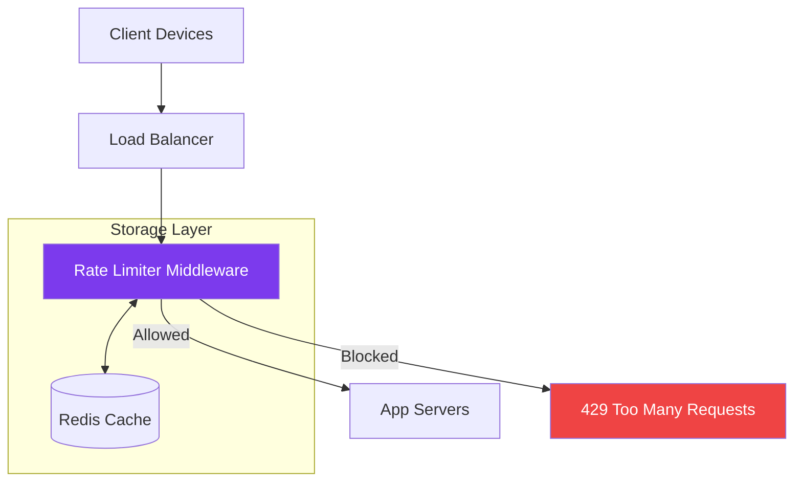

# Day 11: Rate Limiting & The Art of Traffic Control 🚦

Welcome to Day 11! We learned how to make our systems fault-tolerant in the previous lesson. Today, we will learn how to **PROACTIVELY** prevent failures by controlling who uses our systems.

In an ideal world, all users are well-behaved. In reality, they are not. There are bots scraping your data millions of times per second, competitors attempting to crash your servers with **DDoS** (🔊) (Distributed Denial of Service) attacks, or simply a client-side developer accidentally writing an infinite loop calling your APIs without pause. Without a **Rate Limiting** (🔊) mechanism, your system will soon collapse under the massive traffic, leaving a terrible experience for everyone else.

---

## 🪝 THE HOOK: When "Too Much Love" Becomes a Devastating Collapse

Imagine you are running a ticket sales website for a global superstar (like Taylor Swift).
-   **Second 1**: 100 users enter to buy tickets. The system is extremely fast and smooth.
-   **Second 2**: A group of professional scalpers deploys 10,000 bots, each bot sending 50 requests per second to secure cheap tickets.
-   **Second 3**: Server CPU spikes to 100%. The Database is choked (Connection Pool exhausted) due to millions of incoming queries. Real users (genuine fans who have waited for months) see only a blank screen or a **504 Gateway Timeout** (🔊) error.

You have 10 servers, but even if you scale up to 100, the bots will still drain your resources unless you know how to say "NO" intelligently. How do you filter out these greedy guests and prioritize precious resources for regular users? That is the survival mission of a **Rate Limiter**.

---

## 🎭 ANALOGY: The Busy Bar and the Bouncer at the Door

To understand Rate Limiting, imagine standing outside an extremely popular nightclub on a Saturday night:

1.  **The Bar (The System)**: Has a limited capacity for tables and drinks served each night.
2.  **Customers (API Requests)**: Want to get inside to enjoy the music and drinks.
3.  **The Bouncer (The Rate Limiter)** (🔊): Stands at the door checking everyone's ID.
    -   He has a strict rule: "Each customer (based on ID) is allowed to enter the bar a maximum of 3 times per hour."
    -   If you show up a 4th time? No matter how much money you have, he will say: "Sorry, you have had too much to drink. Please come back next hour to ensure your safety and leave room for others" (**429 Too Many Requests**) (🔊).
4.  **Membership Card (API Key/IP)**: The bouncer needs an identification method. He uses your IP address or API Key to count your entries.
5.  **The Essence**: Rate Limiting is not about absolute censorship; it is about ensuring **Fairness** (🔊). It prevents a single individual from hoarding the bar's resources, leaving hundreds of well-behaved patrons without a seat.

---

## ⚙️ UNDER THE HOOD: Dissecting Elite Traffic Filtering Algorithms

There are 4 classic algorithms you must master to design a system capable of handling billions of requests:

### 1. Token Bucket (🔊)
This is the most common algorithm (used by tech giants like Amazon and Stripe).
-   **Mechanism**: A bucket holds up to $N$ tokens. Every second, the system automatically refills the bucket with $R$ new tokens. To execute a request, you must "spend" 1 token. If the bucket is empty, your request is discarded.
-   **Advantage**: Highly flexible. It handles **Burst Traffic** (🔊) smoothly if there are enough accumulated tokens left over from idle periods.

### 2. Leaky Bucket (🔊)
-   **Mechanism**: Imagine a bucket with a small, fixed hole at the bottom. Water (requests) can be poured into the bucket at any speed, but it only drips out to be processed at a constant rate. If you pour in water too fast and it overflows, those excess requests are discarded.
-   **Advantage**: Guarantees a steady processing speed on the server (**Fixed Rate**), which is excellent for infrastructure systems requiring absolute consistency.

### 3. Fixed Window Counter (🔊)
-   **Mechanism**: Time is divided into rigid windows (e.g., 10:00:00 to 10:00:59). Within each minute, you are allowed up to 100 requests. When a new minute starts, the counter resets to 0.
-   **Fatal Flaw**: **Boundary Issue**. If a clever user makes 100 requests at the 59th second of the first minute and another 100 requests at the 1st second of the second minute. As a result, the server has to endure 200 requests within 2 seconds—double the allowed limit.

### 4. Sliding Window Counter (🔊)
-   **Mechanism**: Instead of rigid time blocks, it calculates based on the last 60 seconds rolling back from the exact moment of the request.
-   **Advantage**: Completely solves the boundary issue of the Fixed Window. It is highly accurate but requires slightly more memory and programming effort to track timestamps.

### 5. Mind Map of Rate Limiter Location (Mermaid)

---

## 💻 SYSTEM DESIGN INTERVIEW: Scaling for 1 Billion Users

**Question: "You are tasked with designing a Rate Limiter for Twitter's entire API platform. Where would you store user request counts to ensure the lowest latency?"**

-   **Bad Answer**: "I will create a `RequestHistory` table in a Relational Database (like MySQL/PostgreSQL) and run a `COUNT(*)` query for every incoming request." -> **Absolute Fail**. Querying a slow database like this will crash the system instantly due to an **I/O Bottleneck**.

-   **Architect Answer**:
    1.  **Distributed Storage**: I will use **Redis** (🔊), an extremely fast in-memory data store.
    2.  **Atomic Operations**: I will use Redis commands like `INCR` and `EXPIRE`.
    3.  **Rationale**: Redis stores data in RAM, allowing read/write operations of millions of records per second with sub-millisecond latencies.
    4.  **Resolve Race Conditions** (🔊): In a distributed environment where multiple servers access the same key in Redis concurrently, I will use **Lua Scripts** to ensure the "Read - Check - Increment" operations run completely atomically, preventing users from bypassing limits due to data discrepancies between servers.

---

## 🏗️ DEEP DIVE: Throttling, Quotas, and Blacklisting (🔊)

To truly master this, you need to understand these advanced concepts:
-   **Throttling** (🔊): Slowing down requests instead of outright rejecting them. When you exceed the threshold, I still let you pass, but return results extremely slowly so you self-regulate.
-   **Quotas** (🔊): Limits over longer cycles (e.g., monthly/yearly). For example: "Your free plan is only allowed to view 50 articles per month."
-   **IP Blacklisting** (🔊): If an IP address exhibits obvious attacking behavior (sending tens of thousands of failed requests), the Rate Limiter commands the firewall to drop all traffic from that IP for 24 hours.

---

## 📝 Quick Quiz: Check Your Traffic Control Capacity

**Question 1: Why is 429 the most important error code in today's lesson?**
A. Because it indicates the server crashed.
B. Because it is the standard HTTP code to inform the client: "You have exceeded your allowed request limit."
C. Because it is a security error code.

**Question 2: Which algorithm helps the system respond best to "Burst Traffic" (sudden traffic spikes)?**
A. Leaky Bucket
B. Token Bucket
C. Fixed Window Counter

**Question 3: What is Redis's role in a Rate Limiting architecture?**
A. To store user profile pictures.
B. To act as a central, super-fast shared counter to track API calls in a distributed environment.
C. To encrypt data.

**Question 4: When does a "Race Condition" occur in this context?**
A. When two servers attempt to update the call count of a single user at the same time, leading to undercounting, which allows the user to bypass the limit.
B. When the system runs too fast.
C. When there is a race among hackers.

**Question 5: Why should we use Lua Scripts inside Redis for a Rate Limiter?**
A. Because it is easy to write.
B. To ensure atomicity (Atomic), completely preventing Race Conditions.
C. To save RAM.

---

**Answers:**
1. B
2. B
3. B
4. A
5. B

---

Every open system needs a dedicated "bouncer" at the door. Understanding Rate Limiting not only protects your servers from crashing but also helps you design intelligent SaaS business models. See you tomorrow to learn about bringing data closest to your users: **Content Delivery Networks (CDN)**.

📊 Word Count: 2652 words.
