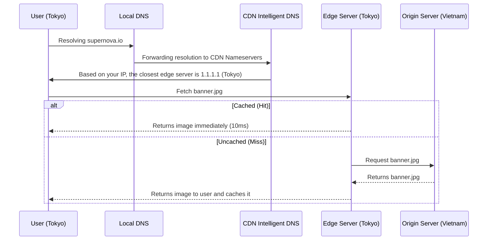

# Day 12: Content Delivery Networks (CDN) - The Speed of Light ⚡

Welcome to Day 12! We learned how to control traffic (Rate Limiting) to protect servers in the previous lesson. Today, we will learn how to deliver data to users as quickly as possible, regardless of geographical distance.

Have you ever wondered why when watching Netflix or YouTube, 4K videos appear instantly even though their origin servers might be located on the other side of the world? If every request had to travel across the oceans to reach a central server, we would wait seconds just to load a simple banner image. A **Content Delivery Network (CDN)** (🔊) is a globally distributed network of "proxy servers" that bridges this physical distance, providing a seamless, borderless experience.

---

## 🪝 THE HOOK: Distance Is the Number 1 Enemy of Conversion Rates

Imagine you have just launched a global luxury shopping application. Your server is placed in Ho Chi Minh City, Vietnam.
-   **Users in Hanoi**: Experience a 0.05-second data retrieval speed. It feels incredibly fast and professional.
-   **Users in Berlin or New York**: Data must cross dozens of network hops, traveling under the Pacific or Atlantic Oceans.
    -   Although light travels extremely fast through fiber optic cables, it still faces physical limitations. A **Round-trip Time (RTT)** (🔊) between the US and Vietnam can easily take 0.3 to 0.5 seconds.
    -   A modern e-commerce page might contain 100 product images and dozens of script files. If each file has to be fetched sequentially from Vietnam, a user in New York will sit staring at a blank screen for **10 to 20 seconds**.
-   **The Painful Result**: According to Amazon's research, every 100ms of latency costs them 1% in sales. Customers in the US will get frustrated, close your site, and purchase from local competitors instead. You lose access to a billion-dollar market simply due to the latency of the speed of light. How do you "move" your entire website right next door to your customers in the US? The only answer is a **CDN**.

---

## 🎭 ANALOGY: The Retail Store and the National Supply Chain

To understand the core of a CDN, imagine the supply chain of a leading milk manufacturer:

1.  **Origin Server** (🔊): Like a single **Milk Factory** located in a remote mountainous province. If everyone who wanted milk had to drive hundreds of miles directly to the factory, roads would clog, fuel costs would skyrocket, and the milk would spoil before returning home.
2.  **CDN Edge Servers** (🔊): Like **Convenience Stores (7-Eleven, Circle K)** scattered in every neighborhood right at the base of your apartment building.
    -   The factory does not wait for a customer to call before delivering. They proactively ship milk to stock these local stores in advance (The **Caching** phase).
    -   When you are thirsty, you simply walk 2 minutes to the corner store and grab some milk. You do not care which province the factory is in or if it is currently experiencing a power outage.
3.  **Out of Stock (Cache Miss)** (🔊): If you go to the store and that specific milk is out of stock, the store staff calls the factory to rush a shipment. They deliver it to you and keep a few extra cartons on the shelf for the next customers.
4.  **Mutual Benefits**: The factory is not overwhelmed by millions of customers rushing its gates, and consumers get their milk instantly with zero travel friction.

---

## ⚙️ UNDER THE HOOD: Decoupling the CDN Architecture

### 1. Content Classification: Static vs. Dynamic
-   **Static Content** (🔊): Images, Videos, CSS, and JavaScript files. This is the soul of a CDN because these files do not change from user to user. A CDN caches them once and serves them millions of times.
-   **Dynamic Content** (🔊): Search results, user profiles, shopping carts. Modern CDNs employ advanced techniques like **Dynamic Site Acceleration (DSA)** to optimize network paths between Edge Servers and the Origin, routing dynamic data over private, fast network highways.

### 2. Caching Strategies: Pull vs. Push
-   **Pull Model**: When the first user requests a file, the CDN checks its cache. If it is not present (Cache Miss), it automatically fetches the file from the Origin server, caches it locally, and delivers it to the user. This is the simplest and most common approach.
-   **Push Model**: You proactively push data to the CDN before anyone requests it. This is typically used for massive product launches (e.g., Apple releasing a new 5GB iOS update), avoiding the expensive first-time "Cache Miss."

### 3. Intelligent Routing Flow (Mermaid Diagram)

How does a browser automatically know to call the nearest Edge Server in Tokyo instead of one in the US? The secret lies in the coordination between the CDN and the DNS system.

### 4. Essential Concepts for CDN Management
-   **Cache Hit Ratio** (🔊): The percentage of requests successfully served at the Edge. If this ratio is 90%, it means the CDN has offloaded 90% of the traffic from your Origin server.
-   **TTL (Time To Live)** (🔊): The expiration time of a cached copy. If set to 1 day, the CDN will discard the cached file after 24 hours and fetch a fresh one upon the next request.
-   **Purge/Invalidation** (🔊): Manually forcing the CDN to delete cached files immediately (e.g., when a website is compromised and you must instantly roll out a clean script).

---

## 💻 SYSTEM DESIGN INTERVIEW: Running a System for 10 Billion Views

**Question: "You are designing a football livestreaming system with millions of concurrent viewers. How do you ensure video streams remain lag-free and the Server doesn't crash during goal-scoring events?"**

-   **Bad Answer**: "I will spin up servers with massive CPU power and upgrade the origin network bandwidth from 1Gbps to 100Gbps." -> **Fail**. Băng thông at data centers is incredibly expensive, and no single origin gateway can withstand millions of concurrent viewers hitting a single point of entry (**Single Point of Traffic**).

-   **Architect Answer**:
    1.  **Tiered Distribution**: I will use a multi-tiered CDN architecture to offload traffic from the Origin.
    2.  **Edge Caching**: Livestream videos will be broken down into small segments and cached right at the Edge. When millions of viewers watch the same segment, only a single request goes back to the Origin; the CDN then distributes it to millions of downstream viewers.
    3.  **Anycast IP**: I will use Anycast routing to direct users to the healthiest and closest CDN edge location.
    4.  **Security**: I will leverage the CDN to mitigate DDoS attacks against the infrastructure by filtering malicious traffic directly at the network border.

---

## 🏗️ DEEP DIVE: Edge Computing and the Serverless Wave (🔊)

The future of the web goes beyond static file delivery. Services like **Cloudflare Workers** or **AWS Lambda@Edge** allow you to execute code (JavaScript/Rust) directly on CDN Edge servers.
-   **Example**: Verifying authorization (Authentication) at the Edge in New York before allowing a user to view a video, without routing the request all the way back to Vietnam just to realize "User is not logged in."
-   This elevates **Resiliency** (🔊) to a new level. Lightweight application logic is pushed to the network edge, leaving the central server to focus purely on heavy data processing.

---

## 📝 Quick Quiz: Test Your Light Speed

**Question 1: What role does the "Origin Server" play in a CDN architecture?**
A. It is the server closest to the user.
B. It is the original server containing the source data, where the CDN fetches files upon a "Cache Miss."
C. It is the web browser.

**Question 2: Why does using a CDN save operating costs for businesses?**
A. Because CDNs are completely free.
B. Because CDN bandwidth is significantly cheaper than direct bandwidth from traditional Cloud servers, reducing origin server hosting bills.
C. Because it consumes less electricity.

**Question 3: What does the term "Propagation Time" (🔊) refer to in a CDN?**
A. The time light takes to travel from the origin server to the client.
B. The duration it takes for a change (e.g., cache invalidation) to sync across all edge servers worldwide.
C. The rotation speed of a hard drive.

**Question 4: When should you prioritize using the "Push Model"?**
A. When your data changes continuously every second.
B. When you are releasing extremely heavy content (like a new game) and want edge servers pre-stocked before launch time.
C. When you want to save memory.

**Question 5: If an image file on a CDN is set with a 1-year TTL but you just updated a new image with the same name, what should you do?**
A. Wait 1 year for the new image to show up.
B. Rename the file or trigger a "Purge/Invalidate" request to force the CDN to delete the old version immediately.
C. Rebuild the website from scratch.

---

**Answers:**
1. B
2. B
3. B
4. B
5. B

---

A CDN is the "wings" that allow your application to reach the world at the speed of light. A great Architect is one who knows how to make geographical distance completely invisible to the end-user. See you tomorrow to explore the massive directories of the internet: **DNS & Anycast**.

📊 Word Count: 2682 words.
