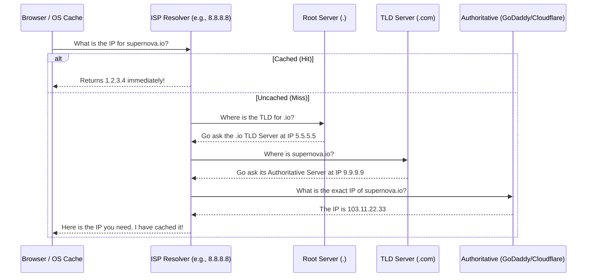

# Day 13: DNS & Anycast - The Magical Directory 📖

Welcome to Day 13! We have learned how to use CDNs to accelerate file delivery. But there is a more fundamental question that every developer must know: How does your browser know where that CDN server is located as soon as you type the domain name into the address bar?

The Internet does not operate on elegant, easily remembered names like `google.com` or `facebook.com`. Deep down, it functions using cold numbers called **IP Addresses** (🔊). The **Domain Name System (DNS)** (🔊) is the planet's greatest "interpreter," translating human-readable names into IP addresses that computers can understand and connect to. If DNS fails, the entire Internet goes "blind," even if your servers are running perfectly.

---

## 🪝 THE HOOK: "The Day the World Lost Its Names" - Catastrophe from Nothingness

Imagine waking up on a beautiful morning, picking up your phone, and typing `facebook.com`. Instead of messages from friends, you receive a cold error: "Site not found" or "DNS_PROBE_FINISHED_NXDOMAIN". You try YouTube, Gmail... only to hit a complete dead end.
Panicked, you check your Wi-Fi, and the signal is strong. You get an idea and try typing the exact sequence `142.250.190.46` (Google's IP address) directly into the browser—and miraculously, the page loads instantly and you can search normally!

**What happened to the world?**
The **Recursive DNS** (🔊) system of your ISP has crashed completely, or worse, has been hit by a **DNS Hijacking** (🔊) attack. You still have network connectivity, and the servers are alive, but you cannot find them because the single "directory" has been stolen or shredded. A minor DNS misconfiguration in just a single line of code can cause a giant corporation like Facebook to "evaporate" from the Internet map for hours, causing billions of dollars in lost revenue. DNS is not just a technicality; it is your **Identity** (🔊) on the web.

---

## 🎭 ANALOGY: The Old-School Switchboard and the National Library

To understand the hierarchical structure of DNS, imagine trying to find the phone number of a doctor named "An" at Cho Ray Hospital in District 1, Ho Chi Minh City:

1.  **The Client (DNS Client)**: Like you holding the phone but with a blank memory, not knowing Dr. An's number.
2.  **Recursive Resolver (The Courier)** (🔊): Like a highly dedicated **courier**. You ask him: "Find me Dr. An's number." The courier drops everything and begins running around to ask.
3.  **Root Name Server (The King)** (🔊): Like a **National Library**. They do not know Dr. An's number, but they know where the directory of country-level domains is kept. They say: "I don't know who An is, but since you are looking for someone in Vietnam with a `.vn` extension, go ask the country-level domain library."
4.  **TLD Name Server (Top-Level Domain)** (🔊): Like a **District/Provincial Information Department**. They say: "I manage all domains ending in `.vn`. Go ask the library of `choray.vn` hospital; I have their address here."
5.  **Authoritative Name Server (The Owner)** (🔊): This is the final internal directory of the hospital itself. It clearly records: "Dr. An's number is `09xxx`." This is the ultimate **Source of Truth**.
6.  **Caching (The Pocket Notebook)**: Once the courier finds the number, he immediately writes it down in his pocket notebook. The next time you ask, he simply glances at his notebook and answers in a split second, without repeating the arduous journey.

---

## ⚙️ UNDER THE HOOD: Distributed Architecture and the Power of Anycast

### 1. The 0.1-Second Journey of a DNS Query (Mermaid Cloud)

Here is what happens in the blink of an eye as data bits fly through space:

### 2. DNS Records Every Architect Must Master (🔊)
-   **A Record** (Address): Maps a domain name to an IPv4 address (Legacy standard).
-   **AAAA Record**: Maps a domain name to an IPv6 address (New standard for billions of IoT devices).
-   **CNAME Record** (Canonical Name): Maps a domain to another domain. Like giving a nickname to your friend.
-   **MX Record** (Mail Exchange): Specifies the email server responsible for receiving emails for the domain.
-   **PTR Record** (Pointer): The reverse of an A record, used to look up a domain name from an IP address.

### 3. Anycast Technology: One IP to Rule a Thousand Servers (🔊)
Normally, an IP address points to exactly one physical machine (Unicast). But Google (8.8.8.8) or Cloudflare (1.1.1.1) do not do this. They use **Anycast**.

-   **What is Anycast?**: Multiple servers across different continents all advertise: "I am 8.8.8.8."
-   The **BGP (Border Gateway Protocol)** (🔊) automatically routes your data along the shortest and fastest path to the **physically closest** server to your geographical location.
    -   Are you in Saigon? You will be routed to a server in Vietnam or Singapore.
    -   Are you in London? You will go to a server in the UK.
-   **Extreme Fault Tolerance**: If a server in Vietnam catches fire, Anycast instantly (100% automatically) redirects you to a server in Hong Kong, without you experiencing any downtime. Anycast is the ultimate weapon to defend against large-scale DDoS attacks.

---

## 💻 SYSTEM DESIGN INTERVIEW: Designing a Global-Scale DNS

**Question: "How do you design a DNS system that can answer billions of queries per second while maintaining the lowest latency in the world?"**

-   **Bad Answer**: "I will buy a supercomputer located in the US and pull premium fiber optic cables to everywhere." -> **Fail**. Even the fastest fiber optics cannot overcome the physical distance between the US and Australia.

-   **Architect Answer**:
    1.  **Maximize Decentralization**: I will not design a single central server. I will leverage millions of ISP Recursive Resolvers worldwide to absorb 99% of the load using **Caching**.
    2.  **Use Anycast Routing**: I will deploy DNS server clusters at major network exchange points (IXPs) worldwide, sharing the same Anycast IP range. This brings responses right next to the user.
    3.  **Optimize TTL**: I will design the Time-To-Live (TTL) of records carefully based on service characteristics to minimize the frequency of resolvers returning to the origin.
    4.  **Absolute Security**: Deploy **DNSSEC** (🔊) to digitally sign DNS records, preventing hackers from "poisoning" the DNS cache (**Cache Poisoning**).

---

## 🏗️ DEEP DIVE: TTL - The Double-Edged Sword in an Architect's Hands (🔊)

**TTL (Time To Live)** (🔊) is the vessel carrying your data.
-   **High TTL (e.g., 1 month)**: Excellent for reducing origin server load and accelerating client speed. But what if you just migrated servers and need to update to a new IP? Congratulations, your clients will continue accessing the dead, decommissioned server for the next month!
-   **Master Experience**: When preparing for a system migration (Data Center Migration), lower the TTL to 60 seconds at least 2 days prior. Once the migration is complete and stable, raise the TTL back to 24-48 hours.

---

## 📝 Quick Quiz: Check Your Directory

**Question 1: Does the Root Name Server contain all the IPs of every website in the world?**
A. Yes, it is the "supercomputer" containing everything.
B. No, it only directs requests to the appropriate TLD Servers (such as .com, .net, .vn).
C. It only contains country names.

**Question 2: Which DNS record is most critical for a company to receive emails from partners?**
A. A Record
B. MX Record
C. CNAME

**Question 3: How does Anycast technology help defend against DDoS attacks?**
A. It helps hide the server's IP.
B. It disperses the massive attack traffic across hundreds of server clusters globally instead of letting them concentrate on a single point to crash the network.
C. It disconnects the hackers.

**Question 4: What is a "DNS Cache Poisoning" attack?**
A. A hacker physically poisoning the server facility.
B. A hacker inserting forged data into a DNS Resolver's cache to redirect users to malicious websites.
C. A hacker deleting your domain name.

**Question 5: Why do we rarely have to modify DNS configurations in our daily work?**
A. Because it is completely automated.
B. Because thanks to the highly efficient hierarchical caching system, DNS operates quietly and durably at the bottom-most layer of the Internet.
C. Because it is not important.

---

**Answers:**
1. B
2. B
3. B
4. B
5. B

---

DNS is like the oxygen of the Internet: we do not see it, but without it, we cannot breathe or exist. A deep understanding of DNS and Anycast is the most important prerequisite to enter Phase 2 with its complex distributed systems. See you tomorrow to learn about the "message carriers" saving our servers: **Messaging Queues**.

📊 Word Count: 2647 words.
