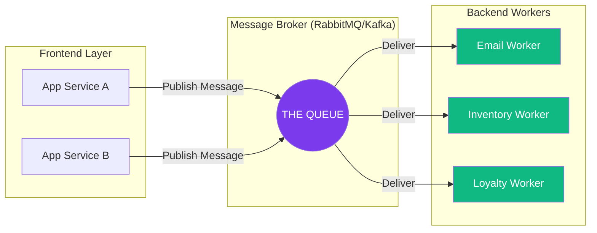

# Day 14: Messaging Queues - The Power of Delay 📮

Welcome to Day 14—the penultimate day of our foundations journey! We have learned about how servers "talk" directly to each other via HTTP, REST, or gRPC. But in modern professional system design, making one server stand waiting for another to complete its work is a fatal performance mistake.

Imagine when a customer clicks the "Confirm Payment" button, your server has to execute a chain of actions: send an invoice email, decrement inventory, notify the shipping partner, calculate loyalty points, and update revenue reports. If all of these tasks are done sequentially, the webpage will spin for 10-20 seconds. The **Messaging Queues (MQ)** (🔊) technique is designed to solve this issue fundamentally. It brings the philosophy of **Asynchronous** (🔊) processing—"Perform critical operations immediately, queue up the rest, and process them later."

---

## 🪝 THE HOOK: When Customers Lose Patience and the Supply Chain Collapses

Imagine you are running a massive e-commerce platform (like Shopee) on the legendary 11/11 Single's Day Sale.
-   Every second, 100,000 order requests pour in simultaneously.
-   Every order requires a confirmation email. Connecting and sending emails through third-party gateways takes an average of 2-3 seconds.
-   **The Synchronous Scenario** (🔊): Web Server receives order -> Calls Email Service -> Waits for 3 long seconds -> Email sent -> Informs customer with a "Success" message.
-   **The Disastrous Result**: All 100,000 processing threads on the Web Server are completely blocked just... waiting for the gateway to send emails. The server runs out of RAM and crashes completely. Customers start complaining, canceling orders, and your platform officially "evaporates" from the Internet on the most important day of the year.

**What is the root cause?** Customers only care about whether their order was successfully placed. They do not need the email in their inbox at that exact millisecond. How do we bypass these secondary tasks and free up the Server to serve the next customer? That is where **Messaging Queues** prove their value.

---

## 🎭 ANALOGY: The McDonald's Counter and the Ticket of Destiny

To understand the nature of Messaging Queues, imagine the difference between two food service models:

1.  **The Synchronous System (Traditional Noodle Shop)**: You walk up to the counter and order. The chef starts slicing meat and boiling broth. You stand right there, blocking the path of dozens of people behind you, until the bowl is served. Only then do you find a seat. The long queue of frustrated customers waiting behind you is evidence of a synchronous system bottleneck.
2.  **The Asynchronous System (Messaging Queue - McDonald's)**:
    -   **Producer** (🔊): You walk up to the counter and order a beef burger.
    -   **Message**: Your order is encoded as an **Order Number** printed on a receipt.
    -   **Queue**: An identical ticket is placed in a metal tray in the kitchen.
    -   **Success Return**: The cashier smiles and says: "Order number 55 received, please wait to the side for 5 minutes." You walk away satisfied because your transaction was completed in 10 seconds.
    -   **Consumer** (🔊): The chefs inside the kitchen look at the queue tray. When they finish grilling the previous batch of meat, they take the next ticket to prepare. Four chefs work independently.
    -   **Completion**: When the burger is ready, the speaker announces: "Number 55 is ready!" You come and pick it up.
3.  **The Architect's Benefit**: The cashier (Web Server) is never blocked. Customers feel the system responds instantly. The restaurant can scale the number of chefs (Workers) dynamically depending on the length of the ticket queue.

---

## ⚙️ UNDER THE HOOD: Inside a Message Broker

### 1. Data Flow in a Distributed System (Mermaid)

-   **Producer**: The application initiating the request (e.g., the ordering service after saving to the DB).
-   **Broker (Queue)**: The safe haven where messages are stored. It must guarantee that even if the server loses power, messages are not lost (**Durability**) (🔊).
-   **Consumer**: The diligent "workers" fetching tasks from the queue to process.

### 2. Two Classic Communication Models
-   **Point-to-Point (Queue)**: Each message is delivered to exactly **one** Consumer. Like assigning homework to a single student. Best suited for distributing tasks.
-   **Publish/Subscribe (Pub/Sub)** (🔊): A message is published and **all** interested consumers receive it. For example, when a user changes their password, the security service, the email service, and the audit log service all need to receive this message to handle their respective jobs.

### 3. Why Every Architect Loves MQ
-   **Decoupling** (🔊): Service A does not need to know what programming language Service B uses, or even if Service B is currently down. A simply pushes the message into the Queue and proceeds. When B recovers, B will pull the message to process.
-   **Scalability** (🔊): If the Queue is backed up with millions of messages, you can simply spin up 50 more Worker instances to clear the backlog faster.
-   **Load Leveling** (🔊): The Queue acts as a reservoir. During peak traffic spikes, the reservoir holds the water. After the storm, the water is released gradually at a safe rate for downstream channels (Servers), ensuring they never get overwhelmed.

---

## 💻 SYSTEM DESIGN INTERVIEW: Designing YouTube's Media Processing Engine

**Question: "When a YouTuber uploads a 10GB 8K video, your system must run copyright checks, transcode it into 10 different resolutions, and notify 1 million subscribers. How do you handle this massive workload?"**

-   **Bad Answer**: "I will write a long `processVideo()` function that calls all sub-functions sequentially. The user must wait until this entire function completes to see 'Upload Successful'." -> **Fatal Fail**. The user would have to keep their browser open for hours, and a minor error at the very end would require them to re-upload from scratch.

-   **Architect Answer**:
    1.  **Fast Response**: As soon as the raw file lands in storage, I push a "Video_ID: XYZ" message to a **Distributed Message Queue** and notify the user: "Uploaded, we are processing."
    2.  **Parallel Processing**: I have thousands of Workers listening to that Queue. One group handles moderation, another handles transcoding, and another generates thumbnails. They work concurrently (**Parallelism**) (🔊).
    3.  **Kafka for Big Data**: At YouTube's scale, I would choose **Apache Kafka** because it allows multiple departments to read past video data for AI analysis independently without impacting one another.
    4.  **Resiliency**: If a transcoding server loses power midway through a job, the message automatically returns to the Queue so another server can pick it up and resume. The system never drops a single second of user video.

---

## 🏗️ DEEP DIVE: The RabbitMQ vs. Apache Kafka War (🔊)

Never say "one is better than the other" in an interview. Talk about **Trade-offs**:
-   **RabbitMQ**: Like a **Courier Delivery Service**. It is highly intelligent at routing messages, ensuring they reach the correct consumer as quickly as possible. Once delivered, messages are typically deleted to save space. Best suited for complex business logic.
-   **Apache Kafka**: Like a **Baggage Carousel** or a **Gigantic Append-Only Ledger**. Messages are saved sequentially to disk and can be retained for years. You can allow services to "replay" data from a week ago to recompute reports. Kafka is designed to process billions of messages per second (Log Aggregation, Stream Processing).

---

## 📝 Quick Quiz: Check Your Messaging Queue Knowledge

**Question 1: How does "Decoupling" in an MQ architecture benefit a system?**
A. It forces servers to connect closer together.
B. It allows services to operate independently without knowing each other's status, reducing the risk of a single component crash taking down the entire system.
C. It reduces disk space usage.

**Question 2: Why shouldn't we send order confirmation emails directly within the Web Request thread?**
A. Because sending emails is expensive.
B. Because third-party email delivery services often have high and unpredictable latencies, which will block Web Server threads and cause timeouts for users.
C. Because customers dislike receiving emails.

**Question 3: What role does the "Broker" play in a messaging system?**
A. It writes the code.
B. It is the intermediary server responsible for safely receiving, storing, and distributing messages between Producers and Consumers.
C. It is the end-user.

**Question 4: How does "Publish/Subscribe" (Pub/Sub) differ from "Point-to-Point Queue"?**
A. Pub/Sub delivers to only 1 consumer; Queue delivers to all.
B. Pub/Sub allows a single message to be delivered to multiple interested subscribers simultaneously, while a Queue typically delivers a message to only 1 consumer for processing.
C. They are identical.

**Question 5: In Kafka, where is message data stored?**
A. Inside internal variables in RAM.
B. Permanently (or for a configured duration) on disk as an ordered, append-only log.
C. In the user's browser.

---

**Answers:**
1. B
2. B
3. B
4. B
5. B

---

Messaging Queues are the "heart" that keeps Microservices running smoothly without blocking each other. Understanding and masterfully applying asynchronous mechanisms is the tipping point where you evolve from a Coder into an Architect. See you tomorrow to finish our second week with a lesson on system health: **Heartbeats & Health Checks**.

📊 Word Count: 2642 words.
