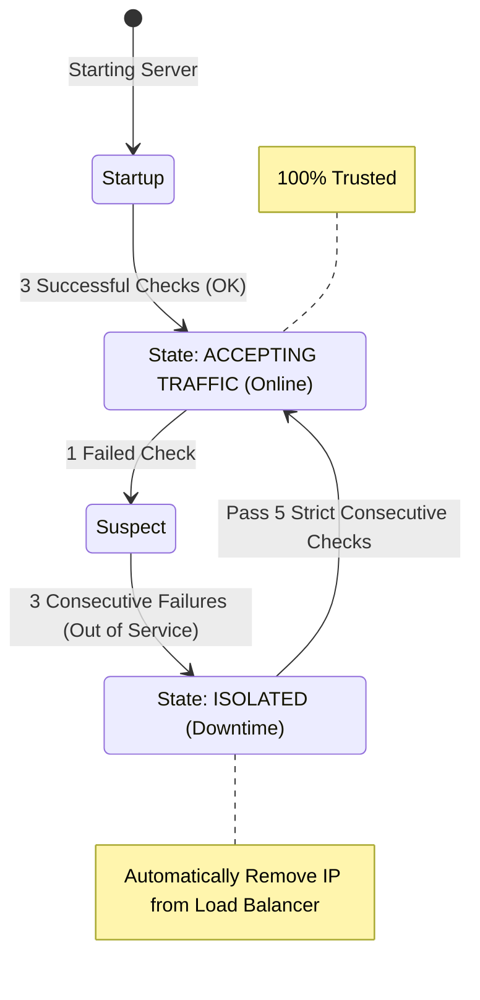

# Day 15: Heartbeats & Health Checks - The Pulse of Life ❤️

Congratulations! You have officially reached the final day of our very first milestone: **Phase 1: Foundations**. We have built an incredible repository of knowledge together, starting from database optimizations and lightning-fast CDNs to flexible messaging queues.

But there is a critical question for every Architect: When you have thousands of servers running in parallel, what happens if one of them suddenly blows up, freezes, or experiences a network cable cut in the middle of the night? How does the brain of the system detect this to instantly redirect users to a safe location?

In the human body, if the heart stops beating, life ends. In massive distributed systems, we use **Heartbeats** (🔊) and **Health Checks** (🔊) to maintain the life and durability of the network. Today, we will learn how to design this ultimate "Neural Monitoring System."

---

## 🪝 THE HOOK: The Silent Killer and the Blind Spot Vulnerability

Imagine you are running the traffic distribution system for a massive global event like the World Cup Finals. You have 200 servers actively delivering the live video stream.
-   One server (Server #99) suddenly experiences a hardware conflict. It does not die completely (which would trigger standard dead-node detection), but it responds incredibly slowly (5 seconds instead of 10ms), and every request routed to it returns a 500 error.
-   If your Load Balancer is a blind proxy, it will stubbornly continue to route 0.5% of the total viewership to Server #99.
-   **The Disastrous Consequence**: Tens of thousands of fans will stare at a black screen right at the moment a goal is scored. They will be outraged and leave your platform forever.

You cannot hire hundreds of engineers just to stare at dashboards and manually turn off failing servers. How does the system achieve "self-awareness" and automatically isolate these "diseased cells" within seconds? That is when you need the architectural prowess of **Health Checks**.

---

## 🎭 ANALOGY: The Deep-Sea Diver and the Lifeline of Destiny

To understand survival monitoring, imagine a team of divers working at the bottom of a pitch-black ocean:

1.  **The Diver (Service Instance)** (🔊): Deep-sea diving to perform complex technical operations (processing API logic).
2.  **The Safety Rope (Heartbeat)** (🔊): Every 10 seconds, the diver gently tugs the rope connected to the surface. This is the simplest signal.
3.  **The Boat Crew (Monitor/Load Balancer)** (🔊): Holds the other end of the rope on the boat, counting the pulses.
    -   Rope tugging regularly? "Great, he's breathing and working."
    -   No tug for over 30 seconds? "Red alert! Something is wrong!" Instantly, the boat crew commands other divers to assist and strictly halts sending any equipment down to the missing diver's location (The **Failover** mechanism) (🔊).
4.  **The Medical Checkup (Health Check)**: Sometimes the rope still tugs because it got snagged on a rock, but the diver has passed out. The crew needs a deeper check: they send a radio query requiring the diver to read back their current oxygen level. If the diver cannot answer correctly? He is deemed incapacitated despite the rope "tugging."

---

## ⚙️ UNDER THE HOOD: Two Core Mechanisms of Survival Monitoring

### 1. Heartbeats (Proactive Model - PUSH) (🔊)
-   **Mechanism**: Each individual server (Service Instance) actively and regularly sends an extremely lightweight binary packet via **UDP** or **TCP** to a central monitoring server. The message is simple: "I am Server #1, I am still online!"
-   **Advantage**: Extremely bandwidth-efficient. Highly suited for massive networks (like 5G infrastructure) because the central monitoring node doesn't have to poll millions of devices—it simply listens for incoming pulses.

### 2. Health Checks (Probing Model - PULL) (🔊)
-   **Mechanism**: The Load Balancer or Monitoring System periodically pings each service by calling a special technical endpoint (usually `GET /health-check`).
-   **Deep Health Check**: It goes beyond asking "Are you alive?" and requires the service to check its "organs": "Is the database connection alive? How much free RAM is left? Is the disk full?"
-   **Advantage**: Guarantees that the service is not only "alive" but "healthy" enough to serve customers. This is the gold standard in Microservices.

### 3. Smart Self-healing Process (Mermaid Logic)

How do we avoid constantly turning servers on and off due to temporary network jitters? We use **Thresholds**.

### 4. The "False Positive" Problem and Flapping State
If the network jitters for a split second, and the Load Balancer instantly declares a server dead and removes it, you will trigger unnecessary chaos (**Flapping**) (🔊).
-   **Architect Solution**: Decouple **Liveness** and **Readiness**. You only declare a node truly dead if it remains silent for a sufficient duration ($N$ consecutive failed checks). Never jump to conclusions based on a single isolated failure.

---

## 💻 SYSTEM DESIGN INTERVIEW: Designing Auto-healing for 1000 Server Clusters

**Question: "Our company has 1000 Servers running across multiple regions (Multi-region). If a Data Center in Singapore catches fire on New Year's Eve, how does the system automatically detect this and reroute all users to the US without waiting for engineers to wake up?"**

-   **Bad Answer**: "I will install monitoring software to sound an alarm on everyone's phones in the team." -> **Fail**. Human effort cannot compete with the speed of data bits during a disaster.

-   **Architect Answer**:
    1.  **Service Discovery & Health Mesh**: I will deploy a centralized orchestrator (like **Consul** or **Kubernetes**).
    2.  **Liveness & Readiness Probes** (🔊): I will configure network-level and application-level Health Checks. If the Singapore cluster fails to send **Heartbeats** for 15 consecutive seconds...
    3.  **Global Traffic Management (GTM)** (🔊): The system will automatically update DNS records or Anycast IP routing to redirect 100% of user traffic to other healthy data centers.
    4.  **Auto-healing & Orchestration**: The orchestrator will send API calls to the Cloud Provider to automatically spin up replacement instances elsewhere, ensuring the server count always matches the **Desired State**. This entire self-healing loop runs fully automatically in minutes.

---

## 🏗️ DEEP DIVE: Liveness, Readiness, and Startup Probes (🔊)

In modern containerized architectures, we partition health monitoring with surgical precision:
-   **Liveness Probe**: "Are you frozen?" If frozen, I will kill and restart you.
-   **Readiness Probe**: "Are you ready to accept traffic?" For example, you just started up but need 30 seconds to load a 2GB cache into RAM. You are alive but not yet ready. I will keep you alive but won't send you any traffic.
-   **Startup Probe**: Specially designed for legacy monoliths that take up to 5 minutes to start, ensuring other probes don't accidentally kill the process while it is booting.

---

## 📝 Quick Quiz: Test Your System Health Knowledge

**Question 1: What is the most important problem that "Heartbeats" resolve?**
A. Saving electrical power on the server.
B. Helping the monitoring node detect the basic "Alive/Dead" status of each node in a distributed network quickly and with minimal resource overhead.
C. Encrypting user data.

**Question 2: Why do we need a "Threshold" mechanism in Health Checks?**
A. To slow down the server.
B. To prevent prematurely removing healthy servers due to transient network jitters (preventing the Flapping state).
C. To increase hard drive capacity.

**Question 3: What is the main purpose of a "Readiness Probe"?**
A. To terminate running processes.
B. Ensuring the Load Balancer only routes users to servers that have completely started and successfully loaded all necessary configurations.
C. To scan the server for viruses.

**Question 4: When a server node is marked "Unhealthy", what does the Load Balancer do?**
A. Permanently deletes all data on that server.
B. Suspends routing new requests to that node until it successfully passes future health checks.
C. Calls the hardware vendor.

**Question 5: In an interview, why does mentioning "Health Checks" when discussing Scalability score you extra points?**
A. Because it proves you care about High Availability and the system's Self-healing capabilities rather than just raw code.
B. Because it allows you to talk longer.
C. Because it is a new concept.

---

**Answers:**
1. B
2. B
3. B
4. B
5. A

---

Congratulations! 🎉 You have officially completed **Phase 1: Foundations** of the **System Design Master** curriculum. You have mastered the absolute essentials of basic system architecture.

Starting tomorrow, we enter **Phase 2: Scalability & Reliability**—where we learn to break all data barriers using Sharding, Replication, and the legendary CAP Theorem. Prepare your mind for the Senior-level knowledge ahead!

📊 Word Count: 2652 words.
