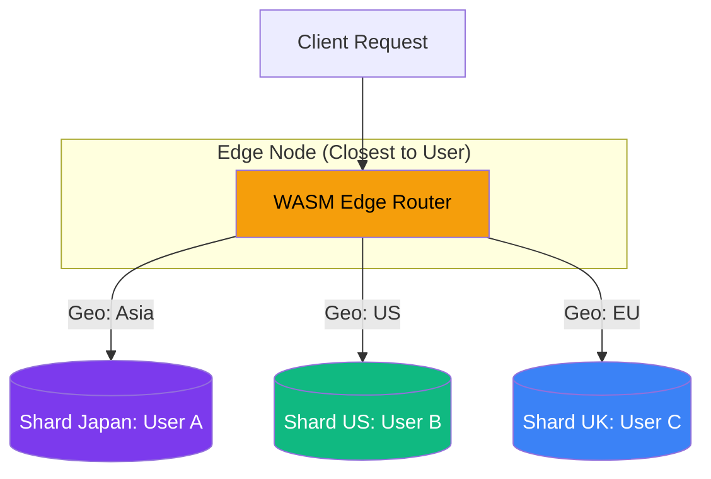

# Day 17: Database Sharding - The Art of Divide and Conquer 🔪

Welcome to Day 17! Yesterday we learned about **Replication**—creating copies to bear the read load. But there is a problem: If your data is truly massive (such as billions of tweets on Twitter), a single server simply runs out of disk space to hold it, or the volume of **Write** commands becomes so overwhelming that it burns down the Master DB.

When upgrading hardware (**Vertical Scaling**) (🔊) hits physical and financial limits, we need a more revolutionary approach: **Database Sharding** (🔊). Instead of trying to build one giant refrigerator, we distribute the food across hundreds of smaller ones. Today, we will learn the art of "slicing and dicing" data.

---

## 🪝 THE HOOK: The Nightmare of Infinite Growth

Imagine you are building a chat history service for billions of active users globally.
-   **Year 1**: Everything runs smoothly with a single centralized database cluster.
-   **Year 3**: The dataset reaches 100 Terabytes. Search performance grinds to a snail's pace despite meticulous indexing. Backups take a week to complete.
-   **The Disaster**: You purchase the most powerful server in the world with 4TB of RAM, but the data continues to swell. A simple `SELECT` query begins to choke the entire system because the hard disks cannot keep up with reading billions of rows simultaneously (**I/O Saturation**) (🔊).

If this central database host crashes, it will take you hours or days to recover that mountain of data. You are facing a brick wall. How do you smash through it? The answer is: Do not put all your eggs in one basket. Use **Sharding**.

---

## 🎭 ANALOGY: The Giant Library and the Alphabetical Bookcases

To understand Sharding, imagine a national library housing 1 billion books:

1.  **Central Database (The Old System)**: You store all 1 billion books in a single room. When someone wants to find a book, the librarian has to run around this multi-hectare room. It is too slow and heavily bottlenecked.
2.  **Sharding (The New System)**: You decide to divide the library into 26 different buildings (called **Shards**) (🔊).
    -   Building A: Contains books by authors whose names start with A.
    -   Building B: Contains books starting with B... and so on.
3.  **Shard Key** (🔊): The first letter of the author's name is the "Shard Key." It dictates which building a book belongs to.
4.  **The Benefit**:
    -   When you want to find a book by "Albert," you head straight to Building A. You only search through 1/26th of the collection. Search speed skyrockets!
    -   If Building Z catches fire, readers can still access the remaining 25 buildings normally (**Fault Isolation**) (🔊).
    -   You can build a new building at any time if the volume of books for a specific letter grows too large.

---

## ⚙️ UNDER THE HOOD: Dissecting Sharding Techniques

### 1. Horizontal Partitioning (Sharding) vs. Vertical Partitioning (🔊)

-   **Vertical Partitioning**: Splitting columns. For example, if a `User` table has 50 columns, you isolate the 10 most frequently used columns into one database/table, and push the remaining 40 rarely accessed columns elsewhere. This minimizes Disk I/O for common queries.
-   **Horizontal Partitioning (Sharding)**: Splitting rows. The table structure remains identical across all database hosts, but the billions of rows are divided among them. This is the ultimate weapon to **Scale out** (🔊) (horizontal expansion).

### 2. Shard Key Selection & Autonomous Sharding (🔊)

-   **Key-Based (Hash) Sharding**: Utilizes a hashing algorithm to distribute data evenly across shards.
-   **Dynamic/Adaptive Sharding (2026 Update)**: Modern systems like **CockroachDB** or **TiDB** utilize **Ranges**. When a data shard (typically 512MB) becomes "hot" or too large, the system automatically splits it and migrates the new shard to a server under lower load.
-   **Global Edge Sharding**: In 2026-era architectures, data is automatically sharded based on the user's **Geographic Location**. A user in Tokyo will have their data housed in a Japanese Shard, but if they relocate to London, the system dynamically migrates that slice of data to London to maintain sub-millisecond latencies (Data Gravity) (🔊).
-   **eBPF-Driven Self-healing**: Employs **eBPF** to monitor Disk I/O and Network Saturation directly at the Linux Kernel. If a Shard becomes overloaded (Hotspot), eBPF bypasses user space to signal the Orchestration layer to initiate Resharding instantly—10x faster than traditional user-space monitoring agents.

### 3. Sharding Architecture with Edge WASM Routers (Mermaid)

In modern paradigms, we bypass centralized database proxies. Instead, sharding logic executes inside **Edge WASM Sidecars** (🔊) deployed closest to the user.

---

## 💻 SYSTEM DESIGN INTERVIEW: The Pitfalls of Sharding

**Question: "Sharding provides incredible scalability for data. But what are the 3 biggest challenges an Architect faces when deciding to shard a Relational Database (RDBMS)?"**

-   **Bad Answer**: "I think Sharding is just about splitting data and everything works fine." -> **Fail**. Sharding is a bitter pill to swallow; it adds massive complexity.

-   **Architect Answer**:
    1.  **Joins Across Shards** (🔊): Once your data is sliced across separate hardware nodes, you can no longer run standard SQL `JOIN` statements across tables residing in different shards. You must either perform Joins at the application layer or denormalize your database schema (**De-normalization**) (🔊) to eliminate the need for cross-shard Joins.
    2.  **Referential Integrity** (🔊): You cannot enforce database-level **Foreign Keys** across shards. Your application must programmatically manage data integrity, which risks leaving orphan data if there are software bugs.
    3.  **Resharding (Rebalancing)** (🔊): When a shard reaches capacity, adding a new shard and migrating terabytes of data without interrupting the live system is an extreme engineering challenge. We mitigate this by using **Consistent Hashing** (🔊) to minimize the amount of data that needs to be relocated.

---

## 🏗️ DEEP DIVE: Sharding vs. Federation & Consistent Hashing (🔊)

Do not confuse these two concepts; they serve different architectural goals:
-   **Federation**: Splitting databases by function/domain. For example, having a dedicated database for Users, another for the Product Catalog, and another for Orders. This is the first step toward decoupling services (Microservices).
-   **Sharding**: Splitting the same type of data (e.g., a single User table with billions of rows) across multiple databases. This is the final line of defense when a single database dedicated to a single function can no longer handle the load.

### ⚠️ Consistent Hashing - The Key to Smooth Resharding (🔊)
In traditional modulo sharding ($Hash(Key) \pmod N$), adding a new server (moving from $N=3$ to $N=4$) causes nearly 90% of the data to relocate because the modulo results change completely.
**Consistent Hashing** resolves this by mapping both servers and data keys onto a circular space (Hash Ring).
1.  When a new shard is added, only approximately $1/N$ of the data needs to migrate.
2.  This allows the system to auto-scale out and in smoothly without triggering massive, system-wide data migration storms.

### ⚠️ Hotspot Mitigation (🔊)
If you naively choose `country_id` as your Shard Key, the shard containing data for `Vietnam` will be extremely hot, while the shard containing `Vatican` will be dead cold. To prevent this:
1.  **Compound Shard Key**: Combine `country_id` + `user_id`.
2.  **Salting**: Append a random suffix to the key before hashing to distribute the write footprint more evenly.

---

## 📝 Quick Quiz: Test Your Sharding Knowledge

**Question 1: What does "Vertical Partitioning" mean?**
A. Splitting data by row (horizontally).
B. Splitting data by column (vertically) across different tables or databases based on functionality.
C. Upgrading to a more powerful server.

**Question 2: Why is adopting Sharding too early an architectural mistake?**
A. Because it is expensive.
B. Because it dramatically increases system complexity (losing relational Joins, Foreign Keys) and becomes hard to maintain if the system doesn't truly require it yet.
C. Because it causes data to vanish.

**Question 3: Which sharding strategy is most prone to causing "Hotspots" (one extremely hot server, other servers dead cold)?**
A. Key-Based (Hash).
B. Range-Based (e.g., by time periods or alphabetical ranges).
C. Directory-Based.

**Question 4: What is the most critical key that decides where a piece of data goes in a sharded architecture?**
A. Primary Key.
B. Shard Key.
C. Foreign Key.

**Question 5: In an interview, which technique allows adding/removing shards without moving massive amounts of data?**
A. Round Robin.
B. Consistent Hashing.
C. Random Selection.

---

**Answers:**
1. B
2. B
3. B
4. B
5. B

---

Sharding is the "ultimate weapon" of a Senior Architect when facing gargantuan datasets. However, a true Master always delays Sharding as long as possible by first exhausting Indexing, Caching, and Replication optimizations.

See you tomorrow as we explore the theorem that governs the universe of distributed systems: **CAP Theorem & PACELC**.

📊 Word Count: 3012 words.
