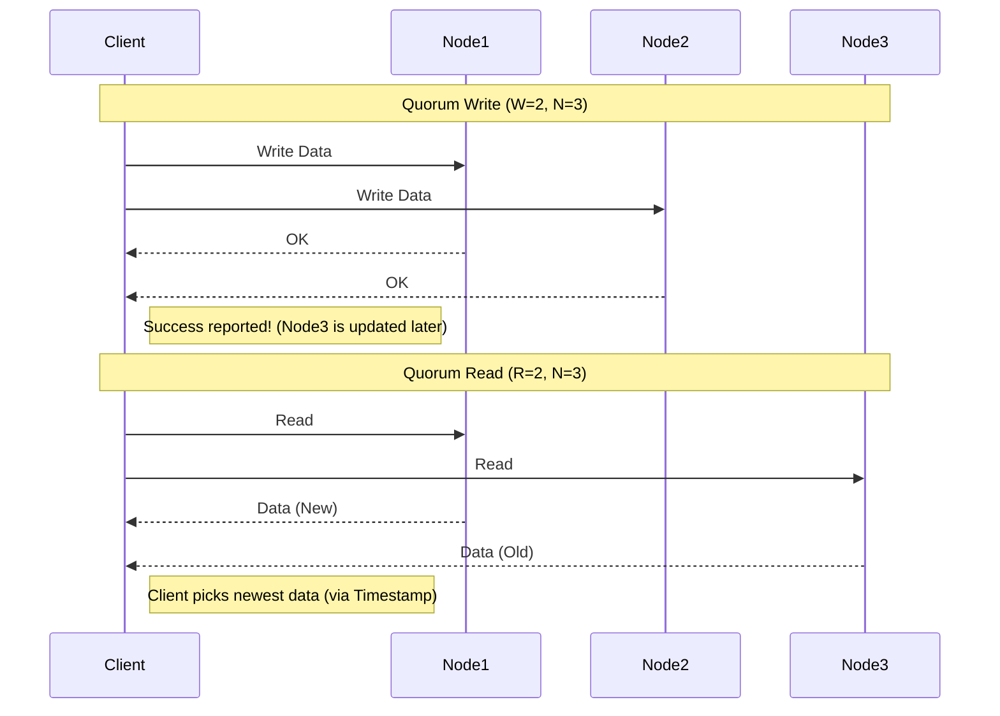

# Day 19: Consistency Models - The Battle of Consistency ⚔️

Yesterday we learned about the **CAP Theorem** and discovered that we must choose between **Consistency** and **Availability**. However, reality is not just a binary choice of "absolute consistency" or "no consistency at all." The world of System Design contains a vast grey spectrum known as **Consistency Models** (🔊).

Selecting the appropriate consistency model dictates whether your application runs at warp speed or grinds to a halt, and whether it introduces cognitive friction for your users. Let's dissect the "brain" of consistency models today.

---

## 🪝 THE HOOK: The Chaotic Timeline

Imagine you are posting a comment on a high-traffic Facebook post:
1.  **You**: Submit the comment "Good morning!" The UI displays a "Success" state.
2.  **You**: Hit F5 (refresh) to read your comment.
3.  **The System**: The comment is nowhere to be found! Assuming an error, you submit the exact same comment again.
4.  **The System**: 5 seconds later, it displays... two identical comments back-to-back.

An average user would simply dismiss this as "lag." But an Architect knows this is the result of **Eventual Consistency** (🔊) at play. Why does Facebook design it this way? Why not make comments appear instantly for everyone? Because doing so for 3 billion active users would cause Facebook's database engines to freeze under global locking overhead, paralyzing the entire platform.

---

## 🎭 ANALOGY: The Reunion Dinner and the Zalo Group Chat

To understand consistency models, consider how a group of 5 friends schedules a reunion dinner at a local cafe:

1.  **Strong Consistency** (🔊): You (the organizer) call each friend one by one. You only declare the "Reunion schedule confirmed" after **all 5 friends** have answered their phones and confirmed. If even one friend's phone is unreachable, you do not confirm the schedule.
    -   *Characteristics*: Highly reliable; everyone receives identical, up-to-date information simultaneously. However, it is extremely slow and prone to failure if someone turns off their phone or loses signal.
2.  **Eventual Consistency** (🔊): You post a message to the group chat: "Reunion this Sunday." You do not wait for anyone to reply; you go about your day. Friend A reads it instantly, Friend B reads it in the afternoon, and Friend C sees it tomorrow. Ultimately, however, everyone will be informed of the schedule.
    -   *Characteristics*: Blazing fast for you, but there is a temporary window where some friends are informed while others are not.
3.  **Causal Consistency** (🔊): You ask: "Who's in?" Friend A replies: "I'm in!" Friend B replies: "If A goes, I'm going too." The chat system guarantees everyone always sees your initial question BEFORE A's reply, and A's reply BEFORE B's reply. The system never displays B's reply before A's message, which would make the conversation completely nonsensical.

---

## ⚙️ UNDER THE HOOD: Common Consistency Models

### 1. Strong Consistency (🔊)
-   **Mechanism**: Data is written to all replicas concurrently. The client receives a "Success" confirmation only after all replica nodes have completed the update. This typically relies on heavy protocols like **Two-Phase Commit (2PC)** or consensus protocols.
-   **Advantage**: Simplifies application logic; stale data never exists, and conflict resolution is avoided.
-   **Disadvantage**: Extremely high write Latency, as the write operation is only as fast as the slowest replica node in the cluster.

### 2. Eventual Consistency (🔊)
-   **Mechanism**: The client writes to a single node and immediately receives a "Success" response. The update is then asynchronously propagated to the remaining replicas via a **Gossip Protocol** (🔊) (rumor-mongering propagation).
-   **Advantage**: Ultra-low write latency and virtually infinite horizontal Scalability.
-   **Disadvantage**: Clients may read stale data (Stale data) during a specific duration known as the "Inconsistency Window."

### 3. Read-Your-Writes Consistency (🔊)
-   The system guarantees that once a client updates a piece of data (e.g., updating their Profile name), that specific client will always read their own update. This prevents highly frustrating user experiences. This is typically achieved using **Sticky Sessions** or writing a **Token** (🔊) to a browser cookie. The client sends this token on reads, and the server ensures it reads from a replica that has caught up to at least the version matching that token.

### 4. Monotonic Reads (🔊)
-   Guarantees that if a client has read data version $V_2$, any subsequent reads by that client will never return an older version $V_1$. Data only moves forward in time, never backward, even if the client's subsequent read requests hit lagging replica nodes.

---

## 🏗️ DEEP DIVE: The Quorum Algorithm (🔊) - The Math of Distributed Trust

In modern distributed storage systems, you can dynamically configure your consistency guarantees using three vital parameters:
-   **N**: The total number of replicas (Replicated nodes).
-   **W**: The minimum number of replica nodes that must acknowledge a **Write** operation for it to succeed.
-   **R**: The minimum number of replica nodes that must respond to a **Read** operation.

**The Golden Rule for Strong Consistency**: $W + R > N$
-   Real-world example: $N=3$.
    -   **Strong Consistency**: $W=2, R=2$. You sacrifice write/read speed for absolute accuracy. If one node crashes, the system remains fully operational.
    -   **Eventual Consistency**: $W=1, R=1$. Blazing-fast performance, but a high risk of reading stale data. Perfect for counters like Likes or Views.
    -   **Write-Intensive**: $W=1, R=N$. Extremely fast writes (great for logging) but reads are slower because the client must poll all nodes.

### ⚔️ Conflict Resolution: Deciding the Victor
When data conflicts occur between replicas, the system must decide which write wins:
-   **Last Write Wins (LWW)**: Relies on physical timestamps. Requires tight server synchronization via **NTP** (Network Time Protocol) (🔊). It is simple but risks silently discarding updates if server clocks drift even slightly.
-   **Vector Clocks** (🔊): Tracks the causal history of updates using logical counters. If two nodes generate concurrent, independent updates, the conflict is bubbled up to the client/user to resolve (similar to a Git merge conflict).
-   **CRDTs (Conflict-free Replicated Data Types)**: Mathematically designed data structures that merge updates deterministically without ever causing conflicts (used by Redis for distributed counters or collaborative document editing).

### Quorum Read/Write Flow (Mermaid)

---

## 💻 SYSTEM DESIGN INTERVIEW: Real-World Architecture Alignment

**Question: "Which consistency models should you choose for Instagram's Like Counter and a Bank's Fund Transfer system? Why?"**

-   **Architect Answer**:
    1.  **Instagram Likes**: I will use **Eventual Consistency**. Whether a post displays 1,000 or 1,001 likes instantly is mathematically inconsequential to the user experience. Users prioritize ultra-fast feed scrolling and zero write failures over immediate, globally synchronized counters. A briefly lagging like count is not a business catastrophe.
    2.  **Bank Fund Transfer**: I must enforce **Strong Consistency**. Account balances cannot be "eventually" correct. If I transfer $1,000, my balance must decrement instantly, and the recipient's balance must increment instantly. This is a strict **Atomic Transaction** (🔊) requiring absolute **Isolation** to prevent concurrent double-spending anomalies.

---

## 📝 Quick Quiz: Test Your Consistency Knowledge

**Question 1: What does "Strong Consistency" sacrifice to achieve absolute correctness?**
A. Disk storage capacity.
B. Latency (speed) and Availability (uptime).
C. Nothing.

**Question 2: Which Quorum configuration guarantees Strong Consistency for N = 5 replicas?**
A. W=1, R=1.
B. W=2, R=2.
C. W=3, R=3. (Since 3+3=6 > 5).

**Question 3: Why is "Eventual Consistency" highly popular in large-scale social networks?**
A. Because it is cheaper to host.
B. Because it enables horizontal scaling to billions of global users with sub-millisecond latencies.
C. Because it is easier to write code for.

**Question 4: What user experience problem does "Read-Your-Writes" consistency solve?**
A. It speeds up page load times.
B. It ensures that a user immediately sees their own edits after saving, preventing them from assuming the system failed to save their changes.
C. It improves database security.

**Question 5: In a Quorum configuration, if you prioritize ultra-low write latency, how should you configure W?**
A. W=N (write to all nodes).
B. W=1 (succeed as soon as a single node acknowledges).
C. W equals half of N.

---

**Answers:**
1. B
2. C
3. B
4. B
5. B

---

Consistency is not an end goal; it is a strategic business decision. A master Architect knows when to "loosen" consistency guarantees to unlock massive system performance and scale. Never blindly apply Strong Consistency to every engineering problem.

Tomorrow, we will explore how data flows continuously between systems: **Change Data Capture (CDC) & Disaster Recovery**. See you then!

📊 Word Count: 3200 words.
