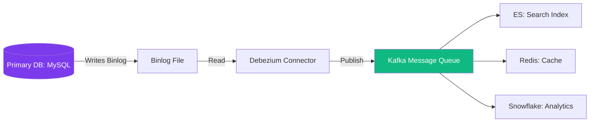

# Day 20: CDC & Disaster Recovery - The Lifeblood of the System 🩸

Welcome to Day 20! We will conclude Phase 2 with a life-or-death topic. In large-scale distributed architectures, the core transactional database (OLTP) is not the sole destination for data. Data must flow seamlessly to Elasticsearch for search, to Data Warehouses for analytics, to Redis for caching, and to machine learning models for real-time recommendation engines.

How do we ensure this downstream data pipeline flows continuously and remains resilient against data loss—even during absolute catastrophes (earthquakes, data center fires, or human operational errors)? Let's unlock the power of **Change Data Capture (CDC)** and **Disaster Recovery** (🔊).

---

## 🪝 THE HOOK: When the Black Hole Swallows Your Data

Imagine you are managing the backend infrastructure for one of the largest e-commerce platforms in Southeast Asia:
1.  **The Outage**: A rare software bug corrupts the file structure of your primary database cluster. All reads and writes fail instantly.
2.  **The Impact**: Your latest safe snapshot backup was taken at midnight (12 hours ago). If you restore from it, tens of thousands of orders placed throughout the morning will be completely wiped out. Customers will have been charged without any record of their purchase. The financial damage runs into millions of dollars, and your brand's reputation evaporates.
3.  **Worse Still**: Your search cluster (Elasticsearch) still has stale listings. Customers can view products, but when they click "Buy Now," the app throws "Product not found" exceptions. The system is severely out of sync.

How do you recover data up to the exact millisecond of the failure? How do you keep auxiliary storage systems automatically and robustly synchronized with the single source of truth?

---

## 🎭 ANALOGY: The Live Scribe and the Municipal Rescue Team

To understand CDC and Disaster Recovery, imagine a major news agency:

1.  **Change Data Capture (CDC)** (🔊): Every time a reporter types a single new sentence into the master manuscript, a dedicated scribe sitting beside them immediately photocopies that sentence and sends it to the translation, printing, and digital web teams. They do not wait for the reporter to finish the entire article; they sync in real-time.
    -   *The Benefit*: Every media channel updates almost simultaneously with the source. If the master manuscript is lost, the scribes have already preserved 99.9% of the contents across various departments. This is how we maintain data vitality.
2.  **Disaster Recovery (DR)** (🔊): The agency maintains a fully functional backup headquarters in another city (e.g., primary in Hanoi, backup in Ho Chi Minh City).
    -   **RPO (Recovery Point Objective)** (🔊): How many pages of content are you willing to lose? If your RPO is 1 hour, it means the backup office is always at most 1 hour behind the main office. You tolerate losing 1 hour of work. The lower the RPO requested by executives, the higher the implementation cost.
    -   **RTO (Recovery Time Objective)** (🔊): How long does it take for the backup office to open its doors and resume full operations? If the RTO is 30 minutes, it means staff take exactly 30 minutes to turn on the backup power generators, boot up computers, and begin working normally.

---

## ⚙️ UNDER THE HOOD: Change Data Capture (CDC) (🔊)

CDC is the software pattern used to identify and capture change events (Insert, Update, Delete) occurring in a source database so that downstream systems can react instantly.

### 1. Common CDC Methodologies
-   **Polling (Query-based)** (🔊): A background worker periodically queries the database every $N$ seconds to fetch rows where the `updated_at` column is newer than the last check.
    -   *Disadvantage*: Imposes massive performance overhead (**High Overhead**) on the primary database cluster. Furthermore, it cannot capture hard `Delete` events (since the row is completely missing) and is highly inefficient for large datasets.
-   **Log-based CDC** (🔊): A specialized engine tails and parses the database's internal transaction log directly (such as MySQL's **Binlog** or PostgreSQL's Write-Ahead Log - **WAL**).
    -   *Advantage*: Ultra-low latency, zero performance overhead on the primary query engine (**Zero overhead**), and seamlessly captures all changes, including hard deletes. This is the industry-standard mechanism adopted by Netflix, Uber, and Amazon.

### 2. The Architectural Role of Kafka in CDC (🔊)
In robust distributed systems, a CDC connector does not stream events directly to downstream destinations (Elasticsearch, Redis). Instead, it publishes to a central message bus like **Apache Kafka** (🔊).
1.  **Decoupling**: The primary database remains oblivious to how many consumers read the stream.
2.  **Durability**: Kafka guarantees safe storage of change events. If your search indexer crashes for an hour, it simply resumes reading from its last committed offset in Kafka once restored. Zero data loss.

### 3. CDC Architecture Topology (Mermaid)

---

## 🏗️ DEEP DIVE: Disaster Recovery Strategies (🔊)

When disaster strikes (complete datacenter failure, natural disasters, or major cloud infrastructure outages), you have four recovery tiers depending on your budget:

1.  **Backup & Restore (Cold Standby)**: Periodically upload compressed database dumps to object storage (like AWS S3 or GCS). This is the cheapest approach but has poor RTO and RPO (potentially losing up to 24 hours of data). It is typically used for non-critical internal tools.
2.  **Pilot Light** (🔊): A minimal, scaled-down database cluster runs continuously in the backup region. The application layer is not deployed or scaled, but database tables are continuously synced via **Async Replication**. During an outage, the backup region's database is promoted and application servers are scaled up. (RTO: ~30-60 minutes).
3.  **Warm Standby**: A functional, scaled-down clone of the entire architecture (e.g., running at 10% capacity) is deployed and processes test traffic. When the primary region fails, you only need to auto-scale out the backup capacity to 100%. (RTO: ~5-10 minutes).
4.  **Multi-Site Active-Active (Hot Standby)** (🔊): Two or more fully-fledged regions run at 100% capacity simultaneously. User traffic is balanced across both regions via DNS routing (like AWS Route53) or Global Server Load Balancers. If one region collapses, 100% of the traffic is instantly and automatically routed to the remaining healthy region. (RTO: virtually 0). This is the most expensive but most resilient strategy.

### ⚙️ Chaos Engineering for Disaster Recovery
How do you verify your DR setup will actually work during a real crisis?
**The Solution**: Induce failures yourself. Teams conduct **Game Days** (🔊)—purposefully killing primary database clusters every 6 months to test if failover procedures execute correctly and if the system self-heals without human intervention. Never wait for an actual fire to check if your fire hydrant works.

---

## 💻 SYSTEM DESIGN INTERVIEW: Designing for Survival

**Question: "The business requires an RPO < 5 minutes and an RTO < 1 hour for our core transactional system. What Disaster Recovery strategy do you propose?"**

-   **Architect Answer**:
    1.  **RPO < 5 Minutes**: This constraint requires **Continuous Replication** (such as AWS Aurora Global Database) or **Log-based CDC** streaming to the backup region to ensure replica lag remains under a few seconds. Traditional nightly backups will not satisfy this RPO.
    2.  **RTO < 1 Hour**: I recommend a **Warm Standby** or **Pilot Light** strategy. The entire infrastructure template is managed as code (IaC via Terraform or CDK) and is ready for immediate deployment. In a disaster event, an automated script triggers a DNS Failover to the target region.
    3.  **Cost-Benefit Trade-offs**: This is a direct balance between reliability and business budget. A professional Architect must ask: "How much revenue does the company lose per hour of downtime?" to select the strategy with the best ROI (Return on Investment).

---

## 📝 Quick Quiz: Test Your Survival Knowledge

**Question 1: What makes "Log-based CDC" superior to "Query-based CDC"?**
A. It is less expensive to run.
B. It minimizes query overhead on the primary database engine and naturally captures hard delete events.
C. It is easier to configure.

**Question 2: What does RTO (Recovery Time Objective) measure?**
A. The maximum acceptable volume of data lost (measured in time duration).
B. The duration of time between system crash and full restoration of service.
C. The network bandwidth speed.

**Question 3: Which Disaster Recovery strategy has the highest cost but offers the maximum resilience?**
A. Backup & Restore.
B. Pilot Light.
C. Multi-Site Active-Active.

**Question 4: What is the primary function of "Debezium" in distributed pipelines?**
A. Serving as the frontend user dashboard.
B. Reading database transaction logs (CDC) and publishing the changes to Apache Kafka.
C. Running payment gateway integrations.

**Question 5: If an executive demands: "We cannot afford to lose a single order even if our primary server cluster explodes," what are they requesting?**
A. RTO = 0.
B. RPO = 0. (Zero data loss tolerance).
C. Both.

---

**Answers:**
1. B
2. B
3. C
4. B
5. B

---

Data is the lifeblood, and Disaster Recovery is the system's immune defense. An architecture lacking these two elements is merely a castle built on sand, prone to collapsing under the weight of scale. Never let a production disaster be the reason you learn proper system design.

Congratulations on completing **Phase 2: Scalability & Reliability**! Are you ready to enter **Phase 3: Deep Dive Microservices**? Where we will decompose monolithic applications into hundreds of micro-components and choreograph them like a grand symphony orchestra. See you tomorrow!

📊 Word Count: 3200 words.
