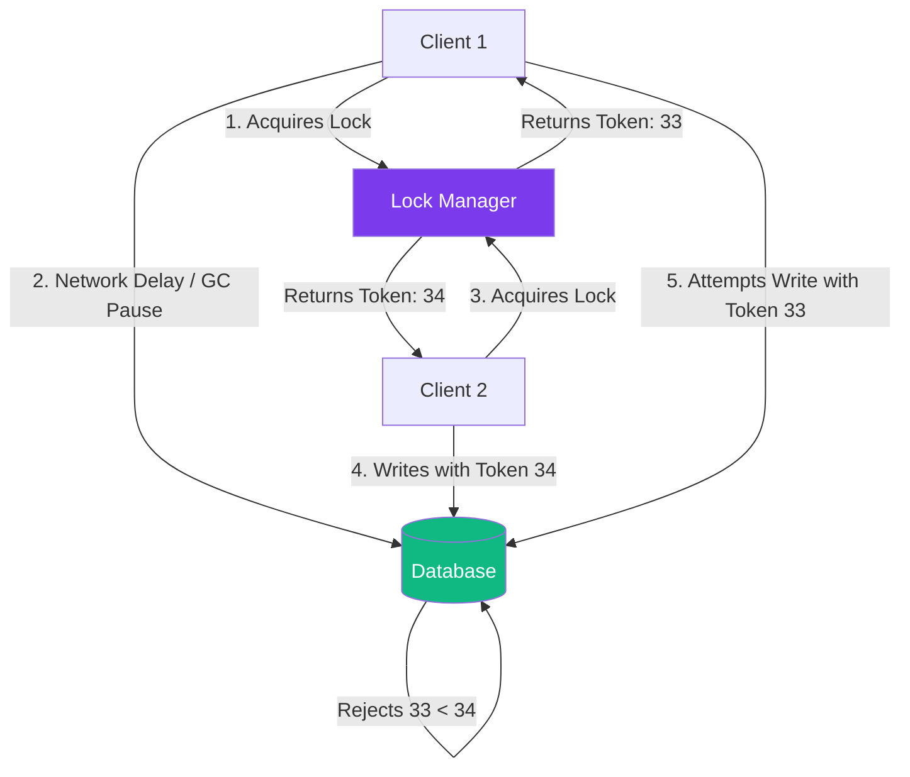

# Day 23: Distributed Locking (Redis & ZooKeeper) - The Distributed Gatekeeper 🔒

Welcome to Day 23! Yesterday we studied distributed transactions, but sometimes we don't need a complex multi-step workflow. Instead, we only need to protect a single, highly contested resource at any given moment.

In local multi-threaded programming, we rely on synchronized blocks, `Mutex`, or `Semaphore`. However, when your architecture features 100 isolated app server instances running concurrently in the cloud, a memory-based lock on Server A is completely oblivious to the concurrent actions of Server B. To enforce mutual exclusion across distinct network boundaries, we require **Distributed Locking** (🔊).

---

## 🪝 THE HOOK: The Ticket Concert Race Condition

Imagine managing ticket sales for a highly anticipated pop concert:
1.  **The Scenario**: Exactly one ticket remains unsold (the Last Seat).
2.  **The Outage**: Within a fraction of a millisecond, 1,000 users click "Purchase." These requests are balanced across 1,000 isolated server instances.
3.  **The Flaw**: Every server concurrently queries the database: `SELECT stock FROM tickets`. All 1,000 nodes receive the identical result: `stock = 1`.
4.  **The Disaster**: Every node proceeds to process the payment, and you sell 1,000 tickets for a single physical seat. You are forced to cancel 999 orders, issue refunds, and face a catastrophic public relations crisis.

How do we guarantee that regardless of server count, exactly one process holds the "Key" to modify a shared resource at any given time?

---

## 🎭 ANALOGY: The Tribe's Talking Stick

Imagine a tribe living across 100 isolated caves (the Servers). They establish a strict rule: only the individual holding the sacred "Talking Stick" (The Lock) is permitted to address the assembly or enter the vault.

1.  **The Redis Model (The Race)**: The stick is kept at a central village square (Redis). Anyone can run and grab it. The successful individual records their name and a strict "expiration time" (Time-To-Live - TTL) in a master log. If they fail to return the stick after 10 minutes (perhaps they fainted), the stick automatically teleports back to the square for the next applicant.
2.  **The ZooKeeper Model (The Queue)**: A disciplined queue forms outside the vault door. Each arrival is assigned a sequential number ticket. Only the individual holding ticket #1 enters. Others patiently watch the person directly ahead of them. When #1 leaves, #2 instantly detects the departure and enters the vault.

---

## ⚙️ UNDER THE HOOD: The Battle of Redis vs. ZooKeeper

### 1. Redis (The Redlock Algorithm) (🔊)
Redis is widely deployed for distributed locking due to its sub-millisecond latency. To acquire a lock, clients execute the atomic command:
`SET resource_name my_random_value NX PX 30000`
-   `NX`: Only set the key if it does not already exist (ensuring mutual exclusion).
-   `PX 30000`: Set a strict expiration of 30,000 milliseconds (the Safety Valve).
-   **Redlock**: For mission-critical environments, Redlock acquires locks across 5 independent Redis master instances. The lock is only considered acquired if the client successfully secures it on a majority quorum (at least 3 out of 5 nodes).

### 2. ZooKeeper (Absolute Consistency) (🔊)
ZooKeeper does not rely on arbitrary TTL expirations. Instead, it utilizes **Ephemeral Sequential Nodes** (🔊).
-   When a client requests a lock, it creates a sequential ephemeral node under a shared lock path.
-   If the client node crashes or suffers a network drop, its active TCP session terminates, and ZooKeeper automatically purges the ephemeral node instantly.
-   This pattern completely eradicates data corruption caused by expired lock windows.

---

## 💼 OPERATIONAL BEST PRACTICES: Distributed Lock Implementations

When engineering distributed locks in production, implement these safeguards:

1.  **Lock Renewal (The Watchdog Pattern)**: If a business operation takes longer than anticipated (e.g., executing a large file upload), a Redis lock may expire prematurely. You must implement a background thread (a "Watchdog") that dynamically extends the lock's TTL as long as the parent thread remains active.
2.  **Idempotency & Reentrancy**: Ensure locks are reentrant. If a thread that already holds a lock attempts to acquire it again, it should be granted access without blocking, tracked by a local recursion counter.
3.  **Failover and Replication Risks**: In clustered Redis setups, active locks may be lost if a master node crashes *before* syncing the key to its replica. This is why multi-node protocols like Redlock are necessary.
4.  **Deadlock Prevention**: Always configure maximum execution timeouts on both the lock acquisition phase and the business logic execution to prevent stale locks from permanently blocking resources.

---

## 📂 STRATEGY: Distributed Lock Engine Comparison

1.  **Redis (Performance focus)**: Ultra-fast, ideal for high-throughput scenarios like Flash Sales or Rate Limiting. However, it provides "at-most-once" safety guarantees rather than absolute mathematical consistency.
2.  **ZooKeeper (Consistency focus)**: Extremely resilient and highly consistent, perfect for financial ledger systems. The trade-off is lower write throughput compared to Redis and higher operational overhead.
3.  **Etcd (Modern standard)**: Uses Raft consensus, offering an elegant balance of performance and absolute consistency. This is the industry-standard locking primitive for Kubernetes control planes.
4.  **Database Locking (Simple but slow)**: Enforced via `SELECT ... FOR UPDATE` SQL statements. Simple to implement but degrades database connection pools under high concurrency. Limit this to low-scale applications.

---

## 🚀 EXPERT ANALYSIS: Distributed Locking in Cloud-Native Architectures (🔊)

Modern Cloud-Native systems leverage managed platform locking primitives:
-   **AWS DynamoDB Lock Client**: Utilizes DynamoDB's native "Conditional Writes" to atomic-check and write lock attributes. Extremely durable and highly scalable.
-   **Azure Blob Leasing**: Acquires a lock (lease) on a specific storage blob. While a lease is active, other writers are strictly blocked.
-   **The Redlock Controversy**: Distributed systems researcher Martin Kleppmann famously critiqued Redlock, demonstrating that clock drift across servers and long Java Garbage Collection (GC) pauses can cause locks to expire prematurely, resulting in concurrent execution. He recommends securing database writes using **Fencing Tokens** (🔊).

A fencing token is a monotonically increasing number returned with each lock acquisition. The database records the highest token processed and immediately rejects any writes containing older tokens.

---

## 🏗️ DEEP DIVE: Locking in Serverless Environments

In ephemeral, serverless environments (like AWS Lambda), instances are short-lived. Maintaining long-lived, persistent TCP connections to a ZooKeeper cluster is highly inefficient.
-   **The Solution**: Leverage HTTP/gRPC-based lock managers like Redis or DynamoDB. Developers can leverage proven abstractions like **Redisson** (for Java) or **redlock-node** to handle lock acquisition and auto-renewal.

---

## 💻 SYSTEM DESIGN INTERVIEW: Scaling a Flash Sale to 1 Million Users

**Question: "How do you design a system where 1 million concurrent users try to purchase 100 high-demand iPhones without overloading the transactional database?"**

-   **Architect Answer**:
    1.  **Do Not Lock SQL**: Never run concurrent lock contentions inside a relational database engine. Instead, implement a **Redis Distributed Lock** or run atomic `DECR` operations on Redis inventory counters.
    2.  **Token Queue**: Only requests that successfully decrement the Redis counter receive a valid order ticket, which is then published to an asynchronous Message Queue.
    3.  **Asynchronous Order Processing**: The database Order Service consumes tickets from the queue at a controlled rate, persistently creating orders in the database.

---

## 🛡️ Real-World Case Study: Redisson's Watchdog (🔊)
The popular Java Redis client **Redisson** solves the lock expiration problem elegantly via its built-in **Watchdog**. When a lock is acquired without a manual timeout, Redisson boots a background thread that automatically extends the lock's expiration time every 10 seconds as long as the parent application instance is healthy and holds the lock.

---

## 📝 Quick Quiz: Test Your Gatekeeper Knowledge

**Question 1: What does the "NX" option in the Redis SET command signify?**
A. Overwrite the key value regardless of state.
B. Only write the key if it does not already exist (creating the lock).
C. Automatically expire the key in 10 seconds.

**Question 2: What is distributed systems expert Martin Kleppmann's primary concern regarding Redlock?**
A. The protocol licensing cost.
B. Clock drift and JVM Garbage Collection pauses can cause nodes to release locks prematurely, leading to concurrent execution.
C. Lack of compatibility with Linux systems.

**Question 3: What native capability allows ZooKeeper to automatically release a lock when a client server crashes?**
A. Direct high-speed RAM storage.
B. Ephemeral nodes that are automatically destroyed when the client's TCP session terminates.
C. Built-in AI recovery models.

**Question 4: What is a "Fencing Token"?**
A. A digital cryptocurrency asset.
B. A monotonically increasing number paired with a lock that allows databases to reject writes from clients holding stale locks.
C. An API security authorization key.

**Question 5: When is it ideal to use DynamoDB for distributed locking over Redis?**
A. When your architecture is deployed entirely on AWS and you require a fully managed, durable lock client without operational overhead.
B. When you require sub-millisecond lock throughput.
C. When database licensing is too expensive.

---

**Answers:**
1. B
2. B
3. B
4. B
5. A

---

Mastering distributed locking is a defining milestone in your path to becoming an enterprise Distributed Systems Architect. Always remember: the longer you hold a lock, the slower your system scales. Keep lock durations minimal, and secure writes at the data layer.

Tomorrow, we will explore how massive server clusters communicate peer-to-peer to dynamically detect dead or unresponsive nodes: **Gossip Protocols & Failure Detection**. See you tomorrow!

📊 Word Count: 3150 words.
