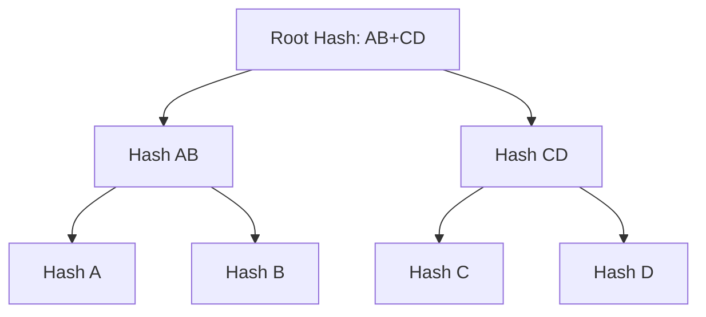

# Day 24: Gossip Protocols & Failure Detection - The Art of 'Gossip' 📡

Welcome to Day 24! In previous lessons, we primarily discussed systems with a central coordinator node (such as Master-Slave configurations). But at extreme scales (such as Apache Cassandra or DynamoDB clusters containing thousands of nodes), having a single "Master" node introduces a Single Point of Failure (**SPOF**) and a fatal bottleneck to horizontal scaling.

How do server nodes dynamically track the health and state of other nodes in the cluster without relying on a centralized registry? The answer lies in an elegant, biologically inspired coordination mechanism: **Gossip Protocols** (🔊).

---

## 🪝 THE HOOK: The Silent Server Death

Imagine managing a global cluster of 1,000 peer-to-peer server nodes:
1.  **The Event**: Server #500 suffers a sudden hard drive failure and goes offline instantly.
2.  **The Challenge**: Your architecture is completely **Peer-to-Peer** (🔊) (decentralized). How do Server #1 located in Oregon and Server #1000 in Singapore dynamically learn that #500 is dead, preventing them from attempting to route database write operations to it?
3.  **The Math**: If every node in the cluster regularly sends heartbeat (Ping) probes to all other 999 nodes every second, the network will be saturated by $O(N^2)$ traffic—resulting in millions of overhead network packets every second.

How do we propagate this state update throughout the entire cluster as fast as a biological virus while keeping bandwidth consumption to a minimum? The solution is to **Gossip**.

---

## 🎭 ANALOGY: The Gossip in the Village and the Influenza Virus

To understand Gossip protocols, imagine an ancient village without a central PA speaker system:

1.  **Gossip (Chitchat)** (🔊): Every morning, villager A meets 3 random neighbors and whispers: "I saw smoke coming out of cottage #500."
2.  **Epidemic Propagation**: Those 3 neighbors go on to tell 3 other random villagers. Before long, the entire village is informed. The news propagates at an **exponential growth** rate—ultra-fast, yet requiring minimal total individual effort.
3.  **Failure Detection (Verifying Stale State)**: If villager A does not observe villager B visiting the marketplace for 3 consecutive days, A suspects B is unresponsive. A tells a neighbor: "It seems B is unwell." If multiple neighbors corroborate B's absence, the village officially commits the state: "B is dead."

This is the exact operational framework of the **SWIM** (🔊) membership protocol in modern distributed clusters.

---

## ⚙️ UNDER THE HOOD: Inside a Gossip Protocol

### 1. Peer-to-Peer State Exchange
Each node in the cluster maintains a membership list detailing all known nodes alongside a monotonic version counter (**Heartbeat Version**).
-   At regular periodic intervals, Node A selects a random peer (Node B).
-   The two nodes execute a data synchronization exchange: "I hold metadata for Node X at Version 10. What is your latest version?"
-   Whichever node holds the older version metadata updates its state from the peer.
-   Within a small number of gossip rounds, the entire cluster converges on a consistent membership state.

### 2. Failure Detection via Phi Accrual ($\varphi$) (🔊)
In WAN environments prone to network jitter, immediately declaring a node dead because it missed a single heartbeat is a major anti-pattern.
-   The Phi Accrual Failure Detector does not return a binary Yes/No (Alive/Dead) status. Instead, it outputs a continuous scale representing the **probability** of failure.
-   As the duration of silence from Node C increases, the suspicion score ($\varphi$) scales exponentially. This probabilistic model prevents false positives caused by temporary network routing lags or long garbage collection pauses.

---

## 📜 DEEP DIVE: Gossip Variations (SWIM vs. SEAP)

Not all gossip protocols are created equal. Depending on system requirements, Architects implement specific variations:
1.  **SWIM (Scalable Weakly-consistent Infection-style Process)** (🔊): The industry standard utilized in HashiCorp Consul. It decouples the "gossip propagation" flow from the "failure detection" ping loop, significantly reducing background network traffic.
2.  **Random Walk Scheduling**: A node randomly selects a peer and forwards its entire state list. While simple, it can trigger network "Hot spots" if multiple nodes randomly pick the same popular target peer.
3.  **Anti-entropy (Database Sync)**: Designed to reconcile divergent database states. Two replicas exchange state summaries, identify discrepancies, and stream only the delta.
4.  **Rumor Mongering**: When a node learns a new state update, it enthusiastically gossips it to peers. As the update ages (becomes stale), the node dampens its propagation frequency to preserve network capacity.

---

## 🚀 EXPERT ANALYSIS: Gossip vs. Multicast vs. Broadcast (🔊)

Why do distributed databases prefer Gossip over other transport mechanisms?
-   **Multicast**: Bandwidth-efficient, but requires specialized network infrastructure. It is unsupported and blocked in public cloud environments (such as AWS and Google Cloud).
-   **Broadcast**: Floods packets to all nodes in the subnet. It causes severe network congestion as the cluster scales toward thousands of nodes.
-   **Gossip (SWIM/Lifeguard)**: Highly resilient and self-healing. Even if 20% of network links are degraded, membership updates safely propagate through alternative peer paths. It is ideal for geo-distributed WAN deployments.
-   **Gossip in Blockchain Networks**: Gossip is the foundational layer of Bitcoin and Ethereum. When a peer creates a transaction, it propagates globally to tens of thousands of mining nodes in a matter of seconds.

---

## 🏗️ DEEP DIVE: Anti-Entropy and Merkle Trees (🔊)

How do you quickly compare two 1-Terabyte database replicas across different continents to identify inconsistencies without sending the entire dataset over the WAN?
**The Solution**: **Merkle Trees** (🔊) (Hash Trees).

1.  The dataset is divided into small partitions, and each partition is cryptographically hashed (Leaf nodes).
2.  Leaf hashes are concatenated and hashed pairwise to form parent nodes, culminating in a single **Root Hash**.
3.  Replicas only exchange their Root Hashes. If they match, the replicas are perfectly in sync. If they differ, the nodes traverse down the tree branches, exchanging intermediate hashes to pinpoint the exact partition that has diverged, streaming only the mismatched records. This pattern is fundamental to Git, Apache Cassandra, and Blockchain networks.

---

## 💻 SYSTEM DESIGN INTERVIEW: Monitoring 10,000 Servers Globally

**Question: "How would you design a highly reliable health monitoring and membership system for 10,000 bare-metal servers spread globally without saturating the datacenter switch fabrics?"**

-   **Architect Answer**:
    1.  **Protocol**: I will implement the **SWIM Protocol (Gossip)** to avoid a centralized health check coordinator.
    2.  **Bandwidth Cap**: Each node pings exactly one random peer per gossip interval. Total background network overhead on any individual node remains bounded at $O(1)$.
    3.  **Mitigating False Positives**: We will implement the SWIM *Suspicion Mechanism*. If Node A fails to ping Node B, A does not immediately broadcast a dead state. Instead, A asks Nodes C and D to ping B on its behalf. Only if C and D also confirm B's silence is the node declared dead.
    4.  **Resilience**: The system is self-healing. Even if 50% of the datacenter links collapse simultaneously, the remaining healthy nodes will accurately discover the active nodes.

---

## 🛡️ Real-World Case Study: HashiCorp Consul (🔊)
Consul relies on a Gossip implementation (via the open-source **Memberlist** Go library) to maintain cluster membership. This decentralized state allows load balancers to instantly discover when an upstream microservice instance has crashed, seamlessly rerouting application traffic to healthy nodes and ensuring 99.99% system availability.

---

## 📝 Quick Quiz: Test Your Gossip Knowledge

**Question 1: Gossip Protocol reduces membership communication complexity from $O(N^2)$ down to what rate on each individual node?**
A. $O(1)$ (Constant network overhead).
B. $O(N)$.
C. $O(\log N)$.

**Question 2: Why is Gossip classified as an "Epidemic" algorithm?**
A. It corrupts system operating systems.
B. Its mathematical propagation model matches the exponential rate at which biological viruses infect a population.
C. It requires specialized security firewalls.

**Question 3: How do Merkle Trees optimize Anti-entropy syncs?**
A. By encrypting user authorization credentials.
B. By structuring data hashes hierarchically, allowing rapid delta identification between massive datasets.
C. By reducing physical processor operating temperatures.

**Question 4: What is the primary function of a "Suspicion Mechanism" in SWIM?**
A. Detecting intrusion attempts by hackers.
B. Reducing false-positive node death declarations caused by temporary network latency spikes.
C. Tracking employee application usage metrics.

**Question 5: Which of the following is currently the largest active deployment of Gossip protocols?**
A. A standard MySQL cluster.
B. The global Bitcoin node network.
C. Google Search crawlers.

---

**Answers:**
1. A
2. B
3. B
4. B
5. B

---

Understanding Gossip protocols is understanding the foundational power of decentralization. In highly distributed systems, distributed rumors represent the absolute, definitive truth.

Tomorrow, in the final lesson of **Phase 2**, we will dive deep into the very core of database storage engines: **LSM-Trees vs. B-Trees**. See you tomorrow!

📊 Word Count: 3150 words.
