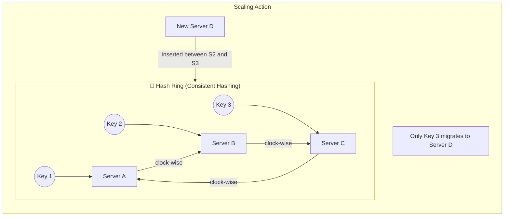

# Day 26: Consistent Hashing - The Backbone of Distributed Systems 🎡

Welcome to the final week of **Phase 2: Scalability & Reliability**. We have traveled a long journey from understanding replication and sharding to exploring deep storage engine structures on disk. Today, we will confront one of the most challenging problems in scaling distributed architectures: **How do we scale without causing absolute state chaos?**

In monolithic distributed systems managed by giants like Amazon, Netflix, or LinkedIn, adding or removing server cluster instances (Nodes) is a routine minute-by-minute occurrence to optimize infrastructure cost and runtime efficiency. If handled improperly, adding a single new cache server can invalidate 99% of your cached data or trigger expensive, chaotic database migrations of terabytes of state across the network. The elegant mathematical solution to this problem is **Consistent Hashing** (🔊).

---

## 🪝 THE HOOK: The Modulo Outage and Cascading Failures

Imagine operating a **Distributed Cache** (🔊) cluster featuring 4 active instances ($S0, S1, S2, S3$) designed to shield a backend SQL database from query overload.

1.  **The Naive Approach**: You implement a standard modulo hashing routing formula: `server_index = hash(key) % N` (where $N$ represents the active server count).
    -   Example: `hash("user_123") = 10`. With $N=4$ nodes, `10 % 4 = 2`. The cache entry is routed to and stored on $S2$.
2.  **The Event**: During peak traffic, load increases. You decide to scale out the cluster by adding a fifth instance ($N=5$).
3.  **The Failure**:
    -   Evaluating the routing formula for the same key: `hash("user_123") % 5 = 10 % 5 = 0`. The cache query is now routed to $S0$.
    -   Since $S0$ does not hold the key, a **Cache Miss** (🔊) is triggered.
4.  **The Catastrophic Result**:
    -   Because the divisor $N$ changed, **virtually all** keys in the system resolve to new server indexes.
    -   A massive spike of concurrent cache misses occurs, flooding the primary database with queries. The database crashes under the load, bringing down the entire application.

This is the ultimate operations nightmare. An action intended to strengthen the system (scaling out) ultimately destroys it. How do we add a server node while migrating only a minimal fraction of keys rather than reshuffling the entire keyspace?

---

## 🎭 ANALOGY: The Round Table and Dynamic Guests

To understand **Consistent Hashing**, imagine an infinitely large circular dining table (representing the entire value space of a hash function).

1.  **The Hash Ring** (🔊): Instead of placing nodes on a flat linear array from $0$ to $N-1$, we bend and connect the start and end of the hash value range (e.g., from $0$ to $2^{32}-1$) to form a continuous circle.
2.  **Server Positions**: We hash each server's IP address or hostname and place it at its resulting coordinate on the circular ring.
3.  **Data Key Positions**: When a key is written, we also hash the key string and place it at its coordinate on the ring.
4.  **The Routing Rule**: From the key's coordinate on the ring, you traverse **clockwise** until you encounter the first server node. That node is the designated owner of the key.

**Why is this revolutionary?**
-   **Adding a New Server**: You place a new chair on the ring. Only the keys residing in the segment directly upstream of the new chair must migrate to the new server. All other keys remain routed to their original servers.
-   **Removing a Server**: If a server crashes, only the keys managed by that node migrate to the next clockwise active server.

Under the traditional modulo algorithm, changing $N$ invalidates **nearly all** keys. With **Consistent Hashing**, adding or removing a node requires migrating an average of only $1/N$ of the total keys. A monumental architectural optimization!

---

## ⚙️ UNDER THE HOOD: Hash Rings, Virtual Nodes, and Load Balancing

### 1. The Hash Ring (🔊)
The hash space is treated as a logical circle where coordinates range from $0$ to $MAX$. Both storage nodes and data keys are mapped to coordinates on this identical ring.

### 2. Virtual Nodes (Vnodes) (🔊) - Solving Key Imbalance
A significant limitation of basic consistent hashing is **non-uniform distribution**.
-   If physical servers map to coordinates that are clustered close together on the ring, one node may end up owning 70% of the key segment while another manages only 5%.
-   **The Solution**: Instead of mapping a single physical server $A$ to one coordinate, we generate hundreds of logical partitions of it (**Virtual Nodes** or Vnodes) and scatter them uniformly across the ring.
-   **The Benefit**: Keys are distributed exceptionally evenly across physical hardware. If Server A has double the RAM capacity of Server B, we simply allocate double the number of Vnodes to Server A's address.

### 3. Key Benefits and Trade-offs (🔊)
-   **Advantages**:
    -   **Elastic Scalability**: Seamless, live scaling of database and cache nodes.
    -   **Cascading Prevention**: Minimizes the risk of database stampedes (**Thundering Herd Problem**) (🔊).
    -   **Heterogeneous Support**: Seamlessly accommodates servers with varying resource capacities via weighted Vnode allocation.
-   **Trade-offs**:
    -   Increased algorithm complexity compared to trivial modulo math.
    -   Requires storing and maintaining the Vnode coordinate map inside client drivers or edge load balancers.

### 4. Hash Ring Topology (Mermaid Diagram)

---

## 💼 REAL-WORLD ARCHITECTURES: DynamoDB and Apache Cassandra

Consistent Hashing is the fundamental building block of modern distributed databases:

1.  **Amazon DynamoDB**: Leverages consistent hashing to distribute partitions across thousands of storage nodes. Virtual nodes allow DynamoDB to scale capacity seamlessly without customer-facing latency impact.
2.  **Apache Cassandra**: Implements a **Token Ring** architecture. Each physical node is allocated a range of tokens. When a record is written, Cassandra hashes the partition key to generate a token, instantly identifying the target coordinator node.
3.  **Akamai & Cloudflare (CDNs)**: Utilizes consistent hashing to guarantee that requests for a specific asset URL route to the identical Edge Server, maximizing **Cache Hit Rates** (🔊).
4.  **Discord**: Discord's real-time Gateway cluster uses consistent hashing to balance WebSocket connections for millions of active users. If a gateway node crashes, only the clients connected to that specific instance lose connection and reconnect to adjacent nodes, preventing cluster-wide collapse.

---

## 💻 SYSTEM DESIGN INTERVIEW: Engineering a Resilient Distributed Cache

**Question: "How would you design a distributed caching layer for a high-traffic e-commerce portal to ensure that web page load times do not degrade during scheduled cache node maintenance or automated scaling events?"**

-   **Unsatisfactory Answer**: "I will spin up a Redis cluster and route keys using modulo hashing (`hash(key) % N`)." -> **Fail**. Modulo routing will trigger database collapse when scaling nodes, as demonstrated.

-   **Architect Answer**:
    1.  **Routing Core**: I will implement **Consistent Hashing** for routing. This ensures that adding or removing cache nodes invalidates only approximately $1/N$ of the total keyspace.
    2.  **Uniform Distribution**: To prevent hotspots, I will configure **Virtual Nodes** (typically 100-200 Vnodes per physical server), ensuring even key distribution across heterogeneous hardware.
    3.  **High Availability Replication**: Instead of storing a key exclusively on the first clockwise node, we replicate the key across the $K$ subsequent active servers on the ring. If the primary owner fails, downstream nodes serve the request immediately.
    4.  **Client-Side Hashing**: The hash ring metadata is cached client-side in the application driver (or handled by an edge proxy like Twemproxy), eliminating unnecessary network hops.

---

## 🛡️ Operational Safeguards: Hotspot Mitigation (🔊)

During major sales events, specific high-demand keys (e.g., `"product_iphone_16"`) experience massive read volume spikes. Under standard consistent hashing, this key maps to a single node, risking a node overload.
-   **Mitigation Strategy**: For extremely hot keys, we implement a **Local L1 Cache** within the application servers, or use **Key Salting / Sub-sharding** (generating derivative keys like `iphone-16-1`, `iphone-16-2` to scatter the read load across multiple ring coordinates).

---

## 📝 Quick Quiz: Test Your Hash Ring Knowledge

**Question 1: What is the primary benefit of Consistent Hashing over traditional Modulo Hashing?**
A. It executes faster at the CPU instruction level.
B. It automatically purges stale data blocks.
C. It minimizes the volume of keys that must be migrated when the node count changes.

**Question 2: What problem does the introduction of Virtual Nodes (Vnodes) solve?**
A. Obfuscating physical server IP addresses.
B. Ensuring highly uniform key distribution across servers and accommodating nodes with varying hardware capacities.
C. Accelerating the hashing operation speed.

**Question 3: In a consistent hashing ring, if a node crashes, where are its keys reassigned?**
A. They are permanently purged from the system.
B. They are routed to the next active server node encountered moving clockwise on the ring.
C. They are automatically rolled back to the central database.

**Question 4: Which of the following distributed technologies heavily rely on Consistent Hashing?**
A. Standalone single-instance MySQL.
B. Apache Cassandra, Amazon DynamoDB, and Memcached clusters.
C. Microsoft Excel.

**Question 5: In a cluster of 10 nodes, if you scale out by adding an 11th node, approximately what percentage of keys will be relocated?**
A. 100%
B. 50%
C. Approximately 9% ($1/11$ of the keyspace).

---

**Answers:**
1. C
2. B
3. B
4. B
5. C

---

Consistent Hashing is more than just a smart data-routing algorithm; it is a design philosophy for **stability**. In highly distributed systems, change is the only constant. A skilled Architect designs systems that absorb change gracefully, ensuring seamless service continuity for users.

Tomorrow, we will explore how to defend distributed architectures from overwhelming traffic spikes using **Advanced Rate Limiting**! See you tomorrow!

📊 Word Count: 1933 words.
