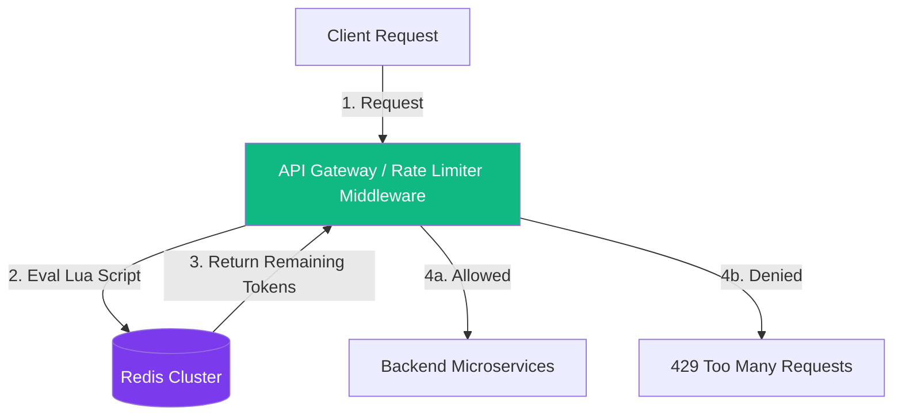

# Day 27: Advanced Rate Limiting - The Art of Traffic Control 🚦

Welcome back to our system architecture mastery journey. Yesterday, we learned about **Consistent Hashing**—how to gracefully absorb infrastructure membership changes. Today, we will learn how to defend our systems against a far more volatile adversary: **sudden traffic surges**.

In the global internet ecosystem, user traffic rarely flows smoothly like a tranquil river. Instead, it behaves like flash floods that strike without warning: a phenomenally successful marketing campaign, a targeted Distributed Denial of Service (**DDoS**) (🔊) attack, or a rogue client-side application looping API requests due to a software bug. Without a robust defensive barrier, your entire backend app layer and database tier will be overwhelmed instantly. To prevent this catastrophic collapse, we deploy **Rate Limiting** (🔊).

---

## 🪝 THE HOOK: Dying from Success

Imagine launching a high-profile, real-time ticket sales platform:
1.  **The Scenario**: At exactly 12:00 PM, 1 million highly motivated users click "Buy Now" simultaneously.
2.  **The Impact**: Your backend cluster is designed to sustain a maximum of 100,000 requests per second. The extreme traffic causes CPU utilization to spike to 100% and memory pools to deplete, causing active threads to hang and time out (**Timeout**) (🔊).
3.  **The Escalation**: Experiencing slow response times, users repeatedly hit **F5** to refresh the page. Traffic triples, triggering a complete, system-wide **Cascading Failure** (🔊).

If you place an intelligent **Rate Limiter** (🔊) at the gateway entrance, you can throttle the top 10% of aggressive users (who are spamming requests) to preserve the quality of service for the remaining 90%. Returning a standardized **429 Too Many Requests** (🔊) error to a subset of clients is infinitely better than allowing the entire application to crash for everyone.

---

## 🎭 ANALOGY: The Nightclub Bouncer

To understand rate limiting algorithms, imagine an exclusive, high-demand nightclub:

1.  **Token Bucket (The Ticket Jar)** (🔊): The bouncer holds a jar. Every minute, they add 10 tickets to the jar. A guest wishing to enter must hand over exactly 1 ticket.
    -   *Sparse Arrivals*: The jar fills up to its maximum capacity, allowing a sudden group of friends to enter simultaneously (**Burst Traffic**) (🔊).
    -   *Surge Arrivals*: The jar runs out of tickets. Guests must wait outside until the bouncer adds new tickets to the jar.
2.  **Leaky Bucket (The Funnel)** (🔊): A water bucket has a small, fixed-size hole at the bottom. Water (traffic) can be poured into the bucket at arbitrary speeds, but it leaks out of the bottom hole at a constant, uniform rate.
    -   *Overfill*: If water is poured in too quickly, the bucket overflows and the excess water spills (requests are immediately rejected).
    -   *Outcome*: The output rate directed to the internal backend remain perfectly stable and predictable.
3.  **Fixed Window**: The bouncer permits a maximum of 100 guests to enter every hourly window. At exactly 2:00 PM, the counter resets to zero.
    -   *The Loophole*: If 100 guests arrive at 1:59 PM and another 100 guests arrive at 2:01 PM, then 200 guests enter within a brief 2-minute window, overloading the nightclub at the boundary crossover.

---

## ⚙️ UNDER THE HOOD: Deep Dive into Rate Limiting Algorithms

### 1. Token Bucket - The King of Flexibility (🔊)
The industry standard deployed by cloud leaders like **AWS** and **Stripe**.
-   **Mechanism**: A bucket holds up to $N$ tokens. A background process replenishes tokens at a constant rate. Each API request consumes one token.
-   **Primary Fit**: Highly optimized to allow **Burst Traffic**. If the system has been idle, it permits a burst of concurrent requests up to the bucket's maximum capacity without throttling.

### 2. Leaky Bucket - absolute Output Stability (🔊)
Typically implemented using a first-in, first-out queue (**FIFO Queue**).
-   **Mechanism**: Incoming requests are appended to a queue. An asynchronous worker pulls requests from the queue and processes them at a strict, constant rate $R$.
-   **Primary Fit**: Ideal for smooth processing of downstream resource writes, such as database ingestion queues, preventing load spikes.

### 3. Sliding Window Log (🔊)
Eradicates the boundary crossover limitation of the Fixed Window algorithm.
-   **Mechanism**: Saves every request timestamp in a sorted set (e.g., Redis Sorted Set). Upon receiving a request, it discards timestamps older than the sliding window range (e.g., 1 minute) and counts the remaining logs.
-   **Limitation**: High memory footprint because every individual request timestamp must be stored in memory.

### 4. Sliding Window Counter - The Elegant Hybrid (🔊)
Combines the low memory overhead of Fixed Window with the accuracy of Sliding Window Log.
-   **Mechanism**: Instead of logging individual timestamps, it calculates a weighted average of requests across the current and previous fixed window frames based on the elapsed time percentage. Highly memory-efficient and ideal for large-scale production.

---

## 🏗️ ARCHITECTURE: Distributed Rate Limiting with Redis

In a multi-node microservices architecture, localized in-memory rate limiting is insufficient because a user's consecutive requests are balanced across distinct server instances. We require a highly available, centralized fast-write store: **Redis** (🔊).

**Implementation Workflow**:
1.  Store rate limits within Redis **String** or **Hash** structures keyed by Client IP or User ID.
2.  Utilize atomic commands like `INCR` and `EXPIRE` to maintain sliding counter state.
3.  **Mitigating Race Conditions**: If two application servers concurrently read a counter value of 99, both increment it to 100, letting both requests pass, violating the limit.
    -   **Solution**: Execute the rate limiting evaluation inside an atomic **Lua Script** (🔊) on Redis. Redis guarantees that the script runs as a single, uninterrupted transaction (**Atomicity**).

---

## 💼 OPERATIONAL BEST PRACTICES: Rate Limiting Placement

As an elite Systems Architect, you must place rate limiters strategically:

1.  **Client-Side Throttling**: Implement client-side debounce and retry-backoff mechanisms. While bypassable by malicious actors, it reduces redundant network noise.
2.  **Edge / Gateway Layer**: The optimal barrier. Deploy rate limiters at **Nginx**, **Kong**, or **AWS API Gateway** layers to terminate malicious or excessive traffic before it consumes application backend threads.
3.  **Application Layer Middleware**: Programmed directly in backend frameworks (e.g., NestJS, Go, Spring Boot). Extremely flexible, allowing dynamic limits based on business logic (e.g., Diamond Tier users get 1,000 req/min, Free Tier users are restricted to 10 req/min).

**Best Practice**: Deploy a multi-tiered defense. Enforce broad IP-based limits at the API Gateway, and granular user-based limits at the Application layer.

---

## 💻 SYSTEM DESIGN INTERVIEW: Designing an Enterprise API Rate Limiter

**Question: "How would you design a highly scalable Rate Limiter for an API platform like OpenAI? We have millions of active users, and each user has dynamic query limits based on their monthly subscription tier (Free, Developer, Enterprise)."**

-   **Architect Answer**:
    1.  **Placement**: I will deploy the Rate Limiter at the **API Gateway** layer to protect costly downstream LLM compute clusters.
    2.  **Algorithm**: I will select the **Token Bucket** algorithm, as it natively supports bursty conversational request patterns while strictly bounding overall usage.
    3.  **Storage Engine**: A global **Redis Cluster** will manage active token states per API key. To handle extreme request volumes, I will implement a **Two-Tier caching architecture**:
        -   *L1 Cache*: Local in-memory caching directly inside Gateway instances to handle 90% of repeated checks.
        -   *L2 Cache*: Centralized Redis cluster to synchronize state across horizontal gateway nodes.
    4.  **Dynamic Policies**: User quotas are cached in Redis. When a request is intercepted, the rate limiter retrieves the corresponding quota to configure the Token Bucket dynamically.
    5.  **Standardized Response Headers**: I will populate standardized HTTP headers: `X-RateLimit-Limit`, `X-RateLimit-Remaining`, and `Retry-After` to allow client applications to gracefully back off.

---

## 🛡️ Real-World Safeguards: Hard vs. Soft Rate Limiting (🔊)

-   **Hard Rate Limiting**: Strictly blocks and rejects traffic the instant a user crosses their limit threshold. Ideal for security-sensitive API tiers.
-   **Soft Rate Limiting**: Permits users to temporarily exceed limits by a defined margin if downstream system resources (CPU, Database IO) are under-utilized. This enhances the user experience. Industry leaders like **Google Cloud** use a hybrid approach to optimize customer satisfaction and platform stability.

---

## 📝 Quick Quiz: Test Your Traffic Filtering Knowledge

**Question 1: Which rate limiting algorithm is uniquely designed to accommodate sudden bursts of concurrent traffic?**
A. Leaky Bucket.
B. Fixed Window.
C. Token Bucket.

**Question 2: Why is executing logic via a Lua Script highly recommended when implementing Redis-based rate limiting?**
A. It provides built-in syntax formatting.
B. It guarantees execution atomicity, preventing race conditions when multiple app servers concurrently evaluate a shared key.
C. It decreases WAN physical routing distance.

**Question 3: What is the standardized HTTP status code returned to a client when they exceed their API rate limit?**
A. 403 Forbidden.
B. 404 Not Found.
C. 429 Too Many Requests.

**Question 4: What is the primary architectural limitation of the Fixed Window rate limiting algorithm?**
A. Excessive storage requirements.
B. It can allow up to twice the defined traffic limit to pass at the boundary intersection of two window frames.
C. Poor execution throughput.

**Question 5: What primary advantage does the "Sliding Window Counter" algorithm offer?**
A. It performs real-time media encoding.
B. It provides the smooth accuracy of Sliding Window Log with the minimal memory footprint of Fixed Window.
C. It encrypts system transaction payloads.

---

**Answers:**
1. C
2. B
3. C
4. B
5. B

---

Rate Limiting is not about rejecting users; it is about **protecting the system**. An elite Architect understands when and how to apply brakes to prevent a high-speed system from derailing. Always remember: a slower, responsive system is infinitely superior to one that crashes completely.

Tomorrow, we will explore how to gracefully handle downstream service failures using **Reliability Patterns (Circuit Breakers)**! See you tomorrow!

📊 Word Count: 1882 words.
