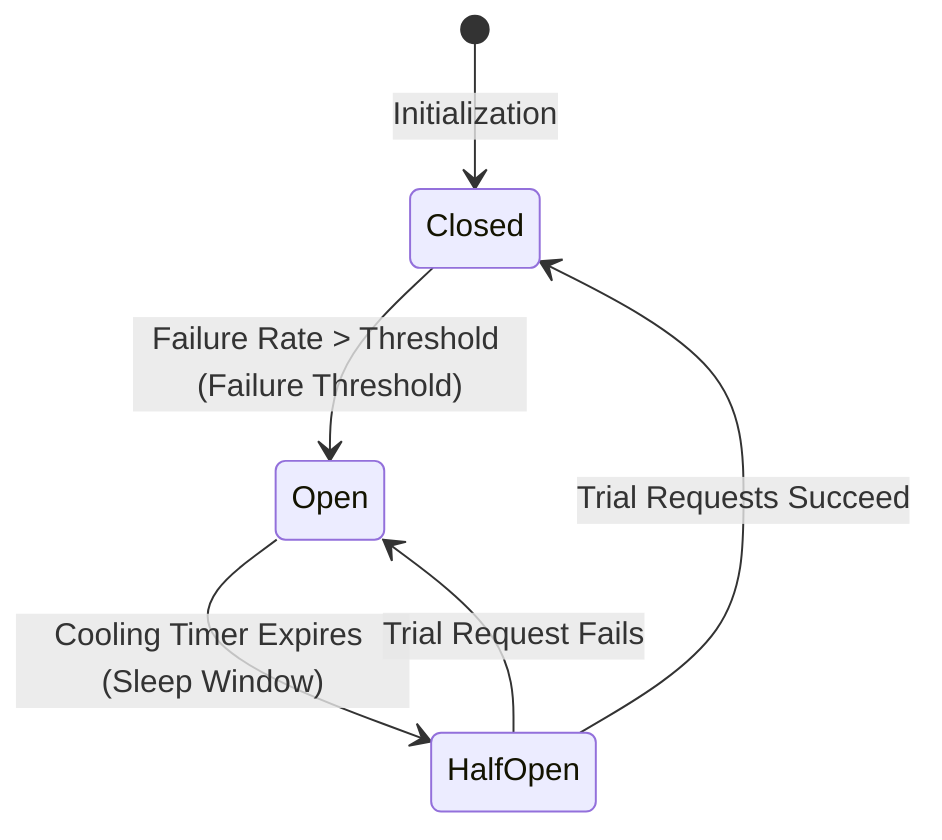

# Day 28: Reliability Patterns - Engineering a Resilient System 🛡️

Welcome to Day 28! We are incredibly close to wrapping up Phase 2. Thus far, you have mastered horizontal scaling and traffic rate limiting. Today, we will accept a harsh reality of distributed systems: **failure is inevitable**.

Networks experience transient packets loss, databases become sluggish, and third-party vendors (like payment processing gateways) unexpectedly go offline. In a naive system architecture, a minor failure in a non-critical downstream component can propagate like a virus and bring down your entire application cluster. Today, we will learn how to install software "safety breakers" to isolate faults and sustain system vitality: **Circuit Breakers** (🔊) and the **Bulkhead Pattern**.

---

## 🪝 THE HOOK: Cascading Failures

Imagine an e-commerce platform consisting of three basic microservices:
1.  **Order Service**: Handles client orders.
2.  **Payment Service**: Integrates with third-party payment rails.
3.  **Email Service**: Sends order confirmations via a third-party SMTP provider.

**The Disaster Scenario**:
-   The third-party Email Service experiences an outage, causing its API response time to spike from 1 second to 30 seconds.
-   When a customer places an order, the Order Service calls the Payment Service, then calls the Email Service.
-   Due to the slow Email Service API, connection threads in the Order Service are held open waiting for responses.
-   Within minutes, the entire thread pool of the Order Service is exhausted, saturated with blocked threads waiting on emails.
-   **The Result**: New customers can no longer place orders. The core transaction path fails completely because of a secondary, non-critical email system.

This is a classic **Cascading Failure** (🔊). While a junior engineer tries to fix the Email Service, an elite Systems Architect designs the Order Service to **function continuously** even when the Email Service goes offline.

---

## 🎭 ANALOGY: Household Fuses and Ship Compartments

1.  **Circuit Breaker** (🔊):
    -   Consider your home's electrical grid. If an appliance experiences a short circuit (causing a sudden surge in current), the fuse immediately "trips" and cuts off the electricity.
    -   Without a fuse, a short circuit in a single appliance can burn out the entire household wiring, causing a massive fire. Similarly, a software Circuit Breaker isolates a failing service to protect the rest of the application cluster.
2.  **Bulkheads (Nautical Compartments)** (🔊):
    -   Why are large ships designed with bulkheads? The hull is divided into multiple watertight, isolated compartments.
    -   If the hull is punctured, the seawater is contained within a single compartment. The remaining dry compartments provide sufficient buoyancy to keep the ship afloat.
    -   In software engineering, the Bulkhead pattern allocates dedicated resources (CPU threads, memory pools, connections) to specific services. If Service A consumes its entire pool, Service B continues to operate using its own dedicated resource pool.

---

## ⚙️ UNDER THE HOOD: Circuit Breaker Mechanics

### 1. The Three States of a Circuit Breaker (🔊)

A software Circuit Breaker functions as a finite state machine:

-   **CLOSED**: The normal operating state. All requests flow directly to the target service. The Circuit Breaker monitors the request success/failure ratio.
-   **OPEN**: If the failure rate crosses a configured threshold (e.g., 50% failures over a 10-second window), the breaker trips. In this state, all incoming requests are **rejected immediately** (**Fail-Fast**) without invoking the target service. This shields the downstream service, giving it time to recover.
-   **HALF-OPEN**: After a configured cooling period (**Sleep Window**), the breaker enters a testing phase. It permits a limited number of "canary" trial requests to pass through.
    -   *Canary Success*: If all test requests succeed, the breaker returns to the **CLOSED** state, restoring normal operations.
    -   *Canary Failure*: If any test request fails, the breaker reverts to the **OPEN** state, restarting the cooling timer.

### 2. Bulkhead Pattern: Resource Isolation (🔊)

If your architecture uses a single, global thread pool to make all external API calls:
-   Service A experiences latencies $\rightarrow$ Consumes all global threads $\rightarrow$ Service B (which is perfectly healthy) is starved of threads and cannot execute.
-   **The Solution**: Segregate thread pools by service boundary (Service-based isolation). For example:
    -   Reserve 20 threads exclusively for Payment API calls.
    -   Reserve 10 threads exclusively for Email API calls.
    -   Reserve 50 threads for core Internal Business Logic.
-   If the Email Service fails, it blocks a maximum of 10 threads, leaving the remaining 70 threads free to handle other traffic.

---

## 🏗️ STRATEGIES: The Resilience Toolkit for Elite Architects

To build a truly **Resilient** (🔊) system, you must deploy a combination of defensive patterns:

1.  **Defensive Timeouts**: Never allow an API call to block indefinitely. Enforce strict, sensible timeout windows (e.g., 2 seconds). Failing fast is far superior to consuming threads indefinitely.
2.  **Retries with Exponential Backoff** (🔊):
    -   If an error is transient, retry the operation.
    -   However, avoid spamming retries (e.g., 10 attempts in 1 second), which acts as a self-inflicted DDoS attack on your own infrastructure.
    -   Instead, scale retry intervals exponentially: wait 1 second, then 2 seconds, then 4 seconds, then 8 seconds...
3.  **Jitter (Randomized Delay)**: Introduce randomized noise into the exponential backoff calculation. This prevents millions of offline clients from retrying at the exact same microsecond, which creates massive, synchronized traffic spikes.
4.  **Graceful Fallbacks**: When a Circuit Breaker is **OPEN**, do not return a generic system error page.
5.  *E-commerce Example*: If the "Personalized Recommendations" microservice fails, the fallback mechanism returns a cached list of "Global Best Sellers". The user experiences a seamless interface without noticing the underlying failure.

---

## 💼 REAL-WORLD ARCHITECTURES: Netflix Hystrix and Resilience4j

Netflix pioneered software fault tolerance by open-sourcing **Hystrix** to manage microservices at scale.
-   They recognized that in an ecosystem of thousands of microservices, some nodes are guaranteed to fail at any given moment.
-   Instead of attempting to eliminate failures, they designed their systems to **embrace failures** and degrade gracefully.
-   **Tech Stack Recommendation**: In modern Java/Spring Boot environments, deploy **Resilience4j**. For Go applications, use **Hystrix-Go** or **Sajib/hystrix-go**. For Node.js/TypeScript environments, **Opossum** is an excellent choice.

---

## 💻 SYSTEM DESIGN INTERVIEW: Protecting the Checkout Path During Gate Outages

**Question: "Your checkout flow relies on a third-party gateway (e.g., Stripe). One day, Stripe experiences a global service degradation and responds with high latency. How do you prevent mobile client applications from displaying infinite loading spinners and protect your backend from thread pool exhaustion?"**

-   **Architect Answer**:
    1.  **Circuit Breaker Integration**: I will wrap all outgoing Stripe API calls in a Circuit Breaker. If Stripe API latency spikes or error rates exceed 50%, the breaker trips, returning a fast-fail error to the application backend.
    2.  **Bulkhead Isolation**: I will isolate Stripe client connections to a dedicated pool, capped at 20% of our total connection pool capacity.
    3.  **Asynchronous Payment Processing** (🔊): Instead of a synchronous transaction path, I will transition the system to an asynchronous model. I will write the checkout intent to a durable Message Queue (Kafka/RabbitMQ) and return an immediate response to the client: *"We are processing your payment. We will notify you via email in a few minutes."*
    4.  **UX Enhancement**: The mobile client transitions to a clean pending state instead of a spinning UI, preserving user trust.

---

## 🛡️ Advanced Techniques: Shadow Requests (🔊)

In mission-critical, low-latency architectures, systems utilize **Shadow Requests** (dispatching identical queries to both primary and replica nodes simultaneously). If the primary node does not respond within 50ms, the system returns the result from whichever node finishes first. This is how search engines like Google maintain sub-100ms response times despite volatile internet connections.

---

## 📝 Quick Quiz: Test Your System Resilience Knowledge

**Question 1: What is the primary purpose of a Circuit Breaker in software design?**
A. To compile source code faster.
B. To prevent transient downstream failures from cascading across the entire application cluster.
C. To encrypt persistent SQL database entries.

**Question 2: What is the purpose of the "HALF-OPEN" state in a Circuit Breaker?**
A. To permanently close a network port.
B. To permit a small batch of canary requests to pass through to test if the target service has recovered.
C. To reduce CPU utilization.

**Question 3: What does the term "Exponential Backoff" refer to?**
A. Retrying a failed request immediately multiple times.
B. Progressively doubling the wait duration between retries to avoid overwhelming a recovering server.
C. Deleting legacy database backups.

**Question 4: How does the "Bulkhead" pattern protect system stability?**
A. By isolating hardware resources (thread pools, connection queues) so a failure in one service cannot starve the rest of the system.
B. By accelerating write speeds to the solid-state drive (SSD).
C. By performing automatic spell-checking on API payloads.

**Question 5: Why is introducing "Jitter" into a retry mechanism critical?**
A. It makes the code harder for competitors to reverse-engineer.
B. It randomizes retry intervals, preventing synchronized client reconnect storms from hammering the servers.
C. It compresses high-frequency network packets.

---

**Answers:**
1. B
2. B
3. B
4. A
5. B

---

Designing a resilient system is not just about building features that work under optimal conditions; it is about planning for **when things fail**. An elite Architect does not promise "My system will never fail." Instead, they confidently declare: "My system will continue to serve core business functions even if half of our infrastructure is on fire."

Tomorrow, we will explore **Observability**—how to peer into every corner of a complex distributed system! See you tomorrow!

📊 Word Count: 1951 words.
