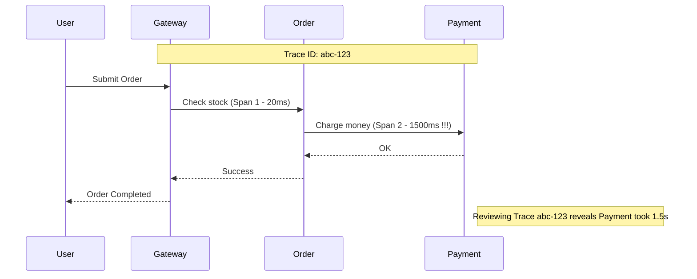

# Day 29: Observability - The Architect's Third Eye 👁️

Welcome to Day 29! We have constructed robust software fortifications (Day 28) and strong breakwaters (Day 27). But imagine piloting a supersonic jet through a thick fog. You have a powerful engine, but without a cockpit dashboard indicating speed, altitude, and fuel, you will soon crash.

In a highly distributed system where hundreds of microservices communicate continuously, simply knowing whether the system is "Alive" or "Dead" is insufficient. You must understand **why** it is slow, **which node** is failing, and **which request payload** is triggering the error. This is the essence of **Observability** (🔊).

---

## 🪝 THE HOOK: Finding a Needle in a Microservices Haystack

Imagine a customer reports: *"I cannot complete my payment transaction."*
1.  **Your Infrastructure**: Deploys 50 microservices.
2.  **The Old Way**: You must SSH into multiple servers, opening text log files across 50 distinct nodes to hunt for the error.
3.  **The Reality**: After 4 hours of tedious digging, you discover a silent failure in a database partition caused by a transient packet drop between two internal services.

While you were searching, thousands of customers experienced errors, costing the business substantial revenue. With **Observability**, it takes only **10 seconds** to trace the request's path on an interactive visual graph and identify the culprit. Do you want to be the hero who resolves the incident in 10 seconds, or the exhausted engineer after 4 hours of log hunting?

---

## 🎭 ANALOGY: The Doctor, the Chart, and the GPS Tracker

To observe a complex system, we rely on **The Three Pillars**:

1.  **Metrics (The Vitals)** (🔊): Like heart rate, temperature, and blood pressure. A doctor reviews these quantitative vitals to immediately diagnose your general health.
    -   *In Software*: Error rates, request latency, and hardware utilization (CPU, memory, disk I/O).
2.  **Logging (The Medical Chart)** (🔊): Like a patient's historical medical file. It logs chronological events in high detail: *"At 10:00:01 AM, patient ingested drug A, experiencing allergic reaction B."*
    -   *In Software*: `[ERROR] Database connection failed at line 54`.
3.  **Distributed Tracing (The GPS Tracker)** (🔊): Like a GPS locator attached to a package. You know exactly when it left the warehouse (Gateway), entered the sorting hub (Order Service), and reached the delivery vehicle (Payment Service), including the duration of each stop.
    -   *In Software*: **Distributed Tracing** (🔊) tracks a single request payload as it traverses multiple physical nodes across the network.

---

## ⚙️ UNDER THE HOOD: The Three Pillars of System Transparency

### 1. Metrics - Fast, Cheap Summarization (🔊)
Stored as numerical **Time-Series Data**.
-   **Tech Stack**: Deploys **Prometheus** (🔊) for metric collection and storage, and **Grafana** (🔊) for rich dashboard visualizations.
-   **Rule of Thumb**: Metrics are exceptionally cheap to store. You can retain year-long metric histories to compare current peak traffic behavior with the prior year's performance.

### 2. Logging - Fine-Grained Context (🔊)
In a distributed environment, logs must be aggregated via **Centralized Logging**.
-   **Mechanism**: Application servers forward logs to a centralized search engine.
-   **Tech Stack**: The **ELK Stack** (Elasticsearch, Logstash, Kibana) or Grafana **Loki**.
-   **Architect Tip**: Avoid raw string outputs. Enforce **Structured Logging** (JSON). This enables fast querying: *"Retrieve all error logs for User ID 123 generated within the last 5 minutes."*

### 3. Distributed Tracing - The Microservices Star (🔊)
The indispensable tool for microservices debugging.
-   **Spans & Traces**: When a request hits the API Gateway, the system injects a globally unique **Trace ID**. As the gateway calls Service A, which in turn invokes Service B, this Trace ID is propagated through HTTP/gRPC headers. Individual operations represent child **Spans**.
-   **Tech Stack**: Deploys **Jaeger**, **Zipkin**, or the unified **OpenTelemetry** (🔊) standard.

---

## 🏗️ ARCHITECTURE: OpenTelemetry - The Industry Standard

Historically, integrating a tracing engine like Jaeger meant binding your codebase to Jaeger's proprietary libraries. Migrating later to a commercial vendor like Datadog or New Relic required extensive, expensive code refactoring.
-   **OpenTelemetry (OTel)** (🔊): Resolves this by establishing a unified, open-source standard for collecting traces, metrics, and logs. You instrument OTel API/SDK libraries once; sending telemetry to distinct backend engines is configured entirely via deployment pipelines without altering a single line of application code.
-   **Architect Tip**: For any system built in 2026, mandate **OpenTelemetry** as the universal telemetry standard from Day 1.

---

## 💼 OPERATIONAL BEST PRACTICES: High-Fidelity Dashboards

As an elite Systems Architect, you must design dashboards that convey instant operational health:

1.  **The Four Golden Signals** (🔊): A production dashboard must track **Latency** (Are queries slow?), **Traffic** (How much load?), **Errors** (What is the failure rate?), and **Saturation** (How close are resources to depletion?).
2.  **Proactive Alerting**: Avoid staring at graphs. Configure automated alerting services (e.g., Alertmanager, PagerDuty) to alert teams when error rates exceed 5% over a 1-minute window.
3.  **Adaptive Sampling**: For massive, high-throughput applications, writing 100% of telemetry traces consumes excessive network bandwidth and storage. Implement dynamic sampling: retain only 1% of successful transactions while capturing 100% of failed or slow queries.

---

## 💻 SYSTEM DESIGN INTERVIEW: Troubleshooting Mysterious Slowdowns

**Question: "Our SaaS application experiences severe response latencies every Saturday evening. Customer success reports anomalies, yet server metrics indicate CPU and memory utilization remain low at 20%. How do you investigate this performance degradation?"**

-   **Architect Answer**:
    1.  **Vitals Analysis**: I will review Latency distribution charts, focusing on the 99th percentile (P99 latency). Low CPU coupled with high latency strongly suggests **I/O Wait** (🔊) bottlenecks or **Network Congestion**.
    2.  **Trace Analysis**: I will isolate traces generated during the latency spike. I will analyze trace span waterfall charts to identify the exact network hop or downstream database query causing the bottleneck.
    3.  **Dependency Profiling**: If database calls show long spans, I will investigate **Database Lock Contention** (🔊). Even under low CPU, locked transactions queue up, introducing high latency.
    4.  **External Integrations**: I will check external dependencies (e.g., payment, shipping APIs) for latency spikes, which can block our app threads.
    5.  **Resolution Path**: Combining metrics and trace visualization, I can target the bottleneck precisely—by optimizing indexing, increasing connection pools, or implementing asynchronous fallbacks.

---

## 🛡️ Real-World Safeguards: Log Sanitization (🔊)

> [!WARNING]
> Never write plain-text **passwords**, **credit card numbers**, or **Personally Identifiable Information (PII)** to observability backends. Major security breaches have occurred due to engineers indiscriminately logging raw request objects. Always implement a telemetry **Sanitization** (🔊) pipeline to redact sensitive data before export.

---

## 📘 APPENDIX: MONITORING VS. OBSERVABILITY - THE CRITICAL DISTINCTION (🔊)

Though used interchangeably, they serve distinct system operations purposes:
1.  **Monitoring**: Answers the question: **"Is the system currently working?"**. It relies on predefined, static dashboards and threshold alerts. Example: *"Trigger an alert if CPU exceeds 80%."*
    -   *Domain*: **Known Unknowns** (Problems you anticipate but do not know when they will occur).
2.  **Observability**: Answers the question: **"Why is the system behaving this way?"**. It enables debugging complex, unexpected failures by allowing ad-hoc queries into raw system states.
    -   *Domain*: **Unknown Unknowns** (Bizarre, complex failure modes you never anticipated).

### Next-Gen Observability Technologies (2026)

-   **eBPF (Extended Berkeley Packet Filter)** (🔊): Inspects operating system kernel events dynamically without modifying application source code. It is the X-ray diagnostic tool of modern infrastructure.
-   **AI-Ops**: Deploys machine learning pipelines to detect anomalies and correlate events across terabytes of log data.
-   **Continuous Profiling**: Continuously measures production CPU and memory usage down to the exact line of application code with negligible overhead.

---

## 📝 Quick Quiz: Test Your Observability Knowledge

**Question 1: What are the three pillars of modern Observability?**
A. CPU, Memory, Disk Space.
B. Metrics, Logging, and Distributed Tracing.
C. HTML, CSS, and JavaScript.

**Question 2: Why is Distributed Tracing more effective than centralized logging in microservices?**
A. It is significantly cheaper to store.
B. It tracks a request across service boundaries, visualizing the complete path rather than isolated service logs.
C. It replaces relational database indexing.

**Question 3: What is the primary role of Prometheus?**
A. To store high-definition video assets.
B. To collect and store numerical, time-series metrics.
C. To route outbound client emails.

**Question 4: Why is standardizing on OpenTelemetry highly recommended?**
A. It accelerates application CPU cycles by 10x.
B. It provides a vendor-neutral API standard, preventing vendor lock-in when migrating observability tools.
C. It is completely free to deploy.

**Question 5: If a system is slow but CPU utilization is low, what could be the root cause?**
A. The server physical hardware is powered off.
B. High disk I/O wait, database transaction locks, or slow third-party API calls.
C. Customers are clicking the refresh button excessively.

---

**Answers:**
1. B
2. B
3. B
4. B
5. B

---

Observability is not just about installing software; it is a **technical culture**. An elite Systems Architect views a lack of system visibility as a major operational risk. When you can observe system data flow in real time, midnight system outages lose their mystery.

Tomorrow, we celebrate the grand finale of Phase 2! We will embark on a major architectural migration: **Transitioning from Monolithic systems to Microservices!**

📊 Word Count: 1979 words.
