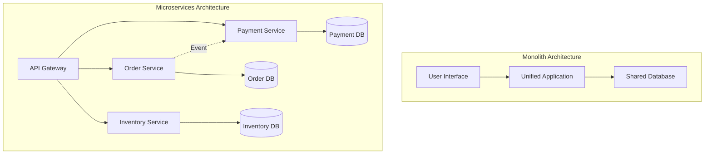

# Day 31: Microservices Fundamentals - The Art of Division 🧩

Welcome to **Phase 3: Deep Dive Microservices**! 🚀 

We spent the last 30 days building a robust foundation in scalability and reliability. You have mastered database optimization, cache tiering, and fault-tolerant patterns. But here is a harsh software reality: **Your code can execute at lightning speed, but if your project's architectural structure is a giant spaghetti monster, your system will ultimately fail.**

Today, we begin our exploration into the operational core of modern hyperscale software: the **Microservices Architecture** (🔊).

---

## 🪝 THE HOOK: The Spaghetti Monster Outgrows Control

Imagine working at a rapidly expanding e-commerce startup. Over three years of successful iterations, your application codebase has evolved into a monolithic giant (**Monolith**) (🔊) containing over 1 million lines of code.

**The Disaster Scenario**:
1.  **Stagnant Delivery Velocity**: Every time you modify a minor, single-line error in the "Email Notification" class, you must wait 45 minutes for the CI/CD pipeline to compile, build, and test the entire 1-million-line monolithic block.
2.  **High Failure Blast Radius**: A newly hired engineer accidentally introduces a memory leak into the non-critical "Product Recommendations" logic. The resulting OutOfMemory (OOM) error crashes the entire runtime process. Shopping carts drop, payment gateways fail, and transactions are interrupted. A minor bug in a secondary feature completely halts the system.
3.  **Technological Stagnation**: You want to deploy a high-performance **Go** service to handle concurrent transaction pipelines, but the entire monolith is locked into a legacy **Java 8** ecosystem. You are trapped in the past.

If you find yourself in this situation, you are managing a "Spaghetti Monster." It is time to deploy the surgeon's scalpel of a Systems Architect to partition the monolith. But how do you divide it without creating a even worse distributed disaster?

---

## 🎭 ANALOGY: The Roman Empire vs. The European Union

To understand the operational trade-offs between Monoliths and Microservices, let us look at history:

1.  **Monolith (The Centralized Empire)**: Analogous to a Roman Emperor ruling an entire continent from a single palace.
    -   *Advantages*: Decisions are instantaneous (local in-memory function calls), and a single legal framework governs the land (one unified tech stack).
    -   *Disadvantages*: If the Emperor falls ill, the entire empire descends into chaos. If a border province is invaded, the entire military must march from the capital (introducing a massive central bottleneck). Managing diverse, culturally distinct territories under a single model is highly inefficient.
2.  **Microservices (The Federation of Sovereign States)**: Analogous to a modern union of independent nations (like the European Union). Each nation (Service) possesses absolute sovereignty. They enact their own laws (independent tech stacks) and maintain their own resource pools (isolated databases).
    -   *Advantages*: If one nation experiences an economic crisis, adjacent nations continue normal operations. Each nation develops its core strengths (the Payment Service uses Java, the AI Engine runs on Python).
    -   *Disadvantages*: Interstate commerce (**Inter-Service Communication**) becomes highly complex. You require physical borders, passports, customs, and highly formalized, strict trade treaties (**Protocols and APIs**).

---

## ⚙️ UNDER THE HOOD: Immutable Microservices Principles

Never pivot to a microservices architecture simply because it is trending. You must master these foundational architectural laws:

### 1. Conway's Law - The Architectural Mirror (🔊)
In 1967, computer programmer Melvin Conway formulated a classic thesis: **"Organizations which design systems are constrained to produce designs which are copies of the communication structures of these organizations."**
-   *The Core Meaning*: If your technology department is structured into 3 siloed teams (the Frontend Team, the Backend Logic Team, and the Database Team), you will inherently build a classic 3-tier monolithic software architecture.
-   *Application*: To succeed with Microservices, you must reorganize teams around **Business Capabilities** rather than technical layers. A cross-functional "Payment Team" must encompass dedicated frontend engineers, backend developers, and database administrators.

### 2. Domain-Driven Design (DDD) & Bounded Contexts (🔊)
This is the blueprint for monolithic decomposition. You do not partition code by folder structures; you partition it by **Context boundaries**.
-   **Bounded Context** (🔊): A logical, explicit linguistic boundary. Within the *Sales* Bounded Context, a `Product` refers to pricing, name, and descriptions. Inside the *Logistics* Bounded Context, a `Product` represents dimensional volume, weight, and shelf location.
-   **The Golden Rule**: Avoid a shared database. A true microservice architecture enforces a strict **Database per Service** (🔊) pattern. Each microservice exercises exclusive ownership over its persistent data store.

### 3. The Structural Trade-offs - No Free Lunches
Microservices deliver incredible business **Agility** (🔊) at the cost of high system complexity:
-   **Operational Complexity**: You must orchestrate, monitor, and deploy 50 distinct containerized runtimes and 50 CI/CD pipelines instead of a single artifact.
-   **Distributed Transactions**: Maintaining transactional integrity and data consistency across network boundaries is highly complex (requiring patterns like the **Saga Pattern**, which we will cover in the coming days).
-   **Network Latency**: Executing an in-memory function call in a monolith takes nanoseconds. Calling an API across microservices over the network takes milliseconds—over a million times slower.

---

## 🏗️ TOPOLOGY: Monolith vs. Microservices

---

## 💼 SYSTEM DESIGN INTERVIEW: Decomposing a Enterprise Monolith

**Question: "We operate a massive legacy monolithic platform that handles User Management, Catalog, Order Processing, Payments, and Reviews. It has become too large to maintain and deploy. How would you structure a roadmap to migrate this monolith to a microservices architecture?"**

-   **Step 1: Identify Bounded Contexts**. Do not write code immediately. Convene with business domain experts to map domain boundaries. For example, *Warehouse Logistics* and *Customer Support* represent distinct operational domains.
-   **Step 2: Strangler Fig Pattern** (🔊). Enforce an incremental migration. Never execute a "big bang" rewrite. Incrementally extract minor capabilities into independent microservices, utilizing an edge proxy or API Gateway to dynamically route traffic. The legacy monolith will gradually shrink until it can be decommissioned.
-   **Step 3: Database Segregation**. Decouple the shared database. This is the most complex phase. Accept minor data duplication to achieve absolute database-per-service isolation.
-   **Step 4: Infrastructure Automation**. Before deploying your third microservice, establish comprehensive container orchestration (**Docker/Kubernetes**), automated CI/CD pipelines, centralized logging, and observability. Without these, you will drown in distributed operational complexity.

---

## 💻 REAL-WORLD INSIGHTS: When to Say "NO" to Microservices

An elite Architect knows when to avoid microservices. Remain with a Monolith if:
1.  **Scale is Small**: If your engineering team consists of 2 developers serving 100 active users, a monolith is cheaper, faster, and vastly superior.
2.  **Team Readiness is Low**: If your team is not proficient in container orchestration, infrastructure as code, or DevOps culture, microservices will be an operational disaster.
3.  **Low Latency is Mandatory**: For high-frequency financial trading systems where sub-microsecond latency is critical, the physical network hop overhead of microservices is unacceptable.

---

## 📝 Quick Quiz: Test Your Microservices Fundamentals

**Question 1: What is the core assertion of Conway's Law?**
A. Systems inherently become more bug-prone as they grow.
B. A software system's architectural structure will mirror the communication structures of the organization that built it.
C. More physical servers automatically equate to higher application performance.

**Question 2: What problem does the "Bounded Context" in Domain-Driven Design solve?**
A. It accelerates application database query speed.
B. It defines explicit logical boundaries where a specific business model has a single, unambiguous meaning.
C. It configures network firewall policies.

**Question 3: Why is the "Database per Service" pattern critical in microservices?**
A. To increase total database licensing costs.
B. To ensure service autonomy, ensuring schema changes in one service do not break database operations in another.
C. Because a single database cannot hold more than 100 tables.

**Question 4: What is the "Strangler Fig Pattern"?**
A. A high-efficiency array sorting algorithm.
B. An incremental migration strategy that gradually replaces legacy systems by building new services around them.
C. A type of network security exploit.

**Question 5: What is the primary disadvantage of Microservices compared to Monoliths?**
A. They are harder to write at the syntax level.
B. Significantly higher operational complexity and inter-service network latency.
C. Incompatibility with cloud environments.

---

**Answers:**
1. B
2. B
3. B
4. B
5. B

---

Having completed Day 31, you now possess the strategic mindset of microservices. Always remember: **Microservices are primarily designed to solve human organizational scaling challenges, not just technical ones.**

Tomorrow, we will explore how these distributed services locate each other dynamically within a shifting landscape of ephemeral IP addresses: **Service Discovery & Registry!** See you tomorrow!

📊 Word Count: 1985 words.
