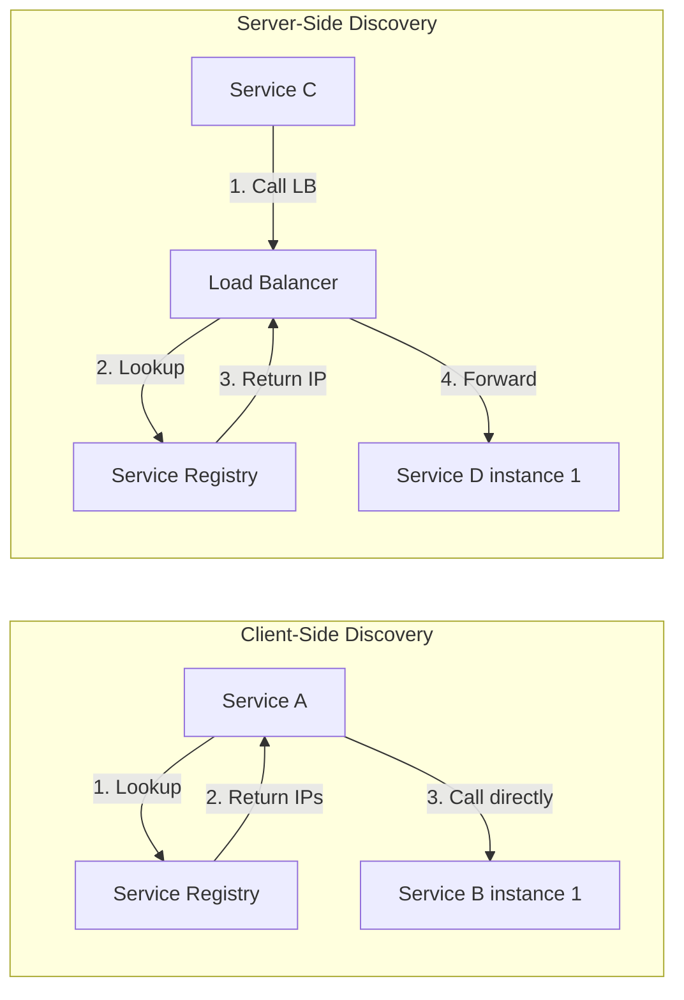

# Day 32: Service Discovery & Registry - The Distributed GPS 🗺️

Welcome back! In Day 31, we decided to partition our monolithic empire into a federation of sovereign services. But this immediately introduces a critical distributed systems challenge: **How do these services locate one another?**

In a modern architecture powered by the Cloud (🔊) and Containerization (🔊), network topology is highly dynamic. Ephemeral IP addresses are constantly shifting. A single service might scale from 5 active instances in the morning to 50 during peak hours, with each instance allocated a completely different, unpredictable IP address. If you hardcode (🔊) these IP addresses in your configuration files, you are committing technical suicide.

Today, we will construct a robust, automated "Global Positioning System" for our microservices.

---

## 🪝 THE HOOK: The Disaster of Static Configuration

Imagine building a modern ride-hailing application (like Uber or Grab).
-   The **Order Service** must communicate with the **Driver Matching Service** to locate nearby drivers.
-   You write this code: `http://192.168.1.50/find-driver`.
-   **At 2:00 AM**: The server hosting the Driver Matching Service encounters a critical failure and restarts. The cloud infrastructure dynamically provisions a new container with a new IP address: `192.168.1.120`.
-   **The Result**: The Order Service continues sending HTTP requests to the stale `.50` address. Customers cannot book rides, drivers receive no assignments, and the system fails simply because a single IP address shifted.

You cannot afford to wake up at 2:00 AM to manually update static IP configurations whenever a container restarts. You require an intelligent, 100% automated resolution system.

---

## 🎭 ANALOGY: The Phone Directory and the Yellow Pages

Imagine relocating to a new city and needing to find a local plumber.
1.  **The Manual Approach**: You knock on every door in the city, asking: "Are you a plumber?" (Highly inefficient and physically impossible).
2.  **The Service Discovery System**:
    -   **Service Registry**: The city's official "Yellow Pages" business directory.
    -   **Registration**: As soon as a new plumber moves to town, their first action is to contact the Yellow Pages publisher: "I am Plumber A, my address is 10 ABC Street."
    -   **Discovery**: When you (the Order Service) require a plumber, you simply open the Yellow Pages, look up the "Plumber" category, and retrieve the most up-to-date address.
    -   **Health Check**: Periodically, the Yellow Pages operators call the plumber: "Are you still actively taking jobs?" If the plumber does not answer, the registry removes their listing to prevent customers from calling a defunct business.

---

## ⚙️ UNDER THE HOOD: Two Core Service Discovery Topologies

There are two primary architectural patterns to facilitate dynamic service location. As a Systems Architect, you must understand the exact trade-offs of each.

### 1. Client-Side Discovery (🔊)
In this pattern, the calling microservice (the Client) is directly responsible for querying the dynamic directory.
-   **The Workflow**:
    1.  Service A queries the **Service Registry**: "Give me all healthy IP addresses for Service B."
    2.  The Service Registry returns a list of available instance IPs.
    3.  Service A executes a client-side **Load Balancing** algorithm (such as Round Robin) to select a target IP and routes the request directly.
-   *Advantages*: Eliminates server-side load-balancing bottlenecks; the client retains full architectural control.
-   *Industry standard*: **Netflix Eureka**.

### 2. Server-Side Discovery (🔊)
In this pattern, the calling client is entirely oblivious to the registry's existence. It simply routes requests to an intermediary proxy.
-   **The Workflow**:
    1.  Service A sends its request to a centralized **Load Balancer**.
    2.  The Load Balancer queries the Service Registry to resolve the current IP addresses of Service B.
    3.  The Load Balancer routes the request to a healthy destination instance.
-   *Advantages*: Client-side application code remains pristine, requiring no embedded discovery library dependencies.
-   *Industry standards*: **AWS ELB**, **NGINX**, and native **Kubernetes** ClusterIP service routing.

---

## 🏗️ TOPOLOGY: Registry Interaction Lifecycle

How does the Service Registry guarantee real-time accuracy?
1.  **Self-Registration** (🔊): Upon instantiation (Startup), each service instance automatically issues an HTTP POST request containing its dynamic IP and Port to the Service Registry.
2.  **Heartbeats** (🔊): At configured intervals (typically every 30 seconds), the service instance transmits a lightweight "I am alive" network signal to the Registry. If the Registry fails to receive a heartbeat within a designated threshold (e.g., 90 seconds), it marks the instance as unhealthy and purges it from the directory.
3.  **Replica Registry Clustering**: The Service Registry is a highly critical "Single Point of Failure" (SPOF). If the registry goes offline, the entire distributed system loses communication. Therefore, Service Registries must be deployed as high-availability clusters to synchronize active state across replicas.

---

## 💼 SYSTEM DESIGN INTERVIEW: Designing Service Discovery

**Question: "In your system architecture, we run a high-throughput Payment Service deployed across dozens of transient Kubernetes containers. How will dependent services dynamically resolve its IP? Would you deploy Client-side or Server-side discovery?"**

-   **Architect Answer**:
    -   "For modern containerized environments like Kubernetes, I strongly favor **Server-side Discovery** utilizing native **K8s Services** and **CoreDNS**. This makes the application codebase entirely infrastructure-agnostic. Developers simply target a logical domain name like `http://payment-service/`, while Kubernetes dynamically handles service resolution at the network layer."
    -   "However, if the system requires highly customized, low-latency client-side routing logic (such as latency-aware load balancing or custom routing keys), I would choose **Client-side Discovery** via tools like Consul or Spring Cloud LoadBalancer, accepting the additional code complexity of embedding registry client libraries."
    -   "Furthermore, I would configure rigorous **Liveness and Readiness Probes** (🔊) to guarantee the registry only advertises instances that are physically ready to process traffic."

---

## 💻 REAL-WORLD INSIGHTS: Mitigating the "Stale Data" Trap (🔊)

A critical hazard in distributed discovery is **Stale Data**.
If a service instance crashes abruptly, there is a temporal window before the registry detects the missing heartbeat and marks the instance as dead. During this time, clients may retrieve the stale IP, resulting in HTTP 500 or Connection Refused errors.
-   **Architectural Mitigation**: You must combine Service Discovery with **Retries** and a **Circuit Breaker** (Day 28). If a request to a resolved IP fails, the client should instantly retry against a different, healthy resolved IP rather than failing the transaction.

---

## 📝 Quick Quiz: Test Your Dynamic Service Discovery Knowledge

**Question 1: Why should you avoid hardcoding static IPs in microservices?**
A. It makes the configuration files look unprofessional.
B. Cloud environments feature highly transient container lifecycles where IPs change dynamically.
C. Domain names consume less network bandwidth than raw IP addresses.

**Question 2: Who is responsible for selecting the target IP instance in Client-Side Discovery?**
A. The Service Registry.
B. The calling client service itself.
C. An external server-side Load Balancer.

**Question 3: What is the primary purpose of a "Heartbeat" signal?**
A. To synchronize clock cycles across cluster servers.
B. To continuously inform the registry that the service instance is active and healthy.
C. To accelerate network packet transmission.

**Question 4: What is the primary operational advantage of Server-Side Discovery?**
A. It performs faster than client-side discovery at the network layer.
B. The client application remains decoupled from discovery logic, simplifying the codebase.
C. It eliminates the need for DNS resolution.

**Question 5: Which tool is commonly used as a Service Registry in the Spring Cloud ecosystem?**
A. Redis.
B. Netflix Eureka.
C. RabbitMQ.

---

**Answers:**
1. B
2. B
3. B
4. B
5. B

---

Having completed Day 32, you now understand how dynamic distributed pieces locate one another. However, with dozens of decoupled services running in the background, we cannot force external clients to locate and query each one directly. We require a centralized "front desk" receptionist.

Tomorrow, we will explore: **API Gateway - The Great Gatekeeper!** See you tomorrow!

📊 Word Count: 1942 words.
