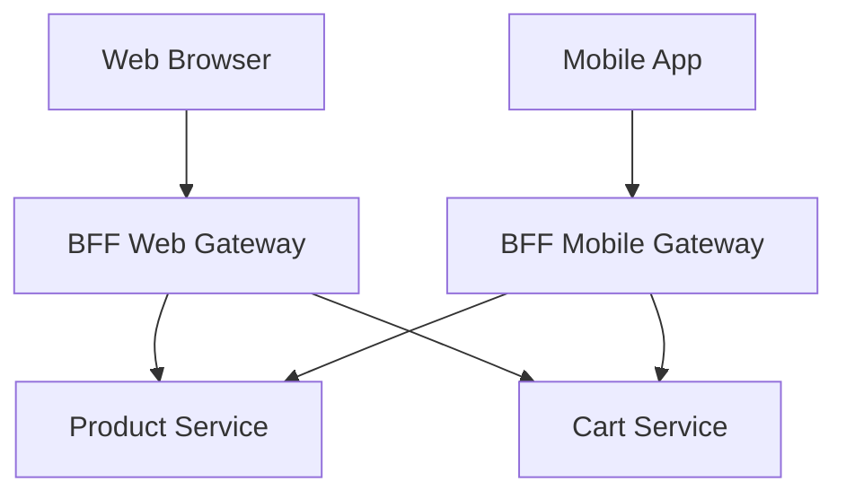

# Day 33: API Gateway & BFF - The Grand Gatekeeper 💂‍♂️

Welcome to Day 33! We explored how microservices register and locate each other via Service Discovery (Day 32). But let us pause for a moment: **Do you really want your client applications directly accessing the dynamic IP address of every internal microservice?**

If you allow a client's mobile app to query 50 decoupled microservices directly just to render a single home page, you are inviting a disaster of security vulnerabilities, high latency, and coupling complexity.

Today, we will construct a robust, unified "Front Door" for our entire system: the **API Gateway** (🔊) and its companion architectural pattern, the **BFF (Backend for Frontends)** (🔊).

---

## 🪝 THE HOOK: The "Chatty Client" Nightmare (🔊)

Imagine opening a modern e-commerce mobile application. To render a single product detail screen, the application must:
1.  Query the **Product Catalog Service** for names, metadata, and images.
2.  Query the **Inventory Service** to verify current stock levels.
3.  Query the **Review Service** to retrieve customer feedback and star ratings.
4.  Query the **Promotion Service** to apply active discount codes.
5.  Query the **User Profile Service** to check if the user qualifies for VIP pricing.

**The Distributed Bottlenecks**:
-   **Battery & Data Drainage**: The user's mobile device must establish 5 distinct HTTP connections. Each connection incurs the high latency cost of repeated TCP handshakes and TLS negotiations over transient cellular networks.
-   **Security Vulnerabilities**: You must expose the endpoints of all 5 internal services directly to the public internet, dramatically expanding your attack surface.
-   **Brittle Coupling**: If you refactor your backend and rename "Product Service" to "Catalog Service", you must immediately deploy a new mobile app update to millions of active devices to avoid breaking the UI.

As a Systems Architect, would you allow restaurant patrons to walk directly into the kitchen to retrieve their own food, or would you employ a waiter to take their order and serve their meal?

---

## 🎭 ANALOGY: The 5-Star Hotel Receptionist

Think of an **API Gateway** as the elite receptionist at the front desk of a luxury hotel:

1.  **A Single Point of Contact**: Guests do not need to locate the laundry room on the 4th floor or navigate to the kitchen. They simply speak to the receptionist.
2.  **Security (Authentication)**: The receptionist verifies your identity (Check ID) and room reservation before issuing a key card for the elevators.
3.  **Routing & Dispatching**: If you want your bags stored, the receptionist calls the bellhop. If you require dinner, they contact the restaurant.
4.  **Protocol Translation**: If you speak English but the chef only speaks French, the receptionist acts as the translator to ensure accurate delivery.
5.  **Access Control (Rate Limiting)**: If an eccentric guest attempts to ask 100 questions per minute, the receptionist politely requests them to wait, protecting staff resources for other patrons.

---

## ⚙️ UNDER THE HOOD: 5 Architectural Superpowers of the API Gateway

An API Gateway is far more than a simple reverse proxy. It serves as the intelligent brain at the boundary of your system:

### 1. Request Routing (🔊)
Using incoming URL paths, the Gateway intelligently routes requests to the appropriate target microservice.
-   *Example*: `/api/orders/**` is routed to the Order Service, while `/api/users/**` goes directly to the User Service.

### 2. Authentication & Authorization (🔊)
Instead of forcing 50 distinct microservices to implement duplicated JSON Web Token (JWT) validation logic, you consolidate this responsibility. The Gateway validates the signature, expiry, and scopes of the token once. Only valid requests pass through to the internal network, keeping downstream services pristine.

### 3. Rate Limiting & Throttling (🔊)
The Gateway is the ideal location to deploy the rate-limiting algorithms we explored in Day 27. It protects downstream services from malicious DDoS attacks, scraping bots, or client-side retry loops.

### 4. Protocol Translation (🔊)
External clients typically communicate using **HTTP/1.1** or **HTTP/2** (REST/JSON). However, internal microservices often communicate via high-performance **gRPC** (🔊) protocols to minimize latency. The Gateway seamlessly translates incoming REST requests to gRPC and vice versa.

### 5. Response Aggregation (🔊)
The Gateway intercepts a single client request for "Home Page Data," concurrently queries 5 backend services in parallel, aggregates the payloads into a single, cohesive JSON response, and returns it to the client. This resolves the "Chatty Client" issue.

---

## 🏗️ TOPOLOGY: The BFF (Backend for Frontends) Pattern

What happens when a desktop web browser requires highly detailed product specifications (with multiple data-rich widgets), while an Apple Watch app only needs a 2-line text summary?

If they share a single API Gateway, the Apple Watch is forced to download the massive desktop payload, wasting processing power, cellular data, and battery life (**Over-fetching**) (🔊).

**The Solution**: The **BFF (Backend for Frontends)** (🔊) pattern.
We deploy dedicated API Gateways optimized for each specific client type:
-   **BFF-Mobile**: Returns lightweight, compressed JSON, omitting heavy desktop-only fields.
-   **BFF-Web**: Delivers rich, detailed payloads and high-resolution assets.

---

## 💼 SYSTEM DESIGN INTERVIEW: Designing for Gateway High Availability

**Question: "If you position a centralized API Gateway at the edge of your network, it inherently becomes a Single Point of Failure (SPOF). If the gateway crashes, your entire system goes offline. How do you mitigate this architectural risk?"**

-   **Architect Answer**:
    -   "We never run a single, isolated API Gateway instance. We deploy the Gateway as a highly available, stateless **Cluster** positioned behind a Layer 4 Load Balancer (such as an AWS NLB or hardware F5 appliance). The Load Balancer performs health checks and dynamically distributes traffic across healthy Gateway nodes."
    -   "Secondly, I would implement **Horizontal Auto-scaling** for the Gateway nodes based on active TCP connections and CPU utilization. During sudden traffic spikes, the orchestrator automatically provisions additional Gateway containers to absorb the load."
    -   "Lastly, I would select an ultra-low-latency, lightweight Gateway engine such as **Kong (built on NGINX)**, **Envoy**, or **Spring Cloud Gateway** to ensure the Gateway layer does not become a physical processing bottleneck."

---

## 💻 REAL-WORLD INSIGHTS: Avoid the "Monolithic Gateway" Trap!

A catastrophic error made by junior architects is embedding business logic into the API Gateway.
-   **Wrong**: Implementing discount calculation rules or database queries directly within the Gateway codebase.
-   **Right**: Keeping the Gateway strictly stateless. Its responsibilities are limited to routing, authentication, rate limiting, and basic aggregation. Business rules must reside within downstream microservices. If you pollute your gateway with business logic, you are simply building a new distributed monolith at the edge of your network.

---

## 📝 Quick Quiz: Test Your API Gateway & BFF Knowledge

**Question 1: What is the primary function of "Response Aggregation" in an API Gateway?**
A. To rebuild the entire system from scratch.
B. To query multiple downstream microservices and combine their responses into a single payload for the client.
C. To backup database clusters.

**Question 2: Why is the API Gateway the optimal place to handle Authentication?**
A. It speeds up application code execution.
B. It offloads token validation from downstream microservices, allowing them to focus entirely on core business logic.
C. Because downstream microservices are physically unable to validate tokens.

**Question 3: What core problem does the BFF (Backend for Frontends) pattern solve?**
A. It facilitates better collaboration between backend and frontend developers.
B. It provides optimized, custom APIs tailored specifically to the unique constraints of different client devices.
C. It replaces relational database schemas.

**Question 4: What is the main risk of embedding business logic inside an API Gateway?**
A. The system becomes too fast to manage.
B. The Gateway becomes a distributed monolith, introducing high code coupling and operational risk.
C. No issues will occur.

**Question 5: Which of the following is a widely used API Gateway technology?**
A. React.
B. Kong / NGINX / Spring Cloud Gateway.
C. Docker Desktop.

---

**Answers:**
1. B
2. B
3. B
4. B
5. B

---

Having completed Day 33, you have designed the robust outer security perimeter of your system. But once internal microservices need to exchange data, should they communicate directly via synchronous APIs (REST), or asynchronously via messages (Message Queues)?

Tomorrow, we will explore: **Inter-service Communication!** See you tomorrow!

📊 Word Count: 1915 words.
