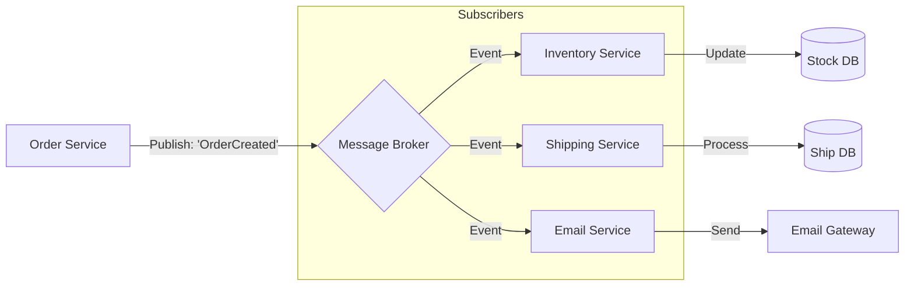

# Day 35: Event-Driven Architecture (EDA) - The Art of Loose Coupling ⚡

Congratulations on reaching the final lesson of our first Microservices Deep Dive week! 🚀

We have mastered API Gateways (Day 33) and synchronous inter-service communication via REST/gRPC (Day 34). However, a critical structural challenge remains: if Service A directly invokes Service B, Service A must have absolute knowledge of Service B's existence, API signature, and network address, and it must block waiting for Service B to respond. This is known as **Tight Coupling** (🔊).

In a massive system comprising 1,000 services, if every service is tightly coupled in this manner, a slow database query or runtime failure at the end of a transaction chain will trigger a domino effect, bringing down your entire ecosystem.

Today, we will master the pinnacle of modern system design: **Event-Driven Architecture (EDA)** (🔊)—where services no longer call each other directly; they simply publish occurrences to the network and allow the system to react organically.

---

## 🪝 THE HOOK: The Death of Blocking Execution

Imagine designing a scale social network like Facebook. When a high-profile user (KOL) publishes a new post:
1.  The system must push notifications to 1 million active followers.
2.  The system must update the home feed (Newsfeed) of those 1 million users.
3.  The system must run natural language processing to optimize ad targeting.
4.  The system must execute content moderation scans using an AI classification pipeline.

If you attempt to orchestrate this synchronously: the "Post Creation Service" must sequentially invoke all 4 downstream services.
-   **The Bottleneck**: The user will be blocked watching a loading indicator for 30 seconds while the backend waits for downstream processing to complete. Furthermore, if the non-critical "AI Moderation Service" is offline, the core action of posting is blocked. This is highly fragile design.

How do we design the Post Creation Service to return a success status in less than 100 milliseconds, while all secondary processes execute automatically in the background?

---

## 🎭 ANALOGY: The University Bulletin Board

Let us compare two organizational workflows:

1.  **Request-Response (Hand-delivered Memos)**: You possess an urgent announcement. You must walk to every single dormitory room, knock on the door, hand the memo directly to the student, and wait for them to read it. You can only mark your task as complete after the final student has received the physical paper. (Highly inefficient, exhausting, and slow).
2.  **Event-Driven (The Public Bulletin Board)**:
    -   You (the Post Service) write the announcement on a piece of paper, pin it to a **Public Bulletin Board** (the Message Broker), and go to sleep.
    -   Any student interested in that category of news (Subscribers) periodically walks past the board and reads the pinned memo.
    -   You do not need to know how many students read it, their room numbers, or whether they are currently awake. Your job is complete the millisecond the paper is pinned to the board.

---

## ⚙️ UNDER THE HOOD: The Core Mechanics of EDA

To construct a highly scalable event-driven system, you must implement these architectural components:

### 1. The Event (🔊)
An Event is a highly structured data record representing "A business occurrence that occurred in the past."
-   *Examples*: `OrderPlaced`, `PaymentProcessed`, `PasswordChanged`.
-   *Key Characteristic*: Events are strictly **Immutable** (🔊). You cannot modify historical facts.

### 2. The Message Broker (🔊)
The centralized middleware orchestrating event routing. There are two primary categories:
-   **Message Queues (e.g., RabbitMQ)**: Designed for point-to-point message delivery. Once a message is consumed and acknowledged, it is purged. Excellent for managing task routing (Commands).
-   **Log-based Brokers (e.g., Apache Kafka)**: Persists events sequentially in an append-only transaction ledger (Log). Multiple independent consumer groups can read and replay events from any point in the past. Perfect for big data pipelines, real-time analytics, and event-replaying.

### 3. The Pub/Sub Model (🔊)
-   **Publisher (Producer)**: The source service that generates and broadcasts the event. It possesses no awareness of downstream consumers.
-   **Subscriber (Consumer)**: The target service that registers interest with the Message Broker, declaring: "Whenever an event of type X occurs, deliver it to my queue."

### 4. Event Sourcing (🔊)
Instead of storing only the *current state* of a resource (e.g., `UserBalance = $100`), you store the absolute sequence of historical delta events:
-   `Deposited $50` -> `Deposited $70` -> `Withdrew $20`.
By replaying these historical events sequentially, you can compute the current state at any precise millisecond in history. This is the gold standard for banking, auditing, and fraud-detection systems.

---

## 🏗️ TOPOLOGY: Event-Driven Topology

---

## 💼 SYSTEM DESIGN INTERVIEW: Real-Time Sports Score Notification

**Question: "Design a high-throughput push notification system to alert millions of active users globally the millisecond a goal is scored in a football match."**

-   **Architect Answer**:
    -   "I would deploy an **Event-Driven Architecture**. The moment a goal is registered, the Score-Tracking Service publishes a `GoalScored` event containing metadata (match ID, scorer, timestamp) to a high-throughput **Apache Kafka Topic**."
    -   "Positioned downstream, a horizontally scaled cluster of **Notification Worker Services** subscribes to this topic. Kafka's partition model allows us to scale out workers to hundreds of consumer nodes to concurrently process notifications for millions of devices without placing any execution load on the core score-tracker."
    -   "To isolate network latency spikes, I would implement a **Fan-out** (🔊) message dispatch pattern. The core event is cloned into dedicated queues for specific platforms (iOS Push, Android Push, WebSockets). If the Apple APNs gateway encounters latency, it will not slow down delivery to Android users."
    -   "This design provides excellent **Fault Tolerance**: if a worker node crashes, Kafka retains the partition offset. Upon recovery, the worker resumes consumption immediately without losing a single match update."

---

## 💻 REAL-WORLD INSIGHTS: The Architectural Cost of Events

EDA is not a silver bullet. It introduces serious trade-offs that you must design around:
1.  **Eventual Consistency** (🔊): Data is no longer instantly consistent across all systems. After placing an order, it may take 1 to 2 seconds for the confirmation email to be sent. You must prepare the business stakeholders and front-end user experience to expect this asynchronous delay.
2.  **Event Ordering**: In a distributed system, Event A might occur before Event B, but network conditions could cause Event B to arrive at the consumer first. You must employ mechanisms like **Sequence Numbers** or logical clocks within the payload to handle out-of-order execution safely.
3.  **Debugging & Observability**: Tracing execution paths becomes exceptionally difficult because there are no direct, synchronous stack traces. You must deploy robust **Distributed Tracing** platforms (such as Jaeger or OpenTelemetry) to trace unique transaction IDs across network boundaries, as explored in Day 29.

---

## 📝 Quick Quiz: Test Your Event-Driven Architecture Knowledge

**Question 1: What does "Loose Coupling" mean in the context of EDA?**
A. Services must share the same programming language runtime.
B. Services have no awareness of downstream consumers, interacting exclusively through event payloads via a broker.
C. Services must share a single relational database schema.

**Question 2: Why must Events be immutable?**
A. To optimize disk storage layouts.
B. Because they represent real-world historical occurrences; modifying them compromises auditability and system integrity.
C. Because Message Brokers are physically unable to rewrite files.

**Question 3: What is the primary responsibility of a Consumer (Subscriber) in a Pub/Sub model?**
A. Broadcasting system events.
B. Registering interest in specific event types and processing them upon delivery.
C. Orchestrating the Message Broker cluster.

**Question 4: What is the main operational challenge of Eventual Consistency?**
A. The entire cluster runs slower.
B. Relational databases cannot store events.
C. Data across decoupled services may temporarily diverge before reaching consistency.

**Question 5: Which open-source platform is optimized for durable, high-throughput event log streaming and real-time processing?**
A. Apache Kafka.
B. MySQL.
C. NGINX.

---

**Answers:**
1. B
2. B
3. B
4. B
5. A

---

Having completed Day 35, you have mastered the ultimate architectural style of elite Systems Architects. Congratulations on completing the first week of Phase 3! 🎊

We have progressed from modular microservices decomposition, to discovery, secure boundary routing, and asynchronous event communication. Next week, we will harden these services with production-grade **Security (OAuth2/OpenID Connect)** and explore advanced **Deployment Topologies**.

See you next week!

📊 Word Count: 1972 words.
