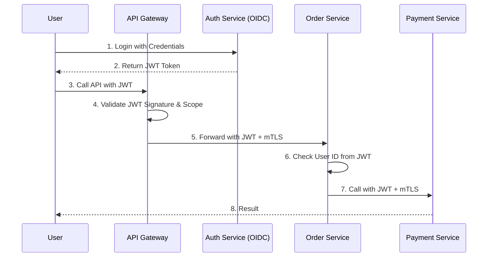

# Day 36: Microservices Security - Building a Multi-Layered Fortress 🛡️

Welcome back! You completed the first week of Phase 3 and mastered how microservices interact with one another. But here is a critical question: **How do you guarantee that a caller communicating with your service is not an impostor?**

In a monolith, security is simple: a single external firewall rule and an active Session ID stored in a shared database. In a microservices architecture, however, every network hop between Service A and Service B represents a potential attack vector. If you fail to secure every internal node, your architecture remains vulnerable.

Today, we will learn how to transition your system into a **Zero Trust** (🔊) architecture—where no service or user is trusted by default, regardless of whether they reside inside or outside the network perimeter.

---

## 🪝 THE HOOK: The Fatal Attack via a Secondary Feature

Imagine digital banking infrastructure comprising 50 decoupled microservices. The core **Money Transfer Service** is heavily secured with state-of-the-art protection. However, a non-critical **Review Service**—which allows users to post application feedback—contains a minor, unpatched remote code execution vulnerability.

**The Attack Vector**:
1.  An attacker exploits the vulnerability, gaining control of the container hosting the non-critical **Review Service**.
2.  Your internal network lacks internal security controls (**East-West Security**). The attacker utilizes the compromised container's internal IP address to execute API calls directly to the **Money Transfer Service**.
3.  The Money Transfer Service assumes: "This request originates from a trusted internal IP address; it is safe to execute," and processes the transaction without further verification.
4.  **The Disaster**: Millions in user deposits are drained simply because a minor, non-critical comment feature was compromised.

In a microservices architecture, if you only build high walls at the front gate (API Gateway) while leaving the internal back doors unlocked, your security model will fail.

---

## 🎭 ANALOGY: The Luxury Hotel and Smart Elevators

Think of **Microservices Security** as the security infrastructure of a high-end hotel:

1.  **OAuth2 (The Front Desk)**: When you arrive, you present your credentials. The receptionist does not hand you a master key to the entire building. Instead, they issue an **Access Token (Key Card)**. This card expires in exactly two days (**Expiration**) and only grants access to the 5th floor (**Scope**).
2.  **JWT (The Smart RFID Card)**: This key card is not a dumb piece of plastic. Its embedded RFID chip contains pre-signed metadata: *"Guest: Jane Doe, Room: 501, Expiry: 12:00 PM."* When you tap the card at the door, the lock reads the chip and verifies your access locally (**Stateless Verification**) without calling the front desk receptionist.
3.  **mTLS (Internal Staff Verification)**: Imagine a policy where hotel employees meeting in a corridor must present their security badges to one another to confirm their identity. No one is permitted to roam the corridors freely without proving who they are and that they belong there.

---

## ⚙️ UNDER THE HOOD: The Microservices Security Triad

To achieve comprehensive, defense-in-depth security, you must integrate these three layers:

### 1. OAuth 2.0 & OpenID Connect (OIDC) (🔊)
The industry standard for **Delegated Authorization**. Instead of sharing passwords, client applications receive a scoped **Access Token**.
-   **OpenID Connect (OIDC)** adds an identity verification layer on top of OAuth 2.0 to deliver an **ID Token**, providing structured user profile claims.
-   *The Security Value*: Your core microservices never touch or store raw user credentials, minimizing the blast radius of potential data leaks.

### 2. JSON Web Tokens (JWT) - The Distributed Passport (🔊)
A JWT is a compact, URL-safe string containing claims that are **Digitally Signed** (🔊) by an identity provider.
-   **Anatomy**: Header (cryptographic algorithm), Payload (user identity claims), and Signature (verifies integrity).
-   *The Architectural Power*: Microservices utilize a cached **Public Key** to verify the JWT signature locally. Once validated, they trust the payload claims without issuing a network call to the central Auth Server. This is a critical pattern for system **Scalability**.

### 3. Mutual TLS (mTLS) - Bidirectional Cryptographic Trust (🔊)
In standard HTTPS, the client validates the server's certificate. Under **mTLS**, both the client and the server must exchange and validate each other's certificates.
-   Every connection between internal microservices is encrypted and bidirectionally verified. Even if an attacker gains access to the internal network, they cannot eavesdrop (man-in-the-middle) or spoof requests.
-   *Real-World Practice*: mTLS is typically managed transparently by a **Service Mesh** (like Istio) via sidecar proxies, offloading cryptographic complexity from application developers.

---

## 🏗️ TOPOLOGY: End-to-End Security Architecture

---

## 💼 SYSTEM DESIGN INTERVIEW: Secrets Management

**Question: "How do you manage API keys, database credentials, and cryptographic certificates across hundreds of decoupled microservices? Would you store them in a standard `.env` configuration file?"**

-   **Architect Answer**:
    -   "We strictly avoid storing raw secrets in source code, configuration files, or git repositories. Doing so exposes credentials to anyone with access to the code."
    -   "Instead, we deploy a centralized **Secrets Management Engine** such as **HashiCorp Vault**, **AWS Secrets Manager**, or **Kubernetes Secrets**."
    -   "The workflow operates as follows: upon container startup, the microservice authenticates with the Vault using a secure Service Identity (such as a Kubernetes Service Account token). The Vault validates this identity and injects the authorized secrets directly into the application's memory space as environment variables. Furthermore, we enforce automated **Secrets Rotation** (e.g., rotating database credentials every 30 days) to minimize credential exposure risks."

---

## 💻 REAL-WORLD INSIGHTS: The JWT Revocation Challenge (🔊)

JWTs possess a fundamental design trade-off: **they are difficult to revoke prematurely**. Because microservices validate JWTs statelessy at the edge or locally via public keys, if a JWT with a 1-hour expiration is compromised, an attacker can access the system for the remaining duration.

**Architectural Remediation Patterns**:
1.  **Short-Lived Access Tokens**: Limit Access Token lifetimes to 5–10 minutes.
2.  **Stateful Refresh Tokens**: Use long-lived Refresh Tokens to request new Access Tokens. Refresh Tokens are stored in a database or Redis cache, allowing the Auth Server to revoke them instantly if a security event occurs.
3.  **Real-Time Blacklisting**: Maintain a distributed, high-performance Redis cache containing the IDs (`jti` claims) of revoked or blacklisted tokens. The API Gateway queries this cache before routing requests.

---

## 📝 Quick Quiz: Test Your Microservices Security Knowledge

**Question 1: How does a JSON Web Token (JWT) enhance microservices scalability?**
A. It compresses application memory footprints.
B. It contains self-describing identity and signature claims, allowing services to validate identity statelessly without querying a central Auth server.
C. It encrypts backend database tables.

**Question 2: What is the primary difference between standard HTTPS and Mutual TLS (mTLS)?**
A. mTLS is computationally cheaper.
B. mTLS enforces bidirectional certificate verification where both the client and the server validate each other's cryptographic identity.
C. mTLS can only be executed on local physical networks.

**Question 3: Why should you avoid provisioning Access Tokens with extremely long lifespans (e.g., 1 year)?**
A. They consume excessive RAM.
B. If compromised, the token grants the attacker prolonged system access with no easy path to stateless revocation.
C. Modern web browsers automatically delete them.

**Question 4: What is the purpose of the "Scope" claim in OAuth 2.0?**
A. It restricts the permissions and access rights granted to the token (e.g., read-only vs. write permissions).
B. It accelerates data transfer protocols.
C. It dynamically configures front-end theme palettes.

**Question 5: What primary challenge does HashiCorp Vault resolve?**
A. Storing application source code.
B. Securely storing, rotating, and managing sensitive operational secrets rather than hardcoding them in config files.
C. Replacing edge API Gateways.

---

**Answers:**
1. B
2. B
3. B
4. A
5. B

---

Having completed Day 36, you have established a highly secure, Zero Trust perimeter around your system. But once your services are secured, how do you handle transactional state? How do you ensure that when a payment is processed, a corresponding order is successfully created in an entirely different, decoupled database?

Tomorrow, we will tackle one of the most challenging topics in distributed systems: **Distributed Transactions & The Saga Pattern!** See you tomorrow!

📊 Word Count: 1953 words.
