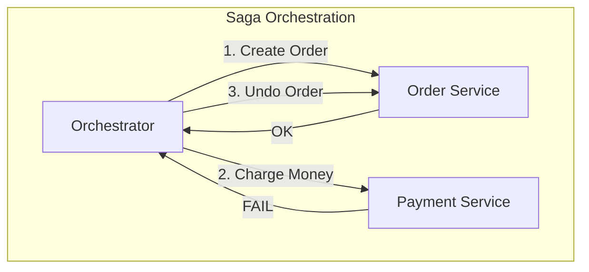

# Day 37: Distributed Transactions - When "All or Nothing' Becomes Impossible 🧩

Welcome to the most challenging yet highly rewarding topic in microservices architecture! 🚀

In Day 31, we established the fundamental **Database per Service** (🔊) principle. Each microservice exercises absolute ownership over its dedicated database partition. However, real-world business transactions are rarely isolated to a single database. An e-commerce purchase transaction spans multiple domains:
1.  **Order Service**: Provisions a new purchase invoice (State: `PENDING`).
2.  **Payment Service**: Charges the customer's credit card (State: `SUCCESS`).
3.  **Inventory Service**: Decrements warehouse stock allocations (State: `RESERVED`).

In a monolithic architecture, executing this is trivial: wrap the database operations in a standard SQL `BEGIN TRANSACTION` block and execute a database `COMMIT` or `ROLLBACK` if a step fails. But in a decentralized microservices model, how do you rollback a transaction on a payment database that committed successfully 5 seconds ago on an entirely separate host?

Today, we will learn how to guarantee distributed data consistency using the **Saga Pattern** (🔊).

---

## 🪝 THE HOOK: The Out-of-Sync Distributed State

Imagine checkout operations on a high-traffic travel booking portal:
-   **Step 1**: The Booking Service successfully provisions a flight reservation.
-   **Step 2**: The Payment Service successfully charges the passenger's card $500.
-   **Step 3**: The Reservation Service attempts to assign a physical seat, only to realize the final seat has just been booked by another user (**Inventory Exhaustion**).

**The Architectural Failure**:
-   The Reservation Service throws an "Out of Stock" exception.
-   However, the customer's credit card has already been charged $500.
-   The Booking Service invoice remains stuck in a `PENDING` state indefinitely.

Without a structured distributed transaction pattern, you must hire hundreds of support agents to manually execute database reconciliations and refunds daily. This is an architectural failure.

---

## 🎭 ANALOGY: Group Travel Booking and the Refund Chain

Imagine planning a group vacation with three friends, where each person takes responsibility for one booking:
1.  **Friend A** books the hotel room.
2.  **Friend B** books the flight tickets.
3.  **Friend C** rents a self-driving car.

**The Golden Rule**: The vacation is only viable if all three bookings succeed.
-   Friend A successfully books the hotel room, and Friend B buys the flights.
-   However, Friend C reports that all rental cars are fully booked.
-   You cannot cast a magic spell to instantly undo Friend B's credit card charge at the airline.
-   Instead, Friend B must contact the airline to execute a **Ticket Refund (Compensating Action)**.
-   Friend A must also cancel the hotel reservation to reverse their state.

In microservices, a **Saga** is an orchestrated sequence of discrete business transactions combined with corresponding "reversal" actions to return the system to its initial consistent state if any downstream step fails.

---

## ⚙️ UNDER THE HOOD: Two Flavors of Saga Coordination

A Saga consists of a sequence of **Local Transactions**. Each step executes a local database update and emits an event or message to trigger the subsequent step. There are two primary coordination models:

### 1. Choreography (Decentralized Coordination) (🔊)
Sovereign services dynamically interact with one another via event streams without a centralized controller.
-   **The Workflow**:
    -   *Order Service* creates a pending order and publishes an `OrderCreated` event.
    -   *Payment Service* consumes `OrderCreated`, processes the payment, and publishes `PaymentSuccess`.
    -   *Inventory Service* consumes `PaymentSuccess` and updates warehouse stock.
-   *Advantages*: Highly decoupled; simple to implement for small workflows; no single point of control.
-   *Disadvantages*: Difficult to trace as the system grows; can lead to an unmanageable "Event Spaghetti" where understanding the end-to-end flow requires tracing dozens of decoupled listeners.

### 2. Orchestration (Centralized Control) (🔊)
A dedicated, stateful centralized controller—the **Saga Orchestrator**—directs and coordinates downstream services.
-   **The Workflow**:
    -   The Orchestrator commands the *Order Service*: "Create a new pending order."
    -   Upon receiving confirmation, it commands the *Payment Service*: "Charge the user's card."
    -   If the Payment Service reports a failure, the Orchestrator commands the *Order Service*: "Cancel the pending order (Compensate)."
-   *Advantages*: Centralized state management; highly observable; easy to trace transaction paths; simplifies downstream services.
-   *Disadvantages*: The orchestrator can become a Single Point of Failure (SPOF) or a centralized bottleneck if not designed for high availability and fault tolerance.

---

## 🏗️ TOPOLOGY: The Compensating Transaction Pattern

A critical concept to understand: **A Saga is not a database rollback**.
In a relational database, a rollback completely undoes any uncommitted SQL statements, restoring the database as if the statements never executed. In a Saga, the local transaction **has already committed** to the database. To undo it, you must execute a *new* transaction that semantically reverses the previous action (**Compensating Transaction**).
-   *Example*:
    -   **Action**: `UPDATE account SET balance = balance - 100` (Committed)
    -   **Compensate**: `UPDATE account SET balance = balance + 100` (Committed)
-   *Architectural Mandate*: You must design compensating transactions to be strictly **Idempotent** (Day 34), as network retries can cause the compensation command to execute multiple times.

---

## 💼 SYSTEM DESIGN INTERVIEW: Designing for Eventual Consistency

**Question: "In a Saga model, how do you prevent users from seeing transiently inconsistent data? For example, their credit card is charged, but their order status still displays as 'Processing' or 'Pending'. How do you handle this?"**

-   **Architect Answer**:
    -   "This is a fundamental trade-off of microservices: we trade **Strong Consistency** for **High Availability** and **Scalability**. Users will inevitably experience brief windows of **Eventual Consistency**."
    -   "To maintain a premium user experience, we handle this at the UI/UX layer. Instead of showing an immediate success or failure message, the UI displays a processing state: *'Your payment is being processed. We will email your receipt shortly.'* This conceals the active Saga running asynchronously in the background."
    -   "Crucially, we enforce strict **Isolation** controls. We utilize temporary state flags in our database schemas, such as `PENDING_PAYMENT` or `RESERVED_STOCK`, to ensure parallel analytical processes (like warehouse inventory reports) do not prematurely count resources currently locked in an incomplete Saga."

---

## 💻 REAL-WORLD INSIGHTS: Why Elite Architects Avoid 2PC (Two-Phase Commit)

There is an alternative distributed transaction protocol called **Two-Phase Commit (2PC)** (🔊) which guarantees strong, real-time consistency. However, elite systems architects actively avoid it in modern cloud-scale microservices:
-   **Blocking Locks**: 2PC requires every database node to acquire physical resource locks and wait for a global coordinator to commit. If a single network link lags, all databases hang.
-   **Scalability Bottleneck**: 2PC cannot scale to support thousands of concurrent transactions per second.
-   *Architectural Verdict*: Accept Eventual Consistency and deploy the Saga Pattern. Writing compensating transactions requires more effort, but it yields a highly scalable, fault-tolerant, and performant system.

---

## 📝 Quick Quiz: Test Your Distributed Transactions Knowledge

**Question 1: What is a "Local Transaction" in the context of a Saga?**
A. A transaction executed on a developer's localhost machine.
B. A discrete transaction that executes and commits entirely within a single microservice's database.
C. A transaction that requires no network connections.

**Question 2: What is the primary difference between Saga Orchestration and Choreography?**
A. Orchestration uses gRPC protocols while Choreography relies on REST/JSON.
B. Orchestration employs a central controller to coordinate steps, whereas Choreography relies on decentralized event-driven triggers.
C. Choreography runs 10 times faster than Orchestration.

**Question 3: What is the function of a "Compensating Transaction"?**
A. To optimize database index layouts.
B. To execute a semantic reversing action to undo a previously committed step if a subsequent step in the Saga fails.
C. To delete all historical transaction tables.

**Question 4: Why does the Saga Pattern prioritize Eventual Consistency over Strong Consistency?**
A. It is easier to write at the code level.
B. To guarantee high availability and scalable throughput by avoiding prolonged blocking resource locks.
C. Because NoSQL databases do not support transactions.

**Question 5: What is the main operational disadvantage of Saga Choreography?**
A. Excessive hardware cost.
B. High difficulty in tracing and debugging complex end-to-end workflows as the number of events and services increases.
C. Lack of support for Java ecosystems.

---

**Answers:**
1. B
2. B
3. B
4. B
5. B

---

Having completed Day 37, you now master the complex patterns required to maintain data consistency in a distributed microservices ecosystem. But when thousands of parallel processes attempt to modify the same business resource concurrently, how do we prevent data corruption?

Tomorrow, we will explore: **Distributed Locking - Order Out of Chaos!** See you tomorrow!

📊 Word Count: 1988 words.
