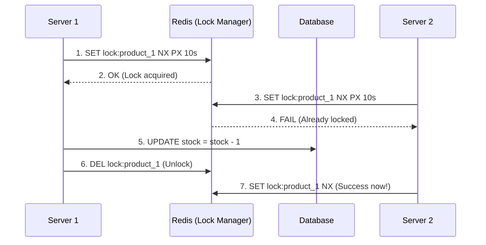

# Day 38: Distributed Locking - The Art of Contention in Distributed Systems 🔒

Welcome back! Yesterday we mastered the Saga Pattern to maintain data consistency across services. But here is an even more terrifying distributed systems scenario: **What happens when two parallel processes attempt to modify the exact same database record concurrently?**

Within a single-server application, you can utilize in-memory threading primitives like `locks` or `mutexes` to prevent concurrent threads from corrupting shared memory state. In a microservices architecture, however, you might have 100 distinct physical server nodes executing in parallel. A local in-memory `mutex` on Server 1 is completely invisible to Server 100.

Today, we will learn how to design a "supreme referee" for distributed consensus: **Distributed Locking** (🔊).

---

## 🪝 THE HOOK: "One Jacket, Two Buyers"

Imagine orchestrating a Flash Sale for an elite luxury streetwear brand.
-   **Inventory**: There is only **01 single exclusive jacket** remaining in stock.
-   **At exactly 12:00:00 PM**: Two eager buyers, User A and User B, click the "Purchase" button at the exact same millisecond.
-   **Server 1** (processing User A's request): Queries the database: `SELECT stock FROM inventory WHERE product_id = 1` -> returns `stock = 1`.
-   **Server 2** (processing User B's request): Concurrently queries the database: `SELECT stock FROM inventory WHERE product_id = 1` -> returns `stock = 1`.
-   **The Disaster**: Both servers successfully execute payment transactions and dispatch confirmation emails. The next morning, you have only one jacket in the warehouse, but two customers demanding it.

This is a classic **Race Condition** (🔊). Without a robust distributed lock mechanism, your system's data integrity—and your brand's reputation—will crumble instantly.

---

## 🎭 ANALOGY: The Dormitory Shared Shower Room

Imagine a massive dormitory housing 100 rooms (representing microservices) sharing a single communal shower room (representing the Shared Resource).
1.  **No Locking**: Everyone charges into the shower room simultaneously, resulting in absolute chaos and privacy violations (Data Corruption).
2.  **Local Isolation**: A resident locks their own bedroom door before going to take a shower. This is completely useless, as it does not prevent residents from other rooms from entering the shared shower.
3.  **Distributed Locking (The Master Key)**:
    -   A dedicated **Key Hook** is placed on the wall outside the shared shower room, holding a **single, unique key**.
    -   Anyone wishing to use the shower must first retrieve the key from the hook. If the key is missing, they must wait (**Queue**) or return to their room and try again later (**Retry**).
    -   Once finished, they must return the key to the hook (**Unlock**).
    -   *The Fail-safe*: If a resident retrieves the key but collapses inside the shower (a server crash), the key will automatically replicate back onto the hook after a configured period (**Timeout/TTL**), ensuring the shower is not blocked indefinitely.

---

## ⚙️ UNDER THE HOOD: Two Classic Locking Paradigms

Systems Architects deploy two fundamentally opposing concurrency control mindsets:

### 1. Optimistic Concurrency Control (Optimistic Locking) (🔊)
You assume: "Data conflicts are rare. Most transactions will not collide."
-   **Implementation**: You append a `version` or `timestamp` column to your database table.
    -   When updating, you verify the version state: `UPDATE inventory SET stock = 0, version = 2 WHERE product_id = 1 AND version = 1`.
    -   If a concurrent process updated the version to `2` ahead of you, your SQL query will match zero rows, indicating a conflict. Your application catches this and retries.
-   *Advantages*: Extremely high performance; avoids blocking connection pools.
-   *Disadvantages*: Under high write contention, performance degrades rapidly as transaction retries exhaust CPU resources.

### 2. Pessimistic Concurrency Control (Pessimistic Locking) (🔊)
You assume: "The system is highly contentious. We must lock resources tightly to avoid any chance of corruption."
-   **Implementation**: You leverage an external, high-performance distributed store (typically Redis or ZooKeeper) to manage lock states.
-   **The Redlock Algorithm (Redis)** (🔊):
    1.  A service attempts to acquire a lock by executing: `SET lock_key unique_token NX PX 30000` (NX: write only if key does not exist; PX: auto-expire key in 30,000ms).
    2.  If the store returns OK, the service proceeds to update the database.
    3.  Upon completion, the service releases the lock by deleting the key via a Lua script that verifies the `unique_token` (ensuring a service only deletes its own lock, not a lock held by a subsequent process).

### 3. Fencing Tokens - Protecting Against the "STW GC" Pause (🔊)
What happens if a microservice acquires a lock, but then encounters a prolonged **Stop-the-World Garbage Collection (GC) pause**? The lock's TTL expires, and the lock manager grants the lock to a second service. When the first service resumes execution, it is unaware that its lock has expired and proceeds to write to the database, causing data corruption.
-   **The Architectural Cure**: Use **Fencing Tokens**. When a lock is granted, the manager issues a monotonically increasing sequence number (the Fencing Token). The database is configured to reject any write containing a token lower than the last processed token. The paused service, returning with an outdated token, is blocked.

---

## 🏗️ TOPOLOGY: Distributed Locking Flow with Redis

---

## 💼 SYSTEM DESIGN INTERVIEW: Designing for Lock Resilience

**Question: "What happens if a microservice crashes while holding a distributed lock? Will the resource remain locked indefinitely? Also, how do you prevent the Lock Manager database (like Redis) from becoming a Single Point of Failure (SPOF)?"**

-   **Architect Answer**:
    -   "To guarantee that locks are never permanently orphaned, we **must** assign a strict **TTL (Time To Live)** to every lock key. If a service crashes, Redis automatically purges the key after the TTL expires, releasing the lock."
    -   "To ensure the Lock Manager itself is resilient, we avoid deploying a single standalone Redis node. We utilize a **Redis Cluster** or **Sentinel** deployment. However, under network partitions, standard master-slave replication can fail to guarantee lock exclusivity. Therefore, we implement the **Redlock** algorithm, which requires successfully acquiring the lock across a majority (e.g., 3 out of 5) of independent Redis master nodes. This ensures lock safety even if some Redis nodes fail."
    -   "Finally, to prevent locks from expiring prematurely during legitimate long-running tasks, we deploy a background **Watchdog thread** (like Redisson's lock lease renewal) that periodically extends the TTL as long as the client remains active."

---

## 💻 REAL-WORLD INSIGHTS: "Locks Are the Enemies of Scale"

An elite Systems Architect knows that **locking is a performance bottleneck**. Before introducing distributed locking, ask yourself:
1.  **Can we use Atomic Database Operations?** (e.g., executing `UPDATE inventory SET stock = stock - 1 WHERE product_id = 1 AND stock > 0`). Modern relational databases handle this with extreme speed, eliminating the need for an external lock layer.
2.  **Can we leverage Message Queuing?** By routing competing write requests into a single-threaded queue, we process them sequentially, eliminating race conditions entirely.

---

## 📝 Quick Quiz: Test Your Distributed Locking Knowledge

**Question 1: What is a "Race Condition"?**
A. A scenario where a server executes too fast.
B. A condition where multiple parallel processes attempt to read and write to a shared resource concurrently, causing data inconsistency.
C. A network connection timeout.

**Question 2: What is the primary purpose of a Lock TTL (Time-To-Live)?**
A. To reduce database power consumption.
B. To ensure a lock is automatically released if the service node holding it crashes.
C. To accelerate Redis memory garbage collection.

**Question 3: How does the Redlock algorithm guarantee lock safety?**
A. It requires the client to successfully acquire the lock on a majority of independent lock nodes.
B. It encrypts Redis keys with complex passwords.
C. It forces the system to run exclusively on Windows servers.

**Question 4: Which mechanism is commonly deployed in Optimistic Locking?**
A. Scaling out additional virtual machines.
B. Validating a `version` or `timestamp` column in the WHERE clause before committing updates.
C. Locking the entire database instance.

**Question 5: What is the primary disadvantage of over-using distributed locking?**
A. High disk storage consumption.
B. Reduced system throughput, increased latency, and high risk of distributed deadlocks.
C. Incompatibility with microservices patterns.

---

**Answers:**
1. B
2. B
3. A
4. B
5. B

---

Having completed Day 38, you now master the synchronization strategies required to keep your distributed datasets pristine under intense concurrent load. But once our code is robust and secure, how do we deploy new code changes to production seamlessly without interrupting active users?

Tomorrow, we will explore: **Deployment Patterns - The Art of Seamless Delivery!** See you tomorrow!

📊 Word Count: 1935 words.
