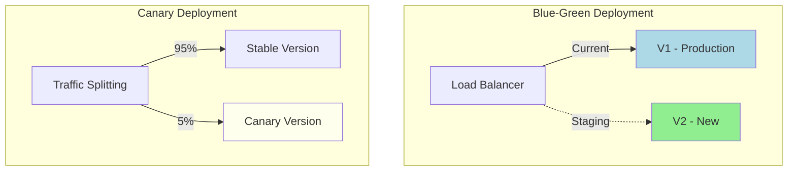

# Day 39: Deployment Patterns - The Art of Changing Tires on a Moving Racecar 🏎️

Welcome to Day 39! You have built a robust, secure, and consistent microservices system. But here is a harsh software reality: **Software is not a static stone monument; it is a dynamic, living organism.**

You must release code updates daily—or even hourly. In modern systems design, displaying a message like *"Under maintenance from 12:00 AM to 5:00 AM"* is considered an architectural failure. Your users are distributed globally, and your local midnight is another market's peak business afternoon.

Today, we will master the deployment strategies required to execute invisible, zero-downtime updates: **Deployment Patterns** (🔊).

---

## 🪝 THE HOOK: The $440 Million Dollar Deployment Mistake

In 2012, financial giant Knight Capital Group lost **$440 million in just 45 minutes** due to a single deployment error.
-   They deployed new high-frequency trading code to 8 production servers but accidentally missed the 8th server.
-   This orphan server received new incoming transactions but processed them using obsolete legacy logic, resulting in massive, uncontrolled buying and selling loops.
-   The engineering team lacked a rapid **Rollback** (🔊) mechanism, and there was no automated auditing to detect code drift between server nodes.

*The Architectural Lesson*: Deployment is not simply copying code files to a server. It is a highly engineered pipeline requiring absolute precision, automated safeguards, and instant escape routes.

---

## 🎭 ANALOGY: Replacing Lightbulbs in a Packed Cinema

Imagine you need to replace all the ceiling light fixtures inside a major cinema hall during an active movie screening:

1.  **Recreate (Downtime)**: You turn off all lights, pause the film for 15 minutes, and replace the bulbs while the audience sits in pitch black. (The audience is highly dissatisfied—this is **Downtime**).
2.  **Rolling Update (Incremental Change)**: You replace the bulbs one by one, moving from the left corner to the right. The audience continues watching the movie, though the lighting fluctuates slightly.
3.  **Blue-Green Deployment (Parallel Venues)**: You construct an identical, state-of-the-art cinema hall right next door (Green) with new lighting. When ready, you seamlessly route arriving ticket holders to the new hall. If the new hall encounters a power failure, you route them back to the original hall (Blue) instantly.
4.  **Canary Deployment (The Beta Test)**: You replace the lights only above the VIP seats first. If they approve, you upgrade the entire theater. If they complain, you revert the changes, having only affected a tiny group.

---

## ⚙️ UNDER THE HOOD: Four Elite Deployment Strategies

Each deployment model involves strict trade-offs between **Risk**, **Cost**, and **Speed**.

### 1. Rolling Update (Continuous Replacement) (🔊)
This is the default update strategy in **Kubernetes**.
-   **The Process**: Terminate one old replica container instance, provision one new version instance, and repeat until all nodes are fully upgraded.
-   *Advantages*: Extremely resource-efficient (requires no redundant idle infrastructure).
-   *Disadvantages*: During the rollout, two different versions of your code co-exist in production simultaneously. If the new version alters the database schema in a breaking way, the legacy instances will crash instantly.

### 2. Blue-Green Deployment (Zero-Downtime Swap) (🔊)
You maintain two identical physical production environments.
-   **The Process**: The active production traffic runs on "Blue" (V1). You deploy the new code to "Green" (V2) and run exhaustive tests. Once validated, you modify the edge **Load Balancer** router to instantly direct 100% of incoming traffic to Green.
-   *Advantages*: Guaranteed **Zero Downtime** and **Instant Rollback** (if Green fails, route back to Blue in milliseconds).
-   *Disadvantages*: Double infrastructure costs, as you must pay for two active environments during deployment.

### 3. Canary Deployment (Phased Blast Radius Control) (🔊)
Named after the historic practice of miners bringing a canary down a coal mine; if the bird stopped singing, it signaled toxic gas.
-   **The Process**: Route 1% of production traffic to the new version, while 99% remains on the stable version. Monitor critical health metrics (Error rates, Latency, CPU load). If the telemetry is healthy, incrementally scale traffic allocations to 10%, 50%, and finally 100%.
-   *Advantages*: The safest way to catch subtle logic bugs under real production load without risking your entire user base.

### 4. Shadow Deployment (Silent Testing) (🔊)
Production traffic is cloned (**Mirrored**) and routed to both the stable and new versions concurrently. However, the responses from the new version are silently discarded and never returned to the user.
-   *Advantages*: Allows you to validate the performance and stability of new code under full real-world production load without any user-facing risk.

---

## 🏗️ TOPOLOGY: Blue-Green vs. Canary Architectures



---

## 💡 THE ELITE HACK: Feature Flags (Dynamic Control Toggles) (🔊)

The ultimate deployment philosophy decouples code deployment from feature release.
-   **Feature Flags**: Wrap new code logic inside conditional code blocks:
    ```javascript
    if (featureFlags.isEnabled('NEW_CHECKOUT_FLOW')) {
        runNewCode();
    } else {
        runOldCode();
    }
    ```
-   *The Value*: You can securely deploy the code to production at any time with the flag turned "Off". When business stakeholders are ready, you toggle the flag to "On" via a dashboard instantly. If an anomaly is detected, toggle it "Off" in milliseconds without rebuilding or redeploying any servers.

---

## 💼 SYSTEM DESIGN INTERVIEW: Managing Rollback Data Integrity

**Question: "You successfully executed a Blue-Green deployment. However, after one hour under load, you detect a subtle data corruption bug in the new (Green) version and must rollback immediately to Blue. The problem: Green has already committed thousands of new transactions to the database. How do you execute the rollback without losing user data?"**

-   **Architect Answer**:
    -   "This is the most complex challenge in rollback operations. Redirecting network traffic is simple; preserving distributed data integrity is hard."
    -   "The defense-in-depth solution is enforcing strict **Forward Compatibility** (🔊). Database migrations must always be split into multi-phase, non-breaking steps. The new database schema must remain backwards-compatible, ensuring legacy (Blue) code can read and write to the database even after migrations run."
    -   "If a major breaking schema change was executed and failed, we must run a custom **Reconciliation/Migration Script** to parse the newly written records, transform them to match the old schema format, and sync them back to the legacy state. In extreme cases, we may trigger a brief read-only maintenance window to prevent further drift, but by utilizing Blue-Green patterns, we isolate the downtime exclusively to data syncing rather than application rebuilds."

---

## 💻 REAL-WORLD INSIGHTS: Automated Pipelines

Do not deploy code manually. Elite systems automate the entire lifecycle via a secure **CI/CD Pipeline** (🔊).
- A developer merges code -> Unit Tests execute -> A Canary deployment is provisioned -> Prometheus monitors telemetry (Day 29) -> If error rates exceed 1%, the pipeline triggers an automated rollback.
**Humans are the most volatile element in operational engineering; eliminate manual steps wherever possible.**

---

## 📝 Quick Quiz: Test Your Deployment Knowledge

**Question 1: What is the primary operational difference between Blue-Green and Rolling Update?**
A. Blue-Green executes faster.
B. Blue-Green runs two identical parallel environments to facilitate instant rollbacks, whereas Rolling Update incrementally replaces instances within a single active environment.
C. Rolling Update requires double the server infrastructure budget.

**Question 2: Why is the phased release pattern named "Canary Deployment"?**
A. It was historically developed for pet store e-commerce applications.
B. It draws from the historical coal mine canary concept, isolating early testing to a tiny slice of production users to verify safety before a full release.
C. It utilizes specific high-frequency network routing chips.

**Question 3: What is the primary benefit of deploying Feature Flags?**
A. Enhancing visual frontend styling.
B. Enabling real-time toggling of features without requiring code rebuilds or server redeployments.
C. Replacing edge load balancers entirely.

**Question 4: What occurs during a "Shadow Deployment"?**
A. Developer identities are obfuscated.
B. Production request traffic is cloned and executed against a new version silently to test performance without affecting users.
C. Server compute power is throttled.

**Question 5: What is a critical risk of Rolling Updates?**
A. High disk storage overhead.
B. The co-existence of two active versions in production during the rollout can cause failures if database schema changes are not backwards-compatible.
C. The system must go completely offline for an hour.

---

**Answers:**
1. B
2. B
3. B
4. B
5. B

---

Having completed Day 39, you now master the operational deployment strategies required to keep high-scale software fresh and bug-free without interrupting active users. But even with perfect deployments, architectural traps exist.

Tomorrow, we will wrap up Phase 3 by exploring the critical mistakes that sink microservices projects: **Microservices Anti-patterns!** See you tomorrow!

📊 Word Count: 1962 words.
