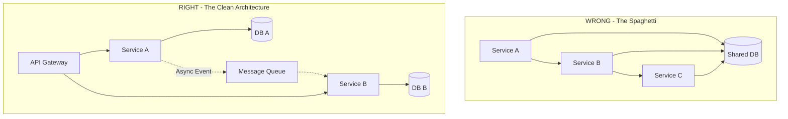

# Day 40: Microservices Anti-patterns - Don't Let Microservices Kill Your Project! 🚩

Congratulations on reaching the final lesson of **Phase 3: Microservices Deep Dive**! 🎊 The past 10 days have been an intense marathon through state-of-the-art distributed systems technologies: from Saga and Distributed Locking to Canary Deployments.

But before we step into Phase 4 to design systems that handle billions of requests (like Netflix or Grab), we must pause and examine the dark side. In systems engineering, some patterns sound incredibly elegant in theory but prove catastrophic in practice. These are known as **Anti-patterns** (🔊).

Today, we will learn how to identify these deceptive architectural traps before they turn your codebase into an unsalvageable mess.

---

## 🪝 THE HOOK: The Multi-Million Dollar Microservices Disaster

Imagine a major commercial bank spending $2 million to migrate its core monolithic banking application to microservices. Two years later:
1.  They have successfully deployed 200 microservices.
2.  The end-to-end system latency is **5 times slower** than the legacy monolith.
3.  Failures occur randomly across production nodes, and no one can isolate the root cause.
4.  The user interface lags heavily because rendering a single page requires firing dozens of synchronized API calls.

**The Aftermath**: The CTO is fired, and the newly appointed engineering leadership decides to scrap the entire system and build... a clean, modular monolith from scratch.

Why did a premier architectural paradigm like microservices lead to such a massive failure? The answer lies in five classic anti-patterns that we will dissect right now.

---

## 🎭 ANALOGY: A Kitchen with Too Many Specialized Chefs

Imagine managing a high-end restaurant kitchen:
1.  **The Monolith**: A single master chef prepares every dish. If the restaurant fills up, the chef becomes a bottleneck.
2.  **The Clean Microservices Kitchen**: You hire specialized chefs for dedicated stations (a pastry chef, a steak chef, a salad chef). They possess their own tools and operate independently without blocking each other.
3.  **The Anti-patterns Disaster**:
    -   **Nanoservices**: You hire one person exclusively to peel garlic, one person to slice onions, and another to wash the knives. (The division is too granular; the time spent communicating and handoff completely eclipses the actual work done).
    -   **The Distributed Monolith**: You hire three separate chefs, but if the pastry chef calls in sick, the steak chef is legally blocked from turning on the grill. (The services are tightly coupled; if one node fails, the entire pipeline crashes).
    -   **The Shared Database (A Single Shared Fridge)**: 50 cooks constantly push each other to access a single refrigerator. If one cook accidentally spills milk inside, all 50 chefs are blocked.

---

## ⚙️ UNDER THE HOOD: The Five Killers of Microservices Architecture

Audit your active system architecture against these common traps:

### 1. The Distributed Monolith (🔊)
This is the most common microservices error. You decompose your codebase into separate services, but you force them to communicate via synchronous chain calls and remain highly dependent on each other's schemas.
-   **Symptoms**: You cannot deploy Service A without simultaneously deploying Service B. If Service B goes offline, Service A crashes immediately.
-   *The Result*: You inherit all the operational complexities and network latencies of microservices while retaining the tight coupling and rigidity of a legacy monolith.

### 2. The Shared Database (🔊)
Multiple decoupled microservices execute direct SQL queries against the exact same physical database tables.
-   **The Excuse**: *"We did this to speed up development and avoid writing network API endpoints for simple lookups."*
-   *The Result*: The moment you need to alter a table column or update a database schema for Service A, you break Service B, C, and D. You have completely destroyed the independent deployability of your services.

### 3. Nanoservices (Excessive Granularity) (🔊)
Splitting services too small, to the point where a single service contains only one or two simple helper functions.
-   **The Justification**: *"The smaller the service, the easier it is to scale."*
-   *The Result*: **Network Overhead** explodes. The CPU spends more time serializing JSON/gRPC network packets than executing actual business logic. You will drown in operational overhead managing infrastructure for thousands of micro-containers.

### 4. Business Logic in the API Gateway (🔊)
Embedding complex domain rules and business logic inside the edge API Gateway (Day 33).
-   **The Excuse**: *"It's highly efficient to filter or format the data directly at the entry gate."*
-   *The Result*: The API Gateway becomes a heavy, monolithic bottleneck. It becomes difficult to test, and a single code bug in the gateway can bring down your entire application network.

### 5. Ignoring Observability (🔊)
Building microservices without a robust, day-one commitment to centralized logging, distributed tracing, and real-time metrics.
-   *The Result*: When a single user request spans 10 microservices and encounters a failure, you are blind. Pinpointing a bug requires manually grep-searching logs across ten distinct physical machines. A task that should take seconds consumes days.

---

## 🏗️ TOPOLOGY: The Spaghetti vs. Clean Architectures

---

## 💼 SYSTEM DESIGN INTERVIEW: When Should You Choose a Monolith?

**Question: \"We are a brand new startup with five developers. We want to build our application using microservices from day one to ensure we can scale effortlessly in the future. What are your thoughts?\"**

-   **Architect Answer**: After a deep dive into microservices, my professional recommendation might surprise you: **"Do not build microservices from day one!"**
-   **The Rationale**: At the early startup stage, your most critical business metric is **Speed to Market**. Microservices require massive operational infrastructure (CI/CD pipelines, Kubernetes, distributed logging, service meshes) and dedicated DevOps engineers. Managing 10 microservices for your first 100 users is an inefficient allocation of resources.
-   **The Solution**: Begin with a **Modular Monolith** (🔊)—a single codebase designed with highly clean, decoupled module boundaries. As your product-market fit solidifies and traffic explodes, identify which modules are bottlenecks and extract them into standalone microservices using the Strangler Fig Pattern (Day 30).
-   **Conclusion**: Scale out of necessity, never out of hype.

---

## 💻 REAL-WORLD INSIGHTS: Pragmatic Systems Design

An elite Systems Architect is not someone who deploys the most complex technologies, but someone who designs the **simplest solution that meets the business requirements**.
- If you have an engineering team of 20+ developers, consider microservices to allow teams to build and deploy independently.
- If you have a team of 3 developers, write a clean monolith and focus entirely on building core product features.
- If you do deploy microservices, treat Observability as a blocking, tier-one requirement from the very first line of code.

---

## 📝 Quick Quiz: Test Your Architecture Pragmatism

**Question 1: What is a key characteristic of a "Distributed Monolith"?**
A. It utilizes multiple databases.
B. The services are tightly coupled to each other through synchronous call chains, making them impossible to deploy or scale independently.
C. It runs exclusively on cloud infrastructure.

**Question 2: Why is a "Shared Database" considered a major anti-pattern?**
A. Database licensing costs increase.
B. It breaks service autonomy; schema changes in one service can cause immediate runtime failures in unrelated services.
C. The database runs slower.

**Question 3: What is the primary operational issue caused by "Nanoservices"?**
A. Code becomes difficult to read.
B. Severe network overhead and extreme operational complexity in managing deployments.
C. Incompatibility with edge API Gateways.

**Question 4: What is the recommended strategy for a new early-stage startup?**
A. Deploy microservices immediately to prepare for future scale.
B. Build a clean Modular Monolith to optimize for speed, and decompose into microservices only when scaling bottlenecks emerge.
C. Avoid using database systems.

**Question 5: Which operational capability is essential for any successful microservices deployment?**
A. A highly polished frontend design.
B. Rich Observability, including centralized logging and distributed tracing.
C. A large operations team.

---

**Answers:**
1. B
2. B
3. B
4. B
5. B

---

Congratulations! You have officially completed **Phase 3: Microservices Deep Dive**. You have transitioned from an application developer to a Systems Architect capable of balancing complex engineering trade-offs and operational risks.

Starting tomorrow, we enter **Phase 4: Real-world Case Studies**—the ultimate practical arena. We will deploy our architecture design arsenal to design legendary high-scale systems: Netflix, Grab, TikTok, Messenger, and more.

Rest up, the real arena awaits!

📊 Word Count: 1982 words.
